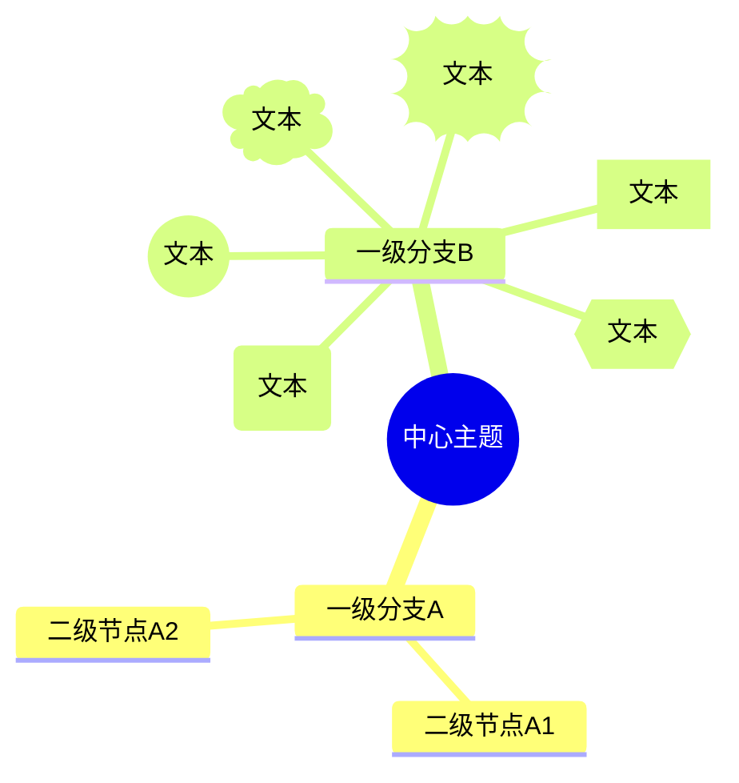
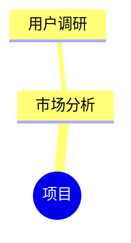
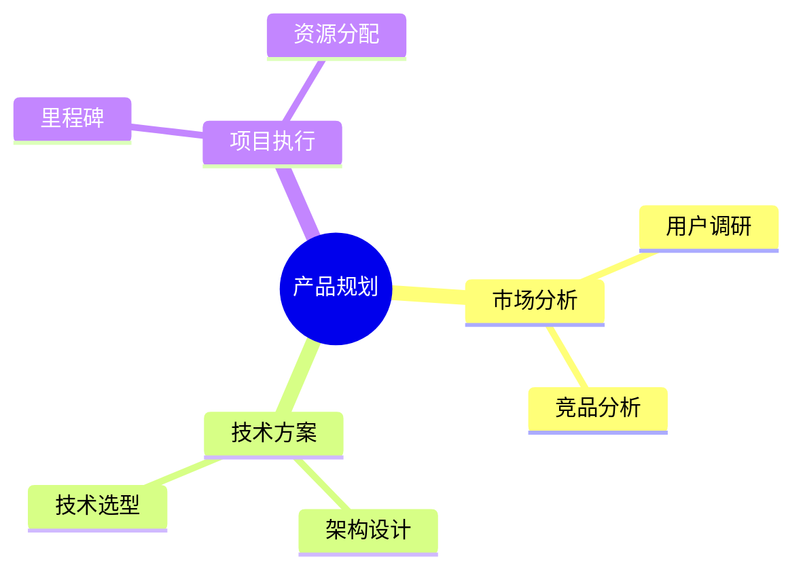
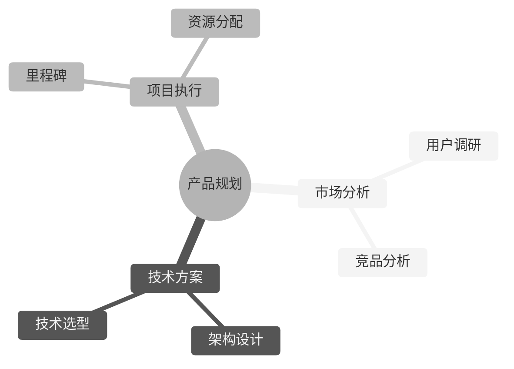
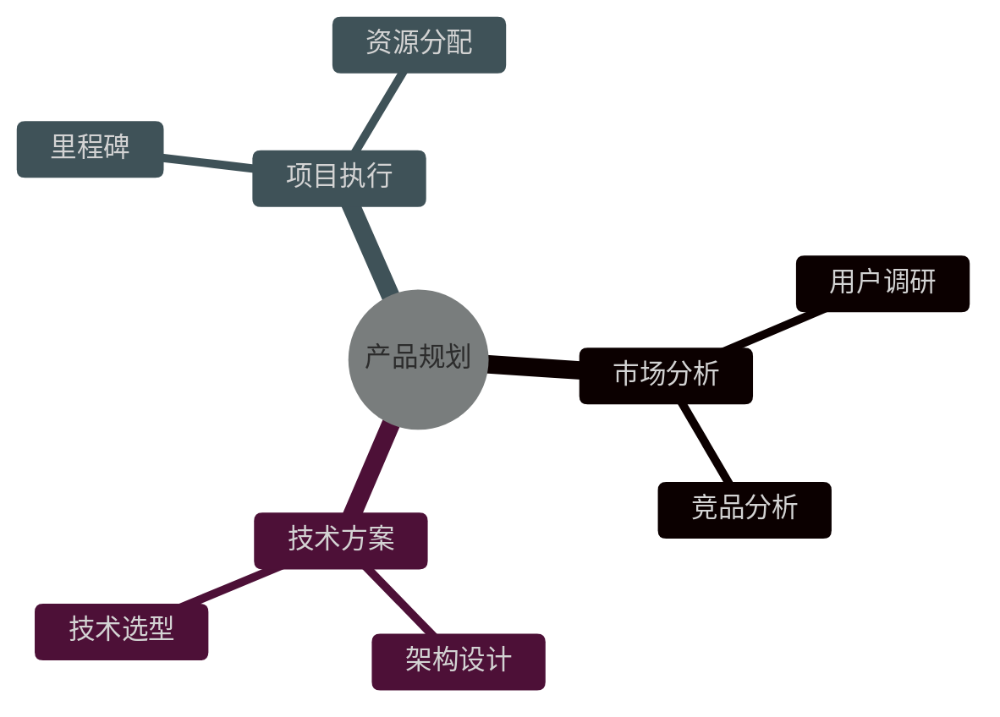
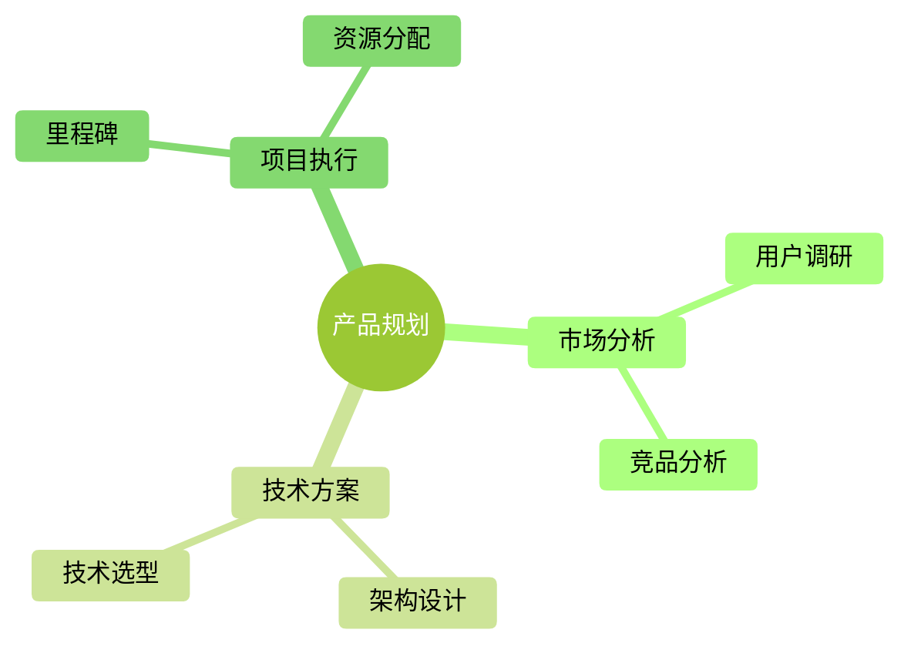
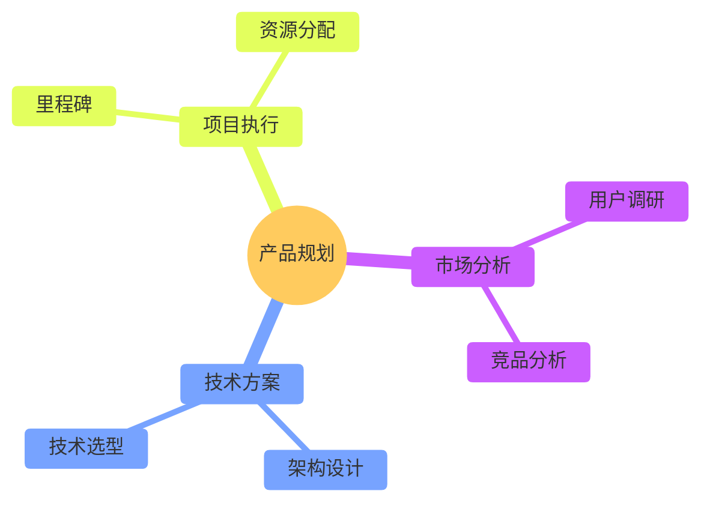
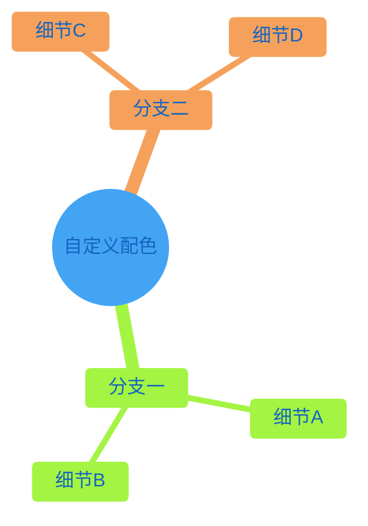

#### 1. 基础结构：缩进即层级
Mermaid 思维导图完全依靠**行首缩进**来定义父子关系。根节点缩进最少，子节点每多一层就增加缩进（空格数量一致即可）。

#### 2. 节点形状
在节点文本两侧添加特定符号即可改变形状，语法与流程图节点类似。

| 形状 | 语法 | 显示效果 |
| :--- | :--- | :--- |
| **方形** | `id[文本]` | 矩形 |
| **圆角方形** | `id(文本)` | 圆角矩形（默认） |
| **圆形** | `id((文本))` | 圆形 |
| **爆炸形** | `id))文本((` | 爆炸/锯齿形 |
| **云朵形** | `id)文本(` | 云朵形 |
| **六边形** | `id{{文本}}` | 六边形 |

> 根节点通常使用 `(( ))` 定义，使其呈现为圆形或圆角形，与分支节点形成视觉区分。

#### 3. 图标：`::icon()`
在**节点定义的下一行**，使用 `::icon(图标类名)` 为节点添加图标。图标类名来自页面已加载的图标字体（如 Font Awesome）。

> **注意**：Mermaid 官方将**图标集成**标记为思维导图的实验性功能，其支持程度取决于渲染环境是否加载了相应的图标字体库。

#### 4. 多行文本：` `
在节点文本中使用 ` ` 可以实现换行，使较长的节点内容更易读。

### 🎨 五种内置主题完整示例

所有示例均可在支持 Mermaid 的编辑器中直接运行。**主题通过 frontmatter config 锁定**，写法为在 `mindmap` 关键字之前加入 `config: theme: 主题名`。

#### 1️⃣ `default`（默认主题）
**风格**：标准蓝色调，干净、专业，适用于大多数通用场景。

#### 2️⃣ `neutral`（中性主题）
**风格**：灰度色调，柔和内敛，尤其适合**打印**或黑白文档场景。

#### 3️⃣ `dark`（深色主题）
**风格**：深色背景配色，与暗色模式页面天然融合，适合技术演示或夜间阅读场景。

#### 4️⃣ `forest`（森林主题）
**风格**：以**绿色调**为主，视觉自然清新，适合环保、组织架构、生长类主题的呈现。

#### 5️⃣ `base`（基础主题）
**风格**：极简的基底配色，**它是唯一支持通过 `themeVariables` 深度自定义的主题**。直接使用 `base` 时外观朴素，但正因如此，它是打造品牌化配色的起点。

### 🛠️ 进阶：用 `themeVariables` 自定义 `base` 主题

在 `base` 主题下，可以通过 `themeVariables` 精确控制思维导图的各类颜色。以下是一个**自定义蓝色系**的示例，其中 `mindmapRootColor` 专门控制根节点，`primaryColor` 控制分支节点，`lineColor` 控制连线：

**关键 `themeVariables` 速查**：

| 变量名 | 作用 |
| :--- | :--- |
| `mindmapRootColor` | **根节点**填充色 |
| `primaryColor` | 分支节点背景色 |
| `primaryTextColor` | 节点文字颜色 |
| `primaryBorderColor` | 节点边框颜色 |
| `lineColor` | 连接线颜色 |

> Mermaid 的主题引擎仅识别**十六进制颜色值**（如 `#ff0000`），不识别颜色名称（如 `red`）。

### 💎 一句话总结

**缩进定层级，符号定形状，`::icon` 加图标，`config: theme:` 切五色，`base` + `themeVariables` 做品牌定制**。五种内置主题开箱即用，而 `base` 主题为你保留了无限的自定义空间。