在 OSI参考模型中有7个层次，提供了相应的安全服务来 加强信息系统的安全性，以下哪一层提供了保密性、身份鉴别、数据完整性服务?

<u>A. 网络层</u>

B. 表示层

C. 会话层

D.物理层

正确答案:A  你的答案:C

**解析依据**：在OSI安全架构（ISO/IEC 7498-2标准）中，网络层是提供全面安全服务（包括保密性、身份鉴别和数据完整性）的关键层。IPsec是网络层的典型安全协议，广泛应用于VPN等场景，确保数据包级别的安全。

扩展阅读：

OSI参考模型分为7层，每层负责不同的功能，安全服务通常分布在多个层，但某些层更专注于特定安全机制：

- **物理层（Physical Layer）** ：处理物理连接和比特流传输，不提供高级安全服务（如保密性、身份鉴别或数据完整性）。
- **数据链路层（Data Link Layer）** ：负责节点到节点的帧传输，可提供基本错误检测，但不涉及身份鉴别或保密性（未在选项中）。
- **网络层（Network Layer）** ：负责路由、寻址和数据包转发。**这是唯一在选项中能提供保密性、身份鉴别和数据完整性服务的层**，主要通过协议如IPsec（Internet Protocol Security）实现：

  - **保密性**：通过加密（如IPsec的封装安全载荷ESP）防止数据窃听。
  - **身份鉴别**：通过认证头（AH）或密钥交换机制验证通信实体的身份。
  - **数据完整性**：使用哈希算法（如HMAC）确保数据在传输中未被篡改。
- **传输层（Transport Layer）** ：提供端到端连接管理，可通过TLS/SSL实现类似服务，但不在选项中（未列出）。
- **会话层（Session Layer）** ：管理会话建立、维护和终止，**不直接提供任何安全服务**（如保密性或身份鉴别）。它只处理对话控制，与会话管理相关，但安全功能通常委托给其他层。
- **表示层（Presentation Layer）** ：处理数据格式转换、加密和压缩。它可以提供**保密性**（如通过加密算法），但**一般不负责身份鉴别或数据完整性**。这些服务更多由网络层或应用层处理。
- **应用层（Application Layer）** ：支持应用程序服务（如HTTP、FTP），可通过协议如HTTPS、PGP或S/MIME提供保密性、身份鉴别和完整性，但**应用层不在选项中**。

---

关于源代码审核，描述**正确**的是

A.源代码审核过程遵循信息安全保障技术框架模型 (IATF)，在执行时应一步一步严格执行

B.**源代码审核有利于发现软件编码中存在的安全问题，相关的审核工具既有商业开源工具**

C.源代码审核如果想要有效率高，则主要依赖人工审核而不是工具审核，因为人工智能的，需要人的脑袋来判断

D.源代码审核能起到很好的安全保证作用，如果执行了源代码审核，则不需要安全测试

正确答案:B 你的答案:D

A: IATF是信息安全保障框架，不专门针对代码审核流程，代码审核通常采用SAST方法或安全编码规范，而非严格遵循IATF步骤执行。  
B: 源代码审核能有效发现SQL注入等编码安全问题，实际应用中既有商业工具如Fortify，也有开源工具如SonarQube，这是最准确的描述。  
C: 现代代码审核强调工具自动化扫描与人工审核相结合，单纯依赖人工审核效率低下，不符合当前安全实践趋势。  
D: 源代码审核只是安全开发的一个环节，无法替代渗透测试等动态安全测试，两者需要配合使用才能确保系统安全。

我选择D是因为高估了源代码审核的作用，认为静态代码检查可以完全替代动态安全测试，忽略了运行时环境检测和业务逻辑漏洞验证的必要性。

---

下图描绘了信息安全管理体系的 PDCA 模型其中，建立 ISMS 中，组织应根据业务、组织、位置、资产和技术等 方面的特性，确定 ISMS 的范围和边界，包括对范围任何 删减的 详细说明和正当性理由。组织应根据业务、组织、 位置、资产和技术等方面的特性，监视和 评审 ISMS() ，实施和运行 ISMS 中，组织应为管理信息安全风险识别 适当的()、资源、职责和优选顺序，监视和评审 ISMS 中，组织应执行监视与评审规程和其他()。以迅速检 测 过程运行结果中的错误，迅速识别图的和得逞的安全违规 和事件，使管理者能够确定分配 给人员的安全活动或通过 信息技术实施的安全活动是否按期望执行，通过使用指示 器帮助检 测安全事态并预防安全事件，确定解决安全违规 的措施是否有效，保持和改进 ISMS 中，组织应经常进行 ISMS 改进，采取合适的纠正和()，从其他组织和组织自 身的安全经验中()。

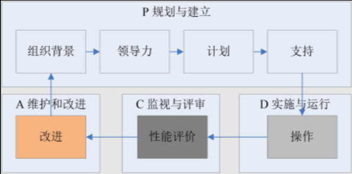  
A.方针;管理措施;控制措施;预防措施;吸取措施  
B.方针;控制措施;管理措施;预防措施;吸取措施  
C.方针;预防措施;管理措施;控制措施;吸取措施  
D.方针;吸取措施;管理措施;控制措施;预防措施  
正确答案:A 你的答案:B

A: **方针**是ISMS的基础，**管理措施**用于风险处置，**控制措施**是具体实施手段，**预防措施**避免问题发生，**吸取措施**强调经验学习，这是PDCA循环的标准表述。  
B: 将**控制措施**和**管理措施**顺序颠倒，**控制措施**应在实施阶段而非规划阶段，不符合ISO 27001标准要求。  
C: **预防措施**不应在第三空出现，ISMS监视评审阶段主要关注检测而非预防，预防属于保持改进阶段。  
D: **吸取措施**位置错误，经验学习应在最后阶段，且**预防措施**应在纠正之后，顺序完全颠倒。

我选择B是因为混淆了**管理措施**和**控制措施**的执行顺序，没有准确理解PDCA各阶段的具体工作重点，将实施阶段的控制措施错误地放在了规划阶段。

---

网络交易发达的今天，贸易双方可以通过签署电子合同来保障自己的合法权益。某中心推出电子签名服务，按照如图方式提供电子签名，**不属于**电子签名的基本特性的是()。  
A.不可伪造性  
B.不可否认性  
C.保证消息完整性  
D.机密性  
正确答案:D 你的答案: C

A: **不可伪造性**是电子签名核心特性，确保签名者身份真实可靠，通过数字证书等技术手段防止他人伪造签名。  
B: **不可否认性**指签名者事后不能否认自己的签名行为，通过数字签名的时间戳等技术实现法律效力保障。  
C: **保证消息完整性**确保签署后的电子合同内容不被篡改，通常采用哈希算法等技术来验证文件完整性。  
D: **机密性**不属于电子签名基本特性，电子签名主要解决身份认证和防篡改问题，数据加密是另外的安全机制。

---

视窗操作系统(Windows)从哪个版本开始引入安全中心的概念?  
A. WinNT SP6  
B. Win2000 SP4  
C. WinXP SP2  
D. Win2003 SP1  
正确答案:C 你的答案:A

A: **WinNT SP6**并未引入安全中心概念，Windows NT系列主要面向企业用户，其安全机制与后续消费级系统不同。  
B: **Win2000 SP4**虽然增强了系统安全性，但仍未集成安全中心功能，其安全配置需要通过控制面板单独设置。  
C: **WinXP SP2**首次引入安全中心功能，整合防火墙、自动更新和病毒防护状态监控，成为微软系统安全的重要里程碑。  
D: **Win2003 SP1**作为服务器系统，虽然强化了安全功能，但安全中心概念最早出现在消费级的XP SP2版本中。

我选择A是因为混淆了Windows NT系列和XP系列的安全功能演进，错误认为企业级系统会更早引入安全中心这样的集成安全功能。

---

下图是安全测试人员连接某远程主机时的操作界面，请您仔细分析该图，下面分析推理正确的是()

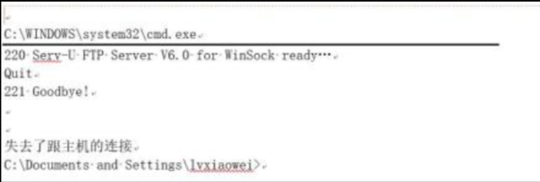  
A.安全测试人员链接了远程服务器的220端口  
B.安全测试人员的本地操作系统是Linux  
C.远程服务器开启了FTP服务，使用的服务器软件名FTP Server  
D.远程服务器的操作系统是windows系统  
正确答案:D 你的答案:C

A: 220是FTP服务的默认响应代码，表示服务就绪，但端口号是21而非220，220只是状态码不是端口号。  
B: 命令提示符显示**C:\Documents and Settings**路径，这是Windows特有目录结构，明确显示本地系统是Windows而非Linux。  
C: 虽然显示FTP服务就绪信息，但**Serx-U-FTPServer**可能是伪造的banner信息，不能直接确认真实服务软件名称。  
D: **C:\WINDOWS\system32\cmd.exe**路径和目录结构明确显示远程主机运行Windows系统，这是最可靠的判断依据。

我选择C是因为过于关注FTP服务的banner信息，而忽略了更可靠的系统路径特征，没有全面分析界面中提供的所有系统标识信息。

---

ISO 27002(Information technology-Security techniques-Code of practice for information security management)是重要的信息安全管理标准之一，下图是关于其演进变化示意图，图中括号空白处应填写()

  
A. BS 7799.1.3  
B. ISO 17799  
C. AS/NZS 4630  
D. NIST SP 800-37  
正确答案:B 你的答案:A

A: **BS 7799.1.3**并非标准演进过程中的正式版本号，BS 7799标准在演进过程中只有.1和.2两个部分。  
B: **ISO 17799**是BS 7799-1在2000年被ISO采纳后的第一个国际标准编号，是标准演进过程中的关键节点。  
C: **AS/NZS 4630**是澳大利亚/新西兰标准，与ISO 27002的演进过程无关，属于干扰项。  
D: **NIST SP 800-37**是美国国家标准技术研究院的风险管理框架，不属于ISO标准体系。

我选择A是因为混淆了BS 7799标准的版本编号体系，错误认为存在.1.3这样的子版本号，没有准确把握标准演进的关键节点。

---

信息安全标准化工作是我国信息安全保障工作的重要组成部分之一，也是政府进行宏观管理的重要依据，同时也是保护国家利益，促进产业发展的重要手段之一，关于我国标准化工作，下面选项中描述错误的是  
A.我国是在国家质量监督检验检疫总局管理下，由国家标准化管理委员会统一管理全国标准化工作，下设有专业技术委员会  
B.事关国家安全利益，信息安全因此不能和国际标准相同，而是要通过本国组织和专家制定标准，切实有效地保护国家利益和安全  
C.我国归口信息安全方面标准是"全国信息安全标准化技术委员会"，为加强有关工作，2016在其下设立"大数据安全特别工作组"  
D.信息安全标准化工作是解决信息安全问题的重要技术支撑，其主要作业突出体现在能够确保有关产品、设施的技术先进性、可靠性和一致性  
正确答案:B 你的答案:C

A:描述完全正确，我国标准化工作确实由国家标准化管理委员会统一管理，下设多个专业技术委员会负责具体领域标准制定。  
B:错误描述，我国信息安全标准既考虑国情也积极采用国际标准，如等同采用ISO 27001等国际标准，并非完全不能与国际标准相同。  
C:准确描述了全国信息安全标准化技术委员会(TC260)的组织架构，2016年确实增设了大数据安全特别工作组。  
D:正确阐述了标准化工作的作用，通过标准可以确保技术产品的质量和一致性，是信息安全的重要保障。

我选择错误是因为没有充分理解我国标准化工作与国际接轨的实际情况，误以为出于安全考虑必须完全自主制定标准，而忽略了我国在标准制定中采用的"等同采用"、"修改采用"等国际标准转化策略。

---

以下哪个选项不是防火墙提供的安全功能?  
A.IP地址欺骗防护  
B.NAT  
C.访问控制  
D.SQL注入攻击防护  
正确答案:D 你的答案:A

A: **IP地址欺骗防护**是防火墙的基础功能，通过检查数据包源地址防止伪造IP的攻击行为，属于网络层防护能力。  
B: **NAT(网络地址转换)** 是防火墙的常见功能，实现公私网地址转换，既能节省IP资源又能隐藏内部网络结构。  
C: **访问控制**是防火墙的核心功能，通过ACL规则控制进出网络的数据流，实现基于端口、协议等的访问限制。  
D: **SQL注入攻击防护**属于应用层防护，通常由WAF(Web应用防火墙)实现，传统网络防火墙无法检测应用层SQL语句。

我选择A是因为混淆了防火墙的基础安全功能，误将IP欺骗防护排除在外，而实际上SQL注入防护才是超出传统防火墙能力范围的功能。

---

以下关于可信计算说法错误的是:  
A.可信的主要目的是要建立起主动防御的信息安全保障体系  
B.可信计算机安全评价标准(TCSEC)中第一次提出了可信计算机和可信计算基的概念  
C.可信的整体框架包含终端可信、终端应用可信、操作系统可信、网络互联可信、互联网交易等应用系统可信  
D.可信计算平台出现后会取代传统的安全防护体系和方法  
正确答案:D 你的答案:C

A: 可信计算通过**可信度量**和**可信验证**等技术实现主动防御，改变传统被动防护模式，是其主要设计目标。  
B: 美国国防部1985年发布的**TCSEC标准**首次明确定义可信计算基(TCB)概念，成为可信计算理论奠基之作。  
C: 可信计算采用**信任链传递**机制，从硬件TPM芯片到操作系统再到应用层逐级验证，形成完整信任体系。  
D: 错误选项，可信计算是对传统安全体系的**增强补充**，而非替代，两者共同构成纵深防御体系。

我选择C是因为过度关注可信计算的技术架构，而忽略了其与传统安全体系的关系，没有理解可信计算是作为现有安全防护的补充而非替代这一关键点。

---

应用软件的数据存储在数据库中，为了保证数据安全，应设置良好的数据库防护策略，以下不属于数据库防护策略的是?  
A.安装最新的数据库软件安全补丁  
B.对存储的敏感数据进行安全加密  
C.不使用管理员权限直接连接数据库系统  
D.定期对数据库服务器进行重启以确保数据库运行良好  
正确答案:D 你的答案:C

A: **安装安全补丁**是基础防护措施，可修复已知漏洞，防止攻击者利用漏洞入侵数据库系统。  
B: **数据加密**保护敏感信息，即使数据泄露也无法直接读取，符合最小权限和深度防御原则。  
C: **最小权限原则**要求使用普通账户而非管理员账户连接，可降低攻击造成的破坏范围。  
D: 错误选项，**定期重启**属于运维操作而非安全策略，无法提升安全性，反而可能影响业务连续性。

我选择C是因为混淆了安全策略和运维操作的区别，误以为权限管理不属于核心防护策略，而忽略了重启操作实际上与数据安全防护无关这一关键点。

---

某学员在学习国家标准《信息系统安全保障评估框架 第一部分：简介和一般模型》(GB/T 20274.1-2006)后，绘制了一张简化的信息系统安全保障模型图，如下所示。请为图中括号空白处选择合适的选项()

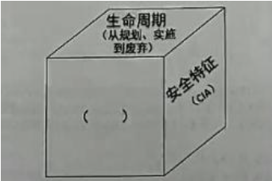  
A.安全保障(方针和组织)  
B.安全防护(技术和管理)  
C.深度防御(策略、防护、检测、响应)  
D.保障要素(管理、工程、技术、人员)  
正确答案:D 你的答案:C

A: **方针和组织**属于管理层面的保障措施，但GB/T 20274.1标准定义的保障要素包含更全面的维度。  
B: **技术和管理**的划分过于简单，未涵盖标准中明确提出的工程和人员等关键保障要素。  
C: **深度防御**是安全防护策略，但并非该标准定义的信息系统保障要素框架内容。  
D: 正确选项，GB/T 20274.1标准明确定义**保障要素**包含管理、工程、技术和人员四个维度，构成完整保障体系。

我选择C是因为将动态防御理念与标准定义的静态保障要素相混淆，没有准确把握GB/T 20274.1标准中关于保障要素的明确定义和分类要求。

---

以下哪个拒绝服务攻击方式不是流量型拒绝服务攻击  
A. Land  
B. UDP Flood  
C. Smurf  
D. Teardrop  
正确答案:D 你的答案:A

A: **Land攻击**属于流量型攻击，通过发送源IP和目标IP相同的特殊数据包导致系统崩溃或重启。  
B: **UDP Flood**是典型的流量型攻击，利用UDP协议无连接特性发送大量数据包耗尽目标带宽资源。  
C: **Smurf攻击**是流量放大攻击，通过伪造源IP向广播地址发送ICMP请求，产生大量回复流量淹没目标。  
D: 正确选项，**Teardrop攻击**属于协议漏洞利用，通过发送异常分片IP包使目标系统重组时崩溃，不依赖流量压制。

我选择A是因为混淆了不同DoS攻击类型的特征，误将Land攻击归类为非流量型，而实际上Teardrop才是利用协议漏洞而非流量压制的攻击方式。

---

如图所示，主体S对客体01有读(R)权限，对客体02有读(R)、写(W)权限。该图所示的访问控制实现方法是:()

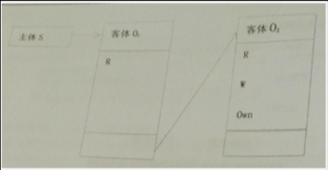  
A.访问控制表(ACL)  
B.访问控制矩阵  
C.能力表(CL)  
D.前缀表(Profiles)  
正确答案:C 你的答案:B

A: **访问控制表(ACL)** 是以客体为中心的权限管理方式，为每个客体维护一个访问主体及其权限的列表，与图示的主体视角不符。  
B: **访问控制矩阵**是理论模型，将主体和客体的权限关系用矩阵表示，实际系统中很少直接实现，且与图示的具体实现方式不符。  
C: 正确选项，**能力表(CL)** 以主体为中心，为每个主体维护其可访问的客体及对应权限列表，正好对应题目描述的权限结构。  
D: **前缀表**主要用于基于标签的访问控制，与题目描述的简单读写权限控制场景不匹配。

我选择B是因为将理论模型与实际实现方式混淆，访问控制矩阵虽然是基础理论，但实际系统中更常用能力表或ACL来实现具体权限控制。

---

关于源代码审核，下列说法正确的是:  
A.人工审核源代码审校的效率低，但采用多人并行分析可以完全弥补这个缺点  
B.源代码审核通过提供**非预期的输入**并监视异常结果来发现软件故障，从而定位可能导致安全弱点的薄弱之处  
C.使用工具进行源代码审核，速度快，准确率高 **，已经**取代了传统的人工审核  
D.源代码审核是对源代码检查分析，检测并报告源代码中可能导致安全弱点的薄弱之处  
正确答案:D 你的答案:B

A: 多人并行分析确实能提高人工审核效率，但"**完全弥补**"说法过于绝对，人工审核固有的效率瓶颈无法被完全消除。  
B: 描述的是**模糊测试(Fuzzing)技术**，属于动态测试方法，而源代码审核是静态分析技术，二者有本质区别。  
C: 工具审核虽快速但存在误报漏报，人工审核在复杂逻辑漏洞检测上**不可替代**，当前最佳实践是工具与人工结合。  
D: 正确选项，明确定义了源代码审核的核心功能是通过静态分析检测代码中的潜在安全漏洞和薄弱环节。

我选择B是因为混淆了静态代码审核与动态测试技术的区别，将模糊测试的特征错误地套用到源代码审核上，没有准确把握源代码静态分析的技术特点。

---

在戴明环(PDCA)模型中，处置(ACT)环节的信息安全管理活动是:  
A.建立环境  
B.实施风险处理计划  
C.持续的监视与评审风险  
D.持续改进信息安全管理过程  
正确答案:D 你的答案:B

A: **建立环境**属于计划(Plan)阶段的活动，主要是确定ISMS的范围、方针和目标，为后续实施奠定基础。  
B: **实施风险处理计划**是执行(Do)阶段的核心工作，将安全控制措施落实到具体操作中，而非处置环节。  
C: **监视与评审**属于检查(Check)阶段，通过审计和评审来验证安全措施的有效性，为改进提供依据。  
D: 正确选项，**持续改进**是处置(Act)阶段的本质特征，基于检查阶段的发现来优化ISMS，形成闭环管理。

我选择B是因为混淆了PDCA各阶段的工作重点，将实施(Do)阶段的任务错误地归入处置(Act)阶段，没有准确理解Act阶段的核心是改进而非执行。

---

在信息系统设计阶段，"安全产品选择"处于风险管理过程的哪个阶段?  
A.背景建立  
B.风险评估  
C.风险处理  
D.批准监督  
正确答案:C 你的答案:A

A: 背景建立是风险管理初始阶段，主要确定系统范围和边界，不涉及具体安全措施选择。  
B: 风险评估阶段识别和分析风险，为风险处理提供依据，但不直接选择安全产品。  
C: 正确选项，风险处理阶段根据评估结果选择适当的安全控制措施，包括安全产品选型。  
D: 批准监督是对整个风险管理过程的审查和监督，属于后期阶段。

我选择A是因为混淆了风险管理各阶段的重点，将前期准备工作与具体控制措施实施阶段相混淆。

---

信息系统安全保护等级为3级的系统，应当()年进行一次等级测评?  
A.0.5  
B.1  
C.2  
D.3  
正确答案:B 你的答案:C

A: 半年周期适用于特殊要求场景，非等级保护通用规定。  
B: 正确选项，等保2.0明确规定三级系统每年测评一次。  
C: 二年周期适用于二级系统，不符合三级系统要求。  
D: 三年周期过长，不符合等保对重要系统的监管要求。

我选择C是因为记混了不同等级系统的测评周期要求，将二级系统的要求套用到三级系统上。

---

关于我国加强信息安全保障工作的总体要求，以下说法错误的是:()  
A.坚持积极防御、综合防范的方针  
B.重点保障基础信息网络和重要信息系统安全  
C.创建安全健康的网络环境  
D.提高个人隐私保护意识  
正确答案:D 你的答案:B

A: 准确描述我国"积极防御、综合防范"的基本方针。  
B: 正确体现对关键基础设施的重点保护原则。  
C: 符合我国网络安全工作的环境建设目标。  
D: 错误选项，个人隐私保护是具体工作内容，不属于总体要求范畴。

我选择B是因为未能区分总体要求与具体工作内容的层次关系。

---

根据《关于加强国家电子政务工程建设项目信息安全风险评估工作的通知》的规定，以下正确的是:  
A.涉密信息系统的风险评估应按照《信息安全等级保护管理办法》等国家有关保密规定和标准进行  
B.非涉密信息系统的风险评估应按照《非涉及国家秘密的信息系统分级保护管理办法》等要求进行  
C.可委托同一专业测评机构完成等级测评和风险评估工作，并形成等级测评报告和风险评估报告  
D.此通知不要求将"信息安全风险评估"作为电子政务项目验收的重要内容  
正确答案:C 你的答案:D

A: 涉密系统评估应依据保密标准，而非等级保护管理办法。  
B: 非涉密系统评估依据等级保护而非分级保护要求。  
C: 正确选项，通知明确允许同一机构承担两项工作。  
D: 通知明确要求将风险评估纳入验收必备环节。

我选择D是因为对政策文件具体要求理解不准确，忽略了风险评估的强制性验收要求。

---

风险要素识别是风险评估实施过程中的一个重要步骤，小李将风险要素识别的主要过程使用图形来表示，如下图所示，请为图中空白框处选择一个最合适的选项()。

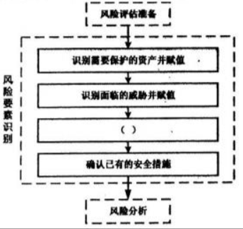

A.识别面临的风险并赋值  
B.识别存在的脆弱性并赋值  
C.制定安全措施实施计划  
D.检查安全措施有效性  
正确答案:B 你的答案:A

A: **风险识别赋值**通常是完成资产、威胁和脆弱性识别后的综合分析步骤，而非风险要素识别的中间环节。  
B: 正确选项，**脆弱性识别赋值**是风险要素识别的关键环节，在资产识别后、风险分析前，构成完整的风险要素链条。  
C: **安全措施计划**属于风险处置阶段内容，与风险要素识别过程无关，不符合流程图逻辑。  
D: **措施有效性检查**是风险管理的后续监督环节，完全不属于风险识别阶段的组成部分。

我选择A是因为颠倒了风险评估的工作流程，错误地将风险分析环节前置到要素识别阶段，忽略了脆弱性识别这一必要步骤。

---

小李去参加单位组织的信息安全培训后，他把自己对管理信息管理体系ISMS的理解画了一张图，但是他还存在一个空白处未填写，请帮他选择一个合适的选项()

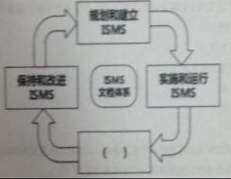  
A.监控和反馈ISMS  
B.批准和监督ISMS  
C.监视和评审ISMS  
D.沟通和咨询ISMS  
正确答案:C 你的答案:A

A: **监控和反馈**是PDCA循环中Check环节的部分内容，但非ISMS标准术语，表述不够规范准确。  
B: **批准和监督**属于管理层职责，通常出现在ISMS建立初期和审计阶段，不符合PDCA持续改进的循环特性。  
C: 正确选项，**监视和评审**是ISO 27001标准明确规定的关键活动，确保ISMS持续有效运行并改进。  
D: **沟通和咨询**是利益相关方管理的重要内容，但属于支持性过程而非核心管理活动。

我选择A是因为将日常管理术语与ISMS标准术语混淆，使用了非标准的"监控和反馈"表述，而忽略了标准中明确规定的"监视和评审"要求。

---

为防范网络欺诈确保交易安全，网银系统首先要求用户安全登录，然后使用"智能卡+短信认证"模式进行网上转账等交易，在此场景中用到下列哪些鉴别方法?  
A.实体"所知"以及实体"所有"的鉴别方法  
B.实体"所有"以及实体"特征"的鉴别方法  
C.实体"所知"以及实体"特征"的鉴别方法  
D.实体"所有"以及实体"行为"的鉴别方法  
正确答案:A 你的答案:C

A: 正确选项，**密码登录**属于"所知"(知识因素)，**智能卡**是物理令牌属于"所有"(拥有因素)，**短信验证**是对手机SIM卡的拥有验证。  
B: 未使用指纹/面容等**生物特征**认证，不符合场景描述。  
C: 错误混淆认证因素，短信验证是对手机SIM卡的拥有验证，而非生物特征识别。  
D: 未涉及击键节奏等**行为特征**认证方式。

我选择C是因为将短信验证错误归类为特征因素，实际上短信验证码是通过验证用户对手机号码的控制权(拥有因素)来实现认证的。

---

信息安全管理体系(ISMS)的实施和运行ISMS阶段，是ISMS过程模型的实施阶段(Do)，下面给出了一些活动：  
①制定风险处理计划  
②实施风险处理计划  
③开发有效性测量程序  
④实施培训和意识教育计划  
⑤管理ISMS的运行  
⑥管理ISMS的资源  
⑦执行检测事态和响应事件的程序  
⑧实施内部审核  
⑨实施风险再评估

选项()描述了在此阶段组织应进行的活动。  
A.①②③④⑤⑥  
**B.①②③④⑤⑥⑦**  
C.①②③④⑤⑥⑦⑧  
D.①②③④⑤⑥⑦⑧⑨  
正确答案:B 你的答案:A

A: 包含基础实施活动但缺少关键的**事件响应**程序(⑦)，不完整。实施阶段需要包含所有关键运行活动。  
B: 正确选项，完整涵盖实施阶段核心工作：**从计划实施(②)、培训(④)到日常管理(⑤⑥)和事件响应(⑦)** 。  
C: 内部审核(⑧)属于**检查(Check)** 阶段活动，不应包含在实施阶段。审核是验证实施效果的活动。  
D: 风险再评估(⑨)明显属于**监督改进环节**，完全超出实施阶段范围。再评估是基于运行效果的调整。

我选择A是因为未能全面把握实施阶段的工作范围，遗漏了关键的事件响应管理(⑦)，这是ISMS运行期间的重要保障措施。实施阶段需要包含所有确保ISMS正常运转的活动。

---

Linux 系统的安全设置中，对文件的权限操作是一项关键操作。通过对文件权限的设置，能够保障不同用户的个人隐私和系统安全。文件 fb.c 的文件属性信息如下图所示，小张想要修改其文件权限，为文件主增加执行权限，并删除组外其他用户的写权限，那么以下操作中正确的是()  
-rw-rw-rw-5 zhang users 759 Jul 64 55:99 fib.c  
A. #chmod u+x, a-w fib.c  
B. #chmod ug+x, o-w fib.c  
C. #chmod 764 fib.c  
D. #chmod 467 fib.c  
正确答案:C 你的答案:A

A: 该命令会为文件主增加执行权限(u+x)，但同时会删除所有用户(a)的写权限，不符合"只删除其他用户写权限"的要求。  
B: 该命令会为文件主和组用户都增加执行权限(ug+x)，而题目只要求为文件主增加执行权限。  
C: 正确选项，764权限对应rwxrw-r--，正好满足为文件主增加**执行权限(7=rwx)** ，同时其他用户**只保留读**权限(4\=r)。  
D: 467权限对应r--rw-rwx，完全不符合题目要求，且会导致安全风险(其他用户有执行权限)。

我选择A是因为混淆了权限设置的对象范围，错误使用了a-w参数导致权限修改范围过大，没有精确实现题目要求的权限变更。

---

从系统工程的角度来处理信息安全问题，以下说法错误的是:  
A.系统安全工程旨在了解企业存在的安全风险，建立一组平衡的安全需求，融合各种工程学科的努力将此安全需求转换为贯穿系统整个生存期的工程实施指南。  
B.系统安全工程需对安全机制的正确性和有效性做出诠释，证明安全系统的信任度能够达到企业的要求，或系统遗留的安全薄弱性在可容许范围之内。  
C.系统安全工程能力成熟度模型(SSE-CMM)是一种衡量安全工程实践能力的方法，是一种使用**面向开发**的方法。  
D.系统安全工程能力成熟度模型(SSE-CMM)是在原有能力成熟度模型(CMM)的基础上，通过对安全工作过程进行管理的途径，将系统安全工程转变为一个完好定义的、成熟的、可测量的先进学科。  
正确答案:C 你的答案:D

A: 准确描述了系统安全工程的总体目标和实施路径，强调全生命周期的安全需求转化和平衡。  
B: 正确阐述了安全工程需要验证和证明安全机制的有效性，确保安全风险控制在可接受范围内。  
C: 错误选项，SSE-CMM是**面向过程**而非面向开发的方法，它关注**安全工程过程**的成熟度而非具体开发方法。  
D: 正确说明SSE-CMM与CMM的关系及其对安全工程学科发展的贡献，强调过程管理和成熟度测量。

我选择D是因为混淆了SSE-CMM的定位，误将其理解为面向开发的方法，而实际上它是评估安全工程过程成熟度的框架，不限定具体开发方法。

---

有关系统安全工程-能力成熟度模型(SSE-CMM)中的基本实施(Base Practices，BP)，正确的理解是:  
A.BP是基于最新技术而制定的安全参数基本配置  
B.大部分BP是没有经过测试的  
C.一项BP适用于组织的生存周期而非仅适用于工程的某一特定阶段  
D.一项BP可以和其他BP有重叠  
正确答案:C 你的答案:A

A: BP是经过验证的安全工程最佳实践集合，而非技术配置参数，其核心是过程实施而非技术实现。  
B: BP都是经过验证的安全工程实践，SSE-CMM收录的都是被证明有效的实践方法。  
C: 正确选项，BP设计覆盖组织完整生命周期，确保安全工程在各个阶段都能得到有效实施。  
D: BP之间允许存在适度重叠，但题目强调的重点是BP的全生命周期适用性。

我选择A是因为混淆了BP的概念内涵，错误地将过程实践理解为技术配置，没有把握BP作为方法论的本质特征。

---

以下哪一种判断信息系统是否安全的方式是最合理的?  
A.是否己经通过部署安全控制措施消灭了风险  
B.是否可以抵抗大部分风险  
C.是否建立了具有自适应能力的信息安全模型  
D.是否已经将风险控制在可接受的范围内  
正确答案:D 你的答案:B

A: **消灭风险**是理想化状态，实际安全工作中风险只能被管理而无法被完全消除，该选项不符合风险管理基本原则。  
B: **抵抗大部分风险**表述模糊，缺乏量化标准，且未考虑风险接受度的差异，不是科学的安全评估方法。  
C: **自适应模型**是安全防护的增强手段，反映系统防御能力而非安全状态，不能作为安全性的直接判断依据。  
D: 正确选项，**风险可控**是信息安全的核心目标，将残余风险控制在组织可接受范围内是最务实的安全判断标准。

我选择B是因为陷入了"防御越多越安全"的误区，忽略了风险管理中风险接受度的关键概念，没有理解安全性的最终评判标准是风险是否可控而非防御是否全面。

---

以下关于信息安全法治建设的意义，说法错误的是:  
A.信息安全法律环境是信息安全保障体系中的必要环节  
B.明确违反信息安全的行为，并对行为进行相应的处罚，以打击信息安全犯罪活动  
C.信息安全主要是技术问题，技术漏洞是信息犯罪的根源  
D.信息安全产业的逐渐形成，需要成熟的技术标准和完善的技术体系  
正确答案:C 你的答案:D

A: **法律环境**确实是信息安全保障体系的重要组成部分，为信息安全提供制度保障和规范依据。  
B: **法律惩戒**功能是法治建设的关键作用，通过明确违法行为的法律后果来震慑犯罪。  
C: 错误选项，**技术决定论**观点片面，信息安全是管理、技术、法律等多维度综合问题，不能简单归因于技术漏洞。  
D: **产业标准**对信息安全产业发展至关重要，是法治建设的技术支撑，表述正确。

我选择D是因为没有准确把握题干要求找出"错误说法"，而C选项明显将信息安全简单归因于技术问题是片面的，更符合题干要求的错误说法。

---

小张是信息安全风险管理方面的专家，被某单位邀请过去对其核心机房经受某种灾害的风险进行评估，已知:核心机房的总价价值一百万，灾害将导致资产总价值损失二成四(24%)，历史数据统计告知该灾害发生的可能性为八年发生三次，请问小张最后得到的年度预期损失为多少:  
A.24万  
B.0.09万  
C.37.5万  
D.9万  
正确答案:D 你的答案:C

A: 直接计算资产损失的绝对值100万×24%\=24万，但未考虑灾害发生频率  
B: 错误计算了发生概率(3/8×24%\=9%)与资产价值的乘积关系  
C: 错误地将8年3次理解为每年37.5%的发生概率  
D: 正确选项，计算公式为100万×24%×(3/8)\=9万，完整考虑资产价值、损失比例和年化发生概率

我选择C是因为错误理解了灾害频率的计算方式，将8年3次简单换算为每年37.5万，没有正确进行年化概率计算。

---

信息安全等级保护要求中，第三级适用的正确的是:  
A.适用于一般的信息和信息系统，其受到破坏后，会对公民、法人和其他组织的权益有一定影响，但不危害国家安全、社会秩序、经济建设和公共利益  
B.适用于一定程度上涉及国家安全、社会秩序、经济建设和公共利益的一般信息和信息系统，其受到破坏后，会对国家安全、社会秩序、经济建设和公共利益造成一般损害  
C.适用于涉及国家安全、社会秩序、经济建设和公共利益的信息和信息系统，其受到破坏后，会对国家安全、社会秩序、经济建设和公共利益造成严重损害  
D.适用于涉及国家安全、社会秩序、经济建设和公共利益的重要信息和信息系统的核心子系统。其受到破坏后，会对国家安全、社会秩序，经济建设和公共利益造成特别严重损害  
正确答案:B 你的答案:A

A: 描述的是第二级（等保二级）系统的特征，主要保护对象是公民、法人权益  
B: 正确选项，准确描述了等保三级系统的保护对象和损害程度，强调"一般损害"  
C: 描述的是第四级（等保四级）系统的特征，损害程度为"严重损害"  
D: 描述的是第五级（等保五级）系统的特征，损害程度为"特别严重损害"

我选择A是因为混淆了等级保护的级别划分标准，将二级系统的适用范围错误对应到三级系统，低估了三级系统对国家安全和社会利益的保护要求。三级系统的核心特征是保护涉及国家社会重要利益但损害程度尚属一般的信息系统。

---

下面哪一项安全控制措施不是用来检测未经授权的信息处理活动的:  
A.设置网络连接时限  
B.记录并分析系统错误日志  
C.记录并分析用户和管理员操作日志  
D.启用时钟同步  
正确答案:A 你的答案:D

A: 正确选项，**连接时限**是预防性控制措施，用于限制访问时长而非检测未授权活动  
B: **错误日志分析**能发现异常系统行为，是有效的检测手段  
C: **操作日志审计**可直接追踪用户行为，识别未授权操作  
D: **时钟同步**为日志时间戳提供一致性，是检测分析的基础支撑

我选择D是因为混淆了检测措施与支撑技术的关系，误将时钟同步这类基础服务当作直接检测手段，而忽略了其实际作用是确保日志时间准确性。

如下图所示，Alice用Bob的密钥加密明文，将密文发送给Bob，Bob再用自己的私钥解密，恢复出明文以下说法正确的是:()  
A.此密码体制为对称密码体制  
B.此密码体制为私钥密码体制  
C.此密码体制为单钥密码体制  
D.此密码体制为公钥密码体制  
正确答案:D 你的答案:B

A: 对称密码体制使用相同密钥加解密，与题目描述的密钥使用方式不符  
B: 私钥密码体制是公钥密码体制的别称，但题目描述的是典型的公钥加密场景  
C: 单钥密码体制即对称密码体制，与题目描述的公私钥配对使用场景不符  
D: 正确选项，题目描述的正是公钥密码体制的典型应用场景：发送方用接收方公钥加密，接收方用自己私钥解密

---

假设一个系统已经包含了充分的**预防控制措施**，那么安装监测控制设备:  
A.是多余的，因为它们完成了同样的功能，但要求更多的开销  
B.是必须的，可以为预防控制的功效提供检测  
C.**是可选的，可以实现深度防御**  
D.在一个人工系统中是需要的，但在一个计算机系统中则是不需要的，因为预防控制功能已经足够  
正确答案:C 你的答案:B

A: 监测控制与预防控制功能不同，前者用于**检测异常**，后者用于**阻止攻击**，二者并非重复  
B: 虽然监测控制能验证预防措施效果，但"必须"的说法过于绝对，不符合实际情况  
C: 正确选项，监测控制作为深度防御策略的一部分，可根据安全需求选择性地部署  
D: 错误区分人工系统与计算机系统的需求，监测控制在两类系统中都有应用价值

---

《信息安全技术 信息安全风险评估规范》(GB/T 20984-2007)中关于信息系统生命周期各阶段的风险评估描述**不正确**的是:  
A.规划阶段风险评估的目的是识别系统的业务战略，以支撑系统安全需求及安全战略等  
B.设计阶段的风险评估需要根据规划阶段所明确的系统运行环境、资产重要性，提出安全功能需求  
C.实施阶段风险评估的目的是根据系统安全需求和运行环境对系统开发、实施过程进行风险识别，并对系统建成后的安全功能进行验证  
D.运行维护阶段风险评估的目的是<u>了解和控制运行过程中的安全风险</u>，是一种全面的风险评估。评估内容包括对真实运行的信息系统、资产、脆弱性等各方面  
正确答案:D 你的答案:B

A: **规划阶段**风险评估确实需要识别业务战略，为后续安全需求提供依据，描述准确  
B: **设计阶段**需基于规划成果提出具体安全需求，符合标准要求  
C: **实施阶段**既要识别开发风险又要验证安全功能，描述完整正确  
D: **错误选项**，运行维护阶段评估是**周期性**的而非持续全面的，标准未要求覆盖所有方面

---

**以下哪些是需要在信息安全策略中进行描述的:**   
A.组织信息系统安全架构  
B.信息安全工作的基本原则  
C.组织信息安全技术参数  
D.组织信息安全实施手段  
正确答案:B 你的答案:A

A: **安全架构**属于技术方案层面内容，通常在具体实施方案而非策略文件中描述  
B: **正确选项**，信息安全策略的核心是明确基本原则和方针，为具体工作提供指导方向  
C: **技术参数**过于具体，属于操作层面细节，不应出现在策略性文件中  
D: **实施手段**是执行层面的内容，通常在标准或规程中规定，而非策略文件

---

**风险值=R(A，T，V)=R(L(T，V)，F(la，Va))以下关于上式各项说明错误的是:**   
A.R表示安全风险计算函数，A表示资产，T表示威胁，V表示脆弱性  
B.L表示威胁利用资产脆弱性导致安全事件的可能性  
C.F表示安全事件发生后造成的损失  
D.la，Va分别表示安全事件作用<u>全部资产的价值</u>与其<u>对应资产的严重程度</u>  
**正确答案：D 你的答案：A**

**解析：**   
**la特指某个资产A的价值**，**Va特指该资产A的脆弱性程度**，而非作用于全部资产。例如，对于一台数据库服务器（资产A），**la是其存储数据的关键价值**，**Va是其存在的SQL注入漏洞的严重程度**。

---

**小李绘制系统安全建设规划图依据的模型是：**

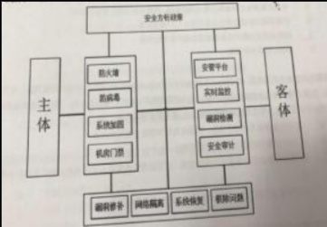  
A. PDR  
B. PPDR  
C. PDCA  
D. IATF  
**正确答案：B 你的答案：C**

**解析：**   
**PPDR模型（Policy Protection Detection Response）是动态安全模型**，包含策略、防护、检测和响应四个环节，适用于系统安全建设规划。**PDCA是质量管理模型**，**PDR缺少策略环节**，**IATF是深度防御框架**。

---

信息安全风险管理过程的模型如图所示。按照流程，请问，信息安全风险管理包括()六个方面的内容。()是信息安全风险管理的四个基本步骤，()则贯穿于这四个基本步骤中。  
A. **背景建立**、**风险评估**、**风险处理**、**批准监督**、**监控审查**和**沟通咨询**；背景建立、风险评估、风险处理和批准监督；<u>监控审查和沟通咨询；</u>  
B. 背景建立、风险评估、风险处理、批准监督、监控审查和沟通咨询；背景建立、风险评估、风险处理和监控审查；批准监督和沟通咨询；  
C. 背景建立、风险评估、风险处理、批准监督、监控审查和沟通咨询；背景建立、风险评估、风险处理和沟通咨询；监控审查和批准监督；  
D. 背景建立、风险评估、风险处理、批准监督、监控审查和沟通咨询；背景建立、风险评估、监控审查和批准监督；风险处理和沟通咨询。

正确答案：A 我的答案：C

解析：

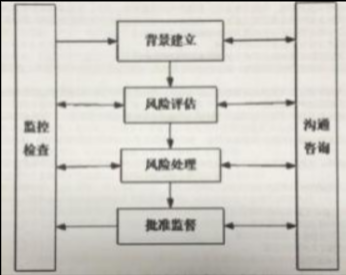  
信息安全风险管理包括**六个方面**：**背景建立、风险评估、风险处理、批准监督、监控审查和沟通咨询**。其中，**四个基本步骤**是**背景建立、风险评估、风险处理和批准监督**，而**监控审查和沟通咨询**贯穿于这四个步骤中。  
**核心考点**：风险管理流程的六个组成部分和四个基本步骤的关系，**监控审查和沟通咨询**是持续性活动。

---

在进行应用系统的测试时，应尽可能避免使用包含个人隐私和其它敏感信息的实际生产系统中的数据，如果需要使用时，以下哪一项**不是必须做的：**   
A. 测试系统应使用不低于生产系统的访问控制措施  
B. **为测试系统中的数据部署完善的备份与恢复措施**  
C. 在测试完成后立即清除测试系统中的所有敏感数据  
D. 部署审计措施，记录生产数据的拷贝和使用

正确答案：B我的答案：C

**解析：**   
使用生产数据进行测试时，必须采取严格的安全措施，包括**访问控制（A）** 、**数据清除（C）** 和**审计记录（D）** 。但**备份与恢复（B）** 不是必须的，因为**测试数据通常不具备长期保存价值，且备份可能增加数据泄露风险。**   
**核心考点**：**测试环境数据安全要求**，重点在于**最小化敏感数据的使用**，并确保**访问控制、审计和清理**措施到位。

---

以下哪一项不属于**信息安全工程监理模型**的组成部分:  
A.监理咨询支撑要素  
B.控制和管理手段  
C.监理咨询阶段过程  
D.**监理组织安全**​**<u>实施</u>**  
正确答案：D 我的答案：A

解析：信息安全工程监理模型由三大核心组成：**监理咨询支撑要素**（如标准规范）、**监理咨询阶段过程**（规划、实施、验收等阶段）、**控制和管理手段**（质量、进度、成本控制）。**D选项属于实施层面内容**，不属于监理模型的理论框架。NISP考试重点在于掌握监理模型的结构性要素，需区分"监理"与"实施"的职责边界。

---

某公司在执行灾难恢复测试时，信息安全专业人员注意到灾难恢复站点的服务器的运行速度缓慢，为了找到根本原因，他应该首先检查:  
**A.灾难恢复站点的错误事件报告**  
B.灾难恢复测试计划  
C.灾难恢复计划(DRP)  
D.主站点和灾难恢复站点的配置文件  
正确答案：A 我的答案：D

解析：**故障排查应优先分析错误事件报告**，因其直接记录系统异常信息。灾难恢复流程强调**从日志和错误报告入手**，而非直接对比配置文件或检查计划文件。NISP考试重点在于**事件响应优先级**，**错误日志是定位性能问题的第一手资料。**

---

COBIT(信息和相关技术的控制目标)是国际专业协会ISACA为信息技术(IT)管理和IT治理创建的良好实践框架。COBIT提供了一套可实施的"信息技术控制"并围绕IT相关流程和推动因素的逻辑框架进行组织。COBIT模型如图所示，按照流程，请问，COBIT组件包括()、()、()、()、()、等部分。  
A.流程描述、框架、控制目标、管理指南、成熟度模型  
B.框架、流程描述、管理目标、控制目标、成熟度模型  
C.框架、流程描述、控制目标、管理指南、成熟度模型  
D.框架、管理指南、流程描述、控制目标、成熟度模型  
正确答案：C 我的答案：D

解析：**COBIT五大核心组件**为：框架（整体结构）、流程描述（IT活动分解）、控制目标（具体要求）、管理指南（执行方法）、成熟度模型（能力评估）。**选项C正确列出全部组件且顺序准确**，NISP考试重点在于掌握COBIT框架的完整组成要素及其逻辑关系。

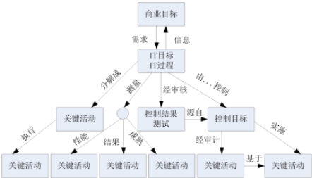

---

作为业务持续性计划的一部分，在进行**业务影响分析(BIA)** 时的**步骤**是:1.标识关键的业务过程;2.开发恢复优先级;3.标识关键的IT资源;4.表示中断影响和允许的中断时间  
A.1-3-4-2  
B.1-3-2-4  
C.1-2-3-4  
D.1-4-3-2  
正确答案：A 我的答案：B

解析：**BIA标准流程顺序**应为：<u>**先识别关键业务→确定支撑的IT资源→分析中断影响→最后制定恢复优先级**</u>。**选项A符合BCM最佳实践**，NISP考试重点在于掌握业务影响分析各阶段的逻辑递进关系，确保恢复策略基于实际业务需求。

---

主体S对**客体01**有读(R)权限，对**客体02**有读(R)、写(W)、拥有(Own)权限，该访问控制实现方法是:  
A.访问控制表(ACL)  
B.访问控制矩阵  
**C.能力表(CL)**   
D.前缀表(Profiles)  
正确答案：C 我的答案：A

解析：**能力表(CL)以主体为中心**记录其对客体的权限，而**ACL以客体为中心**记录访问权限。题目描述的是从主体角度出发的权限分配，符合CL特性。NISP考试重点区分不同访问控制模型的实现机制，**CL更适合描述主体拥有的权限集合**。

---

下面哪一项不是虚拟专用**网络(VPN)协议标准**:  
A.第二层隧道协议(L2TP)  
B.Internet安全性(IPSEC)  
**C.终端访问控制器访问控制系统(TACACS+)**   
D.点对点隧道协议(PPTP)  
正确答案：C 我的答案：D

解析：**TACACS+是AAA(认证、授权、计费)协议**，主要用于远程访问控制，不属于VPN协议。**L2TP、IPSec和PPTP都是主流VPN协议**。（3P）NISP考试重点在于区分网络安全协议的不同应用场景，VPN协议专注于建立安全的远程连接隧道。

---

下列对网络认证协议**Kerberos描述正确**的是:  
A.该协议使用非对称密钥加密机制  
B.密钥分发中心由认证服务器、票据授权服务器和客户机三个部分组成  
**C.该协议完成身份鉴别后将获取用户票据许可票据**  
D.使用该协议不需要时钟基本同步的环境  
正确答案：C 我的答案：A

解析：**Kerberos采用对称加密**而非非对称加密(A错)，其KDC仅包含AS和TGS(B错)，且**严格要求时间同步**(D错)。**C选项正确描述了Kerberos认证第一步**：获取票据许可票据(TGT)。NISP考试重点掌握Kerberos三阶段认证流程及其技术特点。

---

鉴别的基本途径有三种：所知、所有和个人特征，以下哪一项不是基于你所知道的：  
A.口令  
**B.令牌**  
C.知识  
D.密码  
正确答案：B 我的答案：D

解析：**令牌属于"所有"的鉴别方式**（如智能卡、U盾等物理载体），而口令、密码和知识都属于"所知"的鉴别因素。NISP考试重点在于区分三类认证因素：**所知（记忆信息）、所有（持有物品）、个人特征（生物识别）** 。

---

**入侵防御系统(IPS)** 是继入侵检测系统(IDS)后发展出来的一项新的安全技术，它与IDS有着许多不同点，请指出下列哪一项描述不符合IPS的特点：  
A.串接到网络线路中  
B.对异常的进出流量可以直接进行阻断  
C.有可能造成单点故障  
**D.不会影响网络性能**  
正确答案：D 我的答案：B

解析：**IPS采用串联部署方式**（A正确），**能主动阻断威胁**（B正确），**但会引入延迟影响性能**（D错误），且存在单点故障风险（C正确）。NISP考试重点掌握IPS与IDS的核心区别：**IPS是主动防御设备，必然会影响网络性能**，这是其工作原理决定的固有特性。

---

下列关于**kerckhof**准则的说法**正确**的是:  
A.保持算法的秘密性比保持密钥的秘密性要困难的多  
B.密钥一旦泄漏，也可以方便的更换  
**C.在一个密码系统中，密码算法是可以公开的，密钥应保证安全**  
D.公开的算法能够经过更严格的安全性分析  
正确答案：C 我的答案：D

解析：**Kerckhoffs准则核心**是密码系统安全性应仅依赖于密钥而非算法保密（C正确）。虽然公开算法更易分析（D部分正确），但这不是准则核心内容。NISP考试重点在于理解该准则强调**密钥保密比算法保密更重要**，这是现代密码学基本原则。

---

以下列出了MAC和散列函数的相似性，哪一项说法是**错误**的：  
A.MAC和散列函数都是用于提供消息认证  
B.MAC的输出值不是固定长度的，而散列函数的输出值是固定长度的  
C.MAC和散列函数都不需要密钥  
D.MAC和散列函数都不属于非对称加密算法  
正确答案：C 我的答案：A

解析：**MAC（消息认证码）必须使用密钥**，而散列函数不需要密钥（C错误）。两者确实都提供消息认证（A正确），且都非对称加密（D正确）。NISP考试重点在于区分MAC与散列的关键差异：**MAC是带密钥的认证机制，散列是无密钥的指纹算法**。

---

关于《关于信息安全**等级保护工作的实施意见**》(公通字[2004]166号)文件，下面**理解正确**的是：  
A.该文件是一个由部委发布的政策性文件，不属于法律文件  
B.该文件适用于2004年的等级保护工作，其内容<u>不能约束</u>到2005年及之后的工作  
C.该文件是一个总体性指导文件，<u>规定所有</u>信息系统都要纳入等级保护定级范围  
D.该文件适用范围为发文的这四个部门，<u>不适用于其他部门</u>和企业等单位  
正确答案：A 我的答案：C

解析：**该文件属于部委发布的政策性指导文件**（A正确），不具有法律强制力。作为我国等级保护制度的奠基性文件，**其指导原则长期有效**（B错误），但并非要求所有系统强制定级（C错误），且适用范围不限于发文部门（D错误）。NISP考试重点在于理解我国等级保护制度的发展历程和政策文件的法律效力层级。

---

通过**对称密码算法**进行安全消息传输的**必要条件**是：  
A.在安全的传输信道上进行通信  
B.通讯双方通过某种方式，**安全且秘密地共享密钥**  
C.通讯双方使用不公开的加密算法  
D.通讯双方将传输的信息夹杂在无用信息中传输并提取  
正确答案：B 我的答案：A

解析：**对称加密的核心是密钥安全共享**（B正确），而非依赖安全信道（A错误）或算法保密（C错误）。NISP考试重点在于掌握对称加密的基本原理：**安全性完全依赖于密钥的保密性**，与传输信道和算法公开性无关。

---

以下对Windows账号的描述，**正确**的是：  
A.Windows系统是采用**SID(安全标识符)** 来标识用户对文件或文件夹的权限  
B.Windows系统是采用用户名来标识用户对文件或文件夹的权限  
C.Windows系统默认会生成administrator和guest两个账号，两个账号都不允许改名和删除  
D.Windows系统默认生成administrator和guest两个账号，两个账号都可以改名和删除  
正确答案：A 我的答案：D

解析：**Windows权限系统基于SID而非用户名**（A正确）。默认账户中，**administrator可改名但不可删除**，guest可改名和删除（C、D错误）。NISP考试重点在于理解Windows安全机制：**SID是权限管理的核心标识符**，用户名只是SID的友好显示名称。

---

**AES**在<u>抵抗差分密码</u>分析及线性密码分析的能力比DES更有效，已经替代DES成为新的数据加密标准。其算法的信息块长度和加密密钥是可变的，以下哪一种不是其可能的密钥长度：  
**A.64bit**  
B.128bit  
C.192bit  
D.256bit  
正确答案：A 我的答案：C

解析：**AES标准密钥长度为128/192/256位**（B/C/D正确），64位（A选项）是DES的密钥长度而非AES。NISP考试重点在于区分**AES与DES的关键参数差异**：AES采用更长的密钥长度（最小128位）和更大的分组大小（128位），提供比DES（64位密钥/64位分组）更强的安全性。

---

以下关于Windows SAM(**安全账号管理器**)的说法**错误**的是：  
A.安全账号管理器(SAM)具体表现就是%SystemRoot%\\system32\\config\\sam  
B.安全账号管理器(SAM)存储的账号信息是存储在注册表中  
C.安全账号管理器(SAM)存储的账号信息administrator和system是**可读和可写的**  
D.安全账号管理器(SAM)是Windows的用户数据库系统进程通过Security Accounts Manager服务进行访问和操作  
正确答案：C 我的答案：B

解析：**SAM文件仅SYSTEM账户有完全访问权限**（C错误），administrator账户也无权直接读写。SAM数据实际存储在 **%SystemRoot%\system32\config\sam文件**（A正确）而非注册表（B错误）。NISP考试重点在于掌握Windows安全机制：**SAM数据库的访问权限严格控制**，仅系统核心进程可通过安全账户管理器服务访问。

---

信息安全是国家安全的重要组成部分，综合研究当前世界各国信息安全保障工作，总结**错误**的是：  
A.各国普遍将与国家安全、社会稳定和民生密切相关的关键基础设施作为信息安全保障的重点  
B.各国普遍重视战略规划工作，逐步发布网络安全战略、政策评估报告、推进计划等文件  
C.各国普遍加强国际交流与对话，**均同意建立一致的安全保障系统**，强化各国安全系统互通  
D.各国普遍积极推动信息安全立法和标准规范建设，重视应急响应、安全监管和安全测评  
正确答案：C 我的答案：A

解析：**各国安全战略存在显著差异**，并未就"建立一致的安全保障系统"达成共识（C错误）。虽然各国都重视关键基础设施保护（A正确）和战略规划（B正确），但**国家安全考量导致政策独立性**，系统互通存在现实障碍。NISP考试重点在于理解国际信息安全合作的局限性。

---

**公钥密码**的应用不包括：  
A.数字签名  
B.非安全信道的密钥交换  
**C.消息认证码**  
D.身份认证  
正确答案：C 我的答案：D

解析：**消息认证码（MAC）使用对称加密**而非公钥密码（C正确）。公钥密码典型应用包括：**数字签名（A）、密钥交换（B）和身份认证（D）** 。NISP考试重点在于区分对称加密和公钥加密的不同应用场景，**MAC需要共享密钥，属于对称加密范畴**。

---

**自主访问控制模型(DAC)** 的访问控制关系可以用访问控制表(ACL)来表示，该ACL利用在客体上附加一个主体明细表的方法来表示访问控制矩阵，通常使用由客体指向的链表来存储相关数据。下面选项中说法**正确**的是：  
A.ACL是Bell-LaPadula模型的一种具体实现  
B.ACL在删除用户时，去除该用户所有的访问权限比较方便  
C.ACL对于统计某个主体能访问哪些客体比较方便  
D.**ACL管理或增加客体比较方便**  
正确答案：D 我的答案：B

解析：**ACL以客体为中心存储权限**，增加/管理客体时只需修改单个链表（D正确）。**删除主体需遍历所有客体**（B错误），统计主体权限效率低（C错误）。NISP考试重点在于理解ACL的**数据结构特点及其管理效率**，ACL与BLP模型（强制访问控制）无关（A错误）。

---

什么是**系统变更控制**中最重要的内容？  
**A.所有的变更都必须文字化，并被批准**  
B.变更应通过自动化工具来实施  
C.应维护系统的备份  
D.通过测试和批准来确保质量  
正确答案：A 我的答案：D

解析：**变更控制的核心理念是文档化和审批流程**（A正确），<u>这是确保变更可追溯的基础。</u>虽然测试（D）和备份（C）很重要，但属于支持性措施。NISP考试重点在于掌握**变更管理的基本原则**：所有变更必须被记录、评估和授权，这是信息安全治理的关键要求。

---

小陈学习了有关<u>**信息安全管理体系**</u>的内容后，认为组织建立信息安全管理体系并持续运行，比起简单地实施信息安全管理，有更大的作用，他总结了四个方面的作用，其中总结**错误**的是：  
A.可以建立起文档化的信息安全管理规范，实现有"法"可依，有章可循，有据可查  
B.可以强化员工的信息安全意识，建立良好的安全作业习惯，培育组织的信息安全企业文化  
C.可以增强客户、业务伙伴、投资人对该组织保障其业务平台和数据信息的安全信心  
D.可以深化信息安全管理，提高安全防护效果，使组织通过国际标准化**组织的ISO9001认证**  
正确答案：D 我的答案：C

解析：**ISO9001是质量管理体系认证**，与信息安全无关，正确的应是**ISO27001认证**（D错误）。其他选项正确描述了信息安全管理体系(ISMS)的价值：规范化管理（A）、意识提升（B）和增强信任（C）。NISP考试重点在于区分不同管理体系标准的适用范围。

---

随着"互联网"概念的普及，越来越多的新兴住宅小区引入了"**智能楼宇**"的理念，某物业为提供高档次的服务，防止网络主线路出现故障，保证小区内网络服务的可用、稳定、高效，计划通过**网络冗余配置**的是：  
**A.接入互联网时，同时采用不同电信运营商线路，相互备份且互不影响**  
B.核心层、汇聚层的设备和重要的接入层设备均应双机设备  
C.规划网络IP地址，制定网络IP地址分配策略  
D.保证网络带宽和网络设备的业务处理能力具备冗余空间，满足业务高峰期和业务发展需求  
正确答案：A 我的答案：B

解析：**多运营商线路备份**（A）是解决"网络主线路故障"的最直接方案，而设备冗余（B）和带宽冗余（D）属于系统内部冗余。NISP考试重点在于区分不同层级的冗余措施，**线路级冗余最能防范运营商单点故障**，IP规划（C）与冗余无关。

---

若一个组织声称自己的ISMS符合ISO/IEC 27001或GB/T22080标准要求，其信息安全控制措施通常需要在人力资源安全方面实施常规控制，**人力资源安全划分为3个控制阶段**，**不包括**哪一项：  
A.任用之前  
B.任用中  
C.任用终止或变化  
**D.任用后**   
正确答案：D 我的答案：A

解析：**ISO27001标准将人力资源安全分为任用前、任用中和任用终止三个阶段**（A/B/C正确），"任用后"（D）不属于标准划分。NISP考试重点在于掌握**信息安全人力资源管理的全生命周期控制要求**，特别是岗位变更和离职时的安全管理措施。**任用后是离职后的意思吧**

---

关于**Kerberos**认证协议，以下说法**错误**的是：  
A.只要用户拿到了认证服务器(AS)发送的票据许可票据(TGT)并且该TGT没有过期，就可以使用该TGT通过票据授权服务器(TGS)完成到任一个服务器的认证而不必重新输入密码  
B.认证服务器(AS)和票据授权服务器(TGS)是集中式管理，容易形成瓶颈，系统的性能和安全也严重依赖于AS和TGS的性能和安全  
C.该协议通过用户获得票据许可票据、用户获得服务许可票据、用户获得服务三个阶段，仅支持服务器对用户的单向认证  
D.该协议是一种基于对称密码算法的网络认证协议，随用户数量增加，密钥管理较复杂  
正确答案：C 我的答案：D

解析：**Kerberos支持双向认证**（C错误），**<u>不仅验证用户身份，也验证服务器身份</u>**。其他选项正确描述了Kerberos特性：TGT重用（A）、中心化架构（B）和对称加密机制（D）。NISP考试重点在于掌握**Kerberos的三阶段认证流程和双向认证机制**，这是协议的核心安全特性。

---

某单位系统管理员对组织内核心资源的访问制定访问策略，针对**每个用户指明**能够访问的资源，对于不在指定资源列表中的对象**不允许访问**。该访问控制策略属于以下哪一种：  
A.强制访问控制  
B.基于角色的访问控制  
**C.自主访问控制**  
D.基于任务的访问控制  
正确答案：C 我的答案：A

解析：**自主访问控制(DAC)允许资源所有者自主决定访问权限**，符合题目中"<u>**针对每个用户指明访问资源"的描述，说明是自主的。**</u> 强制访问控制(MAC)需要系统统一分配安全标签（A错误）。NISP考试重点在于区分不同访问控制模型：**DAC的特点是权限分配灵活，由数据所有者自主管理**。

---

‍
强制访问控制模型有多种类型，如BLP、Biba、Clark-Willson和ChineseWall等。小李自学了BLP模型，并对该模型的特点进行了总结。以下4种对BLP模型的描述中，正确的是：  
A.BLP模型用于保证系统信息的机密性，规则是"向上读，向下写"  
B.BLP模型用于保证系统信息的机密性，规则是"向下读，向上写"  
C.BLP模型用于保证系统信息的完整性，规则是"向上读，向下写"  
D.BLP模型用于保证系统信息的完整性，规则是"向下读，向上写"  
正确答案：B 我的答案：A

解析：**BLP模型是保护机密性的经典模型**，其核心规则为"向下读（低密级读高密级），向上写（高密级写低密级）"（B正确）。NISP考试重点在于掌握不同安全模型的目标：**BLP保护机密性，Biba保护完整性**，两者的读写方向规则正好相反。

---

2005年，RFC4301(Request for Comments 4301:Security Architecture for the Internet Protocol)发布，用以取代原先的RFC2401，该标准建议规定了**IPsec**系统基础架构，描述如何在IP层(IPV4/IPv6)位流量提供安全业务。请问此类**RFC**系列标准建议是由下面哪个组织发布的：  
A.国际标准化组织(International Organization for Standardization,ISO)  
B.国际电工委员会(International Electrotechnical Commission,IEC)  
C.国际电信联盟远程通信标准化组织(ITU Telecommunication Standardization Sector,ITU-T)  
D.Inte**rnet工程任务组(Internet Engineering Task Force,IETF)**   
正确答案：D 我的答案：B

解析：**RFC文档由IETF制定和发布**（D正确），是互联网标准的核心文件来源。ISO（A）、IEC（B）和ITU-T（C）主要制定国际通用技术标准。NISP考试重点在于区分主要标准化组织职责：**<u>IETF专门负责互联网协议和架构的标准化工作</u>**​<u>。</u>

---

GB/T 18336《信息技术安全性评估准则》是测评标准类中的重要标准，该标准定义了保护轮廓(Protection Profile，PP)和安全目标(Security Target，ST)的评估准则，提出了评估保证级(Evaluation Assurance Level，EAL)，其评估保证级共分为()个递增的评估保证等级：  
A.4  
B.5  
C.6  
D.7  
正确答案：D 我的答案：B

解析：**EAL共分为7个等级（EAL1-EAL7）** （D正确），等级越高安全性保证越强。NISP考试重点在于掌握通用评估准则（CC）的分级体系，**EAL7是最高保证级别**，适用于极高安全要求的系统。

---

在网络信息系统中对用户进行认证识别时，口令是一种传统但仍然使用广泛的方法，口令认证过程中常常使用静态口令和动态口令。下面描述中错误的是：  
A.所谓静态口令方案，是指用户登录验证身份的过程中，每次输入的口令都是固定、静止不变的  
B.使用静态口令方案时，即使对口令进行简单加密或哈希后进行传输，攻击者依然可能通过重放攻击来欺骗信息系统的身份认证模块  
C.动态口令方案中通常需要使用密码算法产生较长的口令序列，攻击者如果连续地收集到足够多的历史口令，则有可能预测出下次要使用的口令  
D.通常，动态口令实现方式分为口令序列、时间同步以及挑战/应答等几种类型  
正确答案：C 我的答案：D

解析：**动态口令的核心安全特性就是不可预测性**（C错误），采用密码算法确保即使获取历史口令也无法推算未来口令。其他选项正确描述了静态口令（A/B）和动态口令类型（D）。NISP考试重点在于理解**动态口令的安全机制**，其设计目的就是防范重放攻击和口令预测。

---

以下哪一项不是常见威胁对应的消减措施：  
A.假冒攻击可以采用身份认证机制来防范  
B.为了防止传输的信息被篡改，收发双方可以使用单向Hash函数来验证数据的完整性  
C.为了防止发送方否认曾经发送过的消息，收发双方可以使用消息验证码来防止抵赖  
D.为了防止信息泄露，可以采用加密技术对传输数据进行加密保护  
正确答案：C 你的答案：B

解析：**消息验证码（MAC）不能提供不可否认性**（C错误），这是数字签名才具备的功能。MAC仅能验证消息完整性和真实性。NISP考试重点在于区分不同安全机制的功能：**MAC用于验证，数字签名用于抗抵赖**，二者虽然都使用密码技术但安全目标不同。

---

国务院信息化工作办公室于2004年7月份下发了《关于做好重要信息系统灾难备份工作的通知》，该文件中指出了我国在灾备工作原则，下面哪项不属于该工作原则：  
A.统筹规划  
B.分组建设  
C.资源共享  
D.平战结合  
正确答案：B 我的答案：D

解析：**我国灾备份工作三大原则为统筹规划、资源共享和平战结合**（A/C/D正确），"分组建设"（B）不属于官方文件提出的原则。NISP考试重点在于掌握国家关于灾备工作的指导方针，**平战结合原则强调日常运维与应急响应的统一**是中国特色灾备体系的重要特征。

---

信息安全事件和分类方法有多种，依据GB/Z 20986-2007《信息安全技术信息安全事件分类分级指南》，信息安全事件分为7个基本类别，描述正确的是：  
A.有害程序事件、网络攻击事件、信息破坏事件、信息内容安全事件、设备设施故障、灾害性事件和其他信息安全事件  
B.网络贡献事件、拒绝服务攻击事件、信息破坏事件、信息内容安全事件、设备设施故障、灾害性事件和其他信息安全事件  
C.网络攻击事件、网络钓鱼事件、信息破坏事件、信息内容安全事件、设备设施故障、灾害性事件和其他信息安全事件  
D.网络攻击事件、网络扫描窃听事件、信息破坏事件、信息内容安全事件、设备设施故障、灾害性事件和其他信息安全事件  
正确答案：A 我的答案：D

解析：**国家标准GB/Z 20986明确划分的7类事件**包括：有害程序事件（如病毒）、网络攻击事件（如入侵）、信息破坏事件（如篡改）、内容安全事件（如违法信息）、设备故障、自然灾害和其他事件（A正确）。NISP考试重点在于掌握我国信息安全事件的**标准分类体系**，其中"有害程序事件"是独立的类别，区别于网络攻击事件。

---

王工是某单位的系统管理员，他在某次参加了单位组织的风险管理工作时，根据任务安排，他使用了Nessus工具来扫描和发现数据库服务器的漏洞，根据风险管理的相关理论，他这个是扫描活动属于下面哪一个阶段的工作：  
A.风险分析  
B.风险要素识别  
C.风险结果判定  
D.风险处理  
正确答案：B 我的答案：A

解析：**漏洞扫描属于风险要素识别阶段**（B正确），具体是对系统脆弱性的识别。风险分析（A）是在识别资产、威胁和脆弱性之后的评估阶段。NISP考试重点在于理解风险管理流程：**要素识别→风险分析→结果判定→风险处理**，Nessus等工具主要用于脆弱性识别环节。

---

王工是某单位的系统管理员，他在某次参加了单位组织的风险管理工作时，根据任务安排，他使用了Nessus工具来扫描和发现数据库服务器的漏洞，根据风险管理的相关理论，他这个是扫描活动属于下面哪一个阶段的工作：  
A.风险分析  
B.风险要素识别  
C.风险结果判定  
D.风险处理  
正确答案：B 我的答案：A

解析：**漏洞扫描属于风险要素识别阶段**（B正确），具体是对系统脆弱性的识别。风险分析（A）是在识别资产、威胁和脆弱性之后的评估阶段。NISP考试重点在于理解风险管理流程：**要素识别→风险分析→结果判定→风险处理**，Nessus等工具主要用于脆弱性识别环节。

---

某市环卫局网络建设是当地政府投资的重点项目。总体目标就是用于交换式千兆以太网为主干，超五类双绞线作水平布线，由大型交换机和路由器连通几个主要的工作区域，在各区域建立一个闭路电视监控系统，再把信号通过网络传输到各监控中心，其中对交换机和路由器进行配置是网络安全中的一个不可缺少的步骤，下面对于交换机和路由器的安全配置，操作错误的是：  
A.保持当前版本的操作系统，不定期更新交换机操作系统补  
B.控制交换机的物理访问端口，关闭空闲的物理端口  
C.带外管理交换机，如果不能实现的话，可以利用单独的VLAN号进行带内管理  
D.安全配置必要的网络服务，关闭不必要的网络服务  
正确答案：A 我的答案：C

解析：**网络设备必须定期更新操作系统补丁**（A错误），这是基本安全要求。其他选项都是正确配置：物理端口控制（B）、带外/带内管理规范（C）、服务最小化（D）。NISP考试重点在于掌握**网络设备安全配置规范**，补丁管理是防范已知漏洞的关键措施。

---

为某航空公司的订票系统设计业务连续性计划时，最适用于异地数据转移/备份的方法是：  
A.文件映像处理  
B.电子链接  
C.硬盘镜像  
D.热备中心配置  
正确答案：D 我的答案：C

解析：**热备中心配置（D）** 是航空公司等关键业务系统的最佳选择，能实现实时数据同步和快速故障切换。虽然硬盘镜像（C）提供数据冗余，但无法满足异地容灾要求。NISP考试重点在于区分不同备份方案：**热备中心同时保障数据安全和业务连续性**，是最高级别的灾备方案。

---

组织内人力资源部门开发了一套系统，用于管理所有员工的各种工资、绩效、考核、奖励等事宜。所有员工都可以登录系统完成相关需要员工配合的工作，以下哪项技术可以保证数据的保密性：  
A.SSL加密  
B.双因子认证  
C.加密会话cookie  
D.IP地址校验  
正确答案：A 我的答案：B

解析：**SSL/TLS加密（A）** 是确保数据传输过程中保密性的核心技术，通过建立加密通道防止工资等敏感信息被窃取。双因子认证（B）提高的是身份验证安全性，加密会话cookie（C）保护的是会话状态，IP地址校验（D）实现的是访问控制，三者均不直接提供数据传输加密功能。NISP考试重点在于区分不同安全技术的核心作用：**SSL专门解决通信保密性问题**，是保护敏感数据传输的基础要求。

---

以下哪一项不是我国信息安全保障的原则：  
A.立足国情，以我为主，坚持以技术为主  
B.正确处理安全与发展的关系，以安全保发展，在发展中求安全  
C.统筹规划，突出重点，强化基础性工作  
D.明确国家、企业、个人的责任和义务，充分发挥各方面的积极性，共同构筑国家信息安全保障体系  
正确答案：A 我的答案：B

解析：**我国信息安全保障强调"技术和管理并重"** （A错误），而非单纯依赖技术。其他选项正确体现了我国信息安全工作的基本原则：安全与发展并重（B）、整体规划（C）和多方共治（D）。NISP考试重点在于掌握**我国信息安全保障的指导思想**，特别是技术与管理相结合的综合防控理念。

---

以下哪一项不是我国信息安全保障的原则：  
A.立足国情，以我为主，坚持以技术为主  
B.正确处理安全与发展的关系，以安全保发展，在发展中求安全  
C.统筹规划，突出重点，强化基础性工作  
D.明确国家、企业、个人的责任和义务，充分发挥各方面的积极性，共同构筑国家信息安全保障体系  
正确答案：A 我的答案：B

解析：**我国信息安全保障强调"技术和管理并重"** （A错误），而非单纯依赖技术。其他选项正确体现了我国信息安全工作的基本原则：安全与发展并重（B）、整体规划（C）和多方共治（D）。NISP考试重点在于掌握**我国信息安全保障的指导思想**，特别是技术与管理相结合的综合防控理念。

---

以下哪一项不是我国信息安全保障工作的主要内容：  
A.加强信息安全标准化工作，积极采用"等同采用、修改采用、制定"等多种方式，尽快建立和完善我国信息安全标准体系  
B.建立国家信息安全研究中心，加快建立国家急需的信息安全技术体系，实现国家信息安全自主可控目标  
C.建设和完善信息安全基础设施，提供国家信息安全保障能力支撑  
D.加快信息安全学科建设和信息安全人才培养  
正确答案：B 我的答案：A

解析：**我国信息安全保障工作聚焦标准体系（A）、基础设施（C）和人才培养（D）** ，而"建立国家信息安全研究中心"（B）并非政策文件明确的主要任务内容。NISP考试重点在于掌握《国家信息化发展战略纲要》等文件提出的**信息安全保障体系建设重点领域**，特别是标准化、基础设施和人才三大支柱工程。

---

A 解析: C 属于风险评估阶段，不属于题干中的安全需求阶段。

下列关于信息系统生命周期中安全需求说法不准确的是：  
A.明确安全总体方针，确保安全总体方针源自业务期望  
B.描述所涉及系统的安全现状，提交明确的安全需求文档  
C.向相关组织和领导人宣贯风险评估准则  
D.对系统规划中安全实现的可能性进行充分分析和论证  
正确答案：C 我的答案：A

解析：**风险评估准则宣贯（C）属于风险评估阶段的活动**，而非安全需求阶段。安全需求阶段应聚焦方针制定（A）、现状分析（B）和可行性论证（D）。NISP考试重点在于区分信息系统生命周期各阶段的安全工作重点：**安全需求阶段主要确定"要什么"，而非"怎么评估"** 。

---

信息安全风险评估是信息安全风险管理工作中的重要环节，在国家网络与信息安全协调小组发布的《关于开展信息安全风险评估工作的意见》(国信办(2006)5号)中，风险评估分为自评估和检查评估两种形式，并对两种工作形式提出了有关工作原则和要求，下面选项中描述正确的是：  
A.信息安全风险评估应以自评估为主，自评估和检查评估相互结合、互为补充  
B.信息安全风险评估应以检查评估为主，自评估和检查评估相互结合、互为补充  
C.自评估和检查评估是相互排斥的，单位应慎重地从两种工作形式选择一个，并长期使用  
D.自评估和检查评估是相互排斥的，无特殊理由单位均应选择检查评估，以保证安全效果  
正确答案：A 我的答案：B

解析：**我国风险评估采用"以自评估为主，检查评估为辅"的工作模式**（A正确），二者互补而非排斥。官方文件明确要求**自评估是常态化工作，检查评估重点抽查**，这是我国风险评估工作的基本原则。NISP考试重点在于掌握《国信办(2006)5号》文件的核心要求。

---

风险要素识别是风险评估实施过程中的一个重要步骤，有关安全要素，请选择一个最合适的选项：  
A.识别面临的风险并赋值  
B.识别存在的脆弱性并赋值  
C.制定安全措施实施计划  
D.检查安全措施有效性  
正确答案：B 我的答案：A

解析：**风险要素识别阶段的核心任务是发现系统脆弱性**（B正确），而非直接评估风险（A）或制定措施（C/D）。NISP考试重点在于掌握风险评估流程：**先识别资产、威胁和脆弱性三要素，再进行风险分析计算**，脆弱性识别是风险评估的基础工作。

---

以下系统工程说法错误的是：  
A.系统工程是基本理论的技术实现  
B.系统工程是一种对所有系统都具有普遍意义的科学方法  
C.系统工程是组织管理系统规划、研究、制造、试验、使用的科学方法  
D.系统工程是一种方法论  
正确答案：A 我的答案：C

解析：**系统工程本质是方法论**（D正确）而非具体技术实现（A错误）。它提供**跨领域的系统化思维和方法**（B/C正确），适用于各类复杂系统的全生命周期管理。NISP考试重点在于理解系统工程的定位：**作为方法论指导实践，而非技术实现本身**。

​

访问控制的实施一般包括两个步骤，首先要鉴别主体的合法身份，接着根据当前系统的访问控制规则授予相应用户的访问权限。在此过程中，涉及主体、客体、访问控制实施部件和访问控制决策部件之间的交互。下图所示的访问控制实施步骤中，你认为那个是正确的：  
A.1是主体，2是客体,3是实施，4是决策  
B.1是客体，2是主体3是决策，4是实施  
C.1实施，2是客体3是主题，4是决策  
D.1是主体，2是实施3是客体，4是决策  
正确答案：D 我的答案：B

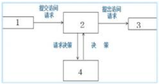

解析：​**标准访问控制流程为：主体(1)→实施部件(2)→客体(3)→决策部件(4)** （D正确）。NISP考试重点在于掌握访问控制模型的基本交互逻辑：​**主体发起请求，实施部件执行，客体接收访问，决策部件裁决**，这是访问控制系统的核心工作机制。

---

以下属于哪一种认证实现方式：用户登录时，认证服务器(Authentication Server, AS)产生一个随机数发送给用户，用户用某种单向算法将自己的口令、种子密钥和随机数混合计算后作为一次性口令，并发送给AS，AS用同样的方法计算后，验证比较两个口令即可验证用户身份  
A.口令序列  
B.时间同步  
C.挑战/应答  
D.静态口令  
正确答案：C 我的答案：A

解析：**挑战/应答机制（C）** 的核心特征就是服务器生成随机数挑战（Challenge），客户端计算应答（Response）。题目描述的随机数交互过程是该机制的典型实现。NISP考试重点在于区分动态口令类型：**挑战/应答基于随机数，时间同步基于时间戳，口令序列基于预先计算的列表**。

---

以下哪个属性不会出现在防火墙的访问控制策略配置中：  
A.本局域网内地址  
B.百度服务器地址  
C.HTTP协议  
D.病毒类型  
正确答案：D 我的答案：B

解析：**防火墙访问控制策略基于五元组（源/目的IP、端口、协议）** ，不检测病毒类型（D）。病毒防护属于**防病毒网关或终端安全软件**的职能。NISP考试重点在于区分不同安全设备的防护边界：**防火墙工作在网络层，不进行应用层内容检测**。

---

某linux系统由于root口令过于简单，被攻击者猜解后获得了root口令，发现被攻击后，管理员更改了root口令，并请安全专家对系统进行检测，在系统中发现有一个文件的权限如下：  
-r-s--x--x 1 test tdst 10704 apr 15 2002 /home/test/sh  
请问以下描述哪个是正确的：  
A.该文件是一个正常文件，test用户使用的shell，test不能读该文件，只能执行  
B.该文件是一个正常文件，是test用户使用的shell，但test用户无权执行该文件  
C.该文件是一个后门程序，该文件被执行时，运行身份是root，test用户间接获得了root权限  
D.该文件是一个后门程序，由于所有者是test，因此运行这个文件时文件执行权限为test  
正确答案：C 我的答案：D

解析：**权限中的's'表示SUID位**，当test用户执行该文件时，会以文件所有者（test）的权限运行。由于文件不可读（r--），但可执行（--x），且设置了SUID，**很可能是精心构造的后门程序**（C正确）。NISP考试重点在于识别Linux特殊权限：**SUID权限可能被滥用进行权限提升**，是系统安全检查的重点。

---

某网站为了更好向用户提供服务，在新版本设计时提供了用户快捷登录功能，用户如果使用上次的IP地址进行访问，就可以无需验证直接登录，该功能推出后，导致大量用户账号被盗用，关于以上问题的说法正确的是：  
A.网站问题是由于开发人员不熟悉安全编码，编写了不安全的代码，导致攻击面增大，产生此安全问题  
B.网站问题是由于用户缺乏安全意识导致，使用了不安全的功能，导致网站攻击面增大，产生此问题  
C.网站问题是由于使用便利性提高，带来网站用户数增加，导致网站攻击面增大，产生此安全问题  
D.网站问题是设计人员不了解安全设计关键要素，设计了不安全的功能，导致网站攻击面增大，产生此问题  
正确答案：D 我的答案：B​​

解析：**IP信任机制属于设计缺陷**（D正确），非编码问题（A）或用户问题（B）。NISP考试重点在于区分安全责任：**设计阶段就应考虑"便捷性vs安全性"平衡**，IP地址易伪造，不能作为唯一认证因素。

---

风险分析是风险评估工作的一个重要内容，GB/T 20984-2007在资料性附录中给出了一种矩阵法来计算信息安全风险大小，如下图所示，图中括号应填那个：

  
A.安全资产价值大小等级  
B.脆弱性严重程度等级  
C.安全风险隐患严重等级  
D.安全事件造成损失大小  
正确答案：D 我的答案：B

解析：**GB/T 20984标准风险矩阵的纵轴应为"安全事件造成的损失大小"** （D正确），这是风险评估的最终量化指标。NISP考试重点在于掌握国家标准风险评估方法：**风险值=可能性×影响，其中影响维度即损失大小**，而非资产价值（A）或脆弱性程度（B）等中间要素。

---

ISO9001-2000标准在制定、实施质量管理体系以及改进其有效性时采用过程方法，通过满足顾客要求增进顾客满意。下图是关于过程方法的示意图，图中括号空白处应填写：

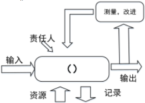  
A.策略  
B.管理者  
C.组织  
D.活动  
正确答案：D 我的答案：A

解析：**过程方法的核心是"活动-输入-输出"的转换过程**（D正确），图中空白处应填入"活动"这一关键要素。NISP考试重点在于理解质量管理体系的过程方法：**所有工作都应视为通过活动将输入转化为输出的过程**，这是ISO9001标准的基本管理理念。

---

等级保护实施根据GB/T 25058-2010《信息安全技术信息系统安全等级保护实施指南》分为五大阶段；()、总体规划、设计实施、()和系统终止。但由于在开展等级保护试点工作时，大量信息系统已经建设完成，因此根据实际情况逐步形成了()、备案、差距分析(也叫差距测评)、建设整改、验收测评、定期复查为流程的()工作流程。和《等级保护实施指南》中规定的针对()的五大阶段略有差异。  
A.运行维护;定级;定级;等级保护;信息系统生命周期  
B.定级;运行维护;定级;等级保护;信息系统生命周期  
C.定级运行维护;等级保护;定级;信息系统生命周期  
D.定级;信息系统生命周期;运行维护;定级;等级保护  
正确答案：B 我的答案：A

解析：**标准五大阶段为：定级→总体规划→设计实施→运行维护→系统终止**（B正确）。实际工作流程调整为：**定级→备案→差距分析→建设整改→验收测评→定期复查**，这是对已建系统的特殊处理。NISP考试重点在于掌握等级保护**标准流程与实际工作流程的对应关系**，特别是对已建系统的"回头看"式整改路径。

---

信息可以以多种形式存在。它可以打印写在纸上、以()、用邮寄或电子手段传递、呈现在片上使用是()。无论信息以什么形式存在，用哪种方法存储或共享，都宜对它进行适当的保护。()是保护信息受各种威胁的损害，以确保业务()，业务风险最小化，投资回报和()。  
A.语言表达;电子方式存储;信息安全;连续性;商业机遇最大化  
B.电子方式存储;语言表达;连续性;信息安全;商业机遇最大化  
C.电子方式存储;连续性;语言表达;信息安全;商业机遇最大化  
D.电子方式存储;语言表达;信息安全;连续性;商业机遇最大化  
正确答案：D 我的答案：A

解析：**完整描述应为：电子方式存储（第一空）、语言表达（第二空）、信息安全（第三空）、连续性（第四空）、商业机遇最大化（第五空）** （D正确）。NISP考试重点在于理解信息安全的**全生命周期保护理念**，无论信息以何种形式存在或传递，都需要确保其**保密性、完整性和可用性**，最终实现业务连续性和商业价值最大化。

---

若一个组织声称自己的ISMS符合ISO/IEC 27001或GB/T22080标准要求，其信息安全控制措施通常在以下方面实施常规控制，以下哪个选项的内容不属于常规控制措施的范围：  
A.安全事件管理、供应商关系、业务安全性审计  
B.信息安全方针、信息安全组织、资产管理  
C.安全采购、开发与维护、合规性  
D.人力资源安全、物理和环境安全、通信安全  
正确答案：A 我的答案：C

解析：**ISO27001标准14个控制域中不包含"业务安全性审计"** （A错误），这是内部审计的范畴。其他选项均属于标准控制域：B选项对应"信息安全方针/组织/资产管理"（A.5/A.6/A.8），C选项对应"供应商关系/系统开发/合规"（A.15/A.14/A.18），D选项对应"人力资源/物理安全/通信安全"（A.7/A.11/A.13）。NISP考试重点在于掌握**ISO27001标准附录A的14个控制域分类**，特别是要区分标准控制措施与组织内部管理活动的差异

---

恢复时间目标(Recovery Time Objective，RTO)和恢复点目标(Recovery Point Objective，RPO)是业务连续性和灾难恢复工作中的两个重要指标，随着信息系统越来越重要和信息技术越来越先进，这两个指标的数值越来越小。小华准备为其工作的信息系统拟定RTO和RPO指标，则以下描述中，正确的是：  
A.RTO不可以为0，RPO也不可以为0  
B.RTO可以为0，RPO也可以为0  
C.RTO可以为0，RPO不可以为0  
D.RTO不可以为0，RPO可以为0  
正确答案：B 我的答案：D

解析：**理论上RTO和RPO均可为0**（B正确），这表示系统实现零中断和零数据丢失，是灾备的最高目标。随着**双活数据中心、持续数据保护(CDP)等技术的成熟**，这种理想状态已成为可能。NISP考试重点在于理解RTO/RPO的极限值含义：**RTO=0表示即时恢复，RPO=0表示无数据丢失**，二者共同构成业务连续性的完美解决方案。

---

某网络安全公司基于网络的实时入侵检测技术，动态监测来自于外部网络和内部网络的所有访问行为。当检测到来自内外网络针对或通过防火墙的攻击行为，会及时响应，并通知防火墙实时阻断攻击源，从而进一步提高了系统的抗攻击能力，更有效地保护了网络资源，提高了防御体系级别。但入侵检测技术不能实现以下哪种功能：  
A.防止IP地址欺骗  
B.核查系统的配置漏洞，评估系统关键资源和数据文件的完整性  
C.识别违反安全策略的用户活动  
D.检测并分析用户和系统的活动  
正确答案：A 我的答案：B

解析：**入侵检测系统(IDS)的核心功能是监测和分析**（C/D正确），高级IDS可进行配置核查（B正确），但**无法直接防止IP欺骗**（A错误），这需要网络层防护措施。NISP考试重点在于区分IDS的检测能力与防护限制：**IDS是"监测"系统，防火墙/认证系统才是"防护"手段**，IP欺骗需通过加密认证等技术防范。

---

某IT公司针对信息安全事件已经建立了完善的预案，在年度企业信息安全总结会上，信息安全管理员对今年应急预案工作做出了四个总结，其中有一项总结工作是错误，作为企业的CSO，请你指出存在问题的是哪个总结：  
A.公司成立了信息安全应急响应组织，该组织由业务和技术人员组成，划分成应急响应领导小组、技术保障小组、专家小组、实施小组和日常运行小组  
B.公司应急预案包括了基础环境类、业务系统类、安全事件类和其他类，基本覆盖了各类应急事件类型  
C.公司制定的应急演练流程包括应急事件通报、确定应急事件优先级、应急响应启动实施、应急响应时间后期运维、更新现有应急预案五个阶段，流程完善可用  
D.公司应急预案对事件分类依据GB/Z 20986-2007《信息安全技术信息安全事件分类分级指南》，分为7个基本类别，预案符合国家相关标准  
正确答案：C 我的答案：B

解析：**应急演练流程不应包含"后期运维和预案更新"** （C错误），这两项属于应急响应实际发生后的处置环节。其他选项均正确描述了应急管理的要素：组织架构（A）、预案分类（B）和标准符合性（D）。NISP考试重点在于掌握**应急演练的标准流程**：准备→演练→评估→改进，与真实应急响应的处置流程有明确区分。

---

目前，信息系统面临外部攻击者的恶意攻击威胁，从威胁能力和掌握资源分，这些威胁可以按照个人威胁、组织威胁和国家威胁三个层面划分，则下面选项中属于组织威胁的是：  
A.喜欢恶作剧、实现自我挑战的娱乐型黑客  
B.巩固战略优势，执行军事任务、进行目标破坏的信息作战部队  
C.实施犯罪、获取非法经济利益网络犯罪团伙  
D.搜集政治、军事、经济等情报信息的情报机构  
正确答案：C 我的答案：B

解析：**组织威胁指有组织的犯罪团伙或商业间谍**（C正确），以经济利益为主要目标。个人威胁（A）动机多为炫耀技术，国家威胁（B/D）涉及军事或情报活动。NISP考试重点在于区分威胁来源的层级特征：**组织威胁具有持续性、专业性和明确牟利目的**，是企业和机构面临的主要威胁类型。

---

王工是某单位的系统管理员，他在某次参加了单位组织的风险管理工作时，发现当前案例中共有两个重要资产：资产A1和资产A2；其中资产A1面临两个主要威胁：威胁T1和威胁T2；而资产A2面临一个主要威胁：威胁T3；威胁T1可以利用的资产A1存在的两个脆弱性：脆弱性V1和脆弱性V2；威胁T2可以利用的资产A1存在的三个脆弱性，脆弱性V3、脆弱性V4和脆弱性V5；威胁T3可以利用的资产A2存在的两个脆弱性：脆弱性V6和脆弱性V7。根据上述条件，请问：使用相乘法时，应该为资产A1计算几个风险值：  
A.3  
B.6  
C.5  
D.2  
正确答案：C 我的答案：B

解析：**风险值计算采用"威胁×脆弱性"相乘法**，资产A1的T1威胁对应2个脆弱性（2风险值），T2威胁对应3个脆弱性（3风险值），合计5个风险值（C正确）。NISP考试重点在于掌握风险量化方法：**每个威胁-脆弱性组合都产生独立风险值**，需分别计算后汇总。

---

在国家标准GB/T 20274.1-2006《信息安全技术信息系统安全保障评估框架第一部分：简介和一般模型》中，信息系统安全保障模型包含哪几个方面：  
A.保障要素、生命周期和运行维护  
B.保障要素、生命周期和安全特征  
C.规划组织、生命周期和安全特征  
D.规划组织、生命周期和运行维护  
正确答案：B 我的答案：A

解析：**国家标准明确的三维模型包含：保障要素（技术/管理/工程）、生命周期（规划/设计/实施等阶段）、安全特征（保密性/完整性/可用性）** （B正确）。NISP考试重点在于掌握我国信息系统安全保障评估框架的核心结构：**三维模型全面覆盖信息安全的要素、过程和属性**，是评估工作的理论基础。

---

北京某公司利用SSE-CMM对其自身工程队伍能力进行自我改善，其理解正确的是：  
A.达到SSE-CMM最高级以后，工程队伍执行同一个过程，每次执行的结果质量必须相同  
B.SSE-CMM强调系统安全工程与其他工程学科的区别性和独立性  
C.系统安全工程能力成熟度模型(SSE-CMM)定义了3个风险过程：评价威胁，评价脆弱性，评价影响  
D.系统安全工程能力成熟度模型(SSE-CMM)定义了6个能力级别，当工程队伍不能执行一个过程域中的基本实践时，该过程域的过程能力是0级  
正确答案：D 我的答案：A

解析：**SSE-CMM确实定义0-5级共6个能力级别**（D正确），0级表示未执行基本实践。其他选项均错误：A错在"质量必须相同"（成熟度不保证结果一致），B错在强调"独立性"（实际强调多学科融合），C漏了"评估安全风险"过程。NISP考试重点在于掌握SSE-CMM的分级标准：**0级（未执行）→1级（非正式执行）→5级（持续优化）** 的演进路径。

---

应急响应是信息安全事件管理的重要内容。基于应急响应工作的特点和事件的不规则性，事先制定出事件应急响应方法和过程，有助于一个组织在事件发生时阻止混乱的发生或是在混乱状态中迅速恢复控制，将损失和负面影响降到最低。应急响应方法和过程并不是唯一的。一种被广为接受的应急响应方法是将应急响应管理过程分为6个阶段，为准备-\>检测-\>遏制-\>根除-\>恢复-\>跟踪总结。请问下列说法有关于信息安全应急响应管理过程错误的是：  
A.应按照应急响应计划中事先制定的业务恢复优先顺序和恢复步骤，顺次恢复相关的系统  
B.在检测阶段，首先要进行监测、报告及信息收集  
C.遏制措施可能会因为事件的类别和级别不同而完全不同。常见的遏制措施有：完全关闭所有系统、拔掉网线等  
D.确定重要资产和风险，实施针对风险的防护措施是信息安全应急响应规划过程中最关键的步骤  
正确答案：C 我的答案：D

解析：**遏制措施应精准针对受影响系统**（C错误），"完全关闭所有系统"属于过度反应。其他选项均正确：A符合业务优先级恢复原则，B是标准检测流程，D是应急准备核心工作。NISP考试重点在于掌握应急响应**适度原则**：遏制阶段需平衡安全影响与业务连续性，避免"一刀切"式处置。

---

对信息安全事件的分级参考下列三个要素：信息系统的重要程度、系统损失和社会影响。依据信息系统的重要程度对信息系统进行划分，不属于正确划分级别的是：  
A.特别重要信息系统  
B.重要信息系统  
C.关键信息系统  
D.一般信息系统  
正确答案：C 我的答案：A

解析：**我国标准将信息系统划分为三级：特别重要、重要和一般**（A/B/D正确），"关键信息系统"（C）并非官方分类。NISP考试重点在于掌握《信息安全技术信息安全事件分类分级指南》的**标准分级体系**，该分类直接关联事件应急处置的优先级和资源配置。

---

关于ARP欺骗原理和防范措施，下面理解错误的是：  
A.ARP欺骗是指攻击者直接向受害者主机发送错误的ARP应答报文，使得受害者主机将错误的硬件地址映射关系存入到ARP缓存中，从而起到冒充主机的目的  
B.解决ARP欺骗的一个有效方法是采用"静态"的ARP缓存，如果发生硬件地址的更改，则需要人工更新缓存  
C.单纯利用ARP欺骗攻击时，ARP欺骗通常影响的是内部子网，不能跨越路由实施攻击  
D.彻底解决ARP欺骗的方法是避免使用ARP协议和ARP缓存，直接采用IP地址和其他主机进行连接  
正确答案：D 我的答案：A

解析：**ARP协议是TCP/IP网络的基础协议**（D错误），完全禁用将导致网络通信瘫痪。其他选项正确描述了ARP欺骗特性：欺骗原理（A）、静态绑定防护（B）和攻击范围（C）。NISP考试重点在于理解**ARP协议的必要性和安全加固方法**，如端口安全、ARP检测等二层防护技术。

---

以下哪一项没有体现CC标准的先进性：  
A.实用性，将CC的安全性要求具体应用到IT产品的开发、生产、测试和评估过程中  
B.结构的开放性，即功能和保证要求都可以在具体的“保护轮廓”和“安全目标”中进一步细化和扩展  
C.表达方式的通用性，即给出通用的表达方式  
D.独立性，它强调将安全的功能和保证分离  
正确答案：D 你的答案：C

解析：**CC标准的先进性体现在实用性（A）、结构开放性（B）和通用表达方式（C）** ，而 **“功能与保证分离”并非CC首创**（D错误），该概念最早由ITSEC提出，CC仅是继承而非创新9。NISP考试重点在于区分CC的核心贡献：**保护轮廓（PP）机制和国际化标准整合能力**，而非基础理论突破。

---

‍

某电子商务网站在开发设计时，使用了威胁建模方法来分析电子商务网站所面临的威胁。STRIDE是微软SDL中提出的威胁建模方法，将威胁分为六类，为每一类威胁提供了标准的消减措施，Spoofing是STRIDE中**欺骗类**的威胁，以下威胁中哪个可以归入此类威胁：  
A.网站竞争对手可能雇佣攻击者实施DDoS攻击，降低网站访问速度  
B.网站使用用户名、密码进行登录验证，攻击者可能会利用**~~弱口令或其他方式获得用户密码~~**，以该用户身份登录修改用户订单等信息  
C.网站使用使用http协议进行浏览等操作，无法确认数据与用户发出的是否一致，可能数据被中途篡改  
D.网站使用使用http协议进行浏览等操作，未对数据进行加密，可能导致用户传输信息泄露，例如购买的商品金额等  
正确答案：B 我的答案：C

解析：**Spoofing（欺骗）威胁特指身份冒充**（B正确），如密码窃取后伪装合法用户。DDoS（A）属于拒绝服务，数据篡改（C）属于篡改（Tampering），信息泄露（D）属于信息泄露（Information Disclosure）。NISP考试重点在于掌握STRIDE模型六类威胁：**欺骗（S）、篡改（T）、抵赖（R）、信息泄露（I）、拒绝服务（D）和权限提升（E）** ，需准确区分各类威胁特征。

---

下列关于软件安全开发中的BSI(Build Security In)系列模型说法**错误**的是：  
A.软件安全的三根支柱是风险管理、软件安全触点和安全知识  
B.BSI含义是指将安全内建到软件开发过程中，而不是可有可无，更不是游离于软件开发生命周期之外  
C.BSI系列模型强调**~~安全测试~~**的重要性，要求安全**~~测试~~**贯穿整个开发过程及软件生命周期  
D.软件安全触点是软件开发生命周期中一套轻量级最优工程化方法，它提供了从不同角度保障安全的行为方式  
正确答案：C 你的答案：D

解析：**BSI模型的核心是"预防性安全措施"而非测试**（C错误），其三大支柱为风险管理、安全触点和安全知识（A正确）。NISP考试重点在于理解BSI模型的**主动防御理念**：通过需求分析、架构设计等触点（D）将安全内建（B）到SDLC中，而非依赖后期的安全测试。

---

在信息安全风险管理过程中，**背景建立**是实施工作的第一步。下面哪项理解是**错误**的：  
A.背景建立阶段应分析信息系统的体系结构和关键要素，分析信息系统的安全环境和要求，形成信息系统的安全要求报告  
B.背景建立阶段应调查信息系统的业务目标、业务特性、管理特性和技术特性，形成信息系统的描述报告  
C.背景建立阶段应识别需~~要保护的资产、面临的威胁以及存在的脆弱性~~，并分别赋值，同时确认已有的安全措施，形成需要保护的资产清单  
D.背景建立的依据是国家、地区或行业的相关政策、法律、法规和标准，以及机构的使命、信息系统的业务目标和特性  
正确答案：C 我的答案：D

解析：**资产识别和赋值属于风险要素识别阶段**（C错误），而非背景建立阶段。背景建立主要完成系统描述（B）、安全要求确定（A）和政策符合性分析（D）。NISP考试重点在于区分风险管理各阶段任务：**背景建立→资产识别→风险分析→风险处置**，C选项内容属于第二阶段工作。

---

有关**系统安全工程-能力成熟度模型(SSE-CMM)** 中的通用实施(Generic Practices，GP)**错误**的理解是：  
A.在工程实施时，GP应该作为基本实施(Base Practices，BP)的一部分加以执行  
B.GP适用于域维中部分过程区域(Process Areas, PA)的活~~动而非所有PA的活动~~  
C.在评估时，GP用于判定工程组织执行某个PA的能力  
D.GP是涉及过程的管理、测量和制度化方面的活动  
正确答案：B 你的答案：C

解析：**通用实施(GP)适用于所有过程区域(PA)** （B错误），是跨PA的共性实践。其他选项正确描述了GP特性：与基本实施(BP)协同执行（A）、用于能力评估（C）、聚焦过程管理（D）。NISP考试重点在于掌握SSE-CMM的双维结构：**11个PA（过程域）和5个GP（公共特征）共同构成能力成熟度评估框架**。

---

Gary McGraw博士及其合作者提出软件安全应由三根支柱来支撑，这**三个支柱**是：  
A.威胁建模、源代码审核和模糊测试  
B.应用**风险管理、软件安全接触点和安全知识**  
C.威胁建模、渗透测试和软件安全接触点  
D.源代码审核、风险分析和渗透测试  
正确答案：B 你的答案：A

解析：**软件安全三大支柱为风险管理（贯穿生命周期）、安全触点（SDLC关键环节）和安全知识（最佳实践）** （B正确）。其他选项混淆了具体技术手段（A/C/D）与体系化框架。NISP考试重点在于掌握BSI模型核心思想：**将安全内建到开发全流程**，而非依赖后期测试（如模糊测试/渗透测试）。

---

软件存在漏洞和缺陷是不可避免的，实践中常使用**软件缺陷密度**(Defects/KLOC)来衡量软件的安全性。假设某个软件共有296万行源代码，总共被检测出145个缺陷，则可以计算出其软件**缺陷密度值**是：​​  
A.49  
B.0.49  
C.0.00049  
**D.0.049**  
正确答案：D 你的答案：C

解析：**缺陷密度=缺陷数/(代码行数/1000)=145/(2,960,000/1000)=0.049缺陷/KLOC**（D正确）。NISP考试重点在于掌握软件安全度量方法：**千行代码缺陷率（Defects/KLOC）是行业通用基准**，计算时需注意单位换算（每千行而非每行）。

---

ISO9001-2000标准鼓励在制定、实施质量管理体系以及改进其有效性时采用过程方法，通过满足顾客要求，增进顾客满意度。下图是关于过程方法的示意图，图中括号空白处应填写：

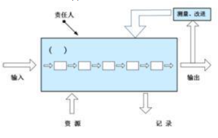  
A.策略  
B.活动  
C.组织  
D.管理者  
正确答案：B 你的答案：D

解析：**过程方法的核心是"活动-输入-输出"转换模型**（B正确），图中空白处应填入"活动"这一关键要素。NISP考试重点在于理解ISO9001的过程方法：**所有工作都应视为通过活动将输入转化为输出的过程**，这是质量管理体系的基础逻辑。

---

以下关于互联网协议安全(Internet Protocol Security, IPsec)协议说法**错误**的是：  
A.IPsec**仅能**保证传输数据的可认证性和保密性  
B.验证头协议(Authentication Head，AH)和IP封装安全载荷协议(Encapsulating Security Payload，ESP)都能以传输模式和隧道模式工作  
C.在隧道模式中，保护的是整个互联网协议(Internet Protocol，IP)包，包括IP头  
D.在传送模式中，保护的是IP负载  
正确答案：A 你的答案：B

解析：**IPsec不仅能提供认证和保密，还能保证数据完整性**（A错误），这是其三大核心安全服务。其他选项正确描述了IPsec特性：AH/ESP的工作模式（B）、隧道模式范围（C）和传输模式范围（D）。NISP考试重点在于掌握IPsec的**三大功能：认证（AH）、加密（ESP）和完整性保护**，以及两种封装模式的区别。

---

下列选项中对**信息系统**审计概念的描述中**不正确**的是：  
A.信息系统审计，也可称作IT审计或信息系统控制审计  
B.信息系统审计是一个获取并评价证据的过程，审计对象是信息系统相关控制，审计目标则是判断信息系统是否能够保证其安全性、可靠性、经济性以及数据的真实性、完整性等相关属性  
C.信息系统审计是单一的概念，**~~是对会计信息系统~~**的安全性、有效性进行检查  
D.从信息系统审计内容上看，可以将信息系统审计分为不同专项审计，例如安全审计、项目合规审计、绩效审计等  
正确答案：C 你的答案：D

解析：**信息系统审计是综合性概念**（C错误），涵盖<u>各类信息系统</u>（非仅会计系统）的多维度评估。其他选项正确描述了审计特性：别称（A）、过程定义（B）和分类方式（D）。NISP考试重点在于理解信息系统审计的**广泛适用性**：覆盖技术控制、管理控制和业务合规性等多个层面。

---

终端访问控制器访问控制系统(TACACS)在认证过程中，客户机发送一个START包给服务器，包的内容包括执行的认证类型、用户名等信息。START包只在一个认证会话开始时使用一个，序列号永远为()。服务器收到START包以后，回送一个REPLY包，表示认证继续还是结束。  
A.0  
**B.1**  
C.2  
D.4  
正确答案：B 你的答案：A

解析：**TACACS协议规定START包序列号固定为1**（B正确），后续REPLY包序列号递增。NISP考试重点在于掌握TACACS认证流程细节：**START（1）→REPLY（2）→CONTINUE（3）** 的序列号递增机制，这是协议设计的核心特征。

---

访问控制方法可分为自主访问控制、强制访问控制、基于角色访问控制和基于规则访问控制，它们具有不同的特点和应用场景。如果需要选择一个访问控制模型，要求能够支**持最小特权原则和职责分离原则**，而且在不同的系统配置下可以具有不同的安全控制，那么在(1)自主访问控制，(2)强制访问控制，(3)**基于角色的访问控制，(4)基于规则的访问控制中**，能够满足以上要求的选项有：  
A.只有(1)(2)  
B.只有(2)(3)  
**C.只有(3)(4)**   
D.只有(4)  
正确答案：C 你的答案：B

解析：**基于角色（RBAC）和基于规则（RuBAC）的访问控制**（C正确）能同时满足最小特权和职责分离要求，且配置灵活。强制访问控制（MAC）过于刚性（B错误），自主访问控制（DAC）难以实现权限约束（A错误）。NISP考试重点在于理解不同访问控制模型的适用场景：**RBAC通过角色权限分离实现最小特权，RuBAC通过策略规则实现动态控制**。

---

分析针对Web的攻击前，先要明白http协议本身不存在安全性问题，攻击者不会把它当作攻击对象。而是应用了http协议的服务器或客户端、以及运行的服务器web应用资源才是攻击目标。针对**Web应用的攻击**，我们归纳出了12种，小陈列举了其中的4种，在这四种当中错误的是：  
A.拒绝服务攻击  
B.网址重定向  
C.传输保护不足  
**D.错误的访问控制**  
正确答案：D 你的答案：C

解析：**错误的访问控制属于系统设计缺陷**（D错误），而非针对Web应用的攻击类型。其他选项均为典型的Web攻击：DoS攻击资源（A）、重定向钓鱼（B）、明文传输嗅探（C）。NISP考试重点在于区分**针对Web应用的攻击手段与系统安全缺陷**，OWASP Top 10中的攻击类型均针对应用层漏洞。

---

1998 年英国公布标准的第二部分《信息安全管理体系规范》，规定()管理体系要求与()要求，它是一个组织的全面或部分信息安全管理体系评估的()，它可以作为一个正式认证方案的()。BS 7799-1与 BS7799-2 经过修订于 1999 年重新予以发布，1999 版考虑了信息处理技术，尤其是在网络和通信领域应用的近期发展，同时还非常强调了商务涉及的信息安全及()的责任。

A. 信息安全;<u>信息安全控制</u>;**根据**;**基础**;信息安全  
B. ~~信息安全控制;信息安全，根据;基础;信息安全
C. 信息安全控制;信息安全;基础;根据;信息安全~~  
D. 信息安全;<u>信息安全控制</u>;基础;根据，信息安全

正确答案：A 我的答案：D

**BS 7799-2标准的核心内容**：该标准规定了**信息安全**管理体系要求与**信息安全控制**要求，是评估的**根据**，并作为认证的**基础**。1999年修订版强化了**信息安全责任**，尤其关注网络和通信技术的发展。**易错点在于“根据”和“基础”的顺序**，正确顺序应为“根据”在前。BS 7799是ISO/IEC 27001的前身，奠定了现代信息安全管理体系（ISMS）的基础。

---

2006 年5月8日电，中共中央办公厅、国务院办公厅印发了《2006-2020年国家信息化发展战略》。全文分()部分共计约 15000余字。对国内外的信息化发展做了宏观分析，对我国信息化发展指导思想和战略目标标准要阐述，对我国()发展的重点、行动计划和保障措施做了详尽描述。该战略指出了我国()发展的()，当前我国信息安全保障工作逐步加强。制定并实施了(),初步建立了信息安全管理体制和)。基础信息网络和重要信息系统的安全防护水平明显提高，互联网信息安全管理进一步加强。  
A.5个; 信息化; 基本形势;国家安全战略;工作机制  
**B.6个**;信息化;基本形势 **;国家信息安全战略**;工作机制  
C.7个;信息化;基本形势;国家安全战略;工作机制  
D.8个;信息化;基本形势;**国家信息安全战略**;工作机制

正确答案：B 我的答案：D  
 **《2006-2020年国家信息化发展战略》是我国信息化发展的重要纲领性文件**。全文共分为**6个部分**，内容涵盖信息化发展的指导思想、战略目标、重点任务和保障措施等。该战略明确指出了我国信息化发展的**基本形势**，并强调制定实施了**国家信息安全战略**，初步建立了信息安全**工作机制**。**关键点在于区分"国家安全战略"和"国家信息安全战略"** ，在信息化领域应选择后者。文件标志着我国将信息安全提升到国家战略高度，为后续网络安全立法奠定了基础。

---

张主任的计算机使用Windows7操作系统，他常登陆的用户名为zhang，张主任给他个人文件夹设置了权限为只有zhang这个用户有权访问这个目录，管理员在某次维护中无意将zhang这个用户删除了，随后又重新建了一个用户名为zhang，张主任使用zhang这个用户登陆系统后，发现无法访问他原来的个人文件夹，原因是()

A. 新建用户需要授权才能访问系统文件  
**B. 新建的zhang用户SID与原用户不同，系统视为不同用户**  
C. 用户删除后其文件夹自动删除  
D. 新建用户会继承原用户权限但文件夹已加密

正确答案：B 我的答案：C

**Windows权限机制的核心是SID（安全标识符）** 。系统通过唯一SID而非用户名识别用户，即使新建同名用户也会生成新SID，导致无法访问原用户权限设置的资源。这是Windows安全体系的基础特性，管理员需通过"取得所有权"功能重新分配权限。**实际工作中常见此类问题，解决方案是使用管理员账户重新配置文件夹权限**。

---

杀毒软件一般是通过对代码与特征库中的特征码进行比对，判断这个文件是否为恶意代码，如果是则联系到病毒库中对该病毒的描述，从而确认其行为，达到分析的目的。下列对恶意代码**静态分析的说法中，错误的是()**

A. 静态分析不需要实际执行恶意代码，它通过对其二进制文件的分析，获得恶意代码的基本结构和特征，了解其工作方式和机制  
B. 静态分析通过查找恶意代码二进制程序中嵌入的可疑字符串，如：文件名称、URL地址、域名、调用函数等来进行分析判断  
C. 静态分析检测系统函数的**运行状态**，数据流转换过程，能判别出恶意代码行为和正常软件操作  
D. 静态分析方法可以分析恶意代码的所**有执行路径**，但是随着程序复杂度的提高，冗余路径增多，会出现分析效率很低的情况

正确答案：C 我的答案：D

**静态分析与动态分析的核心区别**：静态分析仅检查代码本身而不执行，无法获取运行时状态。选项C描述的"检测系统函数运行状态"和"数据流转换过程"属于动态分析范畴。**关键点在于静态分析只能分析代码结构和特征，无法观察实际执行行为**。随着代码复杂度增加（选项D），静态分析确实会面临路径爆炸问题，这是其固有局限性。

---

数据库是一个单位或是一个应用领域的通用数据处理系统，它存储的是属于企业和事业部门、团体和个人的有关数据的集合。数据库中的数据是从全局观点出发建立的，按一定的数据模型进行组织、描述和存储。其结构基于数据间的自然联系，从而可提供一切必要的存取路径，且数据不再针对某一应用，而是面向全组织，具有整体的结构化特征。数据库作为应用系统数据存储的系统，毫无疑问会成为信息安全的重点防护对象。数据库安全涉及到数据资产的安全存储和安全访问，**对数据库安全要求不包括下列**()  
A. 向所有用户提供可靠的信息**服务**  
B. 拒绝执行不正确的数据操作  
C. 拒绝非法用户对数据库的访问  
D. 能跟踪记录，以便为<u>合规性检查、安全责任审查等提供证据和迹象</u>

正确答案：A 我的答案：D

**数据库安全的核心要求**主要聚焦于数据的机密性、完整性和可用性（CIA三要素）。选项A所述的"向所有用户提供可靠的信息服务"属于数据库系统的功能目标，而非安全要求范畴。**关键区分点在于：数据库安全关注的是防护措施（如访问控制、审计日志等），而非服务可用性**。其他选项B、C、D分别对应完整性保护、访问控制和审计追踪，都是典型的安全要求。

---

()在实施攻击之前，需要尽量收集伪装身份()，这些信息是攻击者伪装成功的()。例如攻击者要伪装成某个大型集团公司总部的()，那么他需要了解这个大型集团公司所处行业的一些行规或者()、公司规则制度、组织架构等信息，甚至包括集团公司中相关人员的绰号等等。

**A. 攻击者**；所需要的信息；系统管理员；基础；内部约定  
B. 所需要的信息；基础；攻击者；系统管理员；内部约定  
**C. 攻击者**；所需要的信息；**基础；** 系统管理员；内部约定  
D. 所需要的信息；攻击者；基础；系统管理员；内部约定

正确答案：C 我的答案：B  
**社会工程学攻击的关键在于身份伪装的信息收集**。攻击者需要获取目标的基础信息（如行业规范）和内部约定（如公司暗语）来伪装成系统管理员等可信身份。**核心考点是社会工程学的实施步骤：确定伪装身份→收集必要信息→构建可信形象**。实际防御中，企业应加强员工安全意识培训，建立身份验证机制。

---

风险评估相关政策，目前主要有()(国信办[2006]5号)。主要内容包括：分析信息系统资产的()，评估信息系统面临的()、存在的()、已有的安全措施和残余风险的影响等、两类信息系统的()、涉密信息系统参照"分级保护"、非涉密信息系统参照"等级保护"。

A.《关于开展**信息安全**风险评估工作的意见》；重要程度；**安全威胁**；**脆弱性**；**工作开展**  
B.《关于开展风险评估工作的意见》；安全威胁；重要程度；脆弱性；工作开展  
C.《关于开展风险评估工作的意见》；重要程度；安全威胁；脆弱性；工作开展  
D.《关于开展**信息安全**风险评估工作的意见》；脆弱性；重要程度；安全威胁；工作开展

正确答案：A 我的答案：C  
 **《关于开展信息安全风险评估工作的意见》(国信办[2006]5号)是我国信息安全风险评估工作的纲领性文件**。其核心内容包括：资产重要程度评估、安全威胁分析、系统脆弱性识别，并明确区分涉密系统(分级保护)和非涉密系统(等级保护)的不同管理要求。**关键点在于准确记忆文件全称和评估流程顺序**：资产→威胁→脆弱性。

---

由于病毒攻击、非法入侵等原因，校园网整体瘫痪，或者校园网络中心全部DNS主WEB服务器不能正常工作；由于病毒攻击、非法入侵、人为破坏或不可抗力等原因，造成**校园网出口中断**，属于以下哪种级别事件()

A. 特别重大事件  
B. 重大事件  
C. 较大事件  
D. **一般事件**

正确答案：D 我的答案：A  
**网络安全事件分级标准的核心考量是影响范围和恢复难度**。校园网瘫痪或出口中断属于局部网络故障，**<u>==影响范围限于单个单位，通常列为一般事件==</u>**。**关键区分点在于：特别重大事件需影响多个地区或关键基础设施，而校园网问题不在此列**。实际处置时应参考《网络安全事件应急预案》的具体分级标准，重点关注系统服务中断时长和影响用户规模。

---

以下关于开展软件安全开发必要性描述**错误**的是？()

A. 软件应用越来越广泛  
B. 软件应用场景越来越不安全  
C. 软件安全问题普遍存在  
**D. 以上都不是**

正确答案：D 我的答案：B  
**软件安全开发的必要性体现在多个方面**。选项A、B、C都正确描述了当前软件安全面临的挑战：软件应用普及（A）、应用环境风险增加（B）以及普遍存在的安全问题（C）。**关键点在于理解"以上都不是"作为错误选项的条件**，当其他选项都正确时，D就是错误描述。实际开发中，安全应贯穿软件生命周期全过程，从需求分析到部署维护。

---

灾备指标是指信息安全系统的容灾抗毁能力，主要包括四个具体指标：恢复时间目标(RTO)、恢复点目标(RPO)、降级操作目标(DOO)和网络恢复目标(NRO)。小华准备为其工作的信息系统拟定恢复点目标RPO-0，以下描述中，正确的是()。

A. RPO-0，相当于没有任何数据丢失，但需要进行业务恢复处理，覆盖原有信息  
B. RPO-0，相当于所有数据全部丢失，需要进行业务恢复处理，修复数据丢失  
C. RPO-0，相当于部分数据丢失，需要进行业务恢复处理，修复数据丢失  
D. RPO-0，相当于没有任何数据丢失，且不需要进行业务恢复处理

正确答案：A 我的答案：D

**解析：**   
**RPO-0是灾备领域的最高数据保护标准**，表示系统可以实现零数据丢失。但关键点在于：虽然数据不会丢失，业务恢复过程仍需执行以覆盖原有信息。**实际应用中，RPO-0通常需要同步数据复制技术支撑**，这对系统性能和成本要求较高。选项D错误在于忽略了必要的业务恢复处理环节，这是灾备方案实施的关键步骤。

---

关于信息安全事件管理和应急响应，以下说法**错误**的是

A. 应急响应是指组织为了应对突发/重大信息安全事件的发生所做的准备，以及在事件发生后所采取的措施  
B. 根据信息安全事件的分级参考要素，可将信息安全事件划分为4个级别：特别重大事件（Ⅰ级）、重大事件（Ⅱ级）、较大事件（Ⅲ级）和一般事件（Ⅳ级）  
C. 应急响应方法，将应急响应管理过程分为~~遏制、根除、处置、恢复、报告和跟踪6个阶段~~  
D. 对信息安全事件的分级主要参考信息系统的**重要程度**、**系统损失**和社会影响三方面因素

正确答案：C 你的答案：D

**解析：**   
**标准应急响应流程应为6个阶段：准备、检测、遏制、根除、恢复、跟踪**。选项C错误地将"处置"列为独立阶段，并遗漏了关键的"准备"和"检测"阶段。**关键点在于掌握NIST标准的应急响应生命周期模型**，这是信息安全事件处理的国际通用框架。实际响应中，准备阶段（预案制定等）往往决定事件处置的最终效果。

---

规范的实施流程和文档管理，是信息安全风险评估能否取得成功的重要基础。某单位在实施风险评估时，形成了《待评估信息系统相关设备及资产清单》。在风险评估实施的各个阶段中，该《<u>待评估信息系统相关设备及资产清单</u>》应是如下()中的输出结果。

A **. 风险要素识别**  
B. 风险结果判定  
C. 风险分析  
D. 风险评估准备

正确答案：A 我的答案：D

**解析：**   
**风险评估的核心流程阶段划分**：资产清单是风险要素识别阶段的关键产出物。**关键点在于理解风险评估各阶段的核心任务**：1)准备阶段确定评估范围和方法；2)风险要素识别阶段明确资产、威胁和脆弱性；3)风险分析阶段计算风险值；4)风险结果判定阶段评估风险等级。实际工作中，资产清单的完整性直接影响后续威胁分析和脆弱性评估的准确性。

---

随着信息安全涉及的范围越来越广，各个组织对信息安全管理的需求越来越迫切，越来越多的组织开始尝试使用参考ISO27001介绍的ISMS来实施信息安全管理体系，提高组织的信息安全管理能力。关于ISMS，下面描述**错误**的是()。

A. 组织的管理层应确保ISMS目标和相应的计划得以制定，信息安全管理目标应明确、可度量，风险管理计划应具体，具备可行性  
B. 组织的管理层应全面了解组织所面临的信息安全风险，决定风险可接受级别和风险可接受准则，并确认接受相关残余风险  
C. 组织的信息安全目标、信息安全方针和要求应传达至全组织范围内，应包括全体员工，同时，也应传达到客户、合作伙伴和供应商等外部各方  
D. 在组织中，应由**信息技术责任部门**(如信息中心)制定并颁布信息**安全方针**，为组织的ISMS建设指明方向并提供总体纲领，明确总体要求

正确答案：D 你的答案：C

**解析：**   
**ISMS(信息安全管理体系)的核心管理要求**：根据ISO27001标准，信息安全方针应由最高管理层（而非IT部门）制定和批准，体现领导层对信息安全的承诺。**关键点在于理解ISMS的"领导作用"原则**：1)方针制定是管理层职责；2)需要全员参与；3)需考虑外部相关方。实际实施中，常见误区就是将ISMS仅视为IT部门职责，而忽略了管理层的核心作用和跨部门协作要求。

---

我国等级保护**政策发展的正确顺序**是()  
①等级保护相关政策文件颁布  
②计算机系统安全保护等级划分思想提出  
③等级保护相关标准发布  
④网络安全法将等级保护制度作为基本国策  
⑤等级保护工作试点

A. ①②③④⑤  
B. ②⑤①③④  
C. ①⑤④②③  
D. ②③①⑤④

正确答案：B 你的答案：D

**解析：**   
**我国等级保护制度发展历程**的关键时间节点为：

1. 1994-1999年：计算机系统安全保护等级划分思想首次提出（②）
2. 2002-2006年：等级保护工作试点阶段（⑤）
3. 2004-2009年：相关政策文件陆续颁布（①）
4. 2008-2014年：等级保护标准体系逐步发布（③）
5. 2016年：《网络安全法》确立等级保护为基本国策（④）

**关键点在于把握政策演进的历史脉络**：从理论提出→实践试点→政策完善→标准制定→法律固化。这一发展路径体现了我国网络安全治理体系的不断完善和成熟。

---

数据在进行传输前，需要由协议栈自上而下对数据进行封装。TCP/IP协议中，数据封装的顺序是()。

A. 传输层、网络接口层、互联网络层  
B. **传**输层、互联**网络层**、网络接口层  
C. 互联网络层、传输层、网络接口层  
D. 互联网络层、网络接口层、传输层

正确答案：B 你的答案：D

**解析：**   
**TCP/IP协议栈的标准封装顺序**为：应用层→传输层→互联网络层→网络接口层。**关键点在于理解协议栈的层次结构**：传输层（TCP/UDP）添加端口信息→互联网络层（IP）添加IP包头→网络接口层添加帧头和帧尾。实际网络通信中，这个封装过程确保了数据能正确路由和传输，接收端则按相反顺序解封装。

---

分组密码算法是一类十分重要的密码算法，下面描述中，**错误**的是()。

A. 分组密码算法要求输入明文按组分成固定长度的块  
B ~~. 分组密码算法也称为序列密码算法~~  
C. 分组密码算法每次计算得到固定长度的密文输出块  
D. 常见的DES、IDEA算法都属于分组密码算法

正确答案：B 你的答案：D

**解析：**   
**分组密码与序列密码的核心区别**：分组密码对固定长度数据块加密（如DES的64位块），而序列密码逐比特/字节加密。**关键点在于：分组密码（如DES/AES）和序列密码（如RC4）是两类不同的对称加密技术**，不能混为一谈。实际应用中，分组密码需要配合工作模式（如CBC）来处理长报文，而序列密码更适合实时通信加密。

---

关于标准，下面哪项理解是**错误**的()

A. **标准**是在一定范围内为了获得最佳秩序，经协商一致制定并由公认机构批准，共同重复使用的一种**规范性文件**。标准是标准化活动的重要成果  
B. 行业标准是针对没有国家标准而又需要在全国某个行业范围内统一的技术要求而制定的标准。同样是强制性标准，当行业标准和国家标准的条款发生冲突时，应以国家标准条款为准  
C. 国际标准是由国际标准化组织通过并公开发布的标准。同样是强制性标准，当国家标准和国际标准的条款发生冲突时，应以国际标准条款为准  
D. 地方标准由省、自治区、直辖市标准化行政主管部门制定，并报国务院标准化行政主管部门和国务院有关行政主管部门备案，在公布国家标准之后，该地方标准即应废止

正确答案：C 你的答案：B

**解析：**   
**我国标准体系的核心原则是国家标准优先**。根据《标准化法》规定，当国家标准与国际标准冲突时，应以国家标准为准。**关键点在于理解标准的分级关系**：国际标准→国家标准→行业标准→地方标准→企业标准，下级标准不得与上级标准相抵触。实际应用中，企业需特别注意强制性国家标准的优先执行要求。

---

关于标准，下面哪项理解是**错误**的()。

A. 标准是在一定范围内为了获得最佳秩序，经协商一致制定并由公认机构批准，共同重复使用的一种规范性文件。标准是标准化活动的重要成果  
B. 行业标准是针对没有国家标准而又需要在全国某个行业范围内统一的技术要求而制定的标准。同样是强制性标准，当行业标准和国家标准的条款发生冲突时，应以国家标准条款为准  
C. 国际标准是由国际标准化组织通过并公开发布的标准。同样是强制性标准，当国家标准和国际标准的条款发生冲突时，~~应以国际标准条款为准~~  
D. 地方标准由省、自治区、直辖市标准化行政主管部门制定，并报国务院标准化行政主管部门和国务院有关行政主管部门备案，在公布国家标准之后，该地方标准即应废止

正确答案：C 你的答案：B

**解析：**   
**我国标准化体系的核心原则**是：国家标准优先于国际标准。根据《中华人民共和国标准化法》规定，当国家标准与国际标准冲突时，应以国家标准为准。**关键点在于理解标准的分级效力**：国家标准＞行业标准＞地方标准＞企业标准，国际标准在我国不具有强制优先性。实际应用中，企业应当优先执行强制性国家标准（GB），国际标准（如ISO）仅作为参考或自愿采用。

---

以下哪项的行为不属于违反国家保密规定的行为()

~~A. 以不正当手段获取商业秘密~~  
B. 在私人交往中涉及国家秘密  
C. 将涉国密计算机、涉密存储设备接入互联网及其他公共信息网络  
D. 通过普通邮政等无保密措施的渠道传递国家秘密载体

正确答案：A 你的答案：B

**解析：**   
**国家秘密与商业秘密的法律区分**是本题核心考点。根据《保守国家秘密法》，选项B、C、D均明确违反国家保密规定，而选项A涉及的是《反不正当竞争法》规范的商业秘密。**关键点在于：国家秘密关系国家安全和利益，而商业秘密属于企业知识产权范畴**。实际工作中需注意，即便不构成国家秘密违规，窃取商业秘密仍可能构成民事侵权或刑事犯罪。

---

主体和客体是访问控制模型中常用的概念。下面描述中**错误**的是

A. 主体是动作的实施者，比如人、进程或设备等均是主体，~~这些对象不能被当作客体使用~~  
B. 一个主体为了完成任务，可以创建另外的主体，这些主体可以独立运行  
C. 主体是访问的发起者，是一个主动的实体，可以操作被动实体的相关信息或数据  
D. 客体也是一种实体，是操作的对象，是被规定需要保护的资源

正确答案：A 你的答案：D

**解析：**   
**主体与客体的相对性**是访问控制模型的核心特性。在实际系统中，一个实体（如进程）既可以是执行操作的主体，也可以是被其他主体操作的客体。**关键点在于理解角色转换**：当管理员监控某个进程时，该进程就从主体转变为客体。这种动态关系在操作系统和分布式系统中尤为常见，是访问控制实现的基础机制。

---

《国家信息化领导小组关于加强信息安全保障工作的意见》中办发[2003]27号明确了我国信息安全保障工作的()、加强信息安全保障工作的()、需要重点加强的信息安全保障工作。27号文的重大意义是，它标志着我国信息安全保障工作有了()、我国最近十余年的信息安全保障工作都是围绕此政策性文件来()的、促进了我国()的各项工作。

A. 方针和总体要求；主要原则；总体纲领；展开和推进；信息安全保障建设  
B. 总体要求；总体纲领；主要原则；展开；信息安全保障建设  
C. 方针；主要原则；总体纲领；展开和推进；信息安全保障建设  
**D. 总体要求；主要原则；总体纲领；展开；信息安全保障建设**

正确答案：D 你的答案：C

**解析：**   
 **[2003]27号文是我国信息安全保障体系的纲领性文件**，其核心内容包含三个关键要素：1)明确总体要求；2)确立主要原则；3)形成总体纲领。**关键点在于准确记忆文件的结构性内容**：该文件提出了"积极防御、综合防范"的方针，构建了我国信息安全保障体系的基本框架，后续的等级保护、风险评估等工作都是在其指导下展开的。实际工作中，27号文至今仍是指导我国信息安全工作的顶层政策文件。

---

PDCA循环又叫戴明环，是管理学常用的一种模型。关于PDCA四个字母，下面理解**错误**的是()。

A. D是Do，指实施、具体运作，实现计划中的内容  
B. P是~~Prepare~~，指准备，包括明确对象、方法，制定活动规划  
C. A是Act或Adjust，指改进、完善和处理，对总结检查的结果进行处理，对成功的经验加以肯定，并予以标准化，总结失败的教训并加以重视，对没有解决的问题，应该交给下一个PDCA循环解决

正确答案：B 你的答案：C

**解析：**   
**PDCA循环的标准定义**：P代表Plan（计划），而非Prepare。**关键点在于掌握质量管理四阶段**：Plan（计划）→Do（执行）→Check（检查）→Act/Adjust（改进）。实际应用中，这个循环强调持续改进，每个阶段都有明确任务：计划阶段设定目标，执行阶段实施方案，检查阶段评估结果，改进阶段优化流程。理解这个模型对实施信息安全管理体系(ISMS)尤为重要。

---

以下说法**正确**的是()。

A. 软件测试计划开始于软件设计阶段，完成于软件开发阶段  
B. 验收测试是由承建方和用户按照用户使用手册执行软件验收  
C. 软件测试的目的是为了验证软件功能是否正确  
**D. 监理工程师应按照有关标准审查提交的测试计划，并提出审查意见**

正确答案：D 你的答案：未提供

**解析：**   
**软件测试全生命周期管理要点**：

1. 测试计划贯穿整个开发周期（A错误<u>，应延续至维护阶段</u>）
2. 验收测试依据需求<u>规格/合同</u>而非~~使用手册~~（B错误）
3. 测试目的包括验证功能、性能及合规性等（C表述不全面）
4. 监理的核心职责包括测试计划审查（D正确）

**关键实践标准**：根据GB/T 25000.51，测试活动需覆盖需求追踪、缺陷管理和过程审计，监理方需确保测试方案符合SOW及行业规范。

---

规范的实施流程和文档管理，是信息安全风险评估能否取得成果的重要基础。某单位在实施风险评估时，按照规范形成了若干文档，其中，下面()中的文档应属于风险评估中"**风险要素识别**"阶段输出的文档。

A. 《风险评估方法和工具列表》，主要包括拟用的风险评估方法和评估工具等内容  
B **. 《已有安全措施列表》，** 主要包括经检查确认后的已有技术和管理方面安全措施等内容  
C. 《风险评估方案》，主要包括本次风险评估的目的、范围、目标、评估步骤、经费预算和进度安排等内容  
D. 《风险评估准则要求》，主要包括现有风险评估参考标准、采用的风险分析方法、资产分类标准等内容

正确答案：B 你的答案：C

**解析：**   
**风险评估各阶段的核心输出文档**：

1. 准备阶段输出《风险评估方案》（C选项）
2. 风险要素识别阶段输出《资产清单》《威胁列表》《脆弱性列表》及《已有安全措施列表》（B选项）
3. 风险分析阶段输出《风险计算报告》

**关键区分点**：《已有安全措施列表》是识别阶段对现有防护措施的登记确认，直接影响后续风险计算中的安全措施有效性评估。而《风险评估方案》属于前期规划文档，应在准备阶段完成。

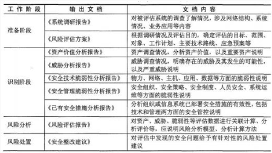

---

近几年，无线通信技术迅猛发展，广泛应用于各个领域。而无线信道是一个开放性信道，它在赋予无线用户通信自由的同时也给无线通信网络带来一些不安全因素，下列选项中，对无线通信技术的安全特点描述**正确**的是()

A. 无线信道是一个开放信道，~~任何~~具有适当无线设备的人均可以通过~~搭线窃听~~而获得网络通信内容  
B. 通过传输流分析，攻击者可以掌握~~精确~~的通信内容  
C. 对于无线局域网络和无线个人区域网络来说，它们的通信内容<u>更容易被窃听</u>  
D. 群通信方式~~可以防止~~网络外部人员获取网络内部通信内容

正确答案：C 你的答案：B

**解析：**   
**无线通信安全的核心脆弱性**主要体现在：

1. 无线信号的空间传播特性（正确答案C），使WLAN/WPAN更易遭受中间人攻击
2. 攻击者通常通过**无线嗅探**（非搭线）获取通信内容（A错误）
3. 加密传输可防止获取精确内容（B过度夸大）
4. 群通信易造成密钥管理漏洞（D完全错误）

**防护要点**：应采用WPA3加密、MAC地址过滤、隐藏SSID等综合措施，并特别注意物联网设备的无线安全配置。

---

以下哪种风险被认为是合理的风险()。

A. 残余风险  
B. 未识别的风险  
C. **可接受的风险**  
D. 最小的风险

正确答案：C 你的答案：D

**解析：**   
**风险管理中的核心概念区分**：

1. 可接受风险（正确答案）是指组织经评估后**决定承担的风险**，通常已采取控制措施将风险降至可容忍水平
2. 残余风险是采取控制措施后剩余的风险，未必都可接受
3. 最小风险是理论最优状态，实际运营中难以实现

**关键决策依据**：根据ISO 31000标准，风险可接受性取决于组织的风险偏好、处置成本与潜在影响的平衡。实际工作中需通过风险处置将残余风险调整至可接受范围。

---

数据链路层负责监督**相邻网络节点的信息流动**，用检错或纠错技术来确保正确的传输，确保解决该层的流量控制问题。数据链路层的数据单元是()

A. 报文  
B. 比特流  
**C. 帧**  
D. 包

正确答案：C 你的答案：B

**解析：**   
**OSI模型各层数据单元的核心对应关系**：

1. 物理层处理比特流（B选项）
2. 数据链路层处理帧（正确答案C），包含帧头、载荷和帧尾
3. 网络层处理包/分组（D选项）
4. 传输层处理报文/段（A选项）

**关键协议实现**：以太网（IEEE 802.3）、PPP等数据链路层协议均采用帧结构，通过FCS字段实现差错检测。实际网络分析中，Wireshark等工具可直接捕获和解析数据链路层帧结构。

---

‍

**内容安全是我国信息安全保障工作中的一个重要环节，互联网所带来的数字资源大爆发使得内容安全越来越受到重视，以下哪个描述不属于内容安全的范畴**

A：某杂志在线网站建立内容正版化审核团队，对向网站投稿的内容进行版权审核，确保无侵犯版权行为后才能在网站发布  
B：某网站采取了技术措施，限制对同一IP地址对网站的并发连接，避免爬虫通过大量的访问采集网站发布数据  
C：某论坛根据相关法律要求，进行了大量的关键词过滤，使用户无法发布包含被过滤关键词的相关内容  
D：某论坛根据国家相关法律要求，为了保证用户信息泄露，对所有用户信息，包括用户名、密码、身份证号等都进行了加密的存储  
正确答案：D 我的答案：B

**内容安全的核心是保障信息的合法性和合规性**，包括版权保护（A）和内容过滤（C）。B选项的反爬虫措施属于系统安全防护，D选项的用户数据加密属于数据安全范畴。**NISP考点重点在于区分内容安全与系统安全、数据安全的边界**，内容安全主要针对信息内容本身的管理，而非技术防护或数据保护措施。

---

**以下对单点登录技术描述不正确的是：（）**

A：单点登录技术实质是安全凭证在多个用户之间的传递或共享  
B：使用单点登录技术用户只需在登录时进行一次注册，就可以访问多个应用  
C：单点登录不仅方便用户使用，而且也便于管理  
D：使用单点登录技术能简化应用系统的开发

正确答案：A 我的答案：C

**解析**：单点登录（SSO）的核心是**安全凭证在应用系统间共享**，而非用户之间（A错误）。B/C/D均为SSO的正确特性：实现一次认证多系统访问（B）、提升用户体验（C）、降低开发成本（D）。**NISP考点在于掌握SSO的技术原理**，其通过中央认证服务实现跨系统身份验证，重点区分"用户间"与"系统间"的凭证传递差异。

---

**自主访问控制是应用很广泛的访问控制方法，常用于多种商业系统中。以下对DAC模型的理解中，存在错误的是（）**

A：在DAC模型中，资源的所有者可以规定谁有权访问它们的资源  
B：DAC是一种对单个用户执行访问控制的过程和措施  
C：DAC可为用户提供灵活调整的安全策略，具有较好的易用性可扩展性，可以抵御特洛伊木马的攻击  
D：在DAC中，具有某种访问能力的主体能够自主地将访问权的某个子集授予其它主体

正确答案：A、C、D 我的答案：B、C

**解析**：**DAC（自主访问控制）的核心缺陷是无法抵御特洛伊木马攻击（C错误）** ，因其允许权限自主传递（D正确）。资源所有者确实可规定访问权限（A正确），但题目要求选择"错误理解"，故A、C、D符合。**NISP考点聚焦DAC的权限传递风险**，其灵活性同时带来安全弱点，需结合强制访问控制（MAC）弥补。B选项描述正确，DAC确实针对单个用户实施访问控制。

---

**关于微软的SDL原则，弃用不安全的函数属于哪个阶段？（）**

A：规则  
B：计划  
C：实现  
D：测试

正确答案：C 我的答案：A

**解析**：**弃用不安全函数属于SDL的实现阶段（C正确）** ，这是编码实践的核心要求。**NISP考点在于掌握SDL各阶段的关键任务**：规则阶段（A）制定安全标准，计划阶段（B）设计安全方案，实现阶段（C）落实安全编码，测试阶段（D）验证安全效果。特别注意实现阶段包含安全编码规范的具体实施。

---

**物理安全是一个非常关键的领域包括环境安全、设施安全与传输安全。其中，信息系统的设施作为直接存储、处理数据的载体，其安全性对信息系统至关重要。下列选项中，对设施安全的保障的描述正确的是()。**

A：安全区域不仅包含物理区域，还包含信息系统等软件区域  
B：建立安全区域需要建立安全屏蔽及访问控制机制  
C：由于传统门锁容易被破解，因此禁止采用门锁的方式进行边界防护  
D：闭路电视监控系统的前端设备包括摄像机、数字式控制录像设备；后端设备包括中央控制设备、监视器等

正确答案：B 我的答案：D

**解析**：**设施安全的核心是物理防护措施**，B选项正确描述了物理安全的基本要求。A错误（不包含软件区域），C错误（门锁仍是基础防护手段），D错误（数字录像设备属于后端）。**NISP考点在于区分物理安全的实施要素**，重点包括：物理边界防护（B）、监控设备部署（D）等实际防护措施。

---

**信息收集是()攻击实施的基础，因此攻击者在实施前会对目标进行()，了解目标所有相关的()。这些资料和信息对很多组织机构来说都是公开或无用的，然而对攻击者来说，这些信息都是非常有价值的，这些信息收集得越多，离他们成功得实现()就越近。如果为信息没有价值或价值的非常低，组织机构通常不会采取措施()，这正是社会工程学攻击者所希望的。**

A：信息收集;社会工程学;资料和信息;身份伪装;进行保护  
B：社会工程学;信息收集;资料和信息;身份伪装;进行保护  
C：社会工程学;信息收集;身份伪装;资料和信息;进行保护  
D：信息收集;资料和信息;社会工程学;身份伪装;进行保护

正确答案：B 我的答案：C

**解析**：**社会工程学攻击**的**基础是信息收集**，正确顺序应为：1)**社会工程学**是攻击类型；2)**信息收集**是前置步骤；3)收集**资料和信息**；4)实现**身份伪装**；5)目标不**进行保护**。**NISP考点**在于理解**社会工程学的攻击流程**，**信息收集**是攻击成功的**关键前提**，而组织往往忽视对"**看似无用**"信息的**保护**。

---

**二十世纪二十年代，德国发明家亚瑟·谢尔比乌斯发明了Enigma密码机。按照密码学发展历史阶段划分，这个阶段属于()**

A：古典密码阶段。这一阶段的密码专家常常靠直觉和技巧来设计密码，而不是凭借推理和证明，常用的密码运算方法包括替代方法和置换方法  
B：近代密码发展阶段。这一阶段开始使用机械代替手工计算，形成了机械式密码设备和更进一步的机电密码设备  
C：近代密码学的早期发展阶段。这一阶段以香农的论文"保密系统的通信理论"(The Communication Theory of Secret Systems)  
D：现代密码学的近期发展阶段。这一阶段以公钥密码思想为标志，引发了密码学历史上的革命性的变革，同时，众多的密码算法开始应用于非机密单位和商业场合

正确答案：A 我的答案：B

**解析**：**Enigma密码机**虽然采用机械装置，但仍属于**古典密码阶段**（A正确），其核心仍是基于**替代和置换**的传统加密思想。**近代密码阶段**（B）以更复杂的机电设备为标志，而**现代密码学**（C/D）则以香农理论和公钥密码体系为分界。**NISP考点**在于准确区分密码学发展的**历史阶段特征**，Enigma的创新在于实现方式而非加密理论突破。

---

**有关危害国家秘密安全的行为包括()**

A：严重违反保密规定行为、定密不当行为、公共信息网络运营商及服务商不履行保密义务的行为、保密行政管理部门的工作人员的违法行为  
B：严重违反保密规定行为、公共信息网络运营商及服务商不履行保密义务的行为、保密行政管理部门的工作人员的违法行为，但不包括定密不当行为  
C：严重违反保密规定行为、定密不当行为、保密行政管理部门的工作人员的违法行为，但不包括公共信息网络运营商及服务商不履行保密义务的行为  
D：严重违反保密规定行为、定密不当行为、公共信息网络运营商及服务商不履行保密义务的行为，但不包括保密行政管理部门的工作人员的违法行为

正确答案：A 你的答案：B

**解析**：**危害国家秘密安全的行为**包含四个主要方面：1)**严重违反保密规定行为**；2)**定密不当行为**；3)**公共信息网络运营商及服务商不履行保密义务**；4)**保密行政管理部门工作人员违法行为**。**NISP考点**在于全面掌握《保守国家秘密法》中规定的各类违法行为，特别是容易忽略的**定密不当行为**和**运营商责任**。选项A是唯一包含所有四类行为的正确答案。

---

**常见的访问控制模型包括自主访问控制模型、强制访问控制模型和基于角色的访问控制模型等，下面描述中错误的是()**

A：从安全性等级来看，这三个模型安全性从低到高的排序是自主访问控制模型，强制访问控制模型和基于角色的访问控制模型  
B：自主访问控制是一种广泛应用的方法，资源的所有者(往往也是创建者)可以规定谁有权利访问他们的资源，具有较好的易用性和可扩展性  
C：强制访问控制模型要求主体和客体都有一个固定的安全属性，系统用该安全属性来决定一个主体是否可以访问某个客体，该模型具有一定的抗恶意程序攻击能力，适用于专用或安全性要求较高的系统  
D：基于角色的访问控制模型的基本思想是根据用户所担任的角色来决定用户在系统中的访问权限，该模型便于实施授权管理和安全约束，容易实现最小特权，职责分离等各种安全策略

正确答案：A 你的答案：D

**解析**：**三大访问控制模型**没有绝对的安全性高低之分，只有适用场景不同（A错误）。**自主访问控制（DAC）** 强调用户自主授权（B正确），**强制访问控制（MAC）** 采用系统强制安全策略（C正确），**基于角色的访问控制（RBAC）** 通过角色管理权限（D正确）。**NISP考点**在于理解不同访问控制模型的**核心特征和适用场景**，而非简单比较安全性。

---

**相比FAT文件系统，以下哪个不是NTFS所具有的优势？**

A：NTFS使用事务日志自动记录所有文件和文件夹更新，当出现系统损坏引起操作失败后，系统能利用日志文件重做或恢复未成功的操作  
B：NTFS的分区上，可以为每个文件或文件夹设置单独的许可权限  
C：对于大磁盘，NTFS文件系统比FAT有更高的磁盘利用率  
D：相比FAT文件系统，NTFS文件系统能有效的兼容linux下的EXT3文件格式

正确答案：D 你的答案：A

**解析**：**NTFS的优势**包括：**事务日志**（A）、**细粒度权限控制**（B）和**高磁盘利用率**（C）。**D选项错误**，因为NTFS与Linux的EXT3文件系统并不直接兼容，这是NTFS的**局限**而非优势。**NISP考点**在于区分NTFS和FAT文件系统的核心特性，特别要注意NTFS在**日志记录**、**权限管理**和**存储效率**方面的优势。

---

**以下哪些问题或概念不是公钥密码体制中经常使用到的困难问题？**

A：大整数分解  
B：离散对数问题  
C：背包问题  
D：伪随机数发生器

正确答案：D 你的答案：B

**解析**：**公钥密码体制**主要基于三类数学难题：1)**大整数分解问题**（RSA算法基础）；2)**离散对数问题**（ElGamal、ECC算法基础）；3)**背包问题**（背包密码基础）。**伪随机数发生器**（D）是**对称密码**中的关键技术，不属于公钥密码的数学基础。**NISP考点**在于区分公钥密码和对称密码的核心技术要素，公钥密码依赖**数学难题**，而对称密码依赖**伪随机数生成**等技术。

---

**从Linux内核2.1版开始，实现了基于权能的特权管理机制，实现了对超级用户的特权分割，打破了UNIX/Linux操作系统中超级用户/普通用户的概念，提高了操作系统的安全性。下列选项中，对特权管理机制的理解错误的是()。**

A：进程可以放弃自己的某些权能  
B：普通用户及其shell没有任何权能，而超级用户及其shell在系统启动之初拥有全部权能  
C：当普通用户的某些操作涉及特权操作时，仍然通过setuid实现  
D：系统管理员可以剥夺和恢复超级用户的某些权能

正确答案：D 你的答案：B

**解析**：**Linux权能机制**的核心特性包括：1) **进程可放弃权能**（A正确）；2) **root用户初始拥有全部权能**（B正确）；3) **普通用户通过setuid获取特权**（C正确）。**D选项错误**，因为root用户的权能是系统最高权限，**不可被管理员剥夺**。**NISP考点**在于理解Linux权能机制对传统root权限的**分割原理**，特别注意root权限的**不可剥夺性**这一关键安全特性。

---

《信息安全保障技术框架》(Information Assurance Technical Framework，IATF)是由()发布的。  
A. 中国  
B. 美国  
C. 欧盟  
D. 俄罗斯

**正确答案：B** 你的答案：D

**解析**：  
**IATF（信息保障技术框架）** 由**美国国家安全局（NSA）** 制定并发布，旨在为保护美国政府和工业界的信息与信息技术设施提供技术指南。该框架的核心思想是 **“纵深防护战略”（Defense-in-Depth）** ，强调人、技术和操作三个核心要素，并涵盖四个关键安全领域：保护网络和基础设施、保护边界、保护计算环境以及支撑基础设施。

**NISP考点**在于掌握IATF的**发布机构**及其**核心原则**，该框架是**美国**在信息安全领域的重要标准之一。

---

某个新成立的互联网金融公司拥有10个与互联网直接连接的IP地址，但是该网络内有15台个人计算机，这些个人计算机不会同时开机并连接互联网。为解决公司员工的上网问题，公司决定将这10个互联网地址集中起来使用，当任意一台个人计算机开机并连接网络时，管理中心从这10个地址中任意取出一个尚未分配的IP地址分配给这个人的计算机。他关机时，管理中心将该地址收回，并重新设置为未分配。可见，只要同时打开的个人计算机数量少于或等于可供分配的IP地址，那么，每台个人计算机可以获取一个IP地址，并实现与互联网的连接。该公司使用的IP地址规划方式是()  
A. 静态NAT分配地址  
B. 端口NAT分配地址  
C. 静态分配地址  
D. 动态分配地址

**正确答案：D** 你的答案：A

**解析**：  
**动态分配地址（D）** 是正确答案，因为题目描述的场景符合动态IP分配的核心特征：

1. **按需分配**：仅在计算机开机时分配IP地址
2. **地址回收**：关机后立即回收地址供其他设备使用
3. **地址池管理**：10个地址在15台设备间动态共享

关键区别点：

- **静态分配（C）** ：每台设备固定绑定一个IP（不回收）
- **NAT相关（A/B）** ：涉及地址转换而非动态分配（题目未提及内网地址转换）

**NISP考点**在于区分IP地址分配方式，动态分配的核心优势是通过**地址复用**提高有限公网IP的利用率。

---

老王是某政府信息中心主任。以下哪项项目是符合《保守国家秘密法》要求的()  
A. 老王要求下属小张把中心所有计算机贴上密级标志  
B. 老王提出对加密机和红黑电源插座应该与涉密信息系统同步投入使用  
C. 老王安排下属小李将损害的涉密计算机的某国外品牌硬盘送到该品牌中国区维修中心修理  
D. 老王每天晚上12点将涉密计算机连接上互联网更新杀毒软件病毒库

**正确答案：B** 你的答案：A

**解析**：  
**B选项**正确体现了《保守国家秘密法》中"三同步"原则（同步规划、同步建设、同步运行），这是涉密信息系统建设的基本要求。

其他选项问题：

- **A选项**错误：非涉密计算机不应贴涉密标识
- **C选项**错误：涉密设备维修必须由具有涉密资质的单位进行
- **D选项**错误：涉密计算机严禁连接互联网

**NISP考点**重点：

1. 涉密设备"**三同步**"原则
2. 涉密设备**维修管理**要求
3. 涉密计算机**网络隔离**规定
4. 密级标识的**规范使用**

注：红黑电源插座是涉密场所专用设备，用于实现物理隔离，确保红区（涉密）和黑区（非涉密）电路的完全分离。

---

以下关于Web传输协议、服务端和客户端软件的安全问题说法不正确的是()。  
A. HTTP协议主要存在明文传输数据、弱验证和缺乏状态跟踪等方面的安全问题  
B. Cookie是为了辨别用户身份，进行会话跟踪而存储在用户本地终端上的数据，用户可以随意查看存储在Cookie中的数据，但其中的内容不能被修改  
C. HTTP协议缺乏有效的安全机制，易导致拒绝服务、电子欺骗、嗅探等攻击  
D. 针对HTTP协议存在的安全问题，使用HTTPS具有较高的安全性，可以通过证书来验证服务器的身份，并为浏览器和服务器之间的通信加密

**正确答案：B** 你的答案：C

**解析**：  
**B选项**说法不正确，因为：

1. **Cookie数据可以被修改**（如通过浏览器开发者工具或插件）
2. **查看Cookie通常需要专门工具**（非"随意"查看）

其他选项分析：

- **A选项**正确描述了HTTP协议的三大安全隐患
- **C选项**准确指出了HTTP协议的安全缺陷
- **D选项**正确说明了HTTPS的安全优势

**NISP考点**：

1. **HTTP协议**的固有安全缺陷（明文传输/弱验证）
2. **Cookie机制**的安全特性（可查看性/可修改性）
3. **HTTPS**的安全增强机制（加密/身份验证）
4. Web安全常见攻击类型（嗅探/欺骗等）

注：现代浏览器都内置Cookie查看和编辑功能（如开发者工具→Application→Cookies），无需专用插件即可操作。

---

**题目**：()第二十三条规定存储、处理国家秘密的计算机信息系统(以下简称涉密信息系统)按照()实行分级保护。()应当按照国家保密标准配备保密设施、设备。()、设备应当与涉密信息系统同步规划、同步建设、同步运行(三同步)。涉密信息系统应当按照规定，经()后，方可投入使用。  
A. 《保密法》;涉密程度;涉密信息系统;保密设施;检查合格  
B. 《安全保密法》;涉密程度;涉密信息系统;保密设施;检查合格  
C. 《国家保密法》;涉密程度;涉密系统;保密设施;检查合格  
D. 《网络保密法》;涉密程度;涉密系统;保密设施;检查合格

**正确答案：A** 你的答案：D

**解析**：  
**A选项**完全符合《中华人民共和国保守国家秘密法》第二十三条规定：

1. **法律依据**：《保密法》（非其他名称法律）
2. **分级标准**：按**涉密程度**分级
3. **规范术语**：使用"**涉密信息系统**"标准表述
4. **三同步原则**：保密**设施、设备**需同步规划/建设/运行
5. **启用条件**：必须**检查合格**后使用

**NISP核心考点**：

1. 涉密信息系统管理的**法律依据**（《保密法》唯一正确）
2. **分级保护**的实施标准（依据涉密程度）
3. **三同步**原则的具体要求（规划/建设/运行）
4. 系统启用的**强制检查**程序

注：选项B/C/D中法律名称均为干扰项，我国现行有效法律为《中华人民共和国保守国家秘密法》（简称《保密法》）。

---

有关能力成熟度模型(CMM)，错误的理解是()  
A. CMM的思想来源于项目管理、质量管理和过程管理  
B. CMM是一种衡量工程实施能力的方法，是一种面向工程过程的方法  
C. CMM是建立在统计过程控制理论基础上的，它基于这样一个假设，即"生产过程的高质量和在过程中组织实施的成熟性可以低成本地生产出高质量产品"  
D. CMM的思想不关注结果，而是强调了过程的控制，过程如果是高质量的，结果通常会是高质量的

**正确答案：A** 你的答案：D

**解析**：  
**A选项**表述错误，因为：

1. **CMM的核心思想**来源于**统计过程控制理论**（Walter Shewhart提出）
2. **项目管理/质量管理**是CMM的应用领域而非思想源头

其他选项正确性分析：

- **B选项**：准确描述CMM作为过程能力评估工具的特性
- **C选项**：正确说明CMM的理论基础（SPC理论）
- **D选项**：符合CMM"过程决定结果"的核心哲学

**NISP核心考点**：

1. CMM的**理论基础**（统计过程控制理论）
2. 模型本质是**过程能力评估框架**
3. "**过程质量决定产品质量**"的核心假设
4. 五个成熟度等级的演进逻辑

---

由于Internet的安全问题日益突出，基于TCP/IP协议，相关组织和专家在协议的不同层次设计了相应的安全通信协议，用来保障网络各层次的安全。其中，属于或依附于传输层的安全协议是()  
A. IPSec  
B. PP2P  
C. L2TP  
D. SSL

**正确答案：D** 你的答案：A

**解析**：  
**SSL/TLS协议（D选项）** 是典型的**传输层安全协议**，其核心特征包括：

1. **位于传输层与应用层之间**
2. **为HTTP/FTP等应用层协议提供加密通道**
3. **使用TCP端口443（HTTPS）**

其他协议层级分析：

- **IPSec（A）** ：网络层（第三层）安全协议
- **PP2P（B）** ：数据链路层（第二层）点对点协议
- **L2TP（C）** ：数据链路层（第二层）隧道协议

**NISP核心考点**：

1. **TCP/IP协议栈各层安全协议**的对应关系
2. **SSL/TLS**在Web安全中的核心作用
3. 不同安全协议的**典型应用场景**（如IPSec用于VPN，SSL用于HTTPS）

注：SSL虽常被归为传输层协议，但严格说处于传输层与应用层之间，现多被TLS协议取代。

---

关于信息安全管理体系(Information Security Management Systems，ISMS)，下面描述错误的是()  
A. 概念上，信息安全管理体系有广义和狭义之分，狭义的信息安全管理体系是指按照ISO27001标准定义的管理体系，它是一个组织整体管理体系的组成部分  
B. 信息安全管理体系是组织在整体或特定范围内建立信息安全方针和目标，以及完成这些目标所用方法的体系，包括组织架构、方针、活动、职责及相关实践要素  
C. 同其他管理体系一样，信息安全管理体系也要建立信息安全管理组织机构、健全信息安全管理制度、构建信息安全技术防护体系和加强人员的安全意识等内容  
D. 管理体系(Management Systems)是为达到组织目标的策略、程序、指南和相关资源的框架，信息安全管理体系是管理体系思想和方法在信息安全领域的应用

**正确答案：C** 你的答案：A

**解析**：  
**C选项**描述错误，因为：

1. **ISMS核心是管理框架**（非技术体系）
2. **不强制要求构建技术防护体系**（ISO27001强调风险管理而非技术实现）

其他选项正确性分析：

- **A选项**：准确区分广义/狭义ISMS概念
- **B选项**：正确定义ISMS组成要素
- **D选项**：正确说明管理体系的核心特征

**NISP核心考点**：

1. **ISMS的本质是管理框架**（非技术方案集合）
2. **ISO27001标准**的核心要求（PDCA循环、风险评估）
3. 管理体系与**技术防护**的界限区分
4. 信息安全"**三分技术七分管理**"原则的体现

注：虽然ISMS实施可能涉及技术措施，但标准本身不强制要求具体技术方案，这是最易误解的知识点。

---

​

公钥基础设施(Public Key Infrastructure，PKI)引入数字证书的概念，用来表示用户的身份。下图简要地描述了终端实体(用户)从认证权威机构CA申请、撤销和更新数字证书的流程。请为中间框空白处选择合适的选项()。  
A. OCSP  
B. 证书库  
C. CRL库  
D. RA

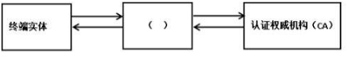

**正确答案：D** 你的答案：A

**解析**：  
**RA（注册机构，D选项）** 是PKI体系中连接用户与CA的关键中间组件，其核心功能包括：

1. **身份核验**：审核用户证书申请材料
2. **请求转发**：向CA提交合法的证书申请
3. **证书管理**：协助处理证书撤销/更新请求

其他选项分析：

- **OCSP（A）** ：在线证书状态协议（用于实时查询证书状态）
- **证书库（B）** ：存储已签发证书的数据库
- **CRL库（C）** ：证书撤销列表存储库

**NISP核心考点**：

1. **PKI核心组件**架构（CA/RA/证书库/终端实体）
2. **RA的核心职能**（身份审核与请求中转）
3. 数字证书**生命周期管理**流程
4. OCSP与CRL的**状态验证机制**区别

注：RA作为"前台受理"角色，与CA的"后台签发"角色形成工作分离，这是PKI体系的重要安全设计。

---

私有IP地址是一段保留的IP地址。只使用在局域网中，无法在Internet上使用。关于私有地址，下面描述正确的是()。  
A. A类地址中没有私有地址，B类和C类地址中可以设置私有地址  
B. A类、B类和C类地址中都可以设置私有地址  
C. A类和B类地址中没有私有地址，C类地址中可以设置私有地址  
D. A类、B类和C类地址中都没有私有地址

**正确答案：B** 你的答案：C

**解析**：  
**私有IP地址范围**覆盖所有主类地址：

1. **A类私有地址**：10.0.0.0 \~ 10.255.255.255（支持超大型局域网）
2. **B类私有地址**：172.16.0.0 \~ 172.31.255.255（中型网络）
3. **C类私有地址**：192.168.0.0 \~ 192.168.255.255（小型/家庭网络）

**关键特性**：

- 所有私有地址**禁止在互联网路由**
- 必须通过NAT转换才能访问公网
- 三类私有地址范围由RFC 1918明确定义

**NISP核心考点**：

1. 私有地址的**分类覆盖范围**（A/B/C类均有）
2. 私有地址与公网地址的**根本区别**（可路由性）
3. **NAT技术**在私有地址应用中的关键作用

注：特殊私有地址还包括环回地址127.0.0.0/8和自动配置地址169.254.0.0/16，但题目特指RFC 1918定义的私有地址块。

---

关于计算机取证描述不正确的是()。  
A. 取证的目的包括：通过证据查找肇事者、通过证据推断犯罪过程、通过证据判断受害者损失程度及收集证据提供法律支持  
B. 计算机取证的过程可以分为准备、保护、提取、分析和提交5个步骤  
C. 电子证据是计算机系统运行过程中产生的各种信息记录及存储的电子化资料及物品。对于电子证据，取证工作主要围绕两方面进行：证据的获取和证据的保护  
D. 计算机取证是使用先进的技术和工具，按照标准规程全面地检查计算机系统，以提取和保护有关计算机犯罪的相关证据的活动

**正确答案：C** 你的答案：A

**解析**：  
**C选项**描述错误，因为：

1. **电子证据处理的核心环节**是**获取**与**分析**（而非保护）
2. **证据保护**属于取证流程中的基础步骤（B选项中的第二步）

其他选项正确性分析：

- **A选项**：完整列举计算机取证的四大目的
- **B选项**：准确描述取证标准流程（5阶段模型）
- **D选项**：正确定义计算机取证的技术特征

**NISP核心考点**：

1. 电子证据处理的**两大核心**（获取+分析）
2. 取证标准流程的**五个阶段**
3. 取证工作的**法律有效性**要求
4. **取证工具链**的技术规范（如写保护设备的使用）

注：证据保护（如防篡改措施）虽重要，但属于基础操作环节，不能与获取、分析并列为核心工作方向。

---

若一个组织声称自己的ISMS符合ISO/IEC 27001或GB/T22080标准要求，其信息安全控制措施通常需要在符合性方面实施常规控制。符合性常规控制这一领域不包括以下哪项控制目标()  
A. 符合安全策略和标准以及技术符合性  
B. 访问控制的业务要求、用户访问管理  
B. 符合法律要求  
D. 信息系统审核考虑

**正确答案：B** 你的答案：D

**解析**：  
**B选项**（访问控制的业务要求、用户访问管理）不属于符合性常规控制范畴，而是属于**访问控制领域**（A.9）。

**符合性常规控制**（A.18）的核心目标包括：

1. **策略与标准符合性**（A选项）
2. **法律合规性**（C选项）
3. **审计要求**（D选项）

**NISP核心考点**：

1. **ISO27001控制域划分**（14个领域/114项控制措施）
2. **符合性管理**的三大方向（内部政策/法律法规/技术标准）
3. 访问控制与符合性控制的**职能边界**
4. **控制措施分类**的实际应用（如A.9与A.18的区别）

注：本题典型考查标准附录A中控制域的归类逻辑，需特别注意A.18符合性管理不包含访问控制相关内容

---

在信息系统中，访问控制是重要的安全功能之一。它的任务是在用户对系统资源提供最大限度共享的基础上，对用户的访问权限进行管理，防止对信息的非授权篡改和滥用。访问控制模型将实体划分为主体（Subject）和客体（Object）两类，通过对主体身份的识别来限制其对客体的访问权限。下列选项中，对主体、客体和访问权限的描述中错误的是()  
A. 对目录的访问权限可分为读、写和拒绝访问  
B. 对文件进行操作的用户是一种主体  
C. 主体可以接收客体的信息和数据，也可以改变客体相关的信息  
D. 访问权限是指主体对客体所允许的操作

**正确答案：A** 你的答案：D

**解析**：  
**A选项**描述错误，因为：

1. **目录的标准访问权限**通常包括：读（Read）、写（Write）、执行（Execute）
2.  **"拒绝访问"不是独立权限**，而是权限的否定状态（如通过ACL实现）

其他选项正确性分析：

- **B选项**：准确定义主体（用户/进程等主动实体）
- **C选项**：正确描述主体的读写能力
- **D选项**：正确定义访问权限概念

**NISP核心考点**：

1. **主体与客体的本质区别**（主动操作者 vs 被动资源）
2. **基础访问权限类型**（读/写/执行）
3. 权限管理的实现机制（ACL/Capability等）
4. 访问控制模型的**三要素**（主体、客体、权限）

注：不同系统可能扩展特殊权限（如删除/修改属性等），但"拒绝"属于权限分配策略而非基础权限类型。

---

Linux系统的安全设置主要从磁盘分区、账户安全设置、禁用危险服务、远程登录安全、用户鉴别安全、审计策略、保护root账户、使用网络防火墙和文件权限操作共10个方面来完成。小张在学习了Linux系统安全的相关知识后，尝试为自己计算机上的Linux系统进行安全配置。下列选项是他的部分操作，其中不合理的是()。  
A. 编辑文件/etc/pam.d/system-auth，设置 auth required pam\_tally.so onerr\=fail deny\=6 unlock\_time\=300  
B. 编辑文件/etc/profile，设置 TMOUT\=600  
C. 编辑文件/etc/passwd，检查文件中用户ID，禁用所有ID\=0的用户  
D. 编辑文件/etc/ssh/sshd\_config，将PermitRootLogin设置为no

**正确答案：C** 你的答案：A

**解析**：  
**C选项**操作不合理，因为：

1. **root用户（UID=0）是Linux系统的超级管理员**，完全禁用会导致系统管理功能瘫痪
2. **正确做法**应是：

    - 禁止root远程登录（如D选项）
    - 限制sudo权限
    - 使用普通用户+su/sudo提权

其他选项合理性分析：

- **A选项**：正确配置登录失败锁定（6次失败锁定300秒）
- **B选项**：合理设置会话超时（600秒无操作自动注销）
- **D选项**：安全做法禁止rootSSH登录

**NISP核心考点**：

1. **Linux账户安全最佳实践**

    - root账户的必要性与风险平衡
    - 密码策略（A选项）
    - 会话超时（B选项）
2. **远程安全管理规范**（D选项）
3. **最小特权原则**的实现方式

注：在/etc/passwd中直接删除或禁用root用户（UID\=0）是危险操作，可能导致系统无法维护。正确安全策略应是通过sudo机制和审计来管控root权限。

---

以下关于灾难恢复和数据备份的理解，说法正确的是()。  
A. 依据具备的灾难恢复资源程度的不同，灾难恢复能力分为7个等级  
B. 使用差分备份，数据恢复时只需最后一次的标准备份与差分备份，如果每天都有大量数据变化，差分备份工作非常费时  
C. 数据备份按数据类型划分可以划分为操作系统备份和数据库备份  
D. 增量备份是备份从上次完全备份后更新的全部数据文件

**正确答案：B** 你的答案：A

**解析**：  
**B选项**正确描述了差分备份的核心特点：

1. **恢复效率**：只需最近一次全备+最后一次差备
2. **备份代价**：随数据变化量增大而耗时增加

其他选项错误分析：

- **A选项**：错误，国家标准《GB/T 20988-2007》规定灾难恢复能力分为**6级**
- **C选项**：错误，正确分类应为**系统数据**（OS/配置）和**业务数据**（DB/文件）
- **D选项**：错误，描述的是**差分备份**的特点，增量备份仅备份**上次备份后变化的数据**

**NISP核心考点**：

1. **备份类型对比**：

    - 完全备份：全部数据
    - 增量备份：上次备份后变化部分
    - 差分备份：上次全备后变化部分
2. **灾难恢复等级划分**（1-6级，最高级要求RTO\<15分钟）
3. **备份数据分类**的逻辑（按数据用途而非存储形式）

注：差分备份在数据恢复便捷性和存储成本间取得平衡，适合中等变化频率的业务场景。

---

按照我国信息安全等级保护的有关政策和标准，有些信息系统只需自主定级、自主保护，按照要求向公安机关备案即可，可以不需要上级或主管部门来测评和检查。此类信息系统应属于()。  
A. 零级系统  
B. 一级系统  
C. 二级系统  
D. 三级系统

**正确答案：B** 你的答案：C

**解析**：  
**一级系统（B选项）** 的等级保护要求为：

1. **自主定级**：由运营使用单位自主确定安全保护等级
2. **自主保护**：自行实施安全保护措施
3. **备案要求**：向公安机关备案即可，**无需等级测评**

其他等级核心要求对比：

- **二级系统**：需备案+定期自查（每两年至少一次）
- **三级系统**：强制测评（每年一次）+监督检查
- **零级系统**：不存在此分类

**NISP核心考点**：

1. **等保2.0分级管理要求**：

    - 一级：自主防护（备案制）
    - 二级：指导防护（备案+自查）
    - 三级：监督防护（测评+检查）
    - 四级/五级：强制防护（实时监控）
2. **备案与测评的区别**
3. 不同等级系统的**适用场景**（一级适用于一般系统）

注：《网络安全法》第二十一条明确规定国家实行网络安全等级保护制度，一级系统适用于**不涉及重要数据/公民隐私**的非关键系统。

---

TCP/IP协议是Internet最基本的协议，也是Internet构成的基础，TCP/IP通常被认为是一个N层协议，每一层都使用它的下一层所提供的网络服务来完成自己的功能，这里N应等于()  
A. 4  
B. 5  
C. 6  
D. 7

**正确答案：A** 你的答案：B

**解析**：  
**TCP/IP协议栈**采用**4层模型**（N\=4）：

1. **网络接口层**（物理层+数据链路层）
2. **网络层**（IP/ICMP等）
3. **传输层**（TCP/UDP）
4. **应用层**（HTTP/FTP等）

对比参考：

- **OSI模型**为7层（物理层→应用层）
- **五层模型**（教学用，拆分网络接口层）

**NISP核心考点**：

1. **TCP/IP与OSI模型层数区别**（4 vs 7）
2. **各层核心协议**：

    - 网络层：IP/ARP
    - 传输层：TCP/UDP
    - 应用层：HTTP/DNS
3. 协议栈的**封装解封装**过程

注：TCP/IP实际开发早于OSI模型，其分层更注重实用性而非理论完备性。

---

随着计算机在商业和民用领域的应用，安全需求变得越来越多样化，自主访问控制和强制访问控制难以适应需求，基于角色的访问控制(RBAC)逐渐成为安全领域的一个研究热点。RBAC模型可以分为RBAC0、RBAC1、RBAC2和RBAC3四种类型，它们之间存在相互包含关系。下列选项中，对它们之间的关系描述错误的是()  
A. RBAC0是基础模型，RBAC1、RBAC2和RBAC3都包含RBAC0  
B. RBAC1在RBAC0的基础上，加入了角色等级的概念  
C. RBAC2在RBAC1的基础上，加入了约束的概念  
D. RBAC3结合RBAC1和RBAC2，同时具备角色等级和约束

**正确答案：C** 你的答案：D

**解析**：  
**C选项**描述错误，因为：

1. **RBAC2**是在**RBAC0基础**上增加约束（如互斥角色/基数约束）
2. **RBAC1**才是引入角色继承（角色等级）的模型

模型演进关系：

- **RBAC0**：最小核心模型（用户-角色-权限）
- **RBAC1**\=RBAC0+**角色继承**
- **RBAC2**\=RBAC0+**约束机制**
- **RBAC3**\=RBAC1+RBAC2（完整模型）

**NISP核心考点**：

1. **RBAC四层模型演进关系**
2. **角色继承**与**约束机制**的区别
3. 最小模型（RBAC0）的核心要素
4. 完整模型（RBAC3）的复合特性

注：RBAC2的约束机制包括静态职责分离（SSD）和动态职责分离（DSD），是实施最小特权原则的关键。

---

入侵检测系统有其技术优越性，但也有局限性，下列说法错误的是()  
A. 对用户知识要求高，配置、操作和管理使用过于简单，容易遭到攻击  
B. 高虚警频率，入侵检测系统会产生大量的警告信息和可疑的入侵行为记录，用户处理负担很重  
C. 入侵检测系统在应对自身攻击时，对其他数据的检测可能会被控制或者受到影响  
D. 警告消息记录如果不完整，可能无法与入侵行为关联

**正确答案：A** 你的答案：D

**解析**：  
**A选项**描述存在矛盾且错误，因为：

1. **实际要求**：IDS需要专业人员配置管理（非"过于简单"）
2. **正确描述**：高专业门槛是其局限，但不会因"简单"导致被攻击

其他选项正确性分析：

- **B选项**：准确描述IDS的虚警问题（需SIEM辅助分析）
- **C选项**：正确指出IDS自身可能成为攻击目标（如Bypass攻击）
- **D选项**：合规要求日志完整性（否则影响事件溯源）

**NISP核心考点**：

1. **IDS的三大局限**：

    - 高虚警率（需误报过滤）
    - 自身脆弱性（需保护检测引擎）
    - 专业运维要求
2. **安全日志管理**的完整性要求
3. 入侵检测与防御系统的差异

注：现代IDS通常与SIEM系统联动，通过机器学习降低虚警率，但专业配置仍是必要条件。

---

某单位需要开发一个网站，为了确保开发出安全的软件。软件开发商进行了OA系统的威胁建模，根据威胁建模，SQL注入是网站系统面临的攻击威胁之一，根据威胁建模的消减威胁的做法。以下哪个属于修改设计消除威胁的做法()  
A. 在编码阶段程序员进行培训，避免程序员写出存在漏洞的代码  
B. 对代码进行严格检查，避免存在SQL注入漏洞的脚本被发布  
C. 使用静态发布，所有面向用户发布的数据都使用静态页面  
D. 在网站中部署防SQL注入脚本，对所有用户提交数据进行过滤

**正确答案：C** 你的答案：D

**解析**：  
**C选项**属于**架构级设计修改**，其通过改变系统设计从根本上消除SQL注入风险：

1. **设计本质**：静态页面无数据库交互接口
2. **威胁消除**：彻底移除SQL注入的攻击面

其他选项分析：

- **A选项**：属于人员培训（管理措施）
- **B选项**：属于代码审计（开发过程控制）
- **D选项**：属于运行时防护（安全加固）

**NISP核心考点**：

1. **威胁消减策略优先级**：

    - 修改设计（最高效）
    - 安全加固（次优）
    - 监测响应（补救）
2. **静态网站的安全优势**：

    - 无动态代码执行
    - 无数据库交互
3. 安全开发生命周期（SDL）的**设计阶段要求**

注：虽然静态网站安全性高，但需配合CDN等方案解决内容更新问题，这是架构权衡的典型案例。

---

某政府机构委托开发商开发了一个OA系统。其中公交分发功能使用了FTP协议，该系统运行过程中被攻击者通过FTP对OA系统中的脚本文件进行了篡改，安全专家提出使用Http下载代替FTP功能以解决以上问题，该安全问题的产生主要是在哪个阶段产生的()  
A. 程序员在进行安全需求分析时，没有分析出OA系统开发的安全需求  
B. 程序员在软件设计时，没遵循降低攻击面的原则，设计了不安全的功能  
C. 程序员在软件编码时，缺乏足够的经验，编写了不安全的代码  
D. 程序员在进行软件测试时，没有针对软件安全需求进行安全测试

**正确答案：B** 你的答案：C

**解析**：  
**B选项**正确指出了问题根源：

1. **设计阶段缺陷**：选择FTP协议（明文传输/无完整性校验）作为文件分发方案
2. **攻击面扩大**：FTP协议固有的安全弱点（vs HTTPS的加密/签名机制）

其他阶段分析：

- **A选项**：需求阶段应识别敏感数据保护要求
- **C选项**：编码问题通常指具体实现漏洞（如缓冲区溢出）
- **D选项**：测试阶段应发现协议安全缺陷

**NISP核心考点**：

1. **安全开发生命周期(SDL)各阶段责任**：

    - 需求：安全功能/合规要求
    - 设计：协议选择/架构安全
    - 编码：漏洞预防
    - 测试：缺陷发现
2. **协议选型安全考量**：

    - FTP风险：明文传输/无完整性保护
    - HTTPS优势：加密+证书校验
3. **最小攻击面原则**的应用

注：该案例典型体现了"安全是设计出来的"原则，后期加固（如FTP over SSL）成本远高于初期选择安全协议。

---

某软件公司准备提高其开发软件的安全性，在公司内部发起了有关软件开发生命周期的讨论，在下面的发言观点中，正确的是()  
A. 软件安全开发生命周期较长，而其中最重要的是要在软件的编码安全措施，就可以解决90%以上的安全问题。  
B. 应当尽早在软件开发的需求和设计阶段增加一定的安全措施，这样可以比在软件发布以后进行漏洞修复所花的代价少得多。  
C. 和传统的软件开发阶段相比，微软提出的安全开发生命周期(SDL)最大特点是增加了一个专门的安全编码阶段  
D. 软件的安全测试也很重要，考虑到程序员的专业性，如果该开发人员已经对软件进行了安全性测试，就没有必要再组织第三方进行安全性测试。

**正确答案：B** 你的答案：D

**解析**：  
**B选项**正确体现了**安全左移**原则：

1. **早期介入优势**：需求/设计阶段实施安全措施的成本仅为发布后修复的1/30（IBM研究数据）
2. **微软SDL实践**：在需求阶段即开始威胁建模

其他选项错误分析：

- **A选项**：错误，编码阶段仅解决约30%安全问题，架构设计决定70%安全基础
- **C选项**：错误，SDL核心是**全过程安全**（7阶段12实践），非仅安全编码
- **D选项**：错误，第三方测试是必须环节（开发者测试存在盲区）

**NISP核心考点**：

1. **安全开发生命周期(SDL)核心思想**：

    - 安全需求分析
    - 威胁建模（设计阶段）
    - 第三方渗透测试
2. **漏洞修复成本曲线**（越晚修复成本指数增长）
3. **防御纵深**在SDLC中的实施

注：微软SDL数据显示，实施完整SDL可将漏洞减少约50%，其中需求/设计阶段措施贡献最大。

---

火灾是机房日常运营中面临最多的安全威胁之一，火灾防护的工作是通过构建火灾预防、检测和响应系统，保护信息化相关人员和信息系统，将火灾导致的影响降低到可接受的程度。下列选项中，对火灾的预防、检测和抑制的措施描述错误的选项是()。  
A. 将机房单独设置防火区，选址时远离易燃易爆物品存放区域，机房外墙使用非燃烧材料，进出机房区域的门采用防火门或防火卷帘，机房通风管设防火栓  
B. 火灾探测器的具体实现方式包括：烟雾检测、温度检测、火焰检测、可燃气体检测及多种检测复合等  
C. 自动响应的火灾抑制系统应考虑同时设立两组独立的火灾探测器，只要有一个探测器报警，就立即启动灭火工作  
D. 目前在机房中使用较多的气体灭火剂有二氧化碳、七氟丙烷、三氟甲烷等

**正确答案：C** 你的答案：D

**解析**：  
**C选项**描述错误，因为：

1. **误报防护机制**：标准要求至少两个独立探测器同时报警才启动灭火（防误触发）
2. **安全冗余设计**：防止单一探测器故障导致误喷放

其他选项正确性分析：

- **A选项**：完整描述机房防火分区建设标准
- **B选项**：准确列举探测器类型（烟雾/温度/火焰复合检测）
- **D选项**：正确说明主流气体灭火剂

**NISP核心考点**：

1. **机房消防三级防护**：

    - 预防（建筑防火）
    - 检测（多传感器联动）
    - 抑制（气体灭火系统）
2. **灭火系统启动逻辑**（"与"逻辑判断）
3. **气体灭火剂特性**：

    - 七氟丙烷：清洁高效（主流选择）
    - 二氧化碳：成本低但危害人员

注：GB50174-2017《数据中心设计规范》明确规定气体灭火系统应设置双重报警确认。

---

组织应定期监控、审查、审计()服务，确保协议中的信息安全条款和条件被遵守，信息安全事件和问题得到妥善管理。应将管理供应商关系的责任分配给指定的个人或()团队。另外，组织应确保落实供应商符合性审查和相关协议要求强制执行的责任。应保存足够的技术技能和资源的可用性以监视协议要求尤其是()要求的实现。当发现服务交付的不足时，宜采取()。当供应商提供的服务包括对()方针、规程和控制措施的维持和改进等发生变更时，应在考虑到其对业务信息、系统、过程的重要性和重新评估风险的基础上管理。  
A. 供应商;服务管理;信息安全;合适的措施;信息安全  
B. 服务管理;供应商;信息安全;合适的措施;信息安全  
C. 供应商;信息安全;服务管理;合适的措施;信息安全  
D. 供应商;合适的措施;服务管理;信息安全;信息安全

**正确答案：A** 你的答案：C

**解析**：  
**A选项**正确对应了ISO/IEC 27001对供应商管理的完整要求：

1. **监控对象**：供应商服务（非服务管理）
2. **责任主体**：服务管理团队（第二空）
3. **监控重点**：信息安全要求（第三空）
4. **处置措施**：采取合适措施（第四空）
5. **变更管理**：信息安全方针（第五空）

**NISP核心考点**：

1. **供应商安全管理四要素**：

    - 协议监控（服务级别）
    - 责任分配（专人负责）
    - 合规审查（技术能力保障）
    - 变更管理（风险评估）
2. **服务管理团队**的核心职责
3. 信息安全**第三方风险控制**流程

注：该题完整呈现了ISO/IEC 27001:2013中"A.15:供应商关系"的控制要求，需特别注意责任主体与监控对象的逻辑顺序。

---

信息安全管理体系也采用了()模型，该模型可应用于所有的()。ISMS把相关方的信息安全要求和期望作为输入，并通过必要的()，产生满足这些要求和期望的()。  
A. ISMS;PDCA过程;行动和过程;信息安全结果  
B. PDCA;ISMS过程;行动和过程;信息安全结果  
C. ISMS;PDCA过程;信息安全结果;行动和过程  
D. PDCA;ISMS过程;信息安全结果;行动和过程

**正确答案：B** 你的答案：A

**解析**：  
**B选项**正确描述了ISMS的核心运作机制：

1. **基础模型**：PDCA循环（Plan-Do-Check-Act）
2. **应用范围**：所有ISMS过程
3. **转化机制**：通过行动和过程实施
4. **输出结果**：满足要求的信息安全成果

**NISP核心考点**：

1. **PDCA模型在ISMS中的应用**：

    - Plan：建立安全策略/目标
    - Do：实施控制措施
    - Check：监控评审有效性
    - Act：持续改进
2. **过程方法**的核心逻辑（输入-转化-输出）
3. ISO27001标准中的**条款结构**与PDCA对应关系

注：PDCA是ISMS的底层方法论，其循环特性体现了信息安全的持续改进本质。

---

小王学习了灾备备份的有关知识，了解到常用的数据备份方式包括完全备份、增量备份、差量备份，为了巩固所学知识，小王对这三种备份方式进行对比，其中在数据恢复速度方面三种备份方式由快到慢的顺序是()  
A. 完全备份、增量备份、差量备份  
B. 完全备份、差量备份、增量备份  
C. 增量备份、差量备份、完全备份  
D. 差量备份、增量备份、完全备份

**正确答案：B** 你的答案：C

**解析**：  
**恢复速度排序**（从快到慢）：

1. **完全备份**：只需恢复最近一次全备文件（单次操作）
2. **差量备份**：需恢复最近全备+最后一次差备（两次操作）
3. **增量备份**：需恢复最近全备+所有后续增备（多次操作）

**关键对比**：

- **差量备份** vs **增量备份**：差量备份只需合并两份数据，而增量备份需按顺序合并多份数据

**NISP核心考点**：

1. **备份类型恢复复杂度**：

    - 完全备份：1个恢复点
    - 差量备份：2个恢复点
    - 增量备份：n+1个恢复点
2. **备份策略选择权衡**：

    - 恢复速度 ←→ 存储空间 ←→ 备份耗时
3. 实际灾备方案中**混合使用策略**（如每周全备+每日增备）

注：差量备份在恢复速度和存储成本间取得较好平衡，适合中等变化频率的业务数据。

---

风险评估文档是指在整个风险评估过程中产生的评估过程文档和评估结果文档，其中，明确评估的目的、职责、过程、相关的文档要求，以及实施本次评估所需要的各种资产、威胁、脆弱性识别和判断依据的文档是()  
A. 《风险评估方案》  
B. 《风险评估程序》  
C. 《资产识别清单》  
D. 《风险评估报告》

**正确答案：B** 你的答案：A

**解析**：  
 **《风险评估程序》（B选项）** 是核心过程指导文件，其包含：

1. **评估框架**：目的/范围/职责
2. **方法论**：资产识别、威胁分析、脆弱性评估的具体方法
3. **判断标准**：风险等级划分依据

其他文档作用：

- **A方案**：侧重资源配置与时间计划
- **C清单**：仅记录资产信息
- **D报告**：呈现最终风险分析结果

**NISP核心考点**：

1. **风险评估四类核心文档**：

    - 程序文件（方法论）
    - 方案（实施计划）
    - 记录表（过程数据）
    - 报告（输出成果）
2. **GB/T 20984标准**要求的文档体系
3. 程序文件与方案的关键区别（方法论 vs 实施计划）

注：实际工作中，《风险评估程序》通常作为组织级标准长期使用，而《风险评估方案》针对具体评估项目制定。

