## 逃逸深度关系
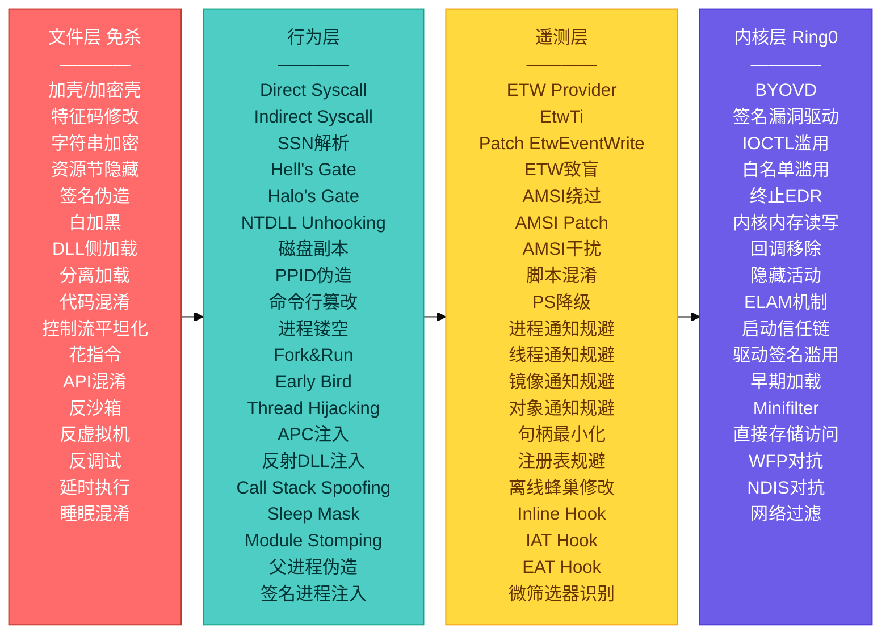
- **文件层**：用户态最外层，解决“文件别被认出来”
- **行为层**：用户态运行时，解决“动作别被判定为恶意”
- **遥测层**：横跨用户态与内核态，是 EDR 的“传感器”，解决“别让 EDR 看见”
- **内核层**：Ring 0，解决“直接在驱动层对抗安全产品”

##  EDR逃逸层级
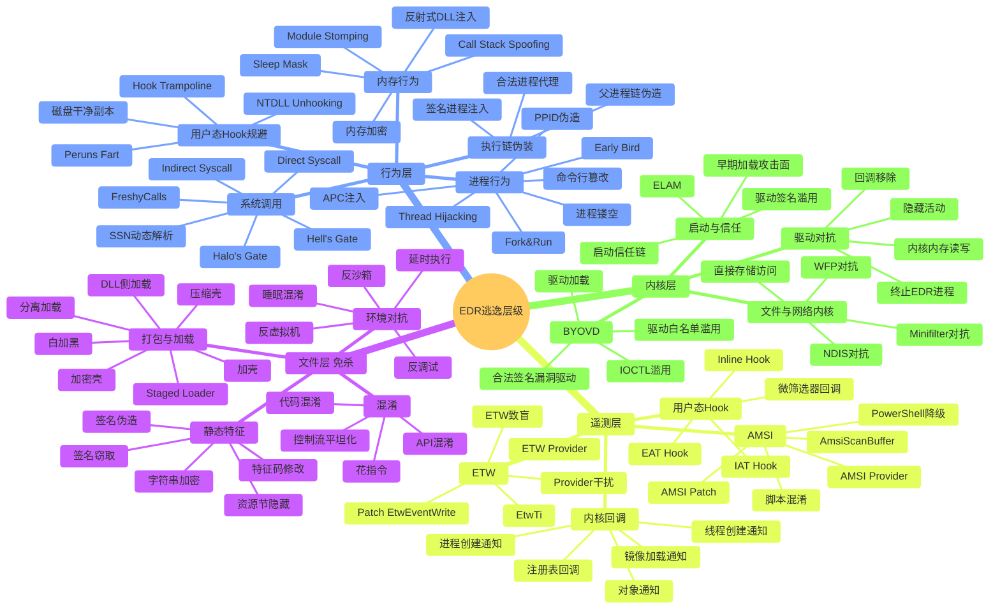
## 第1章 理解EDR

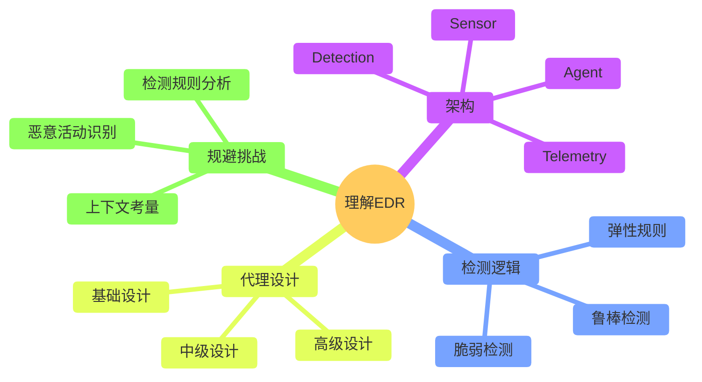

---

## 第2章 函数挂钩DLL

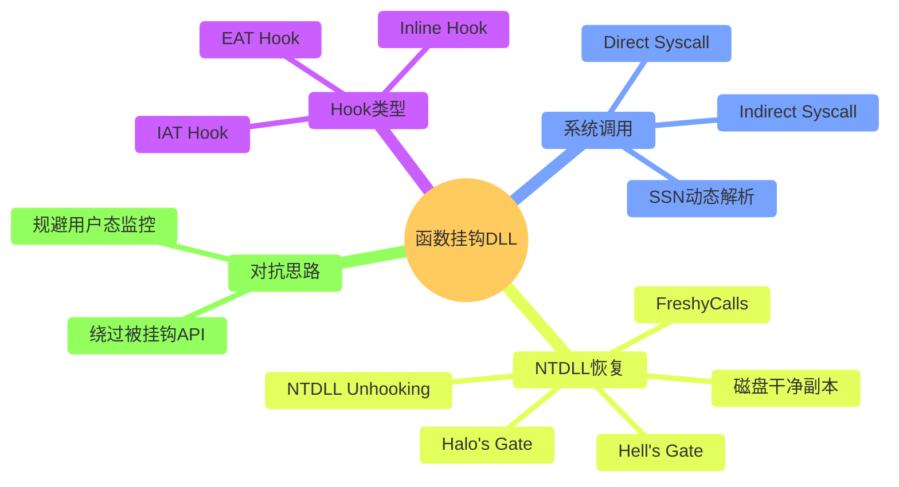

---

## 第3章 进程与线程创建通知

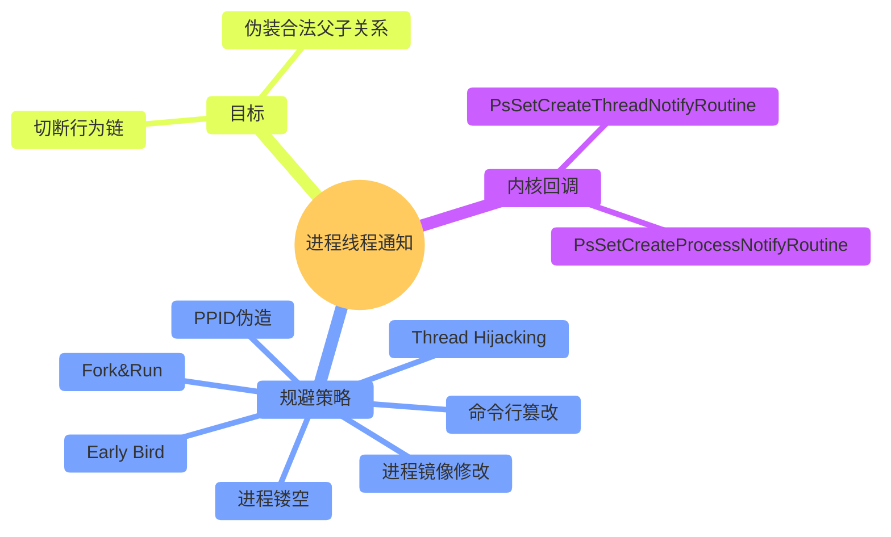

---

## 第4章 对象通知

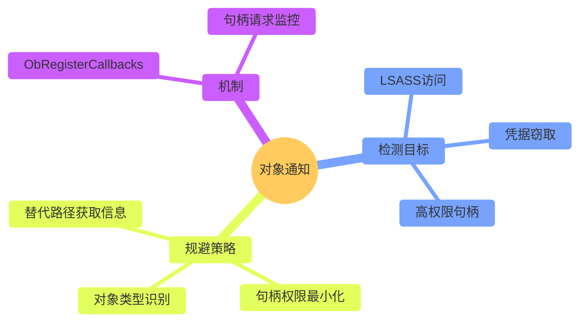

---

## 第5章 镜像加载与注册表通知

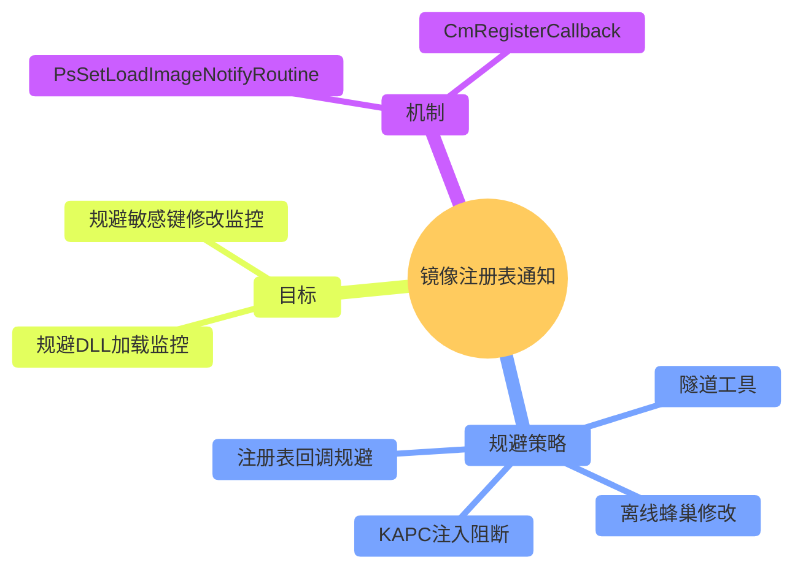

---

## 第6章 文件系统微筛选器驱动

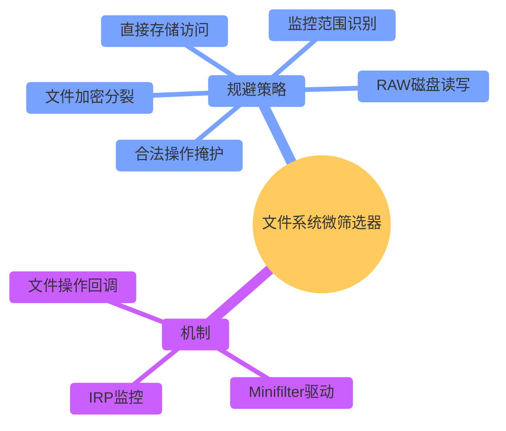

---

## 第7章 网络过滤驱动

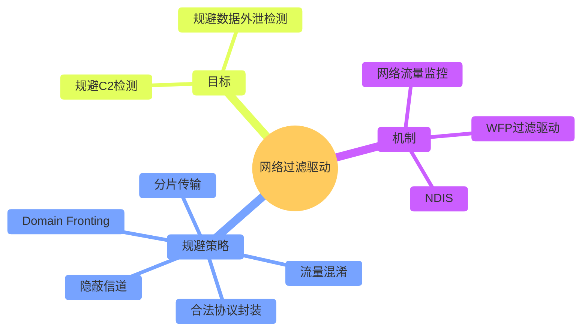

---

## 第8章 Windows事件追踪ETW

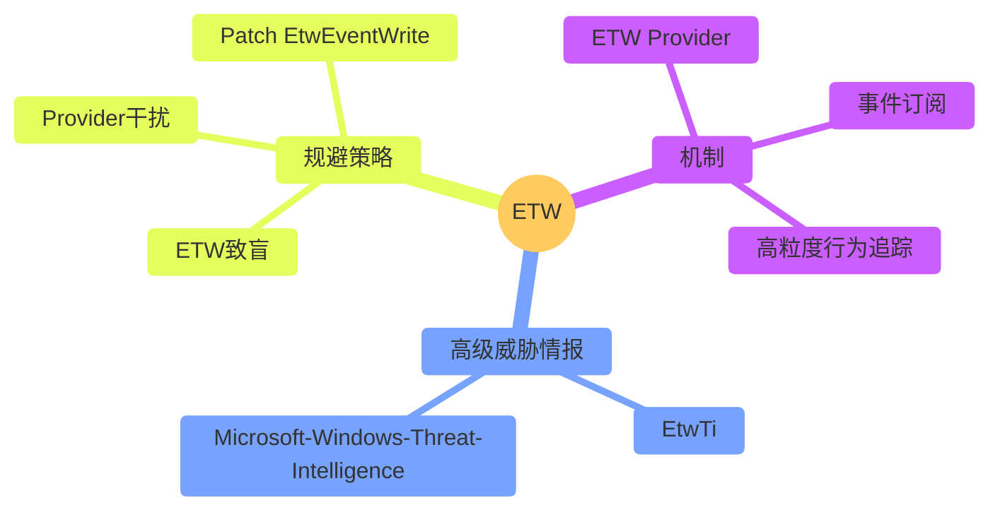

---

## 第9章 扫描器

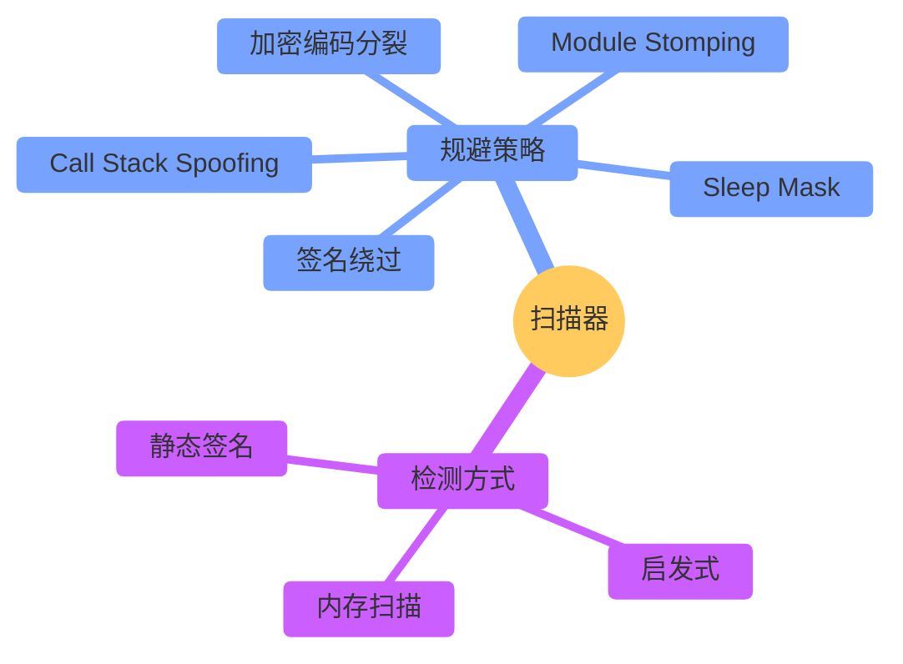

---

## 第10章 反恶意软件扫描接口AMSI

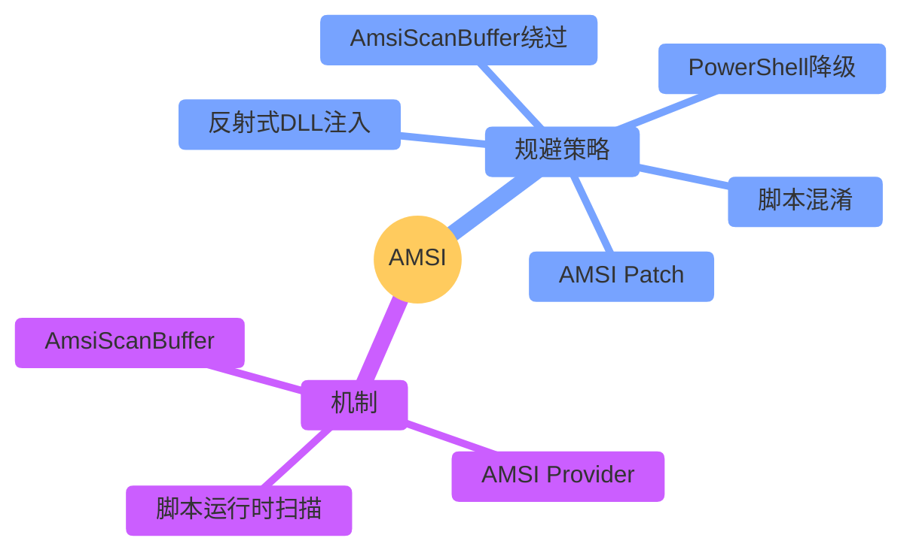

---

## 第11章 早期启动反恶意软件驱动ELAM

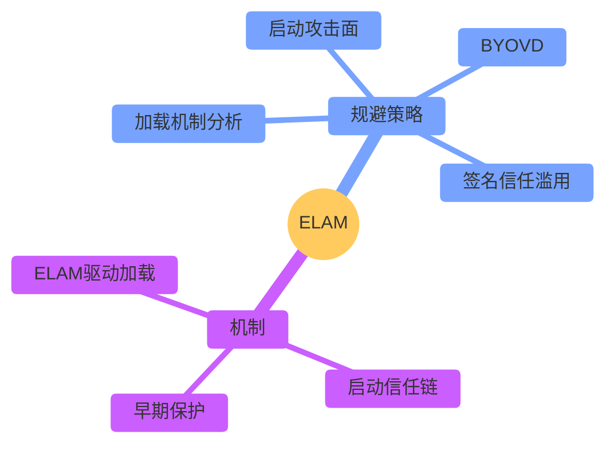

---

## 第12章 Microsoft Windows威胁情报

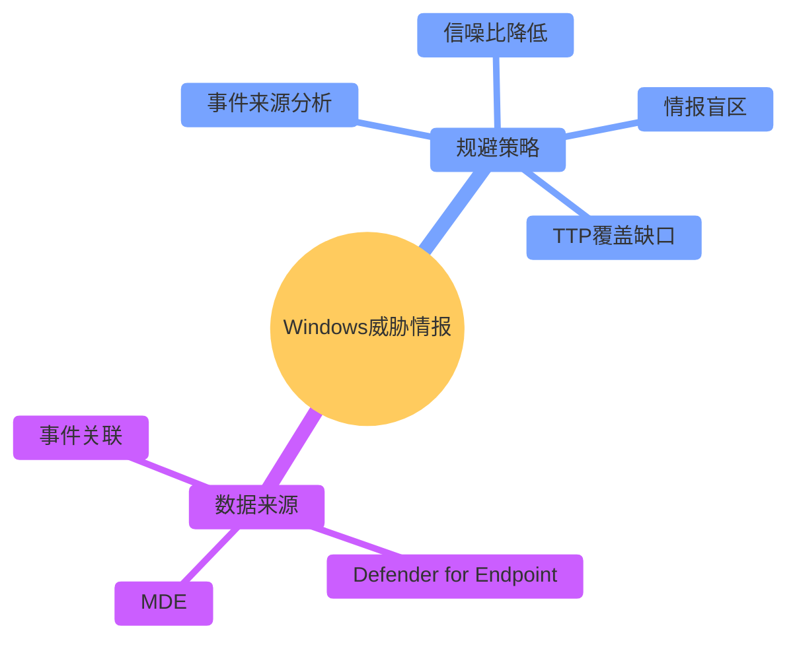

---

## 第13章 综合案例

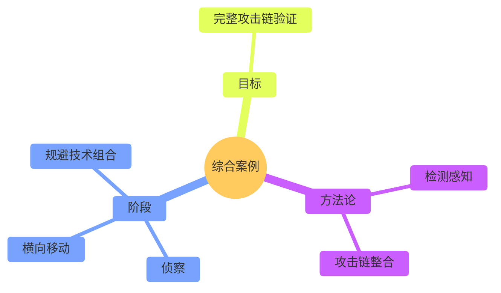
