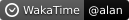
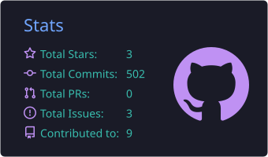
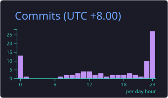
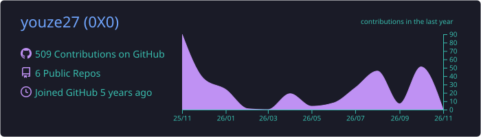
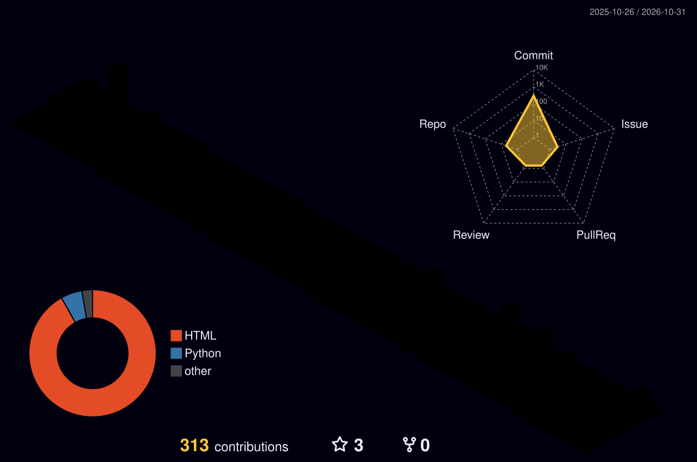

# 介绍页

嘿，朋友们，我是卷卷，欢迎来到我的博客！

这个博客主要记录网络安全和人工智能相关的学习与实践，也会写一些开发和运维里实际用得上的内容。

**安全**：这是我写得最多的部分，主要学习和整理 Web 安全、漏洞原理、攻防基础、防护配置和安全治理相关内容，也会记录应急响应、日志分析、入侵排查和终端防御规避这些偏实战的方向。

**开发**：我平时会写一些代码，关注编程语言、Web 开发、脚本工具和项目搭建，边做边学。常用的有 Python、PHP、JavaScript，也会写点自动化小工具。

**运维**：关注 Linux、服务器部署、Docker、日志、监控和常见故障排查，记录实际用得到的运维内容。网络配置、防火墙、虚拟化和备份恢复也会顺手记一点。

**AI**：关注大模型、AI Agent、提示词、本地模型和 AI 工具的使用，也会看 AI 安全，以及一些和安全不直接相关的 AI 内容。

博客使命：用工程思维解构安全，把漏洞原理、防护配置和安全治理讲清楚，给新手留一条能走通的学习路径。

生活哲学：每天学习，坚定终身学习的信念；定期阅读，给快节奏的生活留一点精神食粮。

“安全是流动的战场，唯有用开放分享筑牢防线”

  
   
  
  
  
   
  
   
  
  
   
  
  
   
  
   

  

