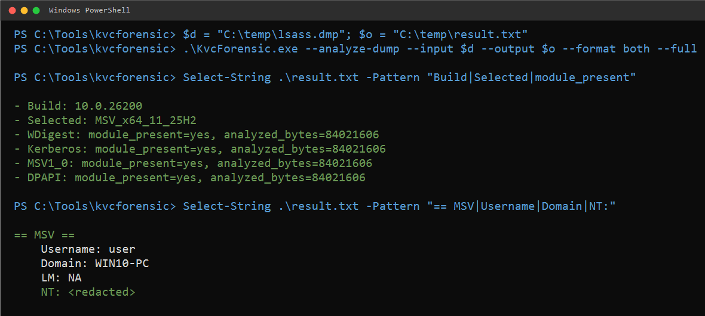
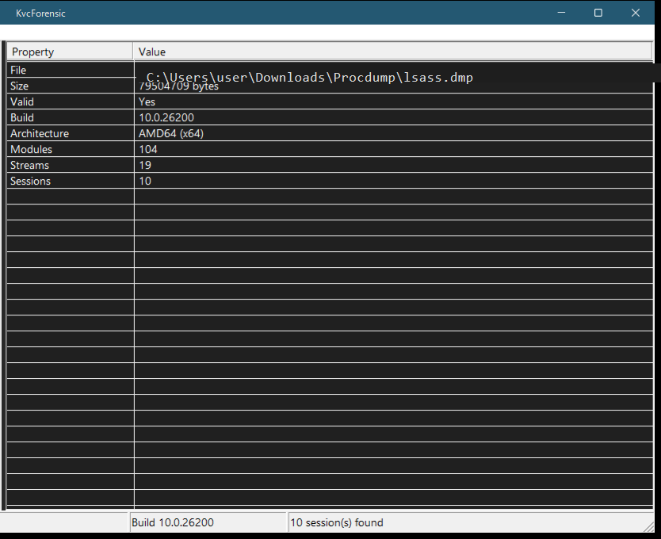
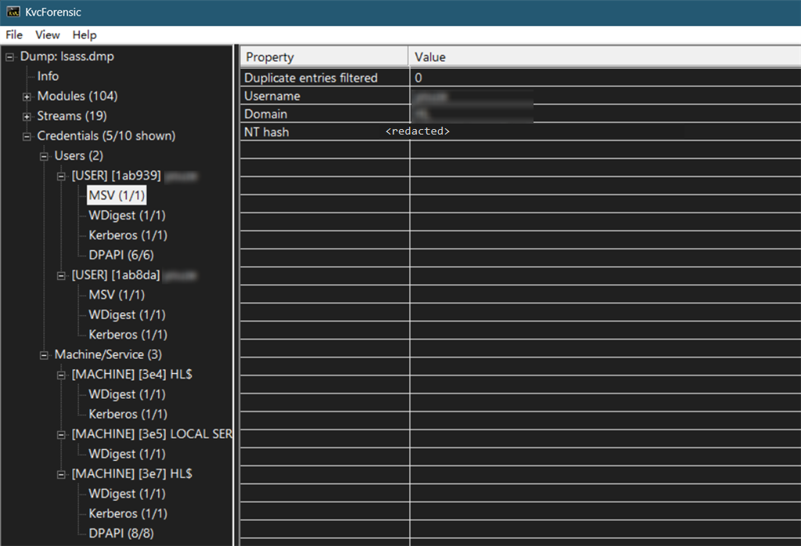

## 背景

Pypykatz 在 25H2 上解析 MSV 失败后，改用 KvcForensic。`kvcforensic.dat` 中的 `KvcForensic.json` 保存了不同 Windows 构建号的 LSA 结构偏移，这是它能读取 Build 26200 的原因。

它和 Mimikatz 的定位不同，更接近一个把偏移模板做成配置文件的解析器。

## KVC 与 KvcForensic 的关系

KVC 全称 Kernel Vulnerability Capabilities Framework，是一个 Ring-0 的安全研究框架，能力包括进程保护、内存检查、凭据和注册表操作、驱动加载等。

KvcForensic 是其中一个可选模块，专门解析 LSASS minidump。它由两部分组成：

- `KvcForensic.exe`：解析引擎；
- `KvcForensic.json`：不同 Windows 版本的 LSA 结构偏移模板。

你不需要加载 KVC 的驱动，也能单独用 KvcForensic 解析一份离线 dump。这一点很重要，后面会展开。

## 下载

KVC 的 release 里有两个相关文件：

- `kvc.7z`：主框架；
- `kvcforensic.dat`：可选的 KvcForensic 模块。

本文使用的是 `kvc.7z` 里 `other-tools/kvcforensic/` 目录下的独立版本。压缩包有密码，按 release 页面说明输入 `github.com`。

解压后至少要有这两个文件：

```text
KvcForensic.exe
KvcForensic.json
```

如果只把 exe 拷出来，运行时会因为找不到模板而失败。

## 命令行用法

独立版本的参数如下：

| 参数 | 作用 |
| --- | --- |
| `--analyze-dump` | 进入 dump 解析模式 |
| `--input <文件>` | 指定 LSASS minidump |
| `--output <文件>` | 指定报告输出路径 |
| `--format txt` | 只输出文本 |
| `--format json` | 只输出 JSON |
| `--format both` | 同时输出文本和 JSON |
| `--full` | 在文本里附带构建号、模块、会话等元数据 |
| `--export-tickets <目录>` | 导出 Kerberos 票据 |
| `--compare <文件>` | 与已有结果对比 |

一条完整的命令：

```powershell
.\KvcForensic.exe --analyze-dump `
    --input C:\temp\lsass.dmp `
    --output C:\temp\result.txt `
    --format both --full
```

必须在包含 `KvcForensic.json` 的目录下执行，或者把 JSON 放到 exe 能找到的位置。



如果你装的是完整的 KVC，还可以用封装命令：

```text
kvc analyze <dump>
kvc analyze lsass
kvc analyze --gui
```

`kvc analyze lsass` 会自动在当前目录和 Downloads 目录里找 LSASS dump；`--gui` 直接打开图形界面。

## 构建号匹配才是关键

这次 dump 的构建号是 `10.0.26200`，KvcForensic 自动选中了：

```text
MSV_x64_11_25H2
```

同一份文件，Pypykatz 0.6.13 在 MSV 阶段报错，KvcForensic 则能正常读出本地账号的 NT Hash。

差别在于模板是否覆盖到 Build 26200。KvcForensic 把偏移放在 JSON 里，新增构建号时只需要更新模板；Pypykatz 的偏移写在代码里，适配新版本要改代码。

## 图形界面

打开 `KvcForensic.exe`，`File` → `Open Dump...`，选择 dump 文件。

先看 `Info` 节点：



这里能看到文件大小、构建号、模块数、会话数。确认 `Build 10.0.26200`，说明模板选对了。

再看 `Credentials` 树。它按登录会话分组，每个用户下面挂 MSV、WDigest、Kerberos、DPAPI：



几个节点的作用：

- `MSV`：NTLM Hash，可直接做 Pass-the-Hash；
- `WDigest`：明文密码，只有开启 `UseLogonCredential` 才可能有值；
- `Kerberos`：TGT/TGS，可导出 `.kirbi` 做票据传递；
- `DPAPI`：Master Key，配合密码或 Hash 解密浏览器、凭据管理器数据。

`Machine/Service` 下是机器账户和 `LOCAL SERVICE`。机器账户的 Hash 可以伪造指向本机服务的白银票据，TGT 可以用于票据传递。

更细的分级说明和截图，放在[信息收集章节的 3.4.7](../红队内网攻防/红队内网攻防-3.信息收集.md)里，这里不重复。

## 25H2 实测记录

环境：

| 项目 | 值 |
| --- | --- |
| 系统 | Windows 11 25H2，Build 26200 |
| 防护 | VBS 运行中，HVCI 未启用，`RunAsPPL=0` |
| dump | ProcDump `-ma`，约 80 MB |
| 结果 | 选中 `MSV_x64_11_25H2`，成功提取 MSV 数据 |

同样的流程也跑过 WSASS 生成的 dump：把 `proc.png` 的文件头恢复成 `MDMP` 后，KvcForensic 一样能解析。

## 注意事项

- KVC 是 Ring-0 框架，主程序带驱动加载能力。做离线解析只用 KvcForensic 就够了，不要在生产机 `kvc install`。
- 第三方工具，下载后先核对来源、版本和哈希。release 压缩包有密码，不要从网盘随便下。
- 解析报告里是真实凭据。截图前把用户名、Hash、票据全部打码。
- 不同版本的参数可能变化，拿不准就看 `kvc` 的帮助或 release notes。

## 检测与防御

KvcForensic 本身是离线工具，目标机上看不到它。需要检测的还是 dump 的生成：

- LSASS 句柄访问；
- PPL 进程创建；
- 大文件写入；
- WER、ProcDump 等进程链。

如果目标机开了 Credential Guard，即使 dump 成功，域凭据也可能拿不到。这一点不要忽略。

## 参考链接

| 链接 | 用途 |
| --- | --- |
| [KVC 项目主页](https://kvc.pl/project-kvc) | 官方介绍、版本说明和下载入口 |
| [KVC GitHub](https://github.com/wesmar/kvc) | 源码、README、能力清单 |
| [KVC Releases](https://github.com/wesmar/kvc/releases) | 下载 `kvc.7z` 和 `kvcforensic.dat` |
| [KvcForensic 说明](https://github.com/wesmar/kvc#kvcforensic--lsass-minidump-credential-extraction-kvc-analyze) | README 里的命令、格式和模板说明 |
| [配置 LSA 保护](https://learn.microsoft.com/en-us/windows-server/security/credentials-protection-and-management/configuring-additional-lsa-protection) | 理解 `RunAsPPL` 对 dump 的影响 |
| [Credential Guard](https://learn.microsoft.com/en-us/windows/security/identity-protection/credential-guard/) | 解释为什么 dump 成功也可能没有域凭据 |
| [MINIDUMP_HEADER](https://learn.microsoft.com/en-us/windows/win32/api/minidumpapiset/ns-minidumpapiset-minidump_header) | 理解 dump 文件头和 WSASS 的 PNG 头替换 |
| [MITRE ATT&CK T1003.001](https://attack.mitre.org/techniques/T1003/001/) | LSASS 凭据转储的技术编号 |
| [Atomic Red Team T1003.001](https://www.atomicredteam.io/atomic-red-team/atomics/T1003.001) | 检测规则验证 |
| [HackTricks：Stealing Windows Credentials](https://hacktricks.wiki/en/windows-hardening/stealing-credentials/index.html) | 对比其他凭据提取路径 |
| [ProcDump 官方文档](https://learn.microsoft.com/en-us/sysinternals/downloads/procdump) | 生成 dump 的上游工具 |

## 相关文章

- [ProcDump 转储 LSASS](./ProcDump转储LSASS实战.md)
- [Pypykatz 离线解析](./Pypykatz离线解析LSASS实战.md)
- [WSASS 转储 PPL 进程](./WSASS转储PPL进程实战.md)

::: warning 声明
本文仅用于授权的安全测试与教学环境。KVC 的部分能力涉及内核驱动，务必在隔离虚拟机中使用。
:::
