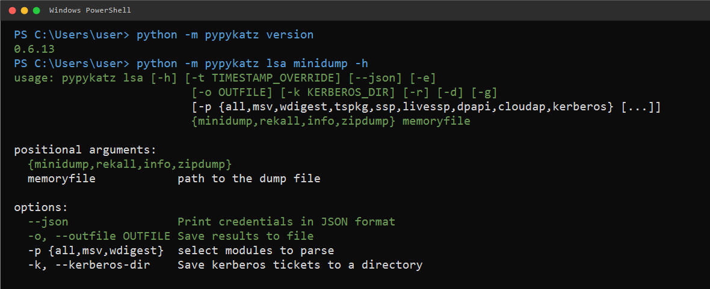
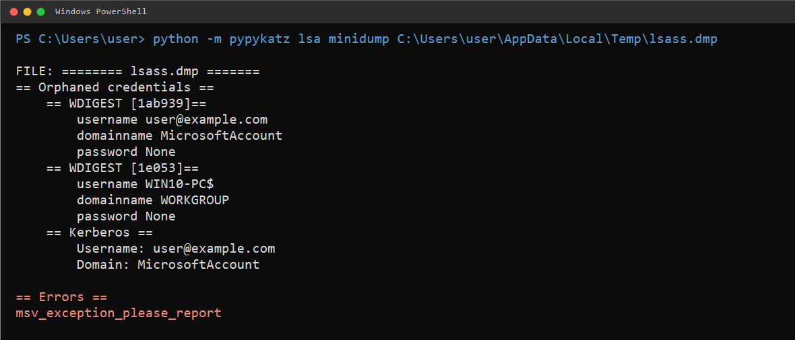

## 使用场景

解析 LSASS dump 时，Pypykatz 是一个常用选择。它用纯 Python 实现，可以在 Linux、macOS 和 Windows 上运行，不需要额外开一台 Windows 虚拟机。把 dump 拷到分析机后，一条命令即可解析。

在 Windows 11 25H2 上测试时，WDigest 和 Kerberos 可以读取，MSV 报 `msv_exception_please_report`，没有拿到 NTLM Hash。下面记录安装、用法、失败原因和替代方案。

## 简介

Pypykatz 是 Mimikatz 的 Python 实现，至少覆盖了常用的一部分。它的设计思路和 Mimikatz 不太一样：把“解析逻辑”和“数据来源”拆开了。

意思是，同一个解析器可以读：

- LSASS 进程的实时内存（仅 Windows）；
- LSASS 的 minidump 文件；
- Rekall 能解析的完整内存镜像；
- 你自己实现的数据源。

除了 LSASS，它还支持注册表解析（SAM、LSA Secrets、缓存凭据）和 DPAPI 相关操作。

它不是杀软对抗工具，也不负责生成 dump。它只负责把已有的 dump 拆开。

## 安装

使用 pip 安装：

```bash
python3 -m pip install pypykatz
```

装完后确认版本：

```bash
python -m pypykatz version
```



系统存在多个 Python 时，安装和运行要使用同一个解释器，否则会出现 `pip` 已安装但命令行找不到模块的情况。

## 常用命令

### 解析 minidump

最常用的就是这一条：

```bash
python -m pypykatz lsa minidump /path/to/lsass.dmp
```

输出会按模块分段，常见的有：

- `MSV`：NTLM Hash；
- `WDigest`：明文密码（如果系统缓存了）；
- `Kerberos`：TGT/TGS；
- `DPAPI`：Master Key；
- `Credential Manager`：凭据管理器条目。

### 只解析指定模块

dump 很大时，可以只跑关心的部分：

```bash
python -m pypykatz lsa minidump -p msv,wdigest,kerberos lsass.dmp
```

不同版本的参数可能略有差异，拿不准就看 `--help`。

### 输出 JSON

需要接脚本或入库时，用 JSON：

```bash
python -m pypykatz lsa minidump lsass.dmp --json -o result.json
```

JSON 里字段比较多，建议先跑一次纯文本，确认结构后再写解析脚本。

### 实时读取

在 Windows 上以管理员权限运行：

```bash
python -m pypykatz live lsa
```

这条命令直接读当前机器的 LSASS，不适合在非授权环境使用。实战里更常见的是先 dump，再离线解析。

## 一次完整的解析流程

常用流程：

1. 在目标机用 ProcDump 或 WSASS 生成 dump；
2. 计算哈希，记录文件大小；
3. 拷到分析机，原机上的 dump 立即删除；
4. 在分析机用 Pypykatz 解析；
5. 结果加密保存，截图前先脱敏。

第 3 步不能省略。dump 中包含完整凭据材料，不应长期留在目标机。

## 25H2 上的实测结果

同一份 80 MB 的 dump，Pypykatz 0.6.13 的表现是：

- 能解析出 WDigest 和 Kerberos 条目；
- WDigest 的 `password` 是 `None`；
- MSV 阶段抛出 `msv_exception_please_report`，没有 NTLM Hash。



这不是 dump 损坏。用 KvcForensic 解析同一份文件，选中 `MSV_x64_11_25H2` 模板后能正常读到 MSV 数据。

原因应该是 Pypykatz 0.6.13 对 Build 26200 的 MSV 结构适配还不完整。遇到新系统时需要先确认版本。

## 常见问题

### `ModuleNotFoundError: No module named 'pypykatz'`

安装和运行用的不是同一个 Python。用 `python -m pip install pypykatz`，再用 `python -m pypykatz`，不要混用 `pip` 和 `python3`。

### 解析结果为空

先确认 dump 是不是完整内存：

- ProcDump 要用 `-ma`，不要用默认的 `-mm`；
- 文件大小是否只有几 MB；
- 目标机是否开了 Credential Guard；
- LSASS 是否受 PPL 保护，dump 是否真的成功。

### `msv_exception_please_report`

这是结构解析失败，不是语法错误。可以尝试：

- 升级 Pypykatz；
- 换 KvcForensic；
- 换一台与 dump 构建号匹配的分析环境。

### 输出太长

用 `-p` 限制模块，或者输出 JSON 后用 `jq` 过滤。不要直接把完整输出贴到聊天工具或工单里。

## 检测与防御

离线解析本身不会在目标机留下痕迹，真正需要检测的是 dump 的生成环节：

- LSASS 句柄访问；
- 异常进程写出大文件；
- WER、ProcDump、PowerShell 相关的进程链。

Pypykatz 更适合放在分析侧使用。蓝队如果只看目标机，重点应该放在“谁把 LSASS 拉走了”。

## 参考链接

| 链接 | 用途 |
| --- | --- |
| [Pypykatz GitHub](https://github.com/skelsec/pypykatz) | 源码、功能列表、安装说明 |
| [Pypykatz Wiki](https://github.com/skelsec/pypykatz/wiki) | 命令行用法和版本变化，比 README 更细 |
| [Pypykatz PyPI](https://pypi.org/project/pypykatz/) | 查看最新版本和安装方式 |
| [minidump 库](https://github.com/skelsec/minidump) | Pypykatz 的底层 minidump 解析库，排查解析错误时会看 |
| [minikerberos](https://github.com/skelsec/minikerberos) | Kerberos 相关解析依赖 |
| [Pypykatz Cheatsheet](https://rnemeth90.github.io/notes/cheatsheets/pypykatz.html) | 常用命令速查，适合临时对照 |
| [Pypykatz 使用笔记](https://rnemeth90.github.io/notes/tools/pypykatz.html) | 实际输出示例和参数说明 |
| [Windows Token and Credential Harvesting](https://hackindex.io/platforms/windows/post-exploitation/windows-token-and-credential-harvesting) | 把 Pypykatz 放进完整的凭据窃取流程里理解 |
| [MITRE ATT&CK T1003.001](https://attack.mitre.org/techniques/T1003/001/) | LSASS 凭据转储的技术定义和检测建议 |
| [Atomic Red Team T1003.001](https://www.atomicredteam.io/atomic-red-team/atomics/T1003.001) | 验证检测规则时可以直接跑的测试用例 |
| [DPAPI 文档](https://learn.microsoft.com/en-us/windows/win32/seccrypto/cryptprotectdata) | 理解 DPAPI 加密和解密接口，分析 Master Key 时会用到 |
| [OctoPwn](https://octopwn.com/) | 同一作者的可视化渗透套件，Pypykatz 也在里面 |
| [Mimikatz](https://github.com/gentilkiwi/mimikatz) | 对照原生实现，理解 Pypykatz 的输出结构 |

## 相关文章

- [ProcDump 转储 LSASS](./ProcDump转储LSASS实战.md)
- [KvcForensic 解析 LSASS](./KvcForensic解析LSASS实战.md)
- [WSASS 转储 PPL 进程](./WSASS转储PPL进程实战.md)
- [信息收集章节中的凭据实验](../红队内网攻防/红队内网攻防-3.信息收集.md)

::: warning 声明
本文仅用于授权的安全测试与教学环境。解析他人主机的 LSASS dump 可能涉及敏感数据，请勿在未授权环境使用。
:::
