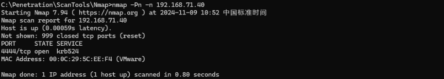
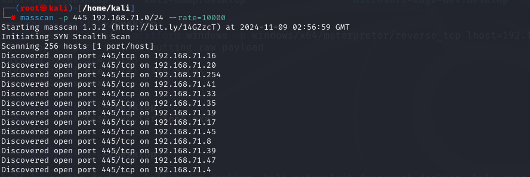
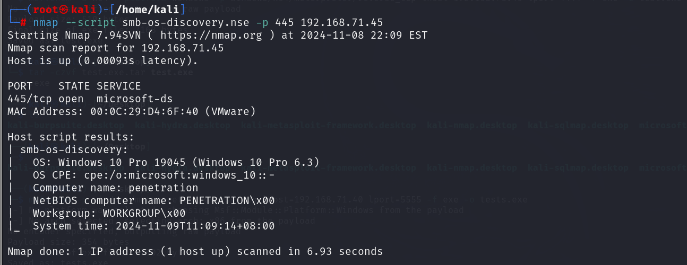
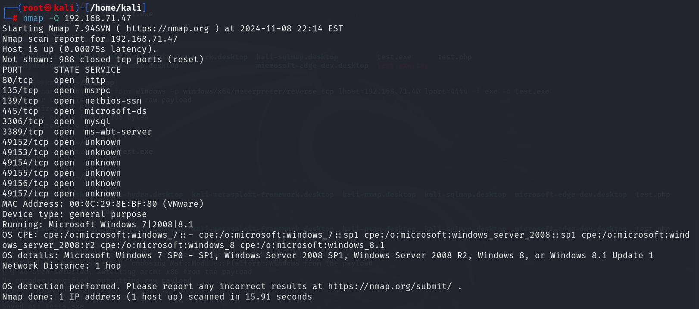
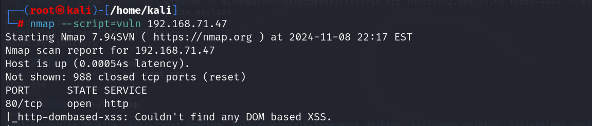
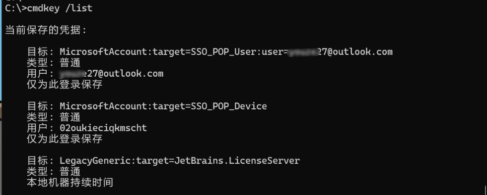
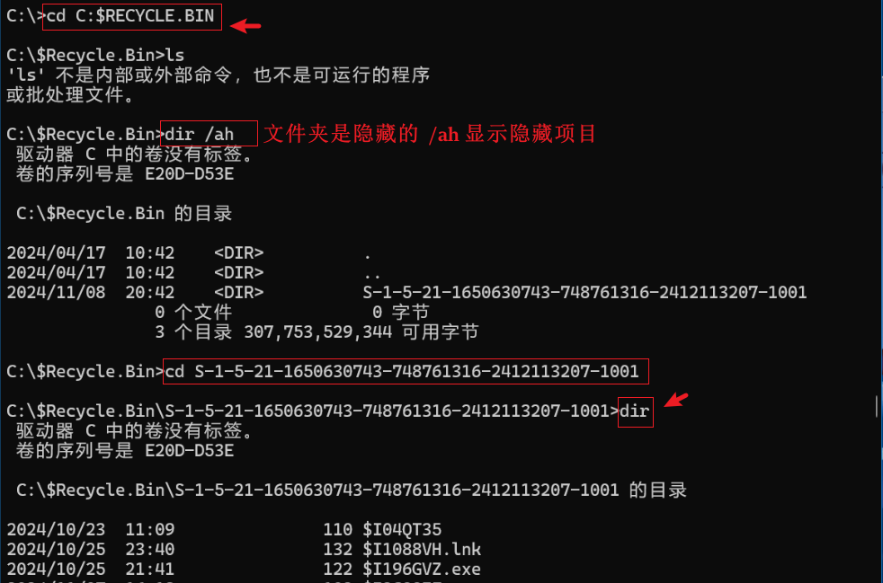
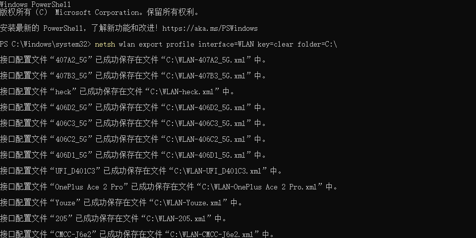
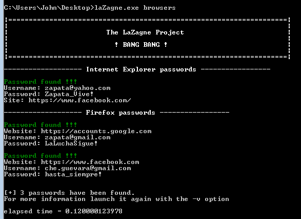

## 收集思路

进入内网后，信息收集通常围绕三类目标展开：

- **内网基础信息**：网段、内网规模、存活主机数量；
- **内网核心业务**：OA、邮件服务器、网络监控、数据库等；
- **主机信息**：Windows 与 Linux 主机上的账号、凭据、配置和连接记录。

常用手段包括主动扫描、端口和服务探测、内网拓扑分析，以及查看本机残留的配置文件。有时候管理员留在机器上的说明文档、拓扑图，比扫描结果更有价值。

## 主动扫描

- 使用 `ping` 扫描内网存活主机；
- 使用 `nmap` 扫描存活主机与端口；
- 使用 `netdiscover` 做 ARP 扫描，既可以主动扫描也可以被动嗅探；
- 使用 `nbtscan` 快速扫描存活 PC，同时获取 NetBIOS 信息。

### Nmap 探测开放端口

```bash
nmap -Pn -n 目标IP/目标网段
```

参数说明：

- `-Pn`：跳过 ping 检测，直接扫描；
- `-v`：输出详细信息，`-vv`、`-vvv` 信息更详细；
- `-p-`：扫描全部 65535 个端口，不加时默认只扫描 1000 个常用端口；
- `-n`：不做 DNS 解析。



### Masscan 快速探测端口

```bash
masscan -p 端口号 目标IP --rate=10000
```

`--rate=10000` 表示以 10000 包/秒的速度扫描。



### Nmap 探测操作系统

```bash
nmap --script smb-os-discovery.nse -p 445 目标IP
```

`smb-os-discovery.nse` 通过 SMB 协议探测操作系统版本、计算机名、工作组和域名等信息。



也可以使用 `-O` 参数：

```bash
nmap -O 目标IP
```



### Nmap 扫描主机漏洞

```bash
nmap --script=vuln 192.168.71.47
```



## 常用 Windows 命令

| 命令 | 说明 |
| --- | --- |
| `net user` | 列出计算机上的所有用户账户 |
| `net view` | 显示当前域或指定域中的计算机列表 |
| `net localgroup administrators` | 列出本地 Administrators 组成员 |
| `net user /domain` | 列出当前域中的所有用户账户 |
| `net group /domain` | 列出当前域中的所有全局组 |
| `net group "domain admins" /domain` | 列出 Domain Admins 组成员 |
| `net localgroup Administrators 用户名 /add` | 把指定用户加入本地管理员组 |
| `net group "Domain Controllers" /domain` | 列出域控制器组成员 |

## Windows 主机信息收集

在 Windows 主机上重点关注：

- 系统管理员密码；
- 其他用户的会话、3389 和 IPC 连接记录；
- 各用户回收站中的文件；
- 浏览器保存的密码和 Cookie；
- Windows 无线密码；
- 数据库密码；
- hosts 文件和 DNS 缓存；
- 杀毒软件、补丁、进程、网络代理信息；
- 共享文件夹、Web 服务器配置文件；
- 计划任务、账号密码策略和锁定策略。

### 读取保存的凭据

`cmdkey /list` 可以查看当前保存的凭据。用户勾选 "记住密码" 后，下次登录就不用再输入密码；拿到凭据后可以用 `netpass.exe` 等工具还原明文。

```cmd
cmdkey /list
```



### 回收站信息收集

回收站目录是隐藏目录，使用 `dir /ah` 查看：

```cmd
cd C:\$RECYCLE.BIN
dir /ah
```

> `a` 表示显示具有指定属性的文件，`h` 表示隐藏文件。



### 获取连接过的 WiFi 密码

需要管理员权限，导出所有无线配置文件，密钥会以明文写入 XML：

```cmd
netsh wlan export profile key=clear folder=C:\
```



### 检索浏览器保存的密码

浏览器保存的密码和 Cookie 一般位于用户目录下，可以结合 LaZagne 等工具统一提取。

### 检索 Windows 存储的密码

LaZagne 用于检索本地计算机上各类软件保存的密码。不同软件使用不同的存储方式（明文、API、自定义算法、数据库等），LaZagne 针对常用软件逐一解析。

```cmd
laZagne.exe all
```



Windows 密码的详细抓取方法见 [Windows 密码抓取与端口转发](./Windows密码抓取与端口转发.md)。

::: warning 声明
本文仅用于授权的安全测试与教学环境，请勿对未授权目标进行测试。
:::
