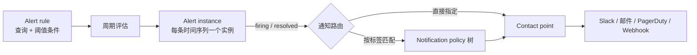

# Grafana 是什么

做安全监控时会遇到一个现实问题：数据源分散在各地——指标在 Prometheus 里，日志在 Loki 或 Elasticsearch 里，告警规则又在另一套系统里，想拼出一块能看的大屏得同时对接好几个系统。Grafana 是开源的监控与可观测性可视化平台，官方定位是**查询、可视化、告警、理解你的指标，无论数据存在哪里**。

它自己基本不采集、不存储数据，而是作为展示和告警的统一前端，接在几十种数据源之上。仓库在 [GitHub](https://github.com/grafana/grafana) 上开源，核心版本采用 AGPL-3.0-only 许可。

## 理解 Grafana

先要建立的心智模型：**Grafana 不存监控数据**。官方对[数据源](https://grafana.com/docs/grafana/latest/datasources/)的定义是"到一个存储后端的连接"——数据存在 Prometheus、Loki、Elasticsearch 这些后端里，Grafana 只做查询和渲染。打开一张面板时，Grafana 用该数据源自己的查询语言（PromQL、LogQL、Lucene 等）向后端实时发查询，把返回结果画出来。它自己存的只有配置：仪表盘定义、数据源连接、用户权限、告警规则，默认落在内置 SQLite 里，生产环境可在[配置](https://grafana.com/docs/grafana/latest/setup-grafana/configure-grafana/)中换成 MySQL 或 PostgreSQL。

完整链路是：数据源 → 查询 → 面板。

- **数据源层**回答"数据在哪"：Grafana 通过插件协议对接各类存储，每个查询可以指定不同数据源
- **Grafana 本体**回答"怎么把数据变成图"：面板（Panel）是渲染单元，仪表盘（Dashboard）是面板的组合，告警引擎持续评估规则
- **消费层**回答"结果给谁看"：大屏轮播、临时排障的 Explore、推到 Slack/PagerDuty 的告警通知

为什么能同时挂多个数据源？因为查询层不落地监控数据，加一个数据源只是多一条"到某个存储后端的连接"，每个面板（精确到面板里的每个查询）独立指定来源，互不影响。这个模型带来的直接好处是换存储不用换前端：今天日志在 Elasticsearch，明天迁到 Loki，查询语句改一改，仪表盘的排版和告警路由基本不用动。

## 核心功能特点

### 混合数据源查询

同一张图里可以混用不同数据源，按查询粒度指定来源。比如一条曲线来自 Prometheus 的主机指标，另一条来自 MySQL 里的业务表，两边数据在同一个坐标系里对齐——做安全分析时常需要这种"流量曲线对上登录日志"的视角。

### 动态仪表盘

仪表盘支持模板变量，顶部下拉切换主机、机房、服务，所有面板跟着变。官方维护了一个[仪表盘市场](https://grafana.com/grafana/dashboards/)，社区贡献了大量现成模板，导入即用，常见的系统监控、K8s、数据库面板都有。

### Explore 与日志探索

Explore 是临时查询界面，用于排障时的 ad-hoc 查询。一个实用的点：**从指标跳到日志时保留标签过滤条件**——在监控图上看到某台机器异常，直接切到同一台机器的日志流，不用重新敲过滤条件。日志还能实时滚动，接近 tail -f 的体验。

### 统一告警

Grafana 自带告警引擎（建立在 Prometheus 告警模型之上），官方[告警概念文档](https://grafana.com/docs/grafana/latest/alerting/fundamentals/)把工作流程讲得很清楚：

- **Alert rule**：一条或多条数据源查询加一个阈值条件，查询可以跨数据源
- **周期评估与实例**：规则被周期性评估，按时间序列或维度展开成多个 alert instance——一条 `sum by(cpu)` 的规则就能分别盯每颗 CPU，不用逐个配。只有 firing 和 resolved 状态的实例会进入通知环节
- **[Contact point](https://grafana.com/docs/grafana/latest/alerting/configure-notifications/manage-contact-points/)**：决定通知文案和发往哪里，邮件、Slack、PagerDuty、Webhook 都是可选目的地
- **[Notification policy](https://grafana.com/docs/grafana/latest/alerting/configure-notifications/create-notification-policy/)**：告警量大时的路由层，按标签匹配把实例分给不同 contact point（比如按团队或服务分流），组织成树形结构，树根是默认策略，保证所有实例都有去处
- **降噪手段**：相关实例默认分组合并成一条通知；silence 用于一次性静默（比如维护窗口），mute timing 用于周期性静默（夜间、周末）。两者只暂停通知，不中断规则评估

规则直接写在仪表盘对应的查询上，看图时顺手就把告警配了，不用再维护另一套告警系统。

### LGTM 栈

Grafana Labs 的开源可观测性栈合称 LGTM——Loki、Grafana、Tempo、Mimir，四个项目各管一类信号，Grafana 是它们共同的查询前端：

| 项目 | 角色 | 关键设计 |
|------|------|----------|
| [Loki](https://grafana.com/docs/loki/latest/) | 日志聚合 | 只给日志流的标签建索引，不索引正文；正文压缩成 chunk 存对象存储，成本明显低于全文索引方案。采集端（如 Alloy）抓日志、打标签后主动推送 |
| [Tempo](https://grafana.com/docs/tempo/latest/) | 分布式追踪 | 只依赖对象存储运行，兼容 Jaeger、Zipkin、OpenTelemetry 等追踪协议 |
| [Mimir](https://grafana.com/docs/mimir/latest/) | 指标长期存储 | 为 Prometheus / OpenTelemetry 指标提供多租户、可水平扩展的长期存储，单机 Prometheus 存不下或要跨团队共用时接它 |
| Grafana | 可视化与告警 | 上面三者的统一查询入口 |

四类信号之间能互跳：Prometheus 指标里的 exemplar 点一下就进到 Tempo 的对应 trace，Loki 日志行可以通过 derived field 关联 trace。排障时"指标异常 → 对应 trace → 相关日志"是一条连贯路径，这也是整套栈打包使用的价值所在。

### 开源版与商业版的分界

选型前要搞清楚的事。核心可视化、数据源插件、告警引擎都在 AGPL 开源版里，免费可用；[Grafana Enterprise 和 Grafana Cloud](https://grafana.com/pricing/) 则提供企业级插件（如 Oracle、Splunk 数据源）、SAML、增强的权限与报表等。对多数自建监控的团队，开源版够用。

### Grafana 和 Zabbix 的定位差异

两者常被放在一起比较，但解决的层面不同：

| 维度 | Grafana | Zabbix |
|------|---------|--------|
| 定位 | 可视化与告警前端 | 完整监控系统（采集+存储+告警+展示） |
| 数据采集 | 不管，依赖外部数据源 | √（Agent / SNMP / IPMI 等） |
| 数据存储 | 不存监控数据，只存自身配置 | √（MySQL/PostgreSQL/TimescaleDB） |
| 可视化 | √，强项 | 有内置图表，能力较基础 |
| 告警 | √，基于已接入的查询 | √，触发器+动作，内置通知升级 |
| 日志 | 依赖 Loki/ES 等数据源 | 支持日志文件监控（作为监控项） |
| 许可 | AGPLv3（另有 Enterprise/Cloud） | 7.0 起 AGPLv3，6.4 及之前 GPLv2 |

实际部署里两者经常共存：Zabbix 负责采集和告警，Grafana 接 Zabbix 数据源出大屏。

## 典型应用场景

1. **安全监控大屏**：SOC 值班室的轮播大屏，把 WAF 告警、主机入侵检测事件、流量异常统一接到 Grafana。两条具体接入路径：
   - 已有 ELK 体系：安全日志和告警已在 Elasticsearch 里，用 Grafana 内置的 [Elasticsearch 数据源](https://grafana.com/docs/grafana/latest/datasources/elasticsearch/)直连（支持 ES v7.17+、8.x、9.x），Lucene 语法或 ES|QL 查告警索引，还能把日志事件作为 annotation 叠在指标图上。凭据按文档要求用只读权限的账号或 API key
   - 用 Wazuh：Wazuh server 生成的告警存进 [Wazuh indexer](https://documentation.wazuh.com/current/getting-started/components/wazuh-indexer.html)，落在 `wazuh-alerts-*` 系列索引里。Grafana 侧安装官方 [OpenSearch 数据源插件](https://grafana.com/grafana/plugins/grafana-opensearch-datasource/)，直连 indexer 建数据源，面板里按规则级别、Agent 分组统计，配时间过滤出大屏
2. **日志可视化**：配合 [Loki](https://grafana.com/oss/loki/)（Grafana 生态的日志系统，标签模型和 Prometheus 一致）做日志检索和实时滚动，或接已有的 Elasticsearch
3. **指标排障**：Explore 里指标与日志互跳，定位"曲线飙高那一刻日志里发生了什么"
4. **多数据源聚合展示**：机房动环、云平台 API、自建脚本输出，只要存进了支持的数据源都能上同一块屏
5. **告警中心**：在没有独立告警系统的中小团队里，直接用 Grafana 告警引擎承担通知分发

## 学习资源

- **项目主仓库**：[github.com/grafana/grafana](https://github.com/grafana/grafana)（README 含功能清单，AGPL-3.0-only 许可）
- **官方文档站**：[grafana.com/docs/grafana/latest](https://grafana.com/docs/grafana/latest/)（安装、配置、数据源、告警的权威入口）
- **数据源概念**：[grafana.com/docs/grafana/latest/datasources](https://grafana.com/docs/grafana/latest/datasources/)（"Grafana 不存数据"这个模型的官方表述）
- **告警概念**：[grafana.com/docs/grafana/latest/alerting/fundamentals](https://grafana.com/docs/grafana/latest/alerting/fundamentals/)（alert rule、contact point、notification policy 的工作流程）
- **在线体验**：[play.grafana.org](https://play.grafana.org/)（官方演示实例，不用装就能点）
- **仪表盘市场**：[grafana.com/grafana/dashboards](https://grafana.com/grafana/dashboards/)（可导入的现成仪表盘）
- **LGTM 各项目文档**：[Loki](https://grafana.com/docs/loki/latest/)、[Tempo](https://grafana.com/docs/tempo/latest/)、[Mimir](https://grafana.com/docs/mimir/latest/)
- **OpenSearch 数据源插件**：[grafana.com/grafana/plugins/grafana-opensearch-datasource](https://grafana.com/grafana/plugins/grafana-opensearch-datasource/)（接 Wazuh indexer 用）
- **安装指南**：[grafana.com/docs/grafana/latest/setup-grafana/installation](https://grafana.com/docs/grafana/latest/setup-grafana/installation/)
