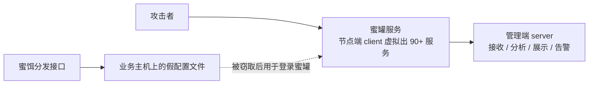

# HFish 是什么

内网检测有个老问题：IDS 每天产生大量告警，绝大多数是误报，真正的横向移动淹没在里面。蜜罐的思路反过来——在网络里挂一个没有任何业务的假服务，正常流量永远不会碰它，只要有人来碰，基本就是攻击行为。告警量小，但每条都值得看。

HFish 是微步在线（ThreatBook）旗下的社区型免费蜜罐，侧重企业安全场景，官方把用途归为三类：内网失陷检测、外网威胁感知、威胁情报生产。它在 2019 年 8 月以开源形式发布，2021 年 2 月发布 v2 版本后转为闭源、向所有用户免费授权使用——GitHub 仓库目前只剩 docs 目录托管文档，不再提供源码，这点选型前要知道。

## 理解 HFish

HFish 采用 B/S 架构，由管理端（server）和节点端（client）组成。架构上把风险拆开了：管理端只做数据的分析和展示，节点端负责构建蜜罐服务，真正承受攻击的是蜜罐本身。节点端被打穿不心疼，管理端藏在后面。

## 核心功能特点

### 90 多种蜜罐服务

覆盖基本网络服务、OA 系统、CRM 系统、NAS 存储、Web 服务器、运维平台、安全产品、无线 AP、交换机/路由器、邮件系统、IoT 设备等类型，同时支持用户自制 Web 蜜罐。另有一项可开关的全端口扫描感知能力，用来抓内网扫描探测行为。

### 中低交互与高交互的分工

蜜罐按交互深度分两类，差别在于"给攻击者看到多少真东西"：

- **低交互蜜罐**只模拟服务的协议应答——攻击者连上 SSH 蜜罐，看到的是伪装出来的登录提示和 banner，背后是程序按剧本回包。安全、轻量，但攻击者多试几步就可能识破，能拿到的攻击数据也止步于连接和爆破尝试
- **高交互蜜罐**给的是真实系统，攻击者登录成功后面对一台真的机器，执行的每条命令、下载的每个样本都是真实发生的。数据价值高，代价是蜜罐本身可能被真正打穿、甚至被当作跳板

HFish 本体是中低交互蜜罐，90 多种服务都是模拟出来的，跑在节点端本地，被打穿也不心疼。高交互 SSH/Telnet 蜜罐走了另一条路：由 HFish 团队在云端统一运维一片真实蜜网，前面用 nginx 负载均衡接攻击流量。本地节点上添加高交互服务后，**攻击者与本地节点的流量交互会被原样转发到云端蜜网，威胁行为全部发生在云端**（原理见[高交互蜜罐文档](https://github.com/hacklcx/HFish/blob/master/docs/highinteractive.md)）。相当于把高交互的风险外包给官方，本地只留一个转发口。使用条件是节点能连通 `zoo.hfish.net`、管理端能连通 `zoo.hfish.net` 和 `api.hfish.net`。

数据回收上，管理端每五分钟向 `api.hfish.net` 拉一次高交互蜜罐数据。拉回来的内容相当具体：攻击者的登录行为、这次登录成功还是失败、登录成功后执行了哪些命令；如果攻击过程带了样本（比如 wget 下来的木马），样本会出现在关联信息下载里。自测可以用公开账号 `root/123456` 登录验证链路。

### 攻击者上钩后能看到什么

蜜罐的价值最终体现在数据页面上。HFish 管理端把攻击数据拆成四个页面（详见[攻击查看文档](https://github.com/hacklcx/HFish/blob/master/docs/3-3-checkattack.md)）：

| 页面 | 收什么 | 实现方式 |
|------|--------|----------|
| 攻击列表 | 所有对蜜罐的攻击信息 | 节点部署蜜罐后，攻击者对蜜罐的所有攻击都被收录 |
| 扫描感知 | 节点主机网卡上的所有连接 | 记录对节点所有网卡的连接：来访 IP、连接 IP 和端口 |
| 攻击来源 | 所有连接和攻击节点的 IP | 蜜罐溯源和反制成功的信息也记录在这里 |
| 账号资产 | 攻击者爆破用的账号密码 | 统一展示爆破词表，可自定义监控词汇（员工姓名、公司名等），命中即高亮告警 |

账号资产这个页面值得单独说：攻击者手里的爆破字典往往混着从其他地方拖来的真实账号，企业把自己的邮箱后缀、员工姓名配成监控词后，蜜罐就从"看攻击"变成了"看泄露"——攻击者用的账号一旦和企业信息重合，说明对应账号可能已在外流通。

### 蜜饵：每个都唯一的假文件

蜜饵是伪造的高价值文件，比如一份写着数据库地址和账号密码的 `payment_config.ini`。HFish 的蜜饵在分发时用 `$username$`、`$password$`、`$honeypot$` 三个变量生成专属内容，每份都不同。攻击者偷走文件后，无论从哪台机器用这批假凭证登录，防守方都能定位失陷源头在哪。节点端默认在 TCP/7878 提供蜜饵分发接口，到目标主机执行一条下发指令即可完成布防。

### 告警输出

支持邮件、syslog、webhook、企业微信、钉钉、飞书。syslog 和 webhook 两种形式可以把告警接进态势感知、NDR 或日志平台，蜜罐当探针用。

### 跨平台与低资源占用

节点端支持 Linux x32/x64/ARM、Windows x32/x64，以及多种国产操作系统和龙芯、海光、飞腾、鲲鹏等国产 CPU。节点端运行不需要 root 权限，但非 root 无法监听 1024 以下的端口。Docker 部署一条命令即可，管理后台在 `https://<server>:4433/web/`，初始账号 `admin` / `HFish2021`。

## 内网与外网部署的差异

同一个产品，挂在内网和挂在互联网上是两种用法，官方文档把两者分得很开（[内网场景](https://github.com/hacklcx/HFish/blob/master/docs/4-1-Intranet.md)、[外网场景](https://github.com/hacklcx/HFish/blob/master/docs/4-2-extranet.md)）：

| | 内网失陷检测 | 外网威胁感知 |
|--|--------------|--------------|
| 感知对象 | 已失陷主机的横向移动、勒索软件扫描、恶意员工刺探 | 自动化蠕虫、竞争对手、境外来源的真实攻击，甚至 0day |
| 管理端建议配置 | 2 核 4G 200G | 4 核 8G 200G，且**必须换 MySQL** |
| 节点端建议配置 | 1 核 2G 50G | 1 核 2G 50G |
| 典型服务模板 | 办公网监听 135/139/445/3389；服务器区模拟 Web、MySQL、Redis、Elasticsearch、SSH、Telnet | 按想观察的威胁类型自选 |
| 特别注意事项 | 节点要铺得密，建议每个网段两个节点，放网段头和网段尾 | 攻击量大，先把蜜罐加进网络检测设备白名单；部分行业要向监管单位报备蜜罐地址 |

两个场景通用的约束：日志磁盘占用跟攻击量直接相关，管理端硬盘建议 200G 起；外网攻击量大，默认的 SQLite 扛不住，这是"必须换 MySQL"的原因。完整配置表见[部署文档](https://github.com/hacklcx/HFish/blob/master/docs/2-0-deploy.md)。

内网场景还有个功能开关要慎重：扫描感知会记录节点主机网卡上的所有连接，节点装在纯净机器（只跑 HFish 的全新机器）上时强烈建议开启；如果节点和正常业务共用一台服务器，正常业务连接也会被记录，产生海量误报，这时改用「TCP 端口监听蜜罐」只盯特定端口。

## 典型应用场景

官方场景文档列得比较具体，挑常用的：

1. **内网失陷检测**：攻击者横向移动时触碰蜜罐即告警，误报极少
2. **外网威胁感知与情报生产**：蜜罐是稳定的私有情报探针；外网部署攻击量大，官方要求把默认的 SQLite 换成 MySQL
3. **云环境风险感知**：云内网部署节点，感知云上失陷和探测行为
4. **员工账号泄露感知**：按企业邮箱后缀、员工姓名等信息定制监控
5. **攻防演练溯源**：蜜饵记录横向移动路径，演练期间可用来混淆攻击者视线
6. **安全意识培训**：用真实触碰记录做内部教育素材

## 学习资源

- **项目仓库（仅文档）**：[github.com/hacklcx/HFish](https://github.com/hacklcx/HFish)（v2 起闭源，仓库只托管文档）
- **官网与下载**：[hfish.net](https://hfish.net)
- **蜜罐基础概念**：[1-1-honeypot.md](https://github.com/hacklcx/HFish/blob/master/docs/1-1-honeypot.md)
- **高交互蜜罐原理**：[highinteractive.md](https://github.com/hacklcx/HFish/blob/master/docs/highinteractive.md)
- **攻击数据查看**：[3-3-checkattack.md](https://github.com/hacklcx/HFish/blob/master/docs/3-3-checkattack.md)（四个数据页面的口径说明）
- **部署配置要求**：[2-0-deploy.md](https://github.com/hacklcx/HFish/blob/master/docs/2-0-deploy.md)（内外网配置表、权限要求）
- **内网场景**：[4-1-Intranet.md](https://github.com/hacklcx/HFish/blob/master/docs/4-1-Intranet.md)；**外网场景**：[4-2-extranet.md](https://github.com/hacklcx/HFish/blob/master/docs/4-2-extranet.md)
- **Docker 部署**：[2-1-docker.md](https://github.com/hacklcx/HFish/blob/master/docs/2-1-docker.md)（含自动升级方案）
- **场景说明**：[4-0-scene.md](https://github.com/hacklcx/HFish/blob/master/docs/4-0-scene.md)
