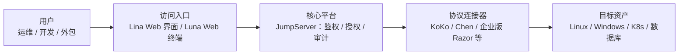
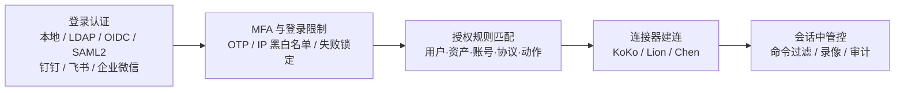
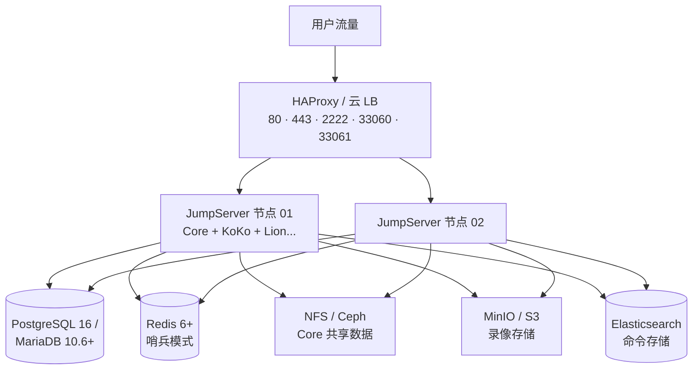

# JumpServer 是什么

服务器一多，账号就管不住：root 密码发在群里，外包离职半年还留着登录方式，谁在哪台机器上执行过什么命令，出事时没人说得清。堡垒机要解决的就是这件事——把所有对服务器、数据库、K8s 集群的访问收敛到一个入口，先鉴权授权，再建立连接，全程留痕可回放。

JumpServer 是飞致云（FIT2CLOUD）开源的特权访问管理（PAM）平台，GPLv3 协议，项目版权从 2014 年延续至今。它给运维和开发团队一个统一工作空间，安全访问 SSH、RDP、Kubernetes、数据库、网站、RemoteApp、VirtualApp 等资源，当前版本还带一个 AI 组件 Kael，支持终端内 AI 提问和 AI 助手。

## 理解 JumpServer

JumpServer 按职责拆成多个组件，官方 README 给出了完整清单。核心项目六个：

| 组件 | 职责 |
|------|------|
| JumpServer | 核心平台：用户、资产、授权、审计 |
| Lina | Web 管理界面 |
| Luna | Web 终端与原生客户端 |
| KoKo | 通用协议连接器与代理 |
| Chen | Web 数据库连接器 |
| Kael | AI 组件 |

部署侧另有 Installer（安装管理工具）和 Docker Web（Web 网关与静态资源）。官方一键脚本 `quick_start.sh` 要求一台干净的 64 位 Linux 服务器，至少 4 核 CPU、8 GB 内存，装完用浏览器打开对应地址，初始账号 `admin` / `ChangeMe`。

### 各组件承担的协议

官方[架构文档](https://github.com/jumpserver/docs/blob/v4.0/docs/architecture.md)把组件分工说得很细，按协议拆开看：

| 组件 | 承担的协议与方式 | 实现要点 |
|------|------------------|----------|
| Core | 无直接协议，是核心组件，其余组件都依赖它启动 | 用户、资产、授权、审计的大脑 |
| KoKo | SSH、Telnet、WinRM、Kubernetes、SFTP，以及数据库协议 | Golang 实现，数据库连接依赖 usql；本地起 2222 端口，支持用 SSH 客户端直连 |
| Lion | RDP、VNC 的 Web 端访问 | Golang + Vue，底层基于 Apache Guacamole |
| Razor | RDP（企业版） | JumpServer Client 客户端方式访问 Windows 的默认组件；仓库私有 |
| Magnus | 数据库原生协议代理（企业版） | 让 Navicat 这类本地客户端经代理连库 |
| Nec | VNC 协议代理（企业版） | — |
| Chen | 数据库的 Web GUI 访问 | 浏览器里连库 |
| Celery | 无 | 异步任务组件，跑自动化作业 |
| Video Worker | 无（企业版） | 把 Razor 和 Lion 产生的会话录像转码成 MP4 |
| Kael | AI 能力 | 终端内 AI 提问、AI 助手 |

社区版里字符协议走 KoKo、图形协议走 Lion、Web 数据库走 Chen，已经能覆盖 SSH/K8s/RDP/Web 连库这些主流入口；企业版再补上客户端方式的 Razor、Magnus、Nec。

## 认证与授权：一次连接的完整链路

堡垒机的价值不在"能连"，而在"谁能连、连什么、用什么账号连、连上能干什么"全部受控。JumpServer 把这条链路拆成四道闸：

**登录认证**支持本地密码和 LDAP、CAS、OIDC、SAML2、OAuth2、Passkey、Radius 及企业微信、钉钉、飞书等第三方来源。MFA 用 OTP 动态码，全局策略可设禁用、所有用户启用或仅管理员启用；全局启用后单个用户无法自行关闭。登录侧还有一层限制：登录失败次数锁定、IP 黑白名单、仅一台设备在线等，见[安全设置文档](https://jumpserver.com/docs/security/auth-security)。

**授权规则**是核心，一条规则把五个维度绑在一起（详见[资产授权文档](https://github.com/jumpserver/docs/blob/v4.0/docs/manual/admin/console/authorization_manage/assets_authorization.md)）：

| 维度 | 可选范围 |
|------|----------|
| 用户 / 用户组 | 被授权的人 |
| 资产 / 节点 | 可连接的资产或资产组 |
| 账号 | 所有账号、指定账号，或虚拟账号（手动输入、与登录用户同名、匿名不代填） |
| 协议 | 全部或指定协议 |
| 动作 | 连接、上传、下载、剪切板（RDP/VNC）、SSH 会话分享等 |

外加生效和失效日期——外包授权到期自动失效，不用记着回收。匹配逻辑上有三个坑要注意：用户和用户组同时选是"都生效"，任一必填项为空整条规则不生效，规则不支持 `*` 通配符全匹配。

**建连与会话中**还有一层[访问控制](https://github.com/jumpserver/docs/blob/v4.0/docs/manual/admin/console/access_control/acls.md)：命令过滤器按用户、资产、账号绑定命令组（正则或固定命令），动作分拒绝、接收、审批、告警四档，优先级 1 到 100 数值越小越先匹配。`rm -rf` 这类命令可以直接拦，或者触发审批让人复核。用户登录复核和资产连接复核（按用户、资产、账号三维限制连接，可要求审批）属于企业版能力。

## 核心功能特点

### 统一访问入口

浏览器打开 Web 终端就能连 SSH、数据库和 K8s，也可以用本地客户端经代理组件直连。机器的账号密码不再发给个人，凭证托管在平台上，权限按资产粒度下发。

### 协议覆盖面广

字符类的 SSH、Kubernetes，图形类的 RDP，数据库，以及网站、RemoteApp、VirtualApp 应用发布，都在同一个授权和审计框架下。

### 会话审计与录像

平台记录会话数据，企业版另配 Video Worker 做录像转码。这是堡垒机的本职能力：谁在什么时间连了哪台资产、做了什么，事后可查。审计台里的实现细节（见[会话记录文档](https://github.com/jumpserver/docs/blob/v4.0/docs/manual/admin/audit/session_audit/session_record.md)）：

- **在线会话**：实时看当前所有连接，出现违规操作可直接终断会话。实时监控支持 SSH 和 RDP 协议会话；RDP 客户端方式（Razor）和数据库协议会话不支持实时监控
- **历史会话**：录像可在线回放，也能下载后用 JumpServer 离线录像播放器看。单个会话的详情页聚合了五类记录：基本信息、执行的命令、协作（会话分享）记录、文件传输记录、连接活动
- **水印**：开启后管理界面、会话窗口和录像里都会带访问者水印，截屏外发也能追溯人。注意 RDP 客户端方式的连接不支持水印

录像和命令记录的存储位置都能外置（见[存储设置文档](https://github.com/jumpserver/docs/blob/v4.0/docs/manual/admin/system_settings/storage.md)）：录像默认存本地，可改到 S3、Ceph、Swift、OSS、Azure、OBS、COS 这类对象存储；命令记录默认存 JumpServer 自己的数据库，量大时可切到 Elasticsearch，按日期建索引。审计数据量大之后，这两件事基本必须做。

### AI 能力

Kael 组件提供 AI 助手和终端内 AI 提问，官方截图展示的是在 SSH 会话中直接向 AI 询问当前上下文。实际效果取决于接入的模型。

### 社区版和企业版差在哪

README 的组件表把边界标得很清楚，企业版组件均为私有仓库：

| 能力 | 社区版 | 企业版 |
|------|--------|--------|
| 核心平台、Lina Web 界面、Luna Web 终端 | √ | √ |
| KoKo 协议代理、Chen Web 数据库连接、Kael AI | √ | √ |
| Tinker Windows 应用连接器 | √（README 标注社区版可免费使用） | √ |
| Razor RDP 协议代理、Magnus 数据库协议代理、Nec VNC 协议代理 | × | √ |
| Panda Linux 应用连接器 | × | √ |
| Video Worker 录像转码、JDMC 主机运维服务 | × | √ |

社区版能覆盖 SSH、K8s、Web 数据库这些最常见的访问类型；RDP、VNC、数据库原生协议的独立代理组件在企业版。选型时按自己环境里图形协议和原生数据库客户端的占比来判断够不够用。

## 高可用部署形态

单机版把全部组件塞进 Docker 跑在一台机器上，测试够用，生产不行。官方[集群部署参考](https://github.com/jumpserver/docs/blob/v4.0/docs/installation/setup_linux_lb/requirements.md)给出的形态是把无状态和有状态的东西分开：

几个要点：

- 前端用 HAProxy 或现有云 LB，用第三方 LB 要自己处理好 session 保持和 WebSocket 转发；扩容就是加 JumpServer 节点再挂回 LB
- Core 的数据走 NFS 共享，但生产环境官方建议用 Ceph 或高可用 NFS 替代，避免单点
- 录像放 MinIO/S3，命令记录放 ES——这两个组件在多节点形态下不是可选项，是上表里的默认角色
- 各组件有健康检查端点（Core 的 `/api/health/`、KoKo 的 `/koko/health/`、Lion 的 `/lion/health/`），LB 探活直接打这几个路径
- 数据库要求 PostgreSQL 16 或 MariaDB 10.6+，Redis 6.0+ 用哨兵模式，均支持 TLS

除 JumpServer 自身组件外，数据库、Redis、存储这些外围件的高可用要参考各自官方文档另行搭建，这套文档解决的是 JumpServer 节点本身的多活。

## 典型应用场景

1. **收敛运维入口**：所有 SSH/RDP 访问经堡垒机中转，服务器不用直接暴露登录端口
2. **外包与临时授权**：按资产和时间授权，人走权限收，不用改机器密码
3. **数据库访问管控**：经 Chen 在浏览器里连库，DBA 操作留痕
4. **K8s 集群运维**：kubectl 经 KoKo 代理接入，集群操作纳入审计
5. **合规需求**：运维审计类要求（如等保）直接由会话记录和录像覆盖

## 学习资源

- **项目主仓库**：[github.com/jumpserver/jumpserver](https://github.com/jumpserver/jumpserver)（含中文 README、架构图和完整组件清单）
- **官方文档站**：[jumpserver.com/docs](https://jumpserver.com/docs)（安装、配置、使用的权威入口）
- **中文文档仓库**：[github.com/jumpserver/docs](https://github.com/jumpserver/docs)（[系统架构](https://github.com/jumpserver/docs/blob/v4.0/docs/architecture.md)、[集群部署参考](https://github.com/jumpserver/docs/blob/v4.0/docs/installation/setup_linux_lb/requirements.md)、[资产授权](https://github.com/jumpserver/docs/blob/v4.0/docs/manual/admin/console/authorization_manage/assets_authorization.md)等手册都在这里）
- **安装工具**：[github.com/jumpserver/installer](https://github.com/jumpserver/installer)
- **协议连接器**：[github.com/jumpserver/koko](https://github.com/jumpserver/koko)（字符协议）、[github.com/jumpserver/lion](https://github.com/jumpserver/lion)（图形协议）
- **Web 终端**：[github.com/jumpserver/luna](https://github.com/jumpserver/luna)
- **Web 界面**：[github.com/jumpserver/lina](https://github.com/jumpserver/lina)
- **数据库连接器**：[github.com/jumpserver/chen](https://github.com/jumpserver/chen)
- **AI 组件**：[github.com/jumpserver/kael](https://github.com/jumpserver/kael)
