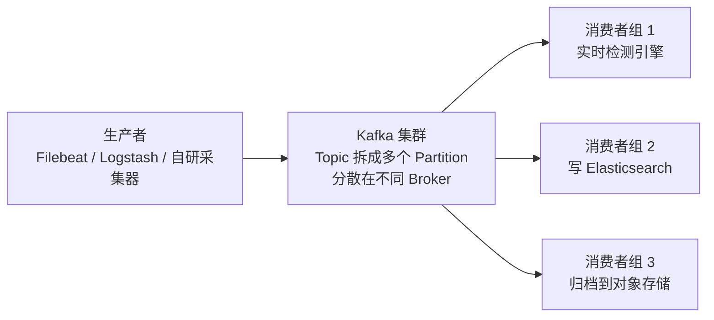
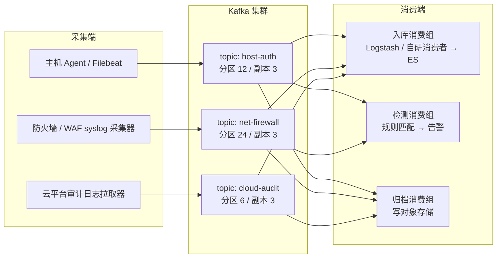

# Kafka 是什么

安全设备日志量一大，直接写库就崩。防火墙、WAF、IDS、主机 Agent，每台每秒产生几百到几万条日志，到了峰值的某个早晨，所有设备一起吐，后面的 Elasticsearch 或数据库接不住，结果是日志丢、告警迟、溯源断链。Kafka 是 Apache 基金会的分布式事件流平台，在安全数据管道里扮演"蓄水池加总线"的角色：生产者只管写，消费者按自己的节奏读，写入洪峰先堆在 Kafka 里，下游慢慢消化。

它最初是 LinkedIn 内部项目，2011 年开源，后来捐给 Apache。官方文档给自己的定位是"distributed event streaming platform"，消息队列只是它最常被用到的那一面。

## 理解 Kafka

- **生产者**只负责往 Topic 追加写，不关心谁读、读没读
- **Broker** 按 Topic 存数据，Topic 切成若干 Partition 分散在多台机器上，读写压力随之摊平
- **消费者**各自维护消费进度（offset），同一份数据可以被多个消费者组各读一遍，互不干扰

"写一次、多方各读各的"是安全管道最需要的一点：同一份原始日志，检测引擎要读，入库的要读，归档的也要读，Kafka 一条链路全供上。

## 核心功能特点

### 分区：并发的最小单位

Topic 的数据被切成 Partition 分布在不同 Broker 上，客户端可以同时从多台 Broker 读写，这是它横向扩展的根。带 key 的事件（比如按源 IP 或主机名做 key）会固定写进同一个 Partition，保证同 key 有序。做会话还原、行为序列检测时，这个保证直接决定规则能不能写对。

分区数同时是消费侧并行度的上限。[官方设计文档](https://kafka.apache.org/43/design/design/)写得很直白：任一时刻，一个分区在一个消费者组内只归一个消费者读。组里消费者数量超过分区数，多出来的就是闲置。所以日志量大的 Topic 建的时候就要把分区数规划够，这是少数几个事后难补救的参数。

### 副本与 ISR：写进来就不容易丢

每个分区本质是一条复制日志：一个 leader 副本负责读写，若干 follower 副本从 leader 同步数据。选新 leader 时 Kafka 不用多数派投票，而是动态维护一组"跟得上 leader"的同步副本（ISR，in-sync replicas）：一条写入要等 ISR 里所有副本都收到才算 committed，ISR 成员才有资格在 leader 挂掉时被选成新 leader，ISR 名单的变化持久化在集群元数据里。这个模型下 f+1 个副本就能容忍 f 个副本故障而不丢已提交的数据；多数派方案容两个故障要五份副本，对日志这种大数据量负载太贵了。

生产上常见的副本因子是 3（[官方入门文档](https://kafka.apache.org/intro)的原话）。生产者可以自选持久化档位：等消息 committed（ISR 全部确认）、只等 leader 落盘、或者完全异步发送，延迟和可靠性自己权衡。

### 消费者组：组内分工，组间独立

同一个组里，分区被分配给组内成员，任一时刻一个分区只归一个消费者。组与组之间互不影响，各自维护自己的消费进度，所以同一份日志可以给检测引擎、入库程序、归档程序各读一遍。

消费进度就是一个整数 offset（下一条要读的消息位置），由消费者维护，周期性 checkpoint 到 Kafka 的内部主题里。offset 小到一个整数带来两个实惠：确认消费的代价极低；消费者可以把 offset 往回拨，重读历史数据。检测规则改了一版想重跑上周的原始日志，就是把组的 offset 拨回去再消费一遍。

成员变动触发再均衡（rebalance）：组里有人加入或掉线，分区要重新分配。4.0 起 GA 的新一代消费者再均衡协议（KIP-848）把分配逻辑挪到服务端、改成增量式，[官方运维文档](https://kafka.apache.org/43/operations/consumer-rebalance-protocol/)称它不再依赖全局同步屏障，再均衡耗时随之下降。目前默认仍是 classic 协议，要用新协议得在消费者端显式把 `group.protocol` 设为 `consumer`。

### offset 提交的时机决定投递语义

[设计文档](https://kafka.apache.org/43/design/design/)把消费者的处理顺序讲得很清楚：

- **先存 offset 再处理**：消费者崩溃在两者之间，接手的进程从已存位置继续，中间那批消息实际没被处理——at-most-once，消息可能丢
- **先处理再存 offset**：崩溃在两者之间，接手者重读已处理过的消息——at-least-once，消息可能重复

生产者侧同理：broker 收到了写但确认丢了，producer 重发，日志里就可能出现重复条目，默认同样是 at-least-once。从 0.11 起，producer 支持幂等发送（broker 给每个 producer 分配 ID，按序列号去重）和事务（跨多个分区原子写，要么全成功要么全失败）。

exactly-once 只在"从 Kafka 读、处理、写回 Kafka"的链路里能严格成立：把 offset 和输出写进同一个事务，事务失败则 offset 回滚、输出对 `read_committed` 级别的其他消费者不可见，Kafka Streams 的精确一次就是这么实现的。落到"消费 Kafka 写 Elasticsearch"这种外部系统，Kafka 管不了 ES 那半段，工程做法是消费端幂等：拿日志里稳定的事件 ID 做 ES 文档 ID，重复消费变成覆盖同一条文档，at-least-once 加幂等写入得到等价于精确一次的效果。

默认配置下消费者 `enable.auto-commit=true`、每 5 秒后台提交一次（`auto.commit.interval.ms` 默认 5000，见[消费者配置文档](https://kafka.apache.org/43/configuration/consumer-configs/)），崩溃时最多重演最近一个提交周期内的消息，行为偏 at-least-once。要精细控制就关掉自动提交，处理完一批再手动提交。安全日志管道里 at-least-once 几乎总是正确选择：宁可告警重复，不可线索丢失。

### 读完不删，按保留策略过期

传统消息队列消费完即删，Kafka 的做法不同：事件被读多少次都行，删不删由每个 Topic 的保留配置决定，可以按天数也可以按总大小。官方文档还明确说，Kafka 的性能相对数据量基本是常数，长时间存数据没有问题。落到安全场景就是两件事：回溯重放成为可能（配合上一节的 offset 回拨）；入库服务挂了，恢复后从 offset 接着读，数据不丢。

### KRaft 取代 ZooKeeper

Kafka 早期依赖 ZooKeeper 存集群元数据，运维要同时管两套分布式系统，扩缩容都牵扯两边。社区后来做了 KRaft 模式，把元数据管理收回 Kafka 内部；从 4.0 版本起，ZooKeeper 被彻底移除，新部署只需要 Kafka 自己。现在搭一套测试集群，一个二进制加一份配置就能起。

按[KRaft 运维文档](https://kafka.apache.org/43/operations/kraft/)，KRaft 模式下每台服务器用 `process.roles` 声明角色：`broker`、`controller`，或两者兼任。兼任形态叫 combined，部署简单，适合开发环境，官方明确不建议用在关键生产环境——controller 和 broker 挤在一起，没法独立滚动升级和扩容。controller 组成元数据法定人数，通常选 3 或 5 台：3 台容 1 台故障，5 台容 2 台，多数派存活元数据才可用。集群元数据从"外部协调系统里的状态"变成 Kafka 自己内部的一条复制日志，运维要管的分布式系统从两套收成一套。

### 和传统 MQ 的差别

| 对比项 | Kafka | RabbitMQ 等传统 MQ |
|--------|-------|--------------------|
| 设计目标 | 高吞吐事件流、日志管道 | 任务分发、灵活路由 |
| 消息读后 | 保留，按保留策略过期 | 默认确认后删除 |
| 同一份数据多方消费 | 原生支持，消费者组互相独立 | 要靠交换机绑多个队列模拟 |
| 顺序保证 | Partition 内有序 | 队列内有序 |
| 吞吐取向 | 批量、顺序写盘，为吞吐优化 | 单条投递，为延迟和路由优化 |
| 回溯历史数据 | √ | × |

传统 MQ 并非不能用，只是日志管道这种"量大、要多方消费、偶尔要回溯"的负载，恰好长在 Kafka 的设计甜区上。

### 周边组件

官方文档里和 Kafka 并列的还有两个子项目：

- **Kafka Connect**：现成的连接器框架，用配置而不是代码把 Kafka 和外部系统（数据库、对象存储、Elasticsearch）接起来
- **Kafka Streams**：流处理客户端库，在消费的同时做过滤、聚合、关联，轻量的实时检测逻辑可以直接写在这里

## 典型应用场景

1. **SIEM 数据源总线**：所有安全设备的日志统一进 Kafka，SIEM、检测引擎、数据湖各自订阅，新增一个下游不用改采集端
2. **采集与入库解耦**：采集器只认 Kafka，Elasticsearch 或 ClickHouse 挂了不影响采集，恢复后断点续传
3. **削峰填谷**：早高峰日志洪峰堆在 Kafka 里，下游按消费能力匀速拉取，省去给峰值流量准备常驻算力
4. **实时流式检测**：用 Kafka Streams 或外部 Flink 消费原始日志，做滑动窗口聚合、频次异常检测，告警不等人肉查询
5. **多机房日志汇聚**：配合 MirrorMaker 做跨机房复制，把各分支机构的日志汇到总部统一分析

## 安全日志管道的典型拓扑

把前面几节拼起来，一条常见的安全日志管道长这样：

按日志类型分 Topic 的理由很实际：分区数、副本数、保留周期都可以按 Topic 单独配。认证日志量小但溯源价值高，留 180 天；防火墙流量日志量大，留 14 天就够检测用。采集端只认 Kafka，ES 集群升级、检测引擎重启都不影响日志进来；每个消费组独立的 offset 保证三路消费互不阻塞，检测组消费得慢，入库组不会被拖住。

## 学习资源

- **官网**：[kafka.apache.org](https://kafka.apache.org/)（发布信息、生态列表）
- **官方文档**：[kafka.apache.org/documentation](https://kafka.apache.org/documentation/)（配置项和运维手册的权威入口）
- **入门概念**：[kafka.apache.org/intro](https://kafka.apache.org/intro)（Topic、Partition、保留策略的官方解释）
- **设计文档**：[kafka.apache.org/43/design/design](https://kafka.apache.org/43/design/design/)（ISR、投递语义、复制机制的取舍思路，本文多节内容的出处）
- **KRaft 运维**：[kafka.apache.org/43/operations/kraft](https://kafka.apache.org/43/operations/kraft/)（controller 法定人数与角色配置）
- **新一代再均衡协议**：[kafka.apache.org/43/operations/consumer-rebalance-protocol](https://kafka.apache.org/43/operations/consumer-rebalance-protocol/)（KIP-848 的服务端分配设计）
- **消费者配置项**：[kafka.apache.org/43/configuration/consumer-configs](https://kafka.apache.org/43/configuration/consumer-configs/)（offset 提交、组协议开关的默认值都在这里查）
- **快速上手**：[kafka.apache.org/quickstart](https://kafka.apache.org/quickstart)（本地起一个 KRaft 模式单机集群）
- **源码仓库**：[github.com/apache/kafka](https://github.com/apache/kafka)（含 KIP 设计提案链接，重大改动先在这里讨论）
