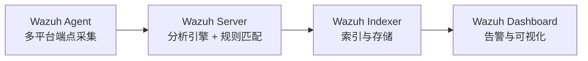

# Wazuh 是什么

商业 SIEM 大多按接入数据量计费，日志量一大账单就失控；而中小团队往往同时背着 PCI DSS、等保这类合规要求，需要文件完整性监控、漏洞扫描这些具体能力。Wazuh 是针对这个处境的开源方案：官方定位是把 XDR 和 SIEM 能力合在同一个平台里，覆盖本地、虚拟化、容器和云环境中的工作负载。

代码托管在 GitHub，以 GPLv2 协议发布，项目衍生自 OSSEC，由 Wazuh Inc. 维护，官网称全球有数千家组织在用。商用支持、培训和托管版 Wazuh Cloud 是它的商业模式。

## 理解 Wazuh

整套平台是"一个通用 Agent + 三个中心组件"：

- **Agent** 装在被监控的端点上，采集日志、文件完整性、软件清单等数据，默认走 1514/TCP 发给 Server，通信用 AES（128 位分组、256 位密钥）加密
- **Server** 跑分析引擎，对事件做解码和规则匹配，再用 Filebeat 经 TLS 把告警写入 Indexer
- **Indexer** 负责索引和存储（9200/TCP），即平台自带的搜索引擎
- **Dashboard** 是 Web 界面，查 Indexer 里的数据做可视化，同时调 Server 的 RESTful API（55000/TCP）管配置和状态

装不了 Agent 的设备（防火墙、交换机、路由器）可以走 Syslog 和 SSH 做无代理监控。部署形态分三档：全组件装一台机器的 all-in-one 适合实验和小环境；三个组件各自独立服务器的单节点部署适合中型环境；Server 和 Indexer 都组集群的多节点部署面向大流量和高可用场景。细节见官方[架构文档](https://documentation.wazuh.com/current/getting-started/architecture.html)。

### 通信与注册：几个端口各管一件事

平台内部通信走一组固定端口，[架构文档](https://documentation.wazuh.com/current/getting-started/architecture.html)列了完整清单，关键的几个：

| 端口 | 所在组件 | 用途 |
|------|----------|------|
| 1514/TCP | Server | Agent 连接服务，事件持续上报的通道（1514/UDP 可选，默认关闭） |
| 1515/TCP | Server | Agent 注册服务，领密钥走这里 |
| 1516/TCP | Server | Server 集群节点间通信 |
| 514/UDP | Server | Syslog 收集器，收网络设备日志（默认关闭） |
| 55000/TCP | Server | RESTful API，Dashboard 和外部工具调它查配置、管 Agent |
| 9200/TCP | Indexer | Indexer 的 RESTful API，Filebeat 往这里写告警 |
| 9300–9400/TCP | Indexer | Indexer 集群节点间通信 |
| 443/TCP | Dashboard | Web 界面 |

新装一台 Agent 要先进注册环节：Agent 配好 Server 地址后，自动向 1515 端口请求密钥并导入，密钥用于之后 1514 通道上的身份验证和 AES 加密（128 位分组、256 位密钥，Blowfish 可选）。也可以在 Server 侧通过 55000 的 API 申请密钥，再手动导入 Agent，适合批量自动化装机。两条路都写在官方[注册文档](https://documentation.wazuh.com/current/user-manual/agent-enrollment/index.html)里。

## 核心功能特点

### 日志数据分析：一条日志怎么变成告警

Agent 读取操作系统和应用日志，加密转发给 Server；装不了 Agent 的设备，Server 也能直接收 Syslog。一条日志进来之后在分析引擎里走三段路，官方[数据分析文档](https://documentation.wazuh.com/current/user-manual/ruleset/index.html)把流程写得很清楚：

1. **预解码**：日志带 syslog 头的话，先提出时间戳、主机名、程序名这几个通用字段
2. **解码**：解码器（decoder）按 XML 定义的正则把剩余内容切成结构化字段；JSON 格式的日志由内置 JSON 解码器直接处理。细节见[解码器文档](https://documentation.wazuh.com/current/user-manual/ruleset/decoders/index.html)
3. **规则匹配**：解码出的字段拿去和规则集比对，命中且级别达到阈值就出告警。规则按严重度分 0–16 级，默认只记录 3 级及以上（阈值 `log_alert_level` 可调），完整分级表见[规则分类文档](https://documentation.wazuh.com/current/user-manual/ruleset/rules/rules-classification.html)

告警写在 Server 的 `/var/ossec/logs/alerts/alerts.log` 和 `alerts.json`，再由 Filebeat 经 TLS 送进 Indexer，之后就能在 Dashboard 的 Security Events 里查到。

平台自带 3000 多条规则和解码器，覆盖常见系统和中间件。自定义规则可以写，但别放进 `/var/ossec/ruleset/` 目录——官方明确说了那里升级时会被覆盖，自定义内容放 `/var/ossec/etc/` 下的 `local_rules.xml` 和 `local_decoder.xml`。这套规则集是 Wazuh 当 SIEM 用的底子，覆盖错误、配置问题、恶意活动、策略违规等场景。

### 入侵检测

Agent 在被监控主机上扫恶意软件、Rootkit 和可疑异常，能发现隐藏文件、隐藏的进程和未登记的网络监听，还能识别系统调用返回结果中的不一致。

### 文件完整性监控（FIM）

监控指定文件的内容、权限、属主和属性变化，并且能识别出是哪个用户、哪个应用做的修改。PCI DSS 明确把 FIM 列为合规要求，这也是 Wazuh 在支付行业用得多的原因之一。

数据来自 Agent 本地的定期扫描加实时监控：Agent 对配置的路径算校验和、记属性，存进端点上的本地 SQLite 库（Windows 在 `C:\Program Files (x86)\ossec-agent\queue\fim\db`，Linux 在 `/var/ossec/queue/fim/db`）；Server 端的 wazuh-db 进程为每台 Agent 各维护一份镜像库（`/var/ossec/queue/db`），两边只同步有变化的条目，比对出不一致就产生告警。细节见官方 [FIM 原理文档](https://documentation.wazuh.com/current/user-manual/capabilities/file-integrity/how-it-works.html)。

### 漏洞检测

数据来源是 Agent 的 Syscollector 模块：它采集操作系统信息和已装软件清单，定期上报后存进 Server 端的本地库；Server 上的漏洞检测模块把清单里的软件版本和 CVE 的影响区间比对，落进区间就标为漏洞。漏洞情报来自官方的 [Wazuh CTI](https://cti.wazuh.com/) 服务，情报源分两类：操作系统厂商官方源（AlmaLinux、Amazon Linux、Arch、Canonical、Debian、Fedora、Oracle、RHEL、Rocky、SUSE）和安全数据库（Microsoft 安全更新、NVD、OSV、CISA），聚合成统一的 CVE JSON v5 格式后下发。内网断网环境可以改用离线情报快照。机制细节见[漏洞检测原理文档](https://documentation.wazuh.com/current/user-manual/capabilities/vulnerability-detection/how-it-works.html)。

### 配置评估（SCA）

按 CIS 加固基线之类的标准检查系统和应用配置，找出未打补丁、配置不安全的应用。告警里带修复建议和合规条款映射，检查项可以按组织自己的策略定制。

每条检查项由元数据（理由、修复建议、合规映射）加一段判定逻辑组成，Agent 在本地执行检查——跑一条命令或读一个配置项，再和预期值比对，结论分 Passed、Failed、Not applicable 三种。结果存 Agent 本地库，只把两次扫描间有变化的部分发给 Server，没变化就只发一个摘要，Server 据此更新全局状态库并产生告警。机制细节见 [SCA 原理文档](https://documentation.wazuh.com/current/user-manual/capabilities/sec-config-assessment/how-it-works.html)。

### 事件响应与主动响应

内置 active response：满足条件时自动执行反制动作，比如封禁攻击来源 IP。也可以远程下发命令或查询，做 IOC 排查和在线取证。

### 合规报表

Dashboard 自带 PCI DSS、GDPR、HIPAA、GPG13 等标准的报表和仪表盘，官方[用例页](https://documentation.wazuh.com/current/getting-started/use-cases/index.html)按端点安全、威胁情报、安全运营、云安全四类列了 12 个场景的落地做法。

### 云与容器安全

通过集成模块从 AWS、Azure、Google Cloud 的 API 拉安全数据，并带云环境配置检查规则。容器侧对接 Docker 引擎 API 和 Kubernetes API，能报特权容器、容器内起 shell、镜像和持久卷变更这类事件。

### 和商业 SIEM 的对比

以 Splunk Enterprise 为参照，差异集中在授权和交付形态上：

| 维度 | Wazuh | Splunk Enterprise |
|------|-------|-------------------|
| 源码 | GPLv2 开源 | 闭源商业软件 |
| 计费方式 | 免费，无数据量限制 | 按天索引数据量或 vCPU 数计费 |
| 免费档功能 | 全部功能 | Splunk Free 限 500 MB/天，砍告警和认证体系 |
| 内置检测规则 | 自带规则集，开箱有告警 | 安全检测靠另购的 ES 应用 |
| 主动响应 | 内置 active response | 由 ES/SOAR 体系承担 |
| 查询与可视化 | Wazuh Dashboard | Splunk Web + SPL |

代价也要说清：Wazuh 的检测能力取决于规则质量，自定义检测要自己写规则；SPL 在复杂关联分析上的表现力目前也没有对等物。

### 和 ELK 栈的关系

熟悉 ELK 的人看 Wazuh 的架构会有既视感，存储层确实是同一族谱：官方 [4.3.0 版本说明](https://documentation.wazuh.com/current/release-notes/release-4-3-0.html)写明，Wazuh Indexer 是定制过的 OpenSearch 发行版，Wazuh Dashboard 是嵌了 Wazuh 插件的定制 OpenSearch Dashboards，从 4.3.0 起随官方安装器一起交付。而 OpenSearch 本身是开源 Elasticsearch 7.10 的 fork，REST API 和查询语法与 ES 7.10 保持兼容（见 [OpenSearch 官方 FAQ](https://opensearch.org/faq/)）。

落到使用层面：告警和事件以 JSON 文档存进 Indexer，按 shard 分散到各节点，索引后约一秒即可查询；在 Dashboard 里查数据用的就是 OpenSearch 那套语法。会 Elasticsearch 的人迁移过来几乎没有学习成本。

## 典型应用场景

1. **预算敏感的自建 SIEM**：零授权费搭一套带检测规则和仪表盘的监控平台，适合中小团队
2. **合规驱动落地**：PCI DSS、等保场景里，FIM、漏洞检测、配置评估、报表这几块是刚需，Wazuh 开箱就有
3. **云与容器环境监控**：Agent 覆盖云主机实例，API 集成覆盖云平台层，Docker/K8s 集成覆盖容器运行时
4. **威胁狩猎与事件处置**：用 Dashboard 检索告警做狩猎，用 active response 做自动封禁
5. **网络设备日志接入**：对装不了 Agent 的防火墙、交换机收 Syslog，纳入同一套规则分析

## 学习资源

- **官方文档站**：[documentation.wazuh.com](https://documentation.wazuh.com/current/getting-started/index.html)，从 Getting Started 进，组件、架构、用例都有专章
- **项目主仓库**：[github.com/wazuh/wazuh](https://github.com/wazuh/wazuh)，README 含能力清单和截图
- **快速安装**：[Quickstart](https://documentation.wazuh.com/current/quickstart.html)，一条命令拉起 all-in-one 环境；正式部署看 [Installation guide](https://documentation.wazuh.com/current/installation-guide/index.html)
- **架构与注册**：[架构文档](https://documentation.wazuh.com/current/getting-started/architecture.html)（含完整端口清单）、[Agent 注册](https://documentation.wazuh.com/current/user-manual/agent-enrollment/index.html)
- **数据分析与规则**：[数据分析引擎](https://documentation.wazuh.com/current/user-manual/ruleset/index.html)、[解码器](https://documentation.wazuh.com/current/user-manual/ruleset/decoders/index.html)、[规则分级](https://documentation.wazuh.com/current/user-manual/ruleset/rules/rules-classification.html)
- **能力原理**：[FIM](https://documentation.wazuh.com/current/user-manual/capabilities/file-integrity/how-it-works.html)、[SCA](https://documentation.wazuh.com/current/user-manual/capabilities/sec-config-assessment/how-it-works.html)、[漏洞检测](https://documentation.wazuh.com/current/user-manual/capabilities/vulnerability-detection/how-it-works.html)
- **运维手册**：[User manual](https://documentation.wazuh.com/current/user-manual/index.html)，规则、Agent、各能力模块的配置都在这里
- **编排部署**：[wazuh-docker](https://github.com/wazuh/wazuh-docker)、[wazuh-kubernetes](https://github.com/wazuh/wazuh-kubernetes)、[wazuh-ansible](https://github.com/wazuh/wazuh-ansible) 三个官方仓库
- **底层引擎**：[4.3.0 版本说明](https://documentation.wazuh.com/current/release-notes/release-4-3-0.html)（Indexer/Dashboard 与 OpenSearch 的关系）、[OpenSearch FAQ](https://opensearch.org/faq/)
- **官方博客**：[wazuh.com/blog](https://wazuh.com/blog/)，版本特性和实战教程的主要发布渠道
