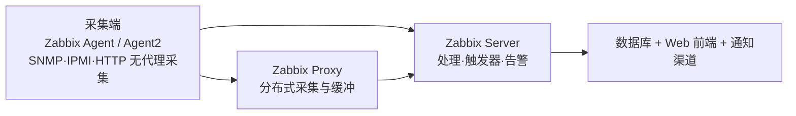

# Zabbix 是什么

管基础设施时会遇到一个现实问题：要监控的东西太杂——服务器、交换机、虚拟机、容器、数据库、Web 页面、Java 应用，每种东西接口都不一样，逐个写脚本采集再拼告警，很快就维护不动。Zabbix 是企业级的开源分布式监控系统，官方定位是**监控网络设备、服务器、服务及其他 IT 资源的性能与可用性**，小到单机应用，大到跨数据中心的环境都能接。

它是一套完整系统：采集、存储、检测、告警、展示全包，不像纯可视化工具那样依赖外部数据源。源码在 [GitHub 镜像仓库](https://github.com/zabbix/zabbix) 可见，许可方面要如实说明：**7.0 起采用 AGPLv3，6.4 及之前的版本采用 GPLv2**（见[官方许可页](https://www.zabbix.com/license)），无论哪一版都是全功能开源，没有"企业版才给"的功能阉割。

## 理解 Zabbix

- **采集端**回答"数据怎么来"：[Agent](https://www.zabbix.com/documentation/current/en/manual/concepts/agent) 装在被监控机上主动/被动上报；无代理方式走 SNMP、IPMI、HTTP 等协议直接拉；[Agent2](https://www.zabbix.com/documentation/current/en/manual/concepts/agent2) 是 Go 写的新一代 Agent，插件式扩展
- **[Proxy](https://www.zabbix.com/documentation/current/en/manual/concepts/proxy)** 回答"跨机房、跨防火墙怎么采"：在远端本地采集、缓存数据，再统一回传给 Server，断网时数据不丢
- **[Server](https://www.zabbix.com/documentation/current/en/manual/concepts/server)** 回答"这些数意味着什么"：处理数据、评估触发器、执行告警动作，前端和数据库挂在它后面

三层可以缩成一台机器跑全，也可以扩成"一 Server 带几十 Proxy 管上万设备"的分布式形态。

## 核心功能特点

### 采集原理：Agent 的两种模式与无代理采集

官方列举的采集对象包括：操作系统、网络设备、虚拟化平台、Docker 与 Kubernetes、云基础设施、数据库、Web 页面、Java 生态、应用服务器、API 端点、业务应用。采集方式分两大类：在被监控机上装 Agent，或不装 Agent 走协议直连。

Agent 的监控项分被动和主动两种类型，差异在连接方向和数据流（见[官方概念页](https://www.zabbix.com/documentation/current/en/manual/concepts/agent)与[主被动检查附录](https://www.zabbix.com/documentation/current/en/manual/appendix/items/activepassive)）：

| 维度 | 被动模式 | 主动模式 |
|------|----------|----------|
| 连接方向 | Server/Proxy 主动连 Agent，问一句答一句 | Agent 主动连 Server/Proxy（由 `ServerActive` 参数指定） |
| 工作方式 | 每次检查建立 TCP 连接，发 item key、收返回值，随后关闭；检查异步并发执行 | 先从 Server/Proxy 拉取监控项清单，之后按各自间隔本地采集，定期把新值推回去 |
| 防火墙适应 | 要放行进站到 Agent 的连接 | Agent 躲在防火墙/NAT 后也能用，只需出站连接 |
| 远程命令 | 支持 | 7.0 起支持 |

主机量大时这个差异有实际意义：被动模式的每个检查都要 Server 建连接、占用轮询进程，主动模式则把采集调度摊到各 Agent 上，Server 只负责接收上报。

无代理采集覆盖装不了 Agent 的对象：[SNMP](https://www.zabbix.com/documentation/current/en/manual/config/items/itemtypes/snmp) 拉网络设备（也支持收 SNMP trap）、[IPMI](https://www.zabbix.com/documentation/current/en/manual/config/items/itemtypes/ipmi) 读服务器带外硬件状态（温度、风扇、电源）、简单检查做 ping 和端口探测、HTTP agent 抓 API 与 Web 页面、SSH/Telnet 跑命令、JMX 接 Java 应用。日志文件监控作为监控项采集，配触发器做关键字告警。

### Server-Proxy-Agent 三级架构在大规模环境的作用

设备量上去或机房分散后，Proxy 层的作用就具体了（见[分布式监控文档](https://www.zabbix.com/documentation/current/en/manual/distributed_monitoring/proxies)）：

- **分担负载**：Proxy 代 Server 做采集，官方给的场景就是"监控数千台设备时给 Server 减负"
- **跨地域与弱网**：远程站点本地采集、本地暂存，与 Server 断连期间数据不丢（`ProxyLocalBuffer`/`ProxyOfflineBuffer` 控制保留时长），恢复后补传
- **过防火墙**：Proxy 到 Server 只需一条 TCP 连接，网络策略上只要放行这一条
- **Server 重启保护**：Server 宕机期间 Proxy 攒了大量数据，恢复瞬间有防过载机制，避免回补流量把 Server 打垮

边界也要清楚：**Proxy 只是采集器**，不计算触发器、不处理事件、不发告警，这些全在 Server 上做；且 Proxy 要用独立的数据库，指到 Server 的库会搞坏配置。

### 模板体系

[模板](https://www.zabbix.com/documentation/current/en/manual/config/templates)是 Zabbix 降低配置成本的关键：官方在 [integrations 页面](https://www.zabbix.com/integrations)维护了覆盖主流软硬件的现成模板，监控项、触发器、图表全在里面，套到主机上即生效。自定义监控项也能打包成模板导出，在内网环境间复制。

### 自动发现与 LLD

[网络发现](https://www.zabbix.com/documentation/current/en/manual/discovery/network_discovery)按网段扫描，发现新设备后自动匹配模板纳管。设备上下线不用手工加，这是大规模环境下省人力的点。

[低级别自动发现（LLD）](https://www.zabbix.com/documentation/current/en/manual/discovery/low_level_discovery)则反过来，在单台主机上自动枚举"有多少个同类对象"：文件系统、网卡、容器实例。原理是发现规则返回一个 JSON 数组，每个对象用宏描述一个实体，比如网卡发现返回 `[{"{#IFNAME}":"lo"}, {"{#IFNAME}":"eth0"}]`；随后按预先定义的 item、触发器、图表**原型**，为每个实体生成真实的监控对象。主机网卡数量各不相同，模板却只需写一套原型。后来消失的实体（比如卸载的文件系统）可以配置成自动禁用或删除，不留垃圾监控项。

### 触发器与动作机制

Zabbix 的告警链路是：item 采到数据 → [触发器](https://www.zabbix.com/documentation/current/en/manual/config/triggers)逻辑表达式求值 → 状态在 OK/PROBLEM 间变化产生事件 → [动作](https://www.zabbix.com/documentation/current/en/manual/config/notifications/action)按条件匹配事件 → 执行操作。

- **触发器**：对采集数据求值的逻辑表达式，比如 `avg(/host/key,5m)>2` 表示五分钟均值超 2 就进入 PROBLEM。表达式可组合多个函数和阈值，官方强调其实时问题检测能做**事件关联与根因分析**——把已存在和新发生的问题关联起来，压掉重复告警
- **动作的操作**：发消息或执行远程命令。[通知](https://www.zabbix.com/documentation/current/en/manual/config/notifications)渠道覆盖 Slack、JIRA、Microsoft Teams、邮件、短信
- **告警升级**：[escalation](https://www.zabbix.com/documentation/current/en/manual/config/notifications/action/escalations) 把操作分成步骤，每步有时长（最短 60 秒，步数不限），可以排出"立即通知值班人 → 未确认则重复通知 → N 分钟后升级到上级组 → 长时间未解决执行远程命令"这样的剧本；问题解决后还有恢复操作，发恢复通知
- **[远程命令](https://www.zabbix.com/documentation/current/en/manual/config/notifications/action/operation/remote_command)**：让动作直接在受监控主机上执行预定义命令，典型用法是应用不响应自动重启、用 IPMI reboot 无响应的服务器、磁盘将满自动清旧文件。默认是关的——Agent 侧要逐条用 `AllowKey=system.run[命令,*]` 放行（默认 `DenyKey=system.run[*]`，别图省事放开全部命令），Proxy 侧设 `EnableRemoteCommands=1`。处于维护期的主机也会照常被远程命令操作，这点要留意

### 可视化与治理

内置[仪表盘](https://www.zabbix.com/documentation/current/en/manual/web_interface/frontend_sections/dashboards)支持图表、列表、地理地图、网络拓扑图，官方称之为"single pane of glass"。可视化能力属于够用级别，追求大屏效果的人通常会再接 Grafana 出图（见下一节）。治理侧有多租户、审计、SLA 计算、报表，以及把指标和事件通过 HTTP 流式推给外部系统的能力。

### 与 Grafana 联动

官方插件 [alexanderzobnin-zabbix-app](https://grafana.com/grafana/plugins/alexanderzobnin-zabbix-app/)（现由 Grafana Labs 维护）把 Zabbix 接成 Grafana 的数据源，`grafana cli plugins install alexanderzobnin-zabbix-app` 一条命令装好，之后走 Zabbix API 读数据。插件支持正则批量选指标、模板变量、用 annotations 把 Zabbix 问题事件叠在图上、Triggers 面板展示当前活跃问题，也能在 Grafana 侧再配告警、和其他数据源混排。分工很清晰：Zabbix 管采集、存储、触发器和通知，Grafana 只做展示层的大屏。

## 典型应用场景

1. **机房与网络设备监控**：SNMP 模板直接套交换机、路由器、UPS，配合网络拓扑图看链路状态
2. **大规模主机监控**：Proxy 分布式架构跨机房采集、本地缓冲，上万台主机由一套 Server 统管
3. **云原生环境**：官方模板覆盖 Docker、Kubernetes、云平台 API，容器指标和传统主机指标进同一套告警
4. **值班告警体系**：多渠道通知加 escalation 升级，适合有值班制度的运维和安全团队
5. **日志安全监控**：日志文件监控配触发器，对 SSH 暴力破解、Web 攻击特征做关键字告警，作为轻量安全监控手段
6. **自动处置**：触发器接远程命令做自愈，服务挂了先自动拉起，起不来再叫人

## 学习资源

- **官网**：[www.zabbix.com](https://www.zabbix.com/)（下载、集成列表、许可说明的入口）
- **官方文档**：[zabbix.com/documentation](https://www.zabbix.com/documentation/current/en/manual)（安装、概念、配置的权威手册）
- **安装手册**：[Installation](https://www.zabbix.com/documentation/current/en/manual/installation)（从包安装、容器、源码编译全覆盖）
- **主动/被动检查**：[Active and passive agent checks](https://www.zabbix.com/documentation/current/en/manual/appendix/items/activepassive)（两种模式的协议细节）
- **分布式监控**：[Proxies](https://www.zabbix.com/documentation/current/en/manual/distributed_monitoring/proxies)（Proxy 的能力边界与缓冲机制）
- **LLD**：[Low-level discovery](https://www.zabbix.com/documentation/current/en/manual/discovery/low_level_discovery)（自动发现的 JSON 约定与原型机制）
- **动作与升级**：[Actions](https://www.zabbix.com/documentation/current/en/manual/config/notifications/action)、[Escalations](https://www.zabbix.com/documentation/current/en/manual/config/notifications/action/escalations)、[Remote commands](https://www.zabbix.com/documentation/current/en/manual/config/notifications/action/operation/remote_command)
- **模板与集成**：[zabbix.com/integrations](https://www.zabbix.com/integrations)
- **Grafana 联动插件**：[grafana.com/grafana/plugins/alexanderzobnin-zabbix-app](https://grafana.com/grafana/plugins/alexanderzobnin-zabbix-app/)
- **下载页**：[zabbix.com/download](https://www.zabbix.com/download)
- **源码镜像**：[github.com/zabbix/zabbix](https://github.com/zabbix/zabbix)（README 含功能清单与许可说明）
