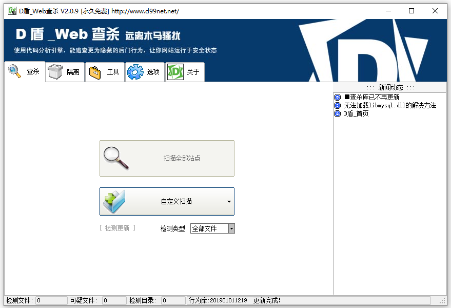
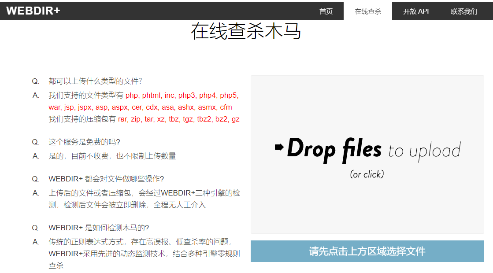
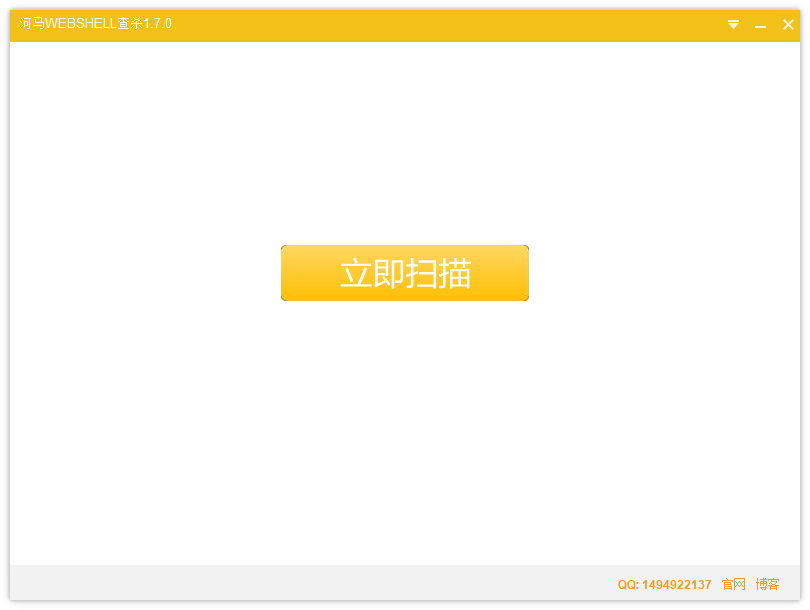
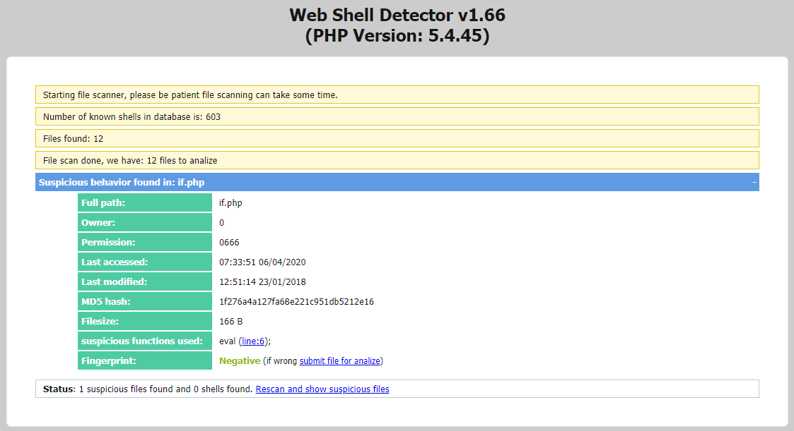
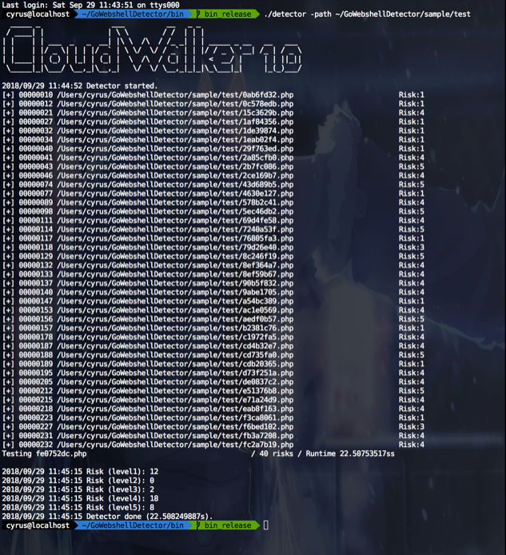
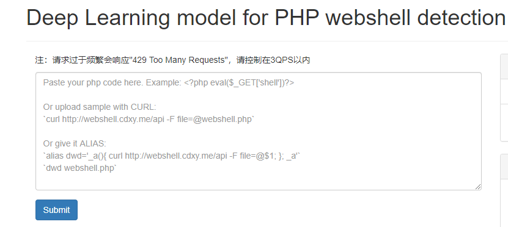
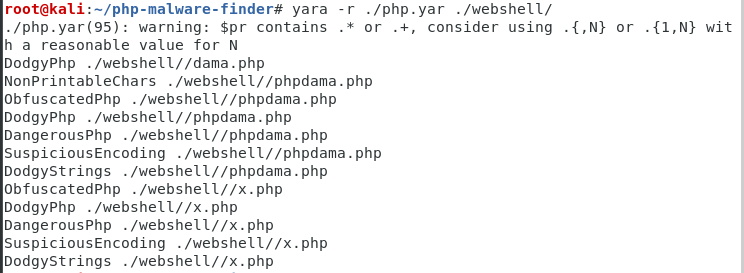
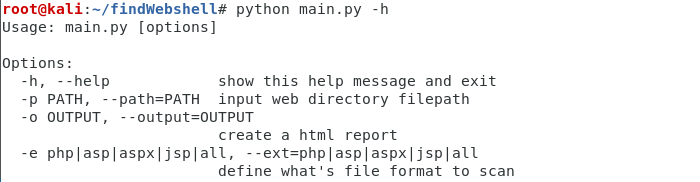
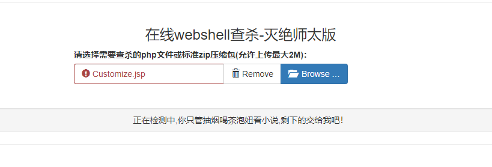

# 第3篇：常见的 Webshell 查杀工具

## ��3ƪ�������� Webshell ��ɱ����

### ǰ��

����վ������������ʱ��������Ҫһ��Webshell���⹤�ߣ����������Ƿ���webshell����һ���Ų�ϵͳ���ܴ��ڵİ�ȫ©����

�����Ƽ���10�� WebShll ���⹤�ߣ�������վ�����Ų顣��Ȼ��Ŀǰ�г��ϵĺܶ�������ȫ��ƷҲ���ṩ���� WebShell �������������簢���ơ������ơ�safedog �ȣ������ݲ����ۡ�

---

**1��D��_Web��ɱ**

��D��Ʒ��ʹ�������з�������չ���Ĵ����������棬�ܷ�����Ϊ���ص� WebShell ������Ϊ��

�����ԣ�ֻ�ṩ Windows �汾��

�������ص�ַ��http://www.d99net.net

**2���ٶ� WEBDIR+**

��һ�� WebShell �������棬�����Ƚ��Ķ�̬���⼼�������϶���������������ɱ��

�����ԣ��ṩ���߲�ɱľ�������ѿ��� API ֧���������⡣

���߲�ɱ��ַ��https://scanner.baidu.com

**3������**

רע WebShell ��ɱ�о���ӵ�к��� WebShell ������������ɱ���������ô�ͳ����+�ƶ˴�����˫�����IJ�ɱ��������ɱ�ٶȿ졢���ȸߡ��󱨵͡�

�����ԣ�֧�� Windows��Linux��֧�����߲�ɱ��

�ٷ���վ��https://www.shellpub.com

**4��Web Shell Detector**

Web Shell Detector ���� WebShell ǩ�����ݿ⣬�ɰ���ʶ���ߴ� 99�� �� WebShell��

�����ԣ��ṩ PHP��Python �ű����ɿ�ƽ̨�����߼��⡣

�ٷ���վ��http://www.shelldetector.com

github��Ŀ��ַ��https://github.com/emposha/PHP-Shell-Detector

**5��CloudWalker�����ƣ�**

һ����ִ�е������а汾 Webshell ���⹤�ߡ�Ŀǰ����Ŀ��ֹͣ���¡�

�����ԣ��ṩ Linux�汾��Windows �ݲ�֧�֡�

���߲�ɱ demo��[https://webshellchop.chaitin.cn](https://webshellchop.chaitin.cn)

GitHub ��Ŀ��ַ��https://github.com/chaitin/cloudwalker

**6��Sangfor WebShellKill**

Sangfor WebShellKill (��վ���ż��⹤��)��һ�� Web ����רɱ���ߣ�����֧�� WebShell ��ɨ�裬ͬʱ��֧�ְ�����ɨ�衣��һ���ں��˶��ؼ��������IJ�ɱ���ߡ��ܸ���׼�ؼ�����WEB��վ��֪��δ֪�ĺ����ļ���

�����ԣ�֧�� Windows��linux

�������ص�ַ��http://edr.sangfor.com.cn/backdoor_detection.html����ֹͣ���ʣ�

**7������ѧϰģ�ͼ��� PHP Webshell**

һ������ѧϰ PHP WebShell ��ɱ���� demo���ṩ�����������⡣

���߲�ɱ��ַ��http://webshell.cdxy.me

**8��PHP Malware Finder**

PHP-malware-finder ��һ�������ļ���webshell�Ͷ����������������Ĺ���

�����ԣ��ṩLinux �汾��Windows �ݲ�֧�֡�

GitHub ��Ŀ��ַ��https://github.com/jvoisin/php-malware-finder

**9��findWebshell**

������Ŀ��һ������ Python ������ WebShell ���鹤�ߣ����Ը���������ƥ�������������͵� WebShell ���š�

GitHub ��Ŀ��ַ��[https://github.com/he1m4n6a/findWebshell](https://github.com/he1m4n6a/findWebshell)

**10������ WebShell ��ɱ����**

���߲�ɱ��ַ��http://tools.bugscaner.com/killwebshell

