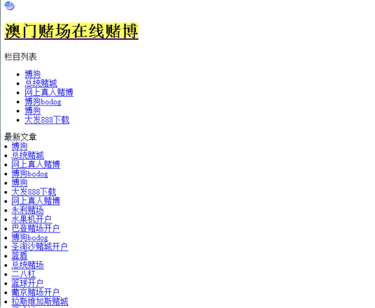
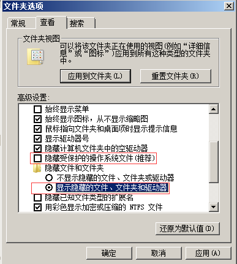
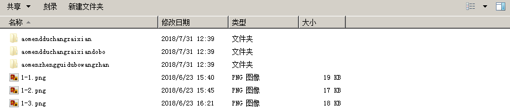
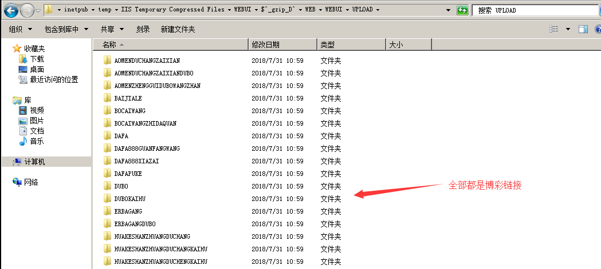

# 第3篇：批量挂黑页

## 第3篇：批量挂黑页

作为一个网站管理员，你采用开源CMS做网站，比如dedecms，但是有一天，你忽然发现不知何时，网站的友情链接模块被挂大量垃圾链接，网站出现了很多不该有的目录，里面全是博彩相关的网页。而且，攻击者在挂黑页以后，会在一些小论坛注册马甲将你的网站黑页链接发到论坛，引爬虫收录。在搜索引擎搜索网站地址时，收录了一些会出现一些博彩页面，严重影响了网站形象。

### 原因分析

网站存在高危漏洞，常见于一些存在安全漏洞的开源CMS，利用0day批量拿站上传黑页。

### 现象描述：

某网站被挂了非常多博彩链接，链接形式如下：

		[http://www.xxx.com/upload/aomendduchangzaixiandobo/index.html](http://www.xxx.com/upload/aomendduchangzaixiandobo/index.html)

		[http://www.xxx.com/upload/aomendduchangzaixian/index.html](http://www.xxx.com/upload/aomendduchangzaixian/index.html)

		[http://www.xxx.com/upload/aomenzhengguidubowangzhan/index.html](http://www.xxx.com/upload/aomenzhengguidubowangzhan/index.html)

链接可以访问，直接访问物理路径也可以看到文件，但是打开网站目录并没有发现这些文件，这些文件到底藏在了哪？

访问这些链接，跳转到如图页面：

### 问题处理：

1、打开电脑文件夹选项卡，取消”隐藏受保护的操作系统文件“勾选，把”隐藏文件和文件夹“下面的单选选择“显示隐藏的文件、文件夹和驱动器”。

2、再次查看，可以看到半透明的文件夹，清楚隐藏文件夹及所有页面

3、然后清除IIS临时压缩文件

C:\inetpub\temp\IIS Temporary Compressed Files\WEBUI\$_gzip_D\WEB\WEBUI\UPLOAD

4、投诉快照，申请删除相关的网页收录，减少对网站的影响。
